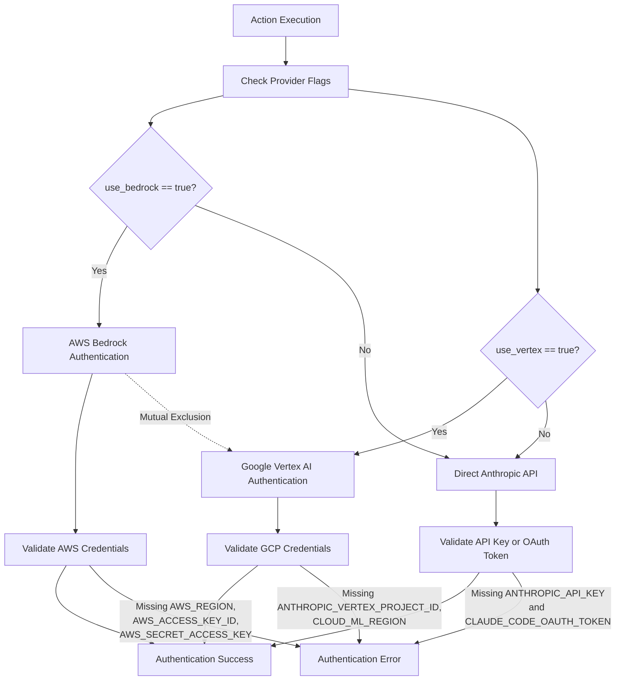
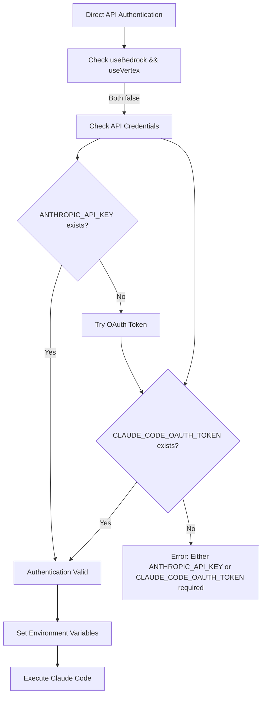
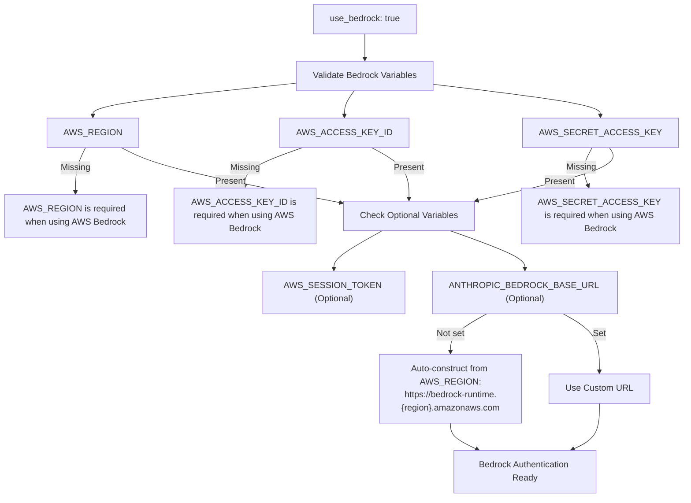
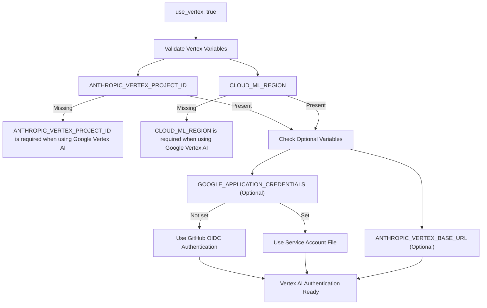
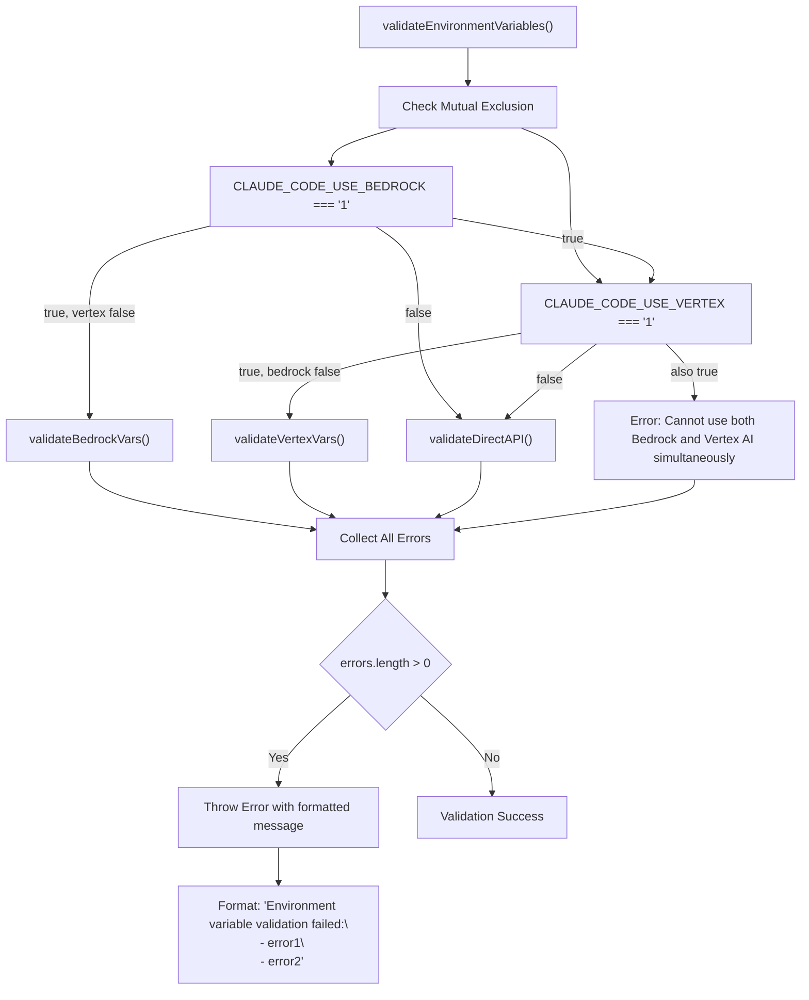
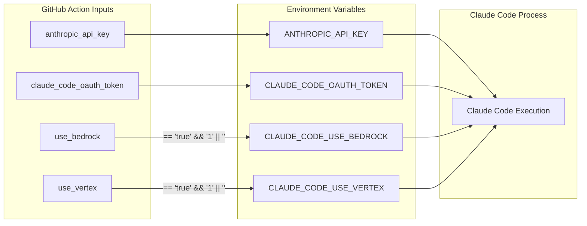

<!-- source: DeepWiki mcp.deepwiki.com · repo anthropics/claude-code-base-action · page 3.2 Authentication Methods · fetched 2026-10-26 -->

# Authentication Methods

<details>
<summary>Relevant source files</summary>

The following files were used as context for generating this wiki page:

- [action.yml](action.yml)
- [src/validate-env.ts](src/validate-env.ts)
- [test/validate-env.test.ts](test/validate-env.test.ts)

</details>


This document covers the authentication methods supported by the claude-code-base-action GitHub Action. The action supports four authentication methods to access Claude AI models through different providers: direct Anthropic API with API key, direct Anthropic API with OAuth token, AWS Bedrock with OIDC authentication, and Google Vertex AI with OIDC authentication.

For configuration of other action settings like MCP servers and system prompts, see [Settings and MCP Configuration](#3.3). For complete input/output reference, see [Inputs and Outputs](#3.1).

## Overview

The claude-code-base-action supports multiple authentication providers to maximize flexibility across different deployment environments. Each method has specific requirements and use cases:

**Authentication Provider Decision Flow**



Sources: [action.yml:65-81](), [src/validate-env.ts:5-54]()

## Direct Anthropic API Authentication

The direct Anthropic API method supports two credential types: API keys and OAuth tokens. This is the default authentication method when neither `use_bedrock` nor `use_vertex` flags are set.

### API Key Authentication

Configure using the `anthropic_api_key` input:

```yaml
- uses: anthropics/claude-code-base-action@v1
  with:
    anthropic_api_key: ${{ secrets.ANTHROPIC_API_KEY }}
    prompt: "Analyze the codebase"
```

### OAuth Token Authentication

Configure using the `claude_code_oauth_token` input as an alternative to API keys:

```yaml
- uses: anthropics/claude-code-base-action@v1
  with:
    claude_code_oauth_token: ${{ secrets.CLAUDE_CODE_OAUTH_TOKEN }}
    prompt: "Analyze the codebase"
```

**Direct API Validation Logic**



The validation logic is implemented in `validateEnvironmentVariables()` function which checks for either credential type when using direct API access.

Sources: [action.yml:66-73](), [src/validate-env.ts:19-24](), [test/validate-env.test.ts:32-44]()

## AWS Bedrock OIDC Authentication

AWS Bedrock authentication enables access to Claude models through Amazon Bedrock using OpenID Connect (OIDC) for secure, key-less authentication in GitHub Actions workflows.

### Configuration

Enable Bedrock authentication by setting `use_bedrock: true`:

```yaml
- uses: anthropics/claude-code-base-action@v1
  with:
    use_bedrock: true
    model: "anthropic.claude-3-5-sonnet-20241022-v2:0"  # Bedrock model format
    prompt: "Analyze the codebase"
  env:
    AWS_REGION: us-east-1
    # AWS credentials set via OIDC or long-term keys
```

### Required Environment Variables

| Variable | Description | Required |
|----------|-------------|----------|
| `AWS_REGION` | AWS region for Bedrock service | Yes |
| `AWS_ACCESS_KEY_ID` | AWS access key identifier | Yes |
| `AWS_SECRET_ACCESS_KEY` | AWS secret access key | Yes |
| `AWS_SESSION_TOKEN` | AWS session token | No |
| `ANTHROPIC_BEDROCK_BASE_URL` | Custom Bedrock endpoint URL | No |

**AWS Bedrock Environment Variable Flow**



The action automatically constructs the Bedrock endpoint URL using the AWS region when `ANTHROPIC_BEDROCK_BASE_URL` is not explicitly provided.

Sources: [action.yml:74-77, 155-161](), [src/validate-env.ts:25-36](), [test/validate-env.test.ts:46-122]()

## Google Vertex AI OIDC Authentication

Google Vertex AI authentication provides access to Claude models through Google Cloud's Vertex AI platform using OIDC for secure authentication without long-term service account keys.

### Configuration

Enable Vertex AI authentication by setting `use_vertex: true`:

```yaml
- uses: anthropics/claude-code-base-action@v1
  with:
    use_vertex: true
    model: "claude-3-5-sonnet-v2@20241022"  # Vertex AI model format
    prompt: "Analyze the codebase"
  env:
    ANTHROPIC_VERTEX_PROJECT_ID: my-gcp-project
    CLOUD_ML_REGION: us-central1
```

### Required Environment Variables

| Variable | Description | Required |
|----------|-------------|----------|
| `ANTHROPIC_VERTEX_PROJECT_ID` | Google Cloud project ID | Yes |
| `CLOUD_ML_REGION` | Google Cloud ML region | Yes |
| `GOOGLE_APPLICATION_CREDENTIALS` | Path to service account credentials | No |
| `ANTHROPIC_VERTEX_BASE_URL` | Custom Vertex AI endpoint URL | No |

**Google Vertex AI Validation Flow**



Sources: [action.yml:78-81, 162-167](), [src/validate-env.ts:37-48](), [test/validate-env.test.ts:124-168]()

## Authentication Validation and Mutual Exclusion

The action implements comprehensive validation to ensure proper authentication configuration and prevent conflicting provider settings.

### Validation Process

The `validateEnvironmentVariables()` function in `validate-env.ts` performs multi-step validation:

1. **Mutual Exclusion Check**: Prevents simultaneous use of Bedrock and Vertex AI
2. **Provider-Specific Validation**: Validates required variables for each provider
3. **Error Aggregation**: Collects and reports all validation errors together

**Complete Authentication Validation Logic**



### Error Message Format

Validation errors are formatted with clear, actionable messages:

```
Environment variable validation failed:
  - AWS_REGION is required when using AWS Bedrock.
  - AWS_ACCESS_KEY_ID is required when using AWS Bedrock.
  - Cannot use both Bedrock and Vertex AI simultaneously. Please set only one provider.
```

Sources: [src/validate-env.ts:5-54](), [test/validate-env.test.ts:170-214]()

## Environment Variable Mapping

The action maps GitHub Action inputs to environment variables that are consumed by the Claude Code execution process:

| Input Parameter | Environment Variable | Provider |
|----------------|---------------------|----------|
| `anthropic_api_key` | `ANTHROPIC_API_KEY` | Direct API |
| `claude_code_oauth_token` | `CLAUDE_CODE_OAUTH_TOKEN` | Direct API |
| `use_bedrock` | `CLAUDE_CODE_USE_BEDROCK` | AWS Bedrock |
| `use_vertex` | `CLAUDE_CODE_USE_VERTEX` | Google Vertex |

Additional environment variables are inherited from the GitHub Actions environment for AWS and GCP configurations.

**Environment Variable Mapping in Action Execution**



Note the special boolean conversion logic for provider flags: only string `"true"` values are converted to `"1"`, otherwise the environment variable is unset.

Sources: [action.yml:148-153](), [action.yml:120-167]()

---

