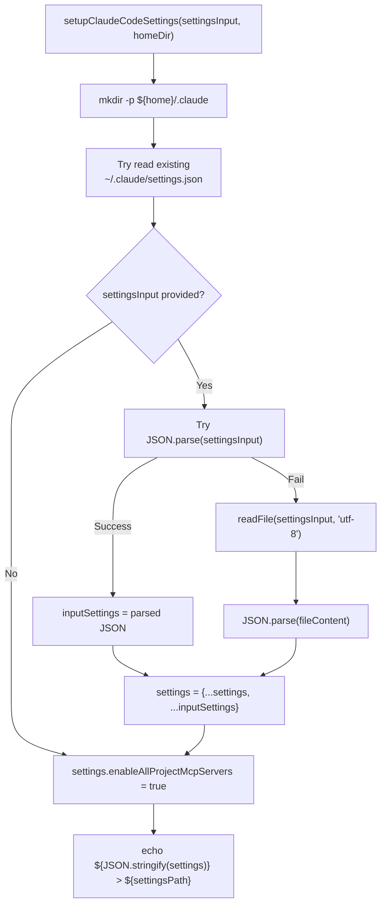
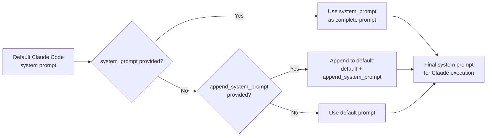

<!-- source: DeepWiki mcp.deepwiki.com · repo anthropics/claude-code-base-action · page 3.3 Settings and MCP Configuration · fetched 2026-10-26 -->

# Settings and MCP Configuration

<details>
<summary>Relevant source files</summary>

The following files were used as context for generating this wiki page:

- [MIRROR_DISCLAIMER.md](MIRROR_DISCLAIMER.md)
- [README.md](README.md)
- [src/setup-claude-code-settings.ts](src/setup-claude-code-settings.ts)

</details>


This section covers the configuration systems that control Claude Code's behavior and capabilities within the GitHub Action. It explains how to configure Claude Code settings, MCP (Model Context Protocol) servers, environment variables, and system prompts through the action's inputs.

For authentication setup, see [Authentication Methods](#3.2). For complete input/output reference, see [Inputs and Outputs](#3.1).

## Settings Configuration System

The action supports Claude Code settings configuration through two methods: inline JSON strings or external configuration files. Settings control Claude Code's behavior, model selection, permissions, hooks, and other operational parameters.

### Settings Processing Flow

```mermaid
flowchart TD
    INPUT["`settings` input"] --> CHECK{"Is JSON string?"}
    CHECK -->|Yes| PARSE_JSON["Parse JSON directly"]
    CHECK -->|No| READ_FILE["Read from file path<br/>readFile(settingsInput)"]
    
    READ_FILE --> PARSE_FILE["Parse file content as JSON"]
    PARSE_JSON --> MERGE_SETTINGS["setupClaudeCodeSettings()"]
    PARSE_FILE --> MERGE_SETTINGS
    
    EXISTING["~/.claude/settings.json<br/>existing settings"] --> MERGE_SETTINGS
    MERGE_SETTINGS --> FORCE_MCP["settings.enableAllProjectMcpServers = true"]
    FORCE_MCP --> WRITE_SETTINGS["Write to ~/.claude/settings.json"]
    
    WRITE_SETTINGS --> CLAUDE_EXEC["Claude Code execution"]
```

Sources: [src/setup-claude-code-settings.ts:5-68](), [README.md:202-264]()

### Settings Configuration Methods

**Method 1: External Settings File**

```yaml
- name: Run Claude Code with settings file
  uses: anthropics/claude-code-base-action@beta
  with:
    settings: "path/to/settings.json"
    prompt: "Your prompt here"
```

**Method 2: Inline Settings JSON**

```yaml
- name: Run Claude Code with inline settings
  uses: anthropics/claude-code-base-action@beta
  with:
    settings: |
      {
        "model": "claude-opus-4-20250514",
        "env": {
          "DEBUG": "true"
        },
        "permissions": {
          "allow": ["Bash", "Read"],
          "deny": ["WebFetch"]
        }
      }
```

Sources: [README.md:206-262]()

### Settings Processing Implementation

The `setupClaudeCodeSettings` function handles all settings configuration:



Sources: [src/setup-claude-code-settings.ts:5-68]()

## MCP Configuration System

MCP (Model Context Protocol) configuration enables Claude Code to interact with external services and tools through standardized server interfaces. The action supports both file-based and inline MCP configuration.

### MCP Configuration Structure

```mermaid
flowchart LR
    MCP_INPUT["`mcp_config` input"] --> PROCESS{"File path or JSON?"}
    PROCESS -->|File| READ_MCP_FILE["Read MCP config file"]
    PROCESS -->|JSON| PARSE_MCP_JSON["Parse inline JSON"]
    
    READ_MCP_FILE --> MCP_STRUCTURE["MCP Configuration Structure"]
    PARSE_MCP_JSON --> MCP_STRUCTURE
    
    MCP_STRUCTURE --> SERVERS["`mcpServers` object"]
    SERVERS --> SERVER_DEF["`server-name` definition"]
    SERVER_DEF --> COMMAND["`command`: executable path"]
    SERVER_DEF --> ARGS["`args`: command arguments"]
    SERVER_DEF --> ENV_VARS["`env`: environment variables"]
```

Sources: [README.md:265-336]()

### MCP Configuration Methods

**Method 1: External MCP Configuration File**

```yaml
- name: Run Claude Code with MCP config file
  uses: anthropics/claude-code-base-action@beta
  with:
    mcp_config: "path/to/mcp-config.json"
    prompt: "Your prompt here"
```

**Method 2: Inline MCP Configuration**

```yaml
- name: Run Claude Code with inline MCP config
  uses: anthropics/claude-code-base-action@beta
  with:
    mcp_config: |
      {
        "mcpServers": {
          "server-name": {
            "command": "node",
            "args": ["./server.js"],
            "env": {
              "API_KEY": "your-api-key"
            }
          }
        }
      }
```

Sources: [README.md:284-306]()

## Environment Variables Configuration

The `claude_env` input allows passing custom environment variables to Claude Code execution using YAML multiline format. These variables are available to Claude during its execution and can reference GitHub secrets.

### Environment Variables Processing

```mermaid
flowchart TD
    CLAUDE_ENV["`claude_env` YAML input"] --> PARSE_YAML["Parse YAML key-value pairs"]
    PARSE_YAML --> RESOLVE_SECRETS["Resolve GitHub secrets<br/>${{ secrets.SECRET_NAME }}"]
    RESOLVE_SECRETS --> SET_ENV_VARS["Set environment variables<br/>for Claude execution"]
    
    GITHUB_SECRETS["`${{ secrets.* }}`"] --> RESOLVE_SECRETS
    
    SET_ENV_VARS --> CLAUDE_RUNTIME["Claude Code runtime<br/>environment"]
    
    EXAMPLES["Examples:<br/>ENVIRONMENT: staging<br/>API_URL: https://api.com<br/>DEBUG: true"] --> PARSE_YAML
```

Sources: [README.md:150-200]()

### Environment Variables Usage Example

```yaml
- name: Run Claude Code with custom environment
  uses: anthropics/claude-code-base-action@beta
  with:
    prompt: "Deploy to staging environment"
    claude_env: |
      ENVIRONMENT: staging
      API_BASE_URL: https://api-staging.example.com
      DATABASE_URL: ${{ secrets.STAGING_DB_URL }}
      DEBUG: true
      LOG_LEVEL: debug
```

Sources: [README.md:157-169]()

## System Prompt Configuration

The action provides two inputs for customizing Claude's system prompt: `system_prompt` for complete override and `append_system_prompt` for extending the default prompt.

### System Prompt Configuration Flow



Sources: [README.md:48-64]()

### System Prompt Examples

**Complete System Prompt Override:**

```yaml
- name: Run Claude Code with custom system prompt
  uses: anthropics/claude-code-base-action@beta
  with:
    prompt: "Build a REST API"
    system_prompt: "You are a senior backend engineer. Focus on security, performance, and maintainability."
```

**Appending to Default System Prompt:**

```yaml
- name: Run Claude Code with appended system prompt
  uses: anthropics/claude-code-base-action@beta
  with:
    prompt: "Create a database schema"
    append_system_prompt: "After writing code, be sure to code review yourself."
```

Sources: [README.md:48-64]()

## Configuration Merge and Processing

All configuration inputs are processed and merged during action execution to create the final Claude Code configuration.

### Complete Configuration Processing Flow

```mermaid
flowchart TD
    subgraph "Input Sources"
        SETTINGS_IN["`settings` input"]
        MCP_IN["`mcp_config` input"]  
        ENV_IN["`claude_env` input"]
        SYS_PROMPT["`system_prompt`<br/>`append_system_prompt`"]
    end
    
    subgraph "Processing Functions"
        SETTINGS_IN --> SETUP_SETTINGS["`setupClaudeCodeSettings()`<br/>src/setup-claude-code-settings.ts"]
        MCP_IN --> PROCESS_MCP["Process MCP config<br/>(file or JSON)"]
        ENV_IN --> PARSE_ENV_YAML["Parse YAML environment<br/>variables"]
        SYS_PROMPT --> PREPARE_PROMPTS["Prepare system prompts"]
    end
    
    subgraph "Configuration Merge"
        SETUP_SETTINGS --> HOME_SETTINGS["`~/.claude/settings.json`<br/>enableAllProjectMcpServers: true"]
        PROCESS_MCP --> MCP_CONFIG["MCP configuration object"]
        PARSE_ENV_YAML --> ENV_VARS["Environment variables"]
        PREPARE_PROMPTS --> PROMPT_CONFIG["System prompt configuration"]
    end
    
    subgraph "Final Configuration"
        HOME_SETTINGS --> FINAL_CONFIG["Final Claude Code configuration"]
        MCP_CONFIG --> FINAL_CONFIG
        ENV_VARS --> FINAL_CONFIG
        PROMPT_CONFIG --> FINAL_CONFIG
        FINAL_CONFIG --> CLAUDE_EXECUTION["Claude Code execution<br/>with merged configuration"]
    end
```

Sources: [src/setup-claude-code-settings.ts:5-68](), [README.md:150-336]()

### Key Configuration Behavior

| Configuration Type | Processing Method | Merge Behavior |
|-------------------|-------------------|----------------|
| **Settings** | File path or JSON string via `setupClaudeCodeSettings` | Merges with existing `~/.claude/settings.json`, forces `enableAllProjectMcpServers: true` |
| **MCP Config** | File path or JSON string | Parsed directly, defines `mcpServers` object |
| **Environment Variables** | YAML parsing with secret resolution | Set as environment variables for Claude execution |
| **System Prompts** | String processing | Override or append to default system prompt |

Sources: [src/setup-claude-code-settings.ts:57-64](), [README.md:150-336]()

## Integration Example

Here's a complete example showing all configuration types working together:

```yaml
- name: Run Claude Code with full configuration
  uses: anthropics/claude-code-base-action@beta
  with:
    prompt: "Deploy application with monitoring"
    
    # Settings configuration
    settings: |
      {
        "model": "claude-opus-4-20250514",
        "permissions": {
          "allow": ["Bash", "View", "Write"],
          "deny": ["WebFetch"]
        },
        "hooks": {
          "PreToolUse": [{
            "matcher": "Bash",
            "hooks": [{"type": "command", "command": "echo Starting deployment..."}]
          }]
        }
      }
    
    # MCP configuration
    mcp_config: |
      {
        "mcpServers": {
          "monitoring-server": {
            "command": "node",
            "args": ["./monitoring-mcp-server.js"],
            "env": {
              "MONITORING_API_KEY": "your-key"
            }
          }
        }
      }
    
    # Environment variables
    claude_env: |
      ENVIRONMENT: production
      API_URL: https://api.example.com
      DATABASE_URL: ${{ secrets.PROD_DB_URL }}
      REDIS_URL: ${{ secrets.REDIS_URL }}
      MONITORING_ENABLED: true
    
    # System prompt configuration
    append_system_prompt: "Ensure all deployments include health checks and monitoring setup."
    
    # Tool permissions
    allowed_tools: "Bash(git:*,docker:*),View,Write,mcp__monitoring-server__*"
    
    anthropic_api_key: ${{ secrets.ANTHROPIC_API_KEY }}
```

Sources: [README.md:202-336]()

---

