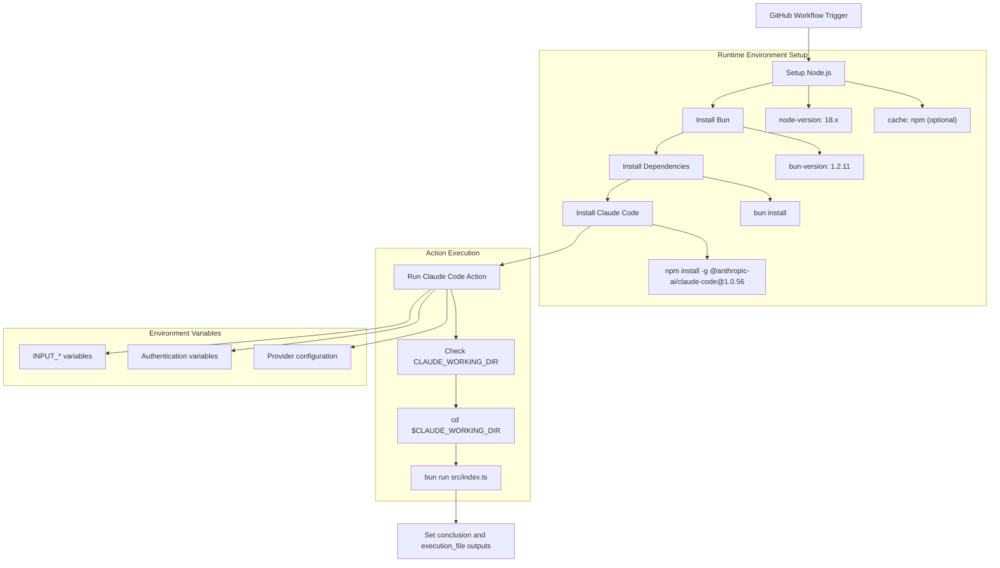
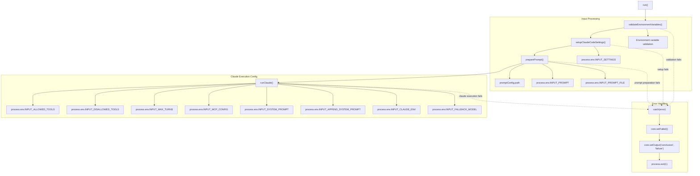

<!-- source: DeepWiki mcp.deepwiki.com · repo anthropics/claude-code-base-action · page 4 Implementation Details · fetched 2026-10-26 -->

# Implementation Details

Relevant source files

The following files were used as context for generating this wiki page:

- [action.yml](action.yml)
- [src/index.ts](src/index.ts)

This document provides a deep dive into the internal architecture, execution flow, and technical implementation of the claude-code-base-action GitHub Action. It covers the composite action pattern, runtime environment setup, main execution flow, and key architectural decisions that enable AI integration in GitHub workflows.

For high-level system architecture and component relationships, see [Architecture Overview](#4.1). For detailed information about specific subsystems, see [Claude Execution Engine](#4.2), [Settings Management System](#4.3), and [Environment Validation](#4.4).

## Composite Action Architecture

The action is implemented as a GitHub composite action, defined in `action.yml`, which orchestrates multiple steps in sequence. This pattern provides better control over the execution environment and dependency management compared to container-based actions.

### Action Execution Flow

The composite action pattern ensures consistent runtime environment setup across different GitHub Actions runners, with specific pinned versions for Node.js (18.x), Bun (1.2.11), and Claude Code (1.0.56).

**Sources:** [action.yml:96-167]()

## Main Execution Entry Point

The core logic is implemented in TypeScript with `src/index.ts` serving as the main entry point. The execution follows a strict sequence with proper error handling and GitHub Actions output management.

### Core Function Flow

The implementation uses a straightforward sequential execution model with comprehensive error handling. Each step must complete successfully before proceeding to the next, and any failure triggers the error handling flow that sets appropriate GitHub Actions outputs.

**Sources:** [src/index.ts:9-35]()

## Runtime Environment Configuration

The action's runtime environment is carefully configured to ensure consistent execution across different GitHub Actions runners. The setup process handles multiple package managers and specific version requirements.

### Environment Setup Strategy

| Component | Version/Configuration | Purpose |
|-----------|----------------------|---------|
| Node.js | 18.x (configurable via `NODE_VERSION`) | Base JavaScript runtime |
| Bun | 1.2.11 (pinned) | Fast package manager and TypeScript executor |
| npm cache | Optional (controlled by `use_node_cache` input) | Dependency caching for Node.js projects |
| Claude Code | 1.0.56 (pinned globally) | AI execution engine |

The action uses Bun for TypeScript execution and dependency management while maintaining compatibility with npm-based caching for performance optimization in Node.js projects.

**Sources:** [action.yml:99-119]()

## Input Processing Architecture

The action processes a wide variety of inputs through environment variables, following GitHub Actions conventions. All inputs are prefixed with `INPUT_` when converted to environment variables.

### Input Categories

```mermaid
graph TB
    subgraph "Core Claude Inputs"
        INPUT_PROMPT["INPUT_PROMPT"]
        INPUT_PROMPT_FILE["INPUT_PROMPT_FILE"]
        INPUT_ALLOWED_TOOLS["INPUT_ALLOWED_TOOLS"]
        INPUT_DISALLOWED_TOOLS["INPUT_DISALLOWED_TOOLS"]
        INPUT_MAX_TURNS["INPUT_MAX_TURNS"]
    end
    
    subgraph "Configuration Inputs"
        INPUT_MCP_CONFIG["INPUT_MCP_CONFIG"]
        INPUT_SETTINGS["INPUT_SETTINGS"]
        INPUT_SYSTEM_PROMPT["INPUT_SYSTEM_PROMPT"]
        INPUT_APPEND_SYSTEM_PROMPT["INPUT_APPEND_SYSTEM_PROMPT"]
        INPUT_CLAUDE_ENV["INPUT_CLAUDE_ENV"]
        INPUT_FALLBACK_MODEL["INPUT_FALLBACK_MODEL"]
    end
    
    subgraph "Authentication Inputs"
        ANTHROPIC_API_KEY["ANTHROPIC_API_KEY"]
        CLAUDE_CODE_OAUTH_TOKEN["CLAUDE_CODE_OAUTH_TOKEN"]
        CLAUDE_CODE_USE_BEDROCK["CLAUDE_CODE_USE_BEDROCK"]
        CLAUDE_CODE_USE_VERTEX["CLAUDE_CODE_USE_VERTEX"]
    end
    
    subgraph "Provider-Specific Inputs"
        AWS_REGION["AWS_REGION"]
        AWS_ACCESS_KEY_ID["AWS_ACCESS_KEY_ID"]
        AWS_SECRET_ACCESS_KEY["AWS_SECRET_ACCESS_KEY"]
        ANTHROPIC_VERTEX_PROJECT_ID["ANTHROPIC_VERTEX_PROJECT_ID"]
        CLOUD_ML_REGION["CLOUD_ML_REGION"]
    end
    
    INPUT_PROMPT --> PROMPT_PROCESSING["Prompt Processing Logic"]
    INPUT_MCP_CONFIG --> CONFIG_PROCESSING["Configuration Processing Logic"]
    ANTHROPIC_API_KEY --> AUTH_PROCESSING["Authentication Processing Logic"]
    AWS_REGION --> PROVIDER_PROCESSING["Provider Processing Logic"]
```

The input processing architecture separates concerns into distinct categories, each handled by specialized functions within the TypeScript implementation.

**Sources:** [action.yml:132-166](), [src/index.ts:15-29]()

## Output Management

The action produces two primary outputs that integrate with GitHub Actions workflows:

### Output Structure

| Output | Type | Source | Purpose |
|--------|------|--------|---------|
| `conclusion` | String (`success`/`failure`) | `steps.run_claude.outputs.conclusion` | Workflow decision making |
| `execution_file` | Path | `steps.run_claude.outputs.execution_file` | JSON execution log access |

The outputs are set through the `@actions/core` library's `setOutput` function, ensuring proper integration with GitHub Actions workflow syntax for conditional logic and artifact handling.

**Sources:** [action.yml:88-94](), [src/index.ts:31-32]()

## Modular Function Architecture

The implementation is structured as a collection of focused modules, each responsible for a specific aspect of the execution flow:

### Module Responsibilities

| Module | Function | Purpose |
|--------|----------|---------|
| `validate-env.ts` | `validateEnvironmentVariables()` | Authentication and provider validation |
| `setup-claude-code-settings.ts` | `setupClaudeCodeSettings()` | Configuration file management |
| `prepare-prompt.ts` | `preparePrompt()` | Prompt processing and file handling |
| `run-claude.ts` | `runClaude()` | Claude Code process execution |

This modular design enables focused testing, clear separation of concerns, and easier maintenance of complex authentication and configuration logic.

**Sources:** [src/index.ts:3-7](), [src/index.ts:11-29]()

---

