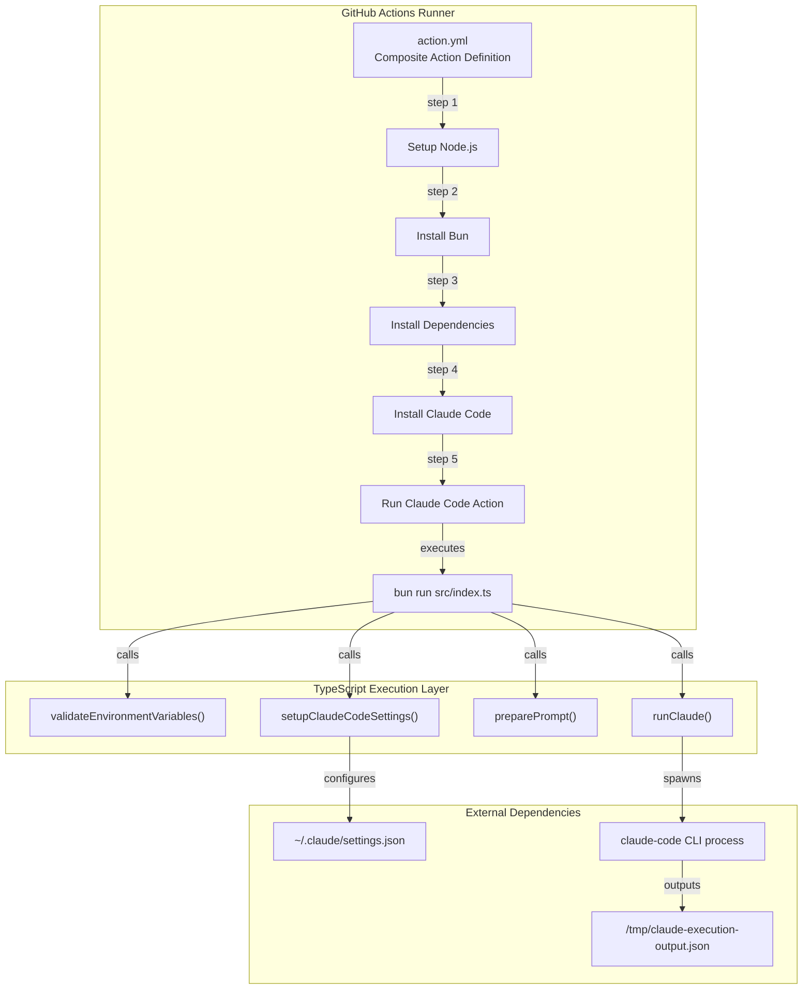
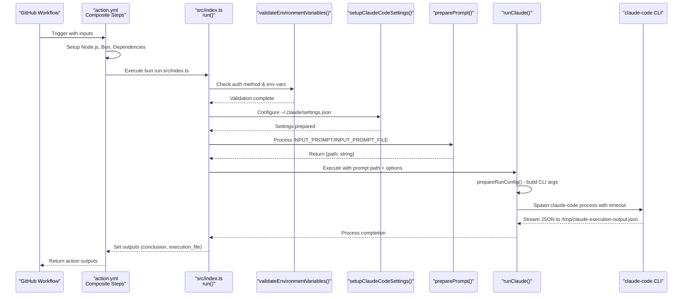
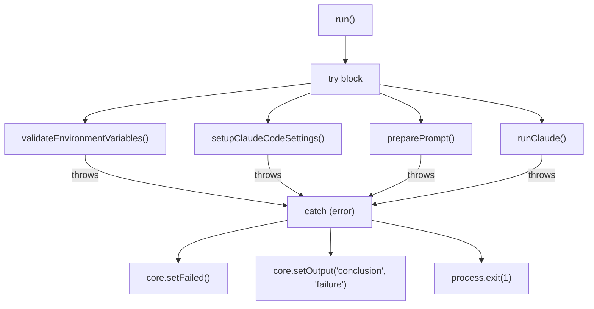
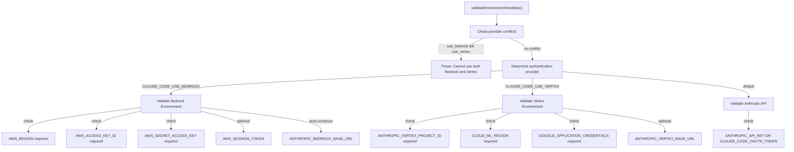
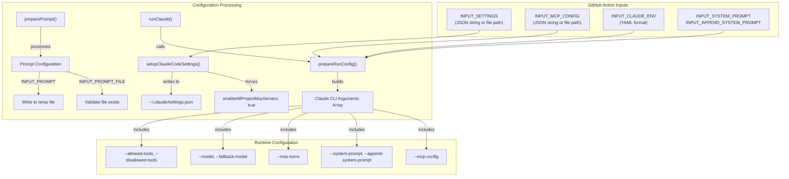
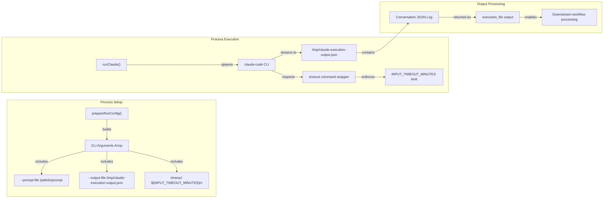

<!-- source: DeepWiki mcp.deepwiki.com · repo anthropics/claude-code-base-action · page 4.1 Architecture Overview · fetched 2026-10-26 -->

# Architecture Overview

<details>
<summary>Relevant source files</summary>

The following files were used as context for generating this wiki page:

- [MIRROR_DISCLAIMER.md](MIRROR_DISCLAIMER.md)
- [README.md](README.md)
- [action.yml](action.yml)
- [src/index.ts](src/index.ts)

</details>


This document provides a technical overview of the claude-code-base-action architecture, explaining the core components, their interactions, and the execution flow. It focuses on the internal structure of the action and how different parts work together to enable Claude AI integration in GitHub workflows. For configuration details, see [Action Configuration](#3), and for detailed execution information, see [Claude Execution](#4.3).

## System Components

The claude-code-base-action is implemented as a GitHub composite action that orchestrates multiple setup steps and executes TypeScript components to run Claude AI in various provider environments.

### Composite Action Architecture



Sources: [action.yml:96-129](), [src/index.ts:9-35]()

### Core TypeScript Components

The action's business logic is implemented through several focused TypeScript modules:

| Module | Primary Function | Key Responsibilities |
|--------|-----------------|---------------------|
| `src/index.ts` | `run()` | Main orchestration, error handling, GitHub Actions integration |
| `src/validate-env.ts` | `validateEnvironmentVariables()` | Authentication method validation, required environment variable checks |
| `src/setup-claude-code-settings.ts` | `setupClaudeCodeSettings()` | Claude settings configuration, MCP server enablement |
| `src/prepare-prompt.ts` | `preparePrompt()` | Prompt processing from inline strings or files |
| `src/run-claude.ts` | `runClaude()` | Claude process execution, argument preparation, output capture |

Sources: [src/index.ts:1-40]()

## Component Details

### Action Definition (`action.yml`)

The action definition serves as the entry point for GitHub workflows, defining inputs, outputs, and the execution steps. It uses the composite action pattern to orchestrate multiple steps.

Key aspects:
- Defines available inputs such as `prompt`, `prompt_file`, `allowed_tools`, etc.
- Configures environment variables for authentication
- Sets up the execution environment
- Defines outputs including `conclusion` and `execution_file`

Sources: [CLAUDE.md:24]()

### Core Execution Logic (`src/index.ts`)

The main TypeScript file that orchestrates the entire process:
1. Validates environment variables
2. Prepares the prompt (from inline or file)
3. Executes Claude with the appropriate configuration
4. Captures and processes the output

Sources: [CLAUDE.md:25]()

## Execution Flow

The execution flow demonstrates the complete lifecycle from GitHub workflow trigger to Claude AI response processing:

### Main Execution Sequence



Sources: [action.yml:96-167](), [src/index.ts:9-35]()

### Error Handling Flow



Sources: [src/index.ts:30-34]()

## Authentication Architecture

The action implements a multi-provider authentication system with mutual exclusion validation and comprehensive environment variable checking.

### Provider Selection and Validation

| Authentication Method | Trigger Condition | Required Environment Variables | Provider-Specific Features |
|----------------------|------------------|------------------------------|---------------------------|
| **Anthropic API** (default) | Neither `use_bedrock` nor `use_vertex` | `ANTHROPIC_API_KEY` or `CLAUDE_CODE_OAUTH_TOKEN` | Direct API access with OAuth token support |
| **AWS Bedrock** | `CLAUDE_CODE_USE_BEDROCK=1` | `AWS_REGION`, `AWS_ACCESS_KEY_ID`, `AWS_SECRET_ACCESS_KEY` | OIDC authentication, cross-region inference profiles |
| **Google Vertex AI** | `CLAUDE_CODE_USE_VERTEX=1` | `ANTHROPIC_VERTEX_PROJECT_ID`, `CLOUD_ML_REGION`, `GOOGLE_APPLICATION_CREDENTIALS` | OIDC authentication, regional model deployment |

### Validation Logic Flow



### Environment Variable Mapping

The composite action maps GitHub Action inputs to environment variables with specific handling for boolean flags:

```yaml
# Provider flags use conditional mapping to avoid truthy "false" strings
CLAUDE_CODE_USE_BEDROCK: ${{ inputs.use_bedrock == 'true' && '1' || '' }}
CLAUDE_CODE_USE_VERTEX: ${{ inputs.use_vertex == 'true' && '1' || '' }}

# Auto-constructed URLs with fallback logic
ANTHROPIC_BEDROCK_BASE_URL: ${{ env.ANTHROPIC_BEDROCK_BASE_URL || (env.AWS_REGION && format('https://bedrock-runtime.{0}.amazonaws.com', env.AWS_REGION)) }}
```

Sources: [action.yml:147-166]()

## Configuration and Settings Management

The action implements a layered configuration system that merges multiple input sources into a unified Claude execution environment.

### Configuration Flow



### Environment Variable Processing

The action processes custom environment variables from YAML format with GitHub secrets resolution:

```yaml
# Example INPUT_CLAUDE_ENV processing
claude_env: |
  ENVIRONMENT: staging
  API_URL: https://api-staging.example.com  
  DATABASE_URL: ${{ secrets.STAGING_DB_URL }}
  DEBUG: true
```

This YAML input gets parsed and injected into the Claude execution environment, enabling runtime access to configuration values and secrets.

Sources: [action.yml:54-57](), [action.yml:131-167]()

## Process Execution Architecture  

The action uses sophisticated process management with named pipes, timeout handling, and JSON output streaming:

### Claude Process Management



Sources: [action.yml:120-129]()

## Key Design Patterns

The architecture demonstrates several patterns optimized for GitHub Actions integration and multi-provider AI access:

### 1. Composite Action Orchestration
The action uses GitHub's composite action pattern to separate environment setup from business logic:
- **Infrastructure Steps**: Node.js setup, Bun installation, dependency management
- **Business Logic**: Delegated to TypeScript modules for testability and maintainability
- **Output Integration**: Proper GitHub Actions output handling with `core.setOutput()`

### 2. Multi-Provider Authentication Strategy  
Implements a plugin-like architecture for different AI providers:
- **Mutual Exclusion Validation**: Prevents conflicting authentication methods
- **Environment-Based Selection**: Uses environment variables to determine provider
- **Provider-Specific Configuration**: Tailored validation logic for each authentication method

### 3. Configuration Layering and Merging
Supports multiple configuration input methods with precedence rules:
- **Settings JSON**: File-based or inline Claude Code settings
- **MCP Configuration**: Server configuration for Model Context Protocol
- **Environment Variables**: YAML-formatted custom environment injection
- **Forced Overrides**: Critical settings like `enableAllProjectMcpServers: true`

### 4. Process Isolation and Timeout Management
Robust process execution with failure isolation:
- **CLI Process Spawning**: Executes `claude-code` as separate process 
- **Timeout Wrapper**: Uses `timeout` command for hard execution limits
- **JSON Output Streaming**: Standardized output format for downstream processing
- **Error Boundary**: Comprehensive catch blocks with proper GitHub Actions failure reporting

### 5. Input Validation and Fail-Fast Philosophy
Validates all inputs before expensive operations:
- **Environment Validation**: Checks authentication requirements upfront
- **Prompt Validation**: Ensures exactly one prompt source (inline or file)
- **Configuration Validation**: Validates JSON parsing and file existence
- **Early Exit**: Fails immediately on validation errors with descriptive messages

Sources: [action.yml:96-167](), [src/index.ts:9-39]()

## Development and Testing Infrastructure

The action uses Bun as its runtime for both development and execution. The development infrastructure includes:

- TypeScript for type checking (`bun run typecheck`)
- Formatting via Prettier (`bun run format`)
- Unit tests (`bun test`)

For local testing, the repository provides:
- `test-local.sh` script using the `act` tool to run GitHub Actions locally
- Integration tests defined in `.github/workflows/test-action.yml`

Sources: [CLAUDE.md:5-16](), [CLAUDE.md:43-54]()

## Conclusion

The claude-code-base-action architecture is designed to be flexible, supporting multiple authentication methods while providing a consistent interface for executing Claude AI within GitHub workflows. The core components work together to validate the environment, prepare prompts, execute Claude, and process the results, with design patterns that ensure efficiency and maintainability.

For more detailed information on specific aspects of the system, refer to the related wiki pages:
- [Prompt Handling](#4.2) for details on how prompts are processed
- [Claude Execution](#4.3) for in-depth execution information
- [Development Guide](#6) for information on contributing to the project

---

