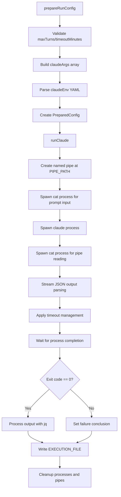
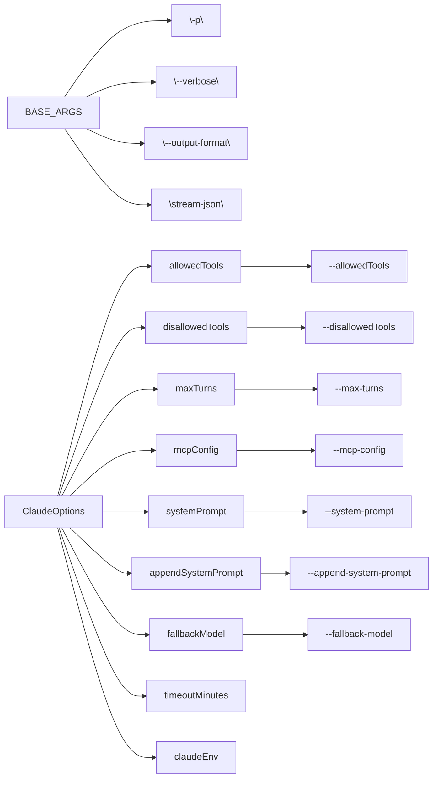
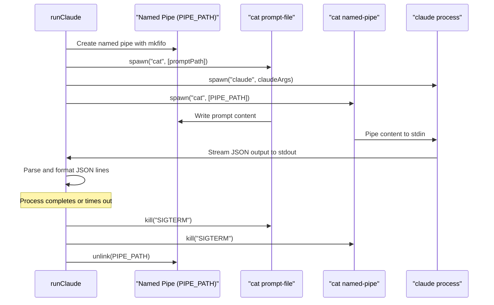
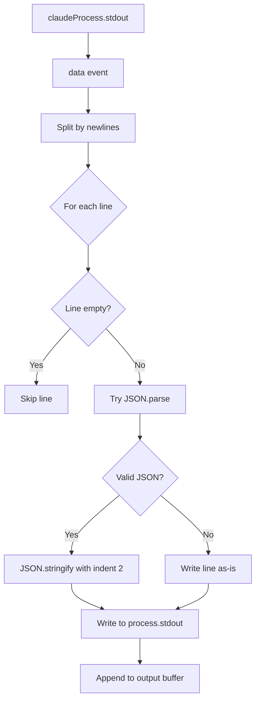
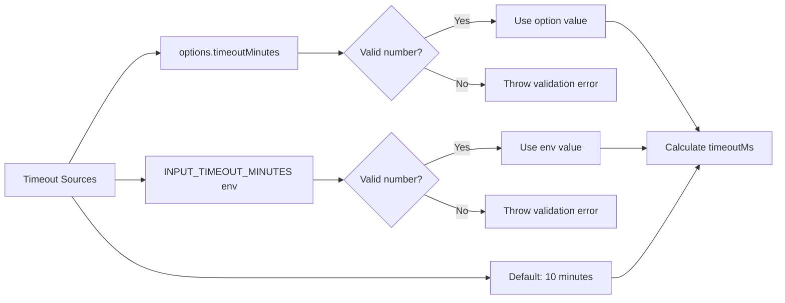
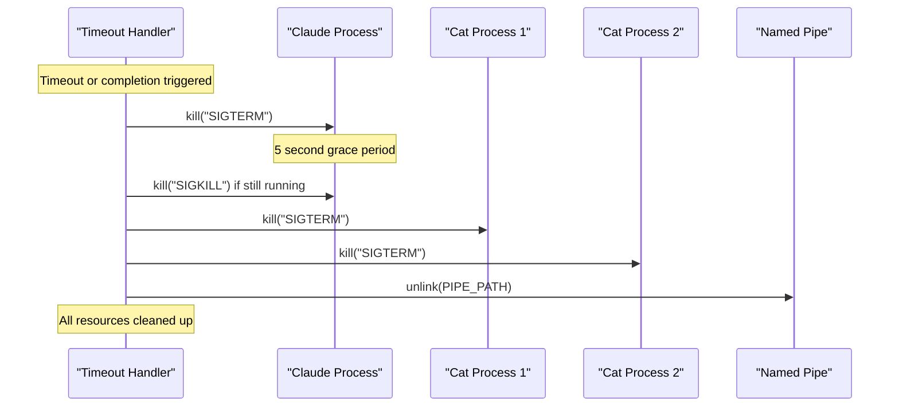
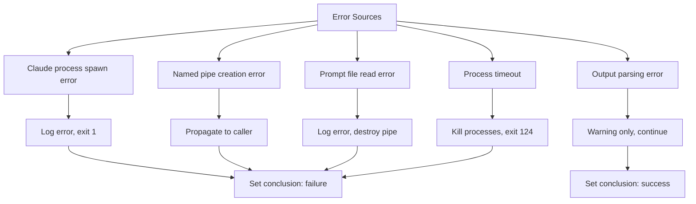

<!-- source: DeepWiki mcp.deepwiki.com · repo anthropics/claude-code-base-action · page 4.2 Claude Execution Engine · fetched 2026-10-26 -->

# Claude Execution Engine

Relevant source files

The following files were used as context for generating this wiki page:

- [src/run-claude.ts](src/run-claude.ts)
- [test/run-claude.test.ts](test/run-claude.test.ts)

The Claude Execution Engine is responsible for executing the Claude Code CLI process within the GitHub Actions environment. This system handles argument preparation, process spawning, inter-process communication via named pipes, output parsing, and timeout management. 

This page covers the low-level execution mechanics of running Claude Code. For information about settings configuration, see [Settings Management System](#4.3). For environment validation, see [Environment Validation](#4.4).

## Execution Flow Overview

The Claude execution process follows a structured pipeline from argument preparation through process cleanup:

**Sources:** [src/run-claude.ts:64-114](), [src/run-claude.ts:116-327]()

## Argument Preparation System

The `prepareRunConfig` function transforms action inputs into Claude CLI arguments and environment configuration:

### Base Configuration

The system starts with base arguments and conditionally adds options:

**Sources:** [src/run-claude.ts:12](), [src/run-claude.ts:14-24](), [src/run-claude.ts:68-96]()

### Environment Variable Processing

The `parseCustomEnvVars` function processes YAML-format environment variables:

| Input Format | Processing Rule | Output |
|--------------|-----------------|---------|
| `KEY: value` | Parse key-value pairs | `{KEY: "value"}` |
| Empty lines | Skip | Ignored |
| `# comments` | Skip | Ignored |
| No colon | Skip | Ignored |
| Whitespace | Trim both key and value | Clean strings |

**Sources:** [src/run-claude.ts:32-62](), [test/run-claude.test.ts:232-296]()

## Process Management and IPC

The execution system uses multiple processes coordinated through named pipes:

**Sources:** [src/run-claude.ts:10-11](), [src/run-claude.ts:119-127](), [src/run-claude.ts:150-154](), [src/run-claude.ts:161-167](), [src/run-claude.ts:211-218]()

## Output Handling and JSON Streaming

The system processes Claude's streaming JSON output with real-time parsing and formatting:

### JSON Stream Processing

**Sources:** [src/run-claude.ts:175-203]()

### Output Processing Pipeline

Upon completion, the system processes the accumulated output:

| Step | Command | Purpose | File Location |
|------|---------|---------|---------------|
| 1 | Write output buffer | Save raw output | `output.txt` |
| 2 | `jq -s '.' output.txt` | Convert to JSON array | Processed in memory |
| 3 | Write JSON | Save execution metrics | `EXECUTION_FILE` |
| 4 | Set GitHub outputs | Return conclusion and file path | Action outputs |

**Sources:** [src/run-claude.ts:295-309](), [src/run-claude.ts:314-323]()

## Timeout and Cleanup Management

The system implements comprehensive timeout handling with graceful cleanup:

### Timeout Configuration

**Sources:** [src/run-claude.ts:221-232](), [src/run-claude.ts:97-104]()

### Process Cleanup Sequence

The cleanup process ensures all spawned processes and resources are properly terminated:

**Sources:** [src/run-claude.ts:237-254](), [src/run-claude.ts:274-291]()

## Error Handling and Exit Codes

The execution engine handles various error scenarios and maps them to appropriate GitHub Actions outputs:

### Exit Code Mapping

| Exit Code | Meaning | Action Output | Execution File |
|-----------|---------|---------------|----------------|
| 0 | Success | `conclusion: success` | Created with metrics |
| 124 | Timeout | `conclusion: failure` | Created if output exists |
| Other | Claude error | `conclusion: failure` | Created if output exists |

**Sources:** [src/run-claude.ts:294-326]()

### Error Handling Points

**Sources:** [src/run-claude.ts:156-159](), [src/run-claude.ts:170-173](), [src/run-claude.ts:206-208](), [src/run-claude.ts:215-218](), [src/run-claude.ts:264-271]()

---

