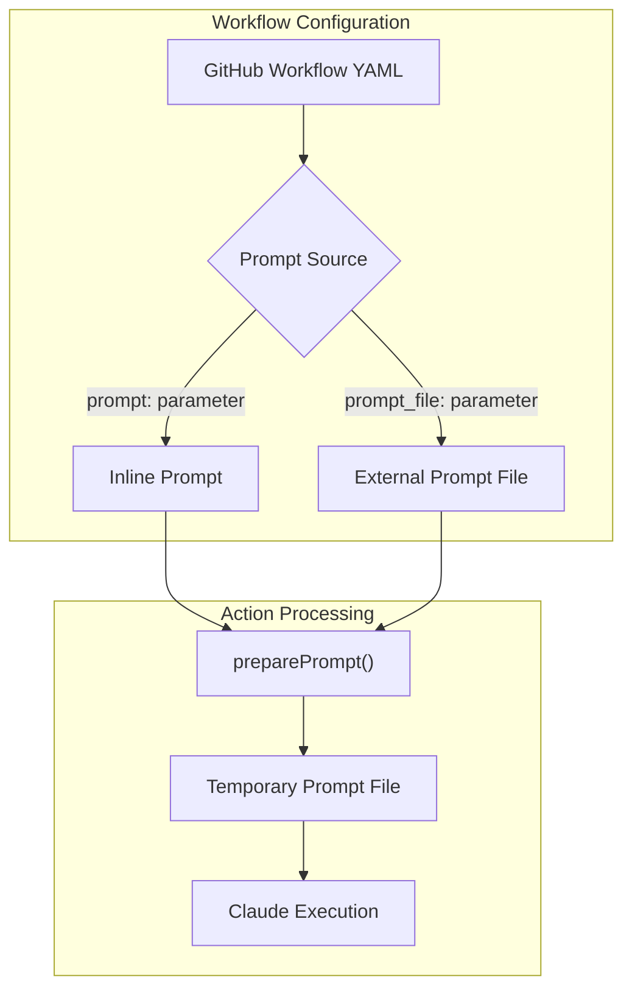
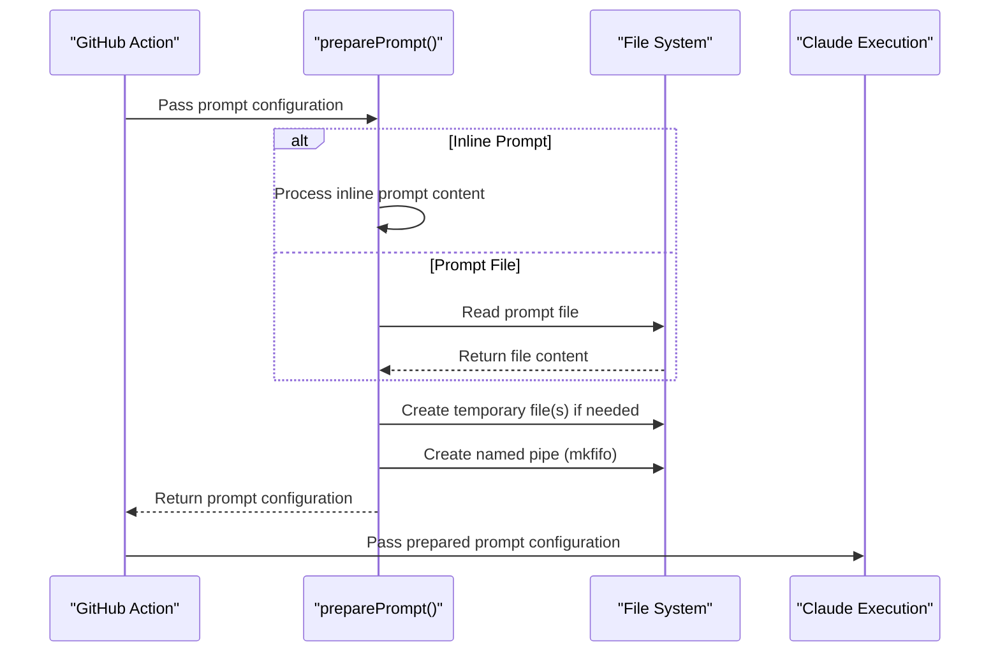
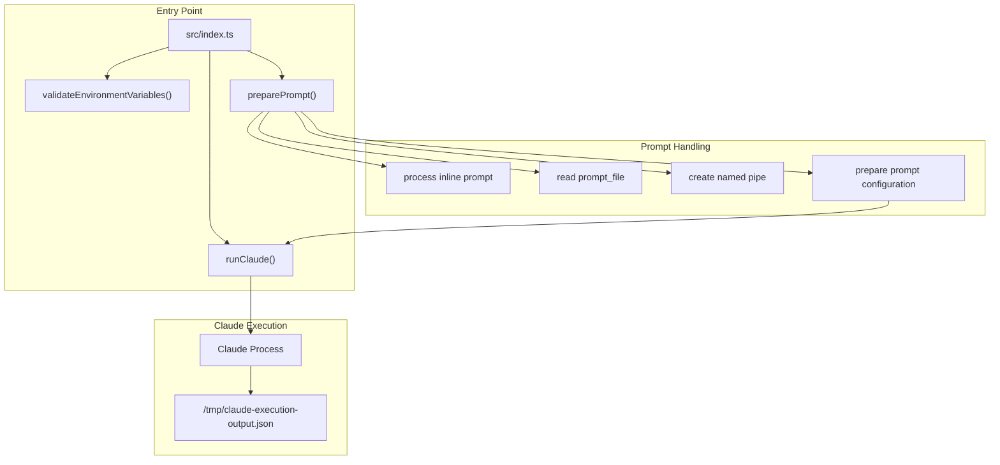
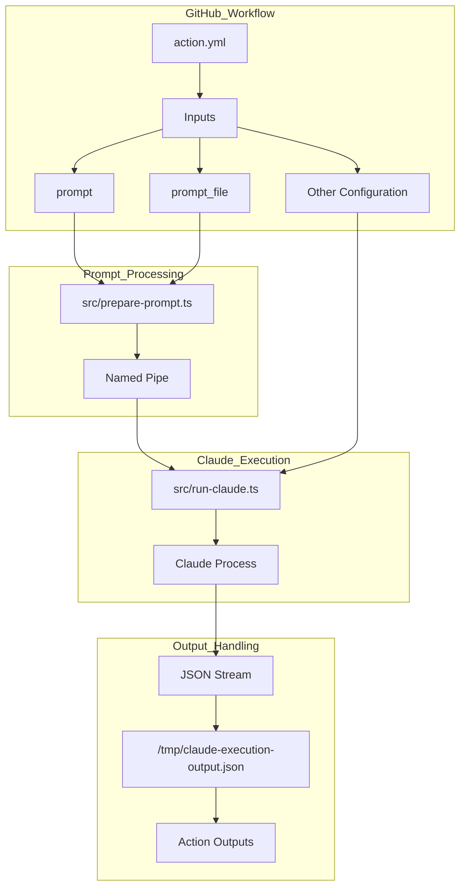

<!-- source: DeepWiki mcp.deepwiki.com · repo anthropics/claude-code-base-action · page 4.3 Settings Management System · fetched 2026-10-26 -->

# Prompt Handling

<details>
<summary>Relevant source files</summary>

The following files were used as context for generating this wiki page:

- [src/setup-claude-code-settings.ts](src/setup-claude-code-settings.ts)
- [test/setup-claude-code-settings.test.ts](test/setup-claude-code-settings.test.ts)

</details>


## Purpose and Scope

This document details how the claude-code-base-action processes and prepares prompts for execution by Claude. It covers the input methods for prompts, the preparation workflow, and how prompts are delivered to the Claude execution engine. For information about how Claude actually executes the prepared prompts, see [Claude Execution](#4.3).

## Prompt Input Methods

The action supports two primary methods for providing prompts to Claude:

1. **Inline Prompts**: Prompts provided directly in the GitHub workflow file using the `prompt` input parameter
2. **Prompt Files**: Prompts stored in external files and referenced through the `prompt_file` input parameter



Sources: CLAUDE.md:25-26

## Prompt Preparation Process

Prompt preparation transforms user-provided prompts into a format that can be efficiently consumed by the Claude execution engine. This process is primarily handled by the `preparePrompt()` function in `src/prepare-prompt.ts`.

The preparation process includes:

1. **Input Validation**: Ensuring either `prompt` or `prompt_file` (but not both) is provided
2. **Source Processing**: Reading prompt content from the appropriate source
3. **Temporary File Creation**: Creating temporary files when needed
4. **Pipe Configuration**: Setting up the named pipe for communication with Claude



Sources: CLAUDE.md:25-26, CLAUDE.md:30-31, CLAUDE.md:57-58

## Named Pipes for Prompt Delivery

The action uses named pipes (created with `mkfifo`) as an inter-process communication (IPC) mechanism to efficiently deliver prompts to the Claude process. This approach:

1. Enables streaming of potentially large prompts
2. Avoids memory limitations from loading entire prompts into memory
3. Creates a unidirectional data flow from the prompt source to Claude

```mermaid
graph LR
  subgraph PromptPreparation["Prompt Preparation"]
    A[preparePrompt()] --> B[Create Named Pipe]
  end
  subgraph FileSystem["File System"]
    B --> C[Named Pipe (FIFO)]
  end
  subgraph ClaudeExecution["Claude Execution"]
    C --> D[runClaude()]
    D --> E[Claude Process]
  end
  subgraph OutputProcessing["Output Processing"]
    E --> F[JSON Output Stream]
    F --> G[Execution Log File]
  end

```

Sources: CLAUDE.md:30-31, CLAUDE.md:57-58

## Prompt Configuration Components

The diagram below shows the relationship between different code components involved in prompt handling:



Sources: CLAUDE.md:24-25, CLAUDE.md:57-59

## Configuration Options for Prompt Handling

The action provides several configuration options that affect prompt handling:

| Option | Description | Default | Effect on Prompt Handling |
|--------|-------------|---------|----------------------------|
| `prompt` | Inline prompt text | - | Direct prompt content used for Claude |
| `prompt_file` | Path to a file containing the prompt | - | File content used as prompt |
| `allowed_tools` | Tools Claude is allowed to use | - | Included in prompt context |
| `disallowed_tools` | Tools Claude is not allowed to use | - | Excluded from prompt context |
| `max_turns` | Maximum conversation turns | `10` | Limits prompt-response iterations |
| `timeout_minutes` | Maximum execution time | `30` | Sets time limit for prompt processing |
| `mcp_config` | MCP server configuration | - | Configures custom tool access in prompts |

Sources: CLAUDE.md:55-60

## Advanced: Input/Output Flow

This diagram shows the complete flow of prompt data from configuration to output:



Sources: CLAUDE.md:24-26, CLAUDE.md:30-31, CLAUDE.md:57-59

## Technical Implementation Notes

- The prompt preparation process creates temporary files that are cleaned up after execution
- Named pipes (`mkfifo`) provide an efficient one-way communication channel for prompts
- Timeout enforcement wraps the Claude execution to prevent hung processes
- The `preparePrompt()` function centralizes all prompt handling logic
- The execution output is saved as JSON to `/tmp/claude-execution-output.json`

Sources: CLAUDE.md:57-60

---

