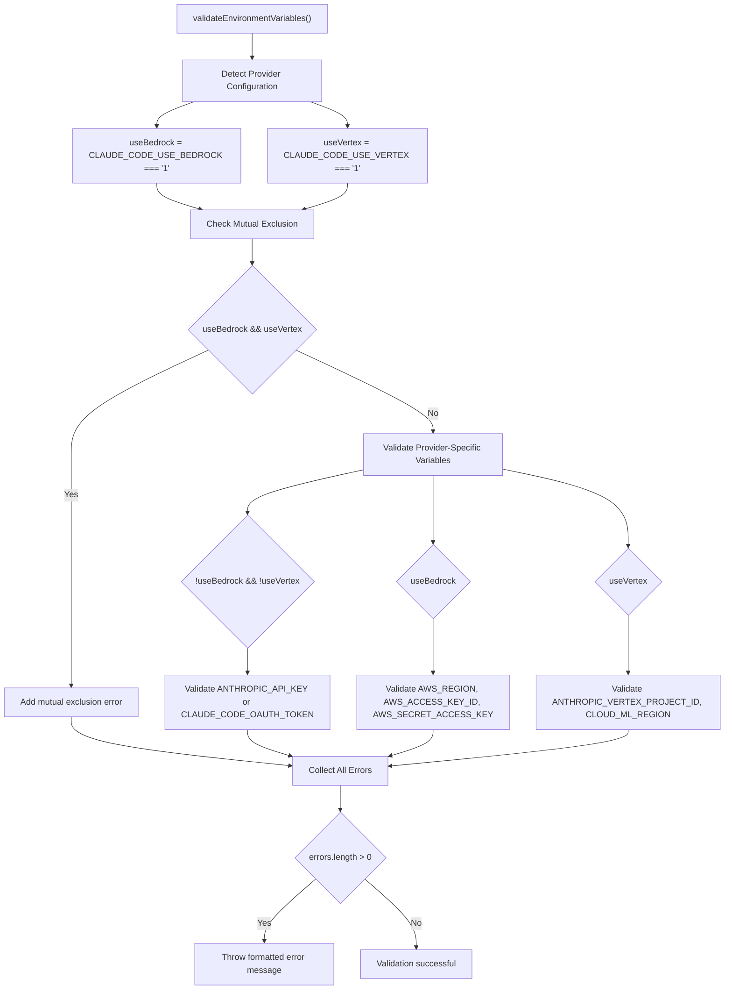
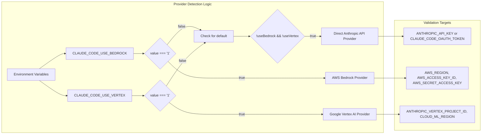
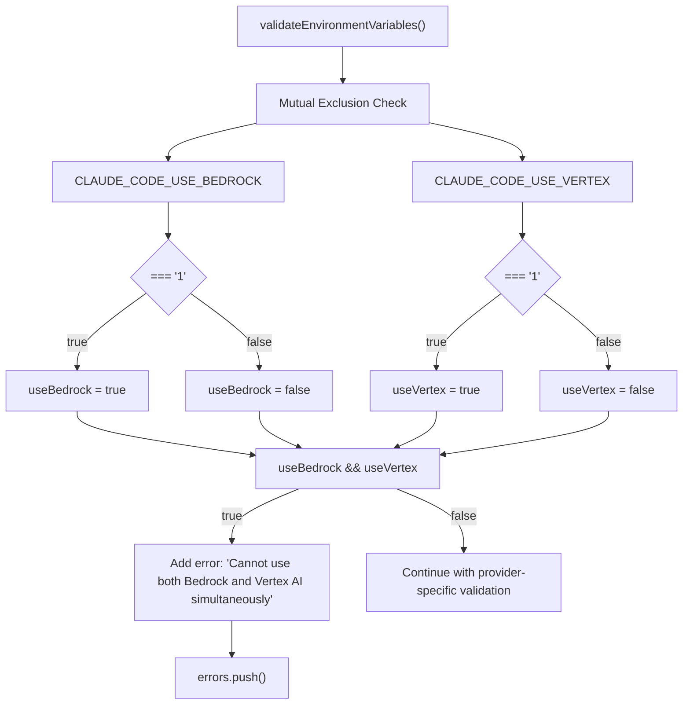
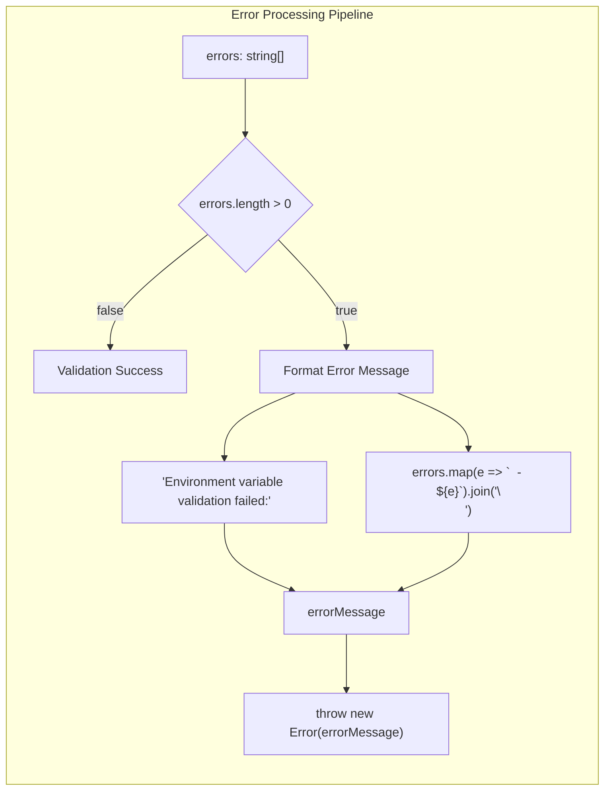

<!-- source: DeepWiki mcp.deepwiki.com · repo anthropics/claude-code-base-action · page 4.4 Environment Validation · fetched 2026-10-26 -->

# Environment Validation

<details>
<summary>Relevant source files</summary>

The following files were used as context for generating this wiki page:

- [src/validate-env.ts](src/validate-env.ts)
- [test/validate-env.test.ts](test/validate-env.test.ts)

</details>


This document covers the environment variable validation system that ensures proper authentication credentials and configuration are available before executing Claude Code. The validation system supports three authentication providers and enforces mutual exclusivity between cloud providers.

For information about the overall execution flow, see [Architecture Overview](#4.1). For details about authentication configuration, see [Authentication Methods](#3.2).

## Purpose and Scope

The Environment Validation system validates that all required environment variables are present and correctly configured based on the selected authentication provider. It runs early in the execution flow to fail fast if authentication requirements are not met.

The validation system:
- Detects which authentication provider is being used
- Validates required environment variables for each provider
- Enforces mutual exclusion between AWS Bedrock and Google Vertex AI
- Provides detailed error messages for missing or invalid configurations

Sources: [src/validate-env.ts:1-54]()

## Validation Flow



Sources: [src/validate-env.ts:5-54](), [test/validate-env.test.ts:6-214]()

## Provider Detection and Configuration

The validation system detects the intended authentication provider based on specific environment variable flags:

| Provider | Detection Variable | Value |
|----------|-------------------|-------|
| Direct Anthropic API | Default behavior | Neither Bedrock nor Vertex flags set |
| AWS Bedrock | `CLAUDE_CODE_USE_BEDROCK` | `"1"` |
| Google Vertex AI | `CLAUDE_CODE_USE_VERTEX` | `"1"` |



Sources: [src/validate-env.ts:6-7](), [test/validate-env.test.ts:48](), [test/validate-env.test.ts:126]()

## Required Environment Variables

### Direct Anthropic API

When neither Bedrock nor Vertex flags are set, the system validates direct Anthropic API authentication:

- **Required**: Either `ANTHROPIC_API_KEY` or `CLAUDE_CODE_OAUTH_TOKEN`
- **Optional**: None

### AWS Bedrock Provider

When `CLAUDE_CODE_USE_BEDROCK="1"` is set:

- **Required**: 
  - `AWS_REGION` 
  - `AWS_ACCESS_KEY_ID`
  - `AWS_SECRET_ACCESS_KEY`
- **Optional**:
  - `AWS_SESSION_TOKEN`
  - `ANTHROPIC_BEDROCK_BASE_URL`

### Google Vertex AI Provider

When `CLAUDE_CODE_USE_VERTEX="1"` is set:

- **Required**:
  - `ANTHROPIC_VERTEX_PROJECT_ID`
  - `CLOUD_ML_REGION`
- **Optional**:
  - `GOOGLE_APPLICATION_CREDENTIALS`
  - `ANTHROPIC_VERTEX_BASE_URL`

Sources: [src/validate-env.ts:19-48](), [test/validate-env.test.ts:32-168]()

## Mutual Exclusion Validation

The system enforces that AWS Bedrock and Google Vertex AI cannot be used simultaneously:



Sources: [src/validate-env.ts:13-17](), [test/validate-env.test.ts:170-185]()

## Error Collection and Reporting

The validation system collects all validation errors and reports them in a structured format:

### Error Collection Process

1. **Initialize**: Empty `errors: string[]` array
2. **Mutual Exclusion**: Add error if both providers are enabled
3. **Provider Validation**: Add errors for missing required variables
4. **Error Formatting**: Format all errors into a single exception

### Error Message Format

```
Environment variable validation failed:
  - <error message 1>
  - <error message 2>
  - ...
```

### Provider-Specific Error Messages

| Provider | Missing Variable | Error Message |
|----------|------------------|---------------|
| Direct API | `ANTHROPIC_API_KEY` and `CLAUDE_CODE_OAUTH_TOKEN` | "Either ANTHROPIC_API_KEY or CLAUDE_CODE_OAUTH_TOKEN is required when using direct Anthropic API." |
| AWS Bedrock | `AWS_REGION` | "AWS_REGION is required when using AWS Bedrock." |
| AWS Bedrock | `AWS_ACCESS_KEY_ID` | "AWS_ACCESS_KEY_ID is required when using AWS Bedrock." |
| AWS Bedrock | `AWS_SECRET_ACCESS_KEY` | "AWS_SECRET_ACCESS_KEY is required when using AWS Bedrock." |
| Google Vertex | `ANTHROPIC_VERTEX_PROJECT_ID` | "ANTHROPIC_VERTEX_PROJECT_ID is required when using Google Vertex AI." |
| Google Vertex | `CLOUD_ML_REGION` | "CLOUD_ML_REGION is required when using Google Vertex AI." |



Sources: [src/validate-env.ts:50-54](), [test/validate-env.test.ts:187-213]()

---

