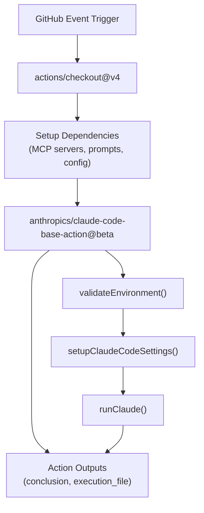
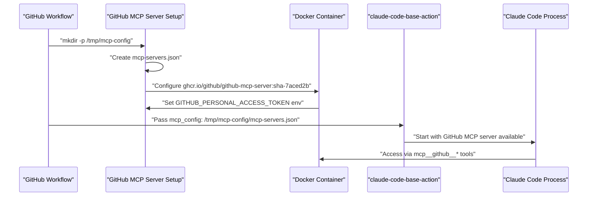
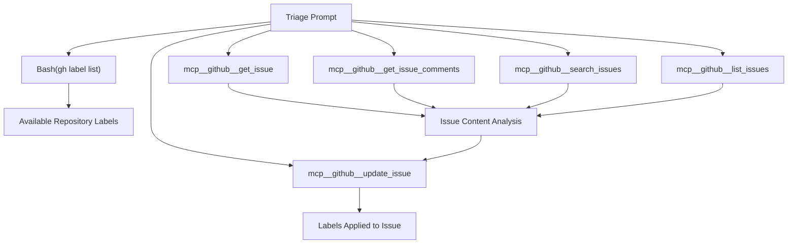

<!-- source: DeepWiki mcp.deepwiki.com · repo anthropics/claude-code-base-action · page 5 Usage Examples · fetched 2026-10-26 -->

# Usage Examples

<details>
<summary>Relevant source files</summary>

The following files were used as context for generating this wiki page:

- [examples/issue-triage.yml](examples/issue-triage.yml)

</details>


This document provides real-world examples demonstrating how to use `claude-code-base-action` in GitHub workflows. These examples show practical implementations covering common automation scenarios, configuration patterns, and integration approaches.

For detailed configuration options, see [Action Configuration](#3). For implementation details about how these examples work internally, see [Implementation Details](#4).

## Basic Usage Pattern

All uses of `claude-code-base-action` follow this general workflow structure:



**Sources:** [examples/issue-triage.yml:15-109]()

## Automated Issue Triage Example

The most comprehensive example demonstrates automated GitHub issue labeling using Claude Code with GitHub MCP server integration.

### Workflow Trigger and Permissions

```yaml
on:
  issues:
    types: [opened]

jobs:
  triage-issue:
    runs-on: ubuntu-latest
    permissions:
      contents: read
      issues: write
```

This workflow triggers when new issues are opened and requires `issues: write` permission for label application.

**Sources:** [examples/issue-triage.yml:3-13]()

### MCP Server Configuration Flow



The MCP server configuration creates a containerized GitHub API interface:

| Component | Configuration | Purpose |
|-----------|---------------|---------|
| `mcpServers.github.command` | `docker` | Run GitHub MCP server in container |
| `mcpServers.github.args` | Docker run parameters | Containerization settings |
| `mcpServers.github.env.GITHUB_PERSONAL_ACCESS_TOKEN` | `${{ secrets.GITHUB_TOKEN }}` | GitHub API authentication |

**Sources:** [examples/issue-triage.yml:21-43]()

### Prompt Engineering and Tool Selection

The example creates a structured prompt file with specific tool permissions:

```yaml
- name: Create triage prompt
  run: |
    mkdir -p /tmp/claude-prompts
    cat > /tmp/claude-prompts/triage-prompt.txt << 'EOF'
    # Detailed prompt content...
    EOF

- name: Run Claude Code for Issue Triage
  uses: anthropics/claude-code-base-action@beta
  with:
    prompt_file: /tmp/claude-prompts/triage-prompt.txt
    allowed_tools: "Bash(gh label list),mcp__github__get_issue,mcp__github__get_issue_comments,mcp__github__update_issue,mcp__github__search_issues,mcp__github__list_issues"
```

**Tool Access Pattern:**



**Sources:** [examples/issue-triage.yml:45-105]()

### Action Configuration Details

The action configuration demonstrates key integration patterns:

| Input | Value | Purpose |
|-------|--------|---------|
| `prompt_file` | `/tmp/claude-prompts/triage-prompt.txt` | File-based prompt input |
| `allowed_tools` | Comma-separated tool list | Restrict Claude's available actions |
| `mcp_config` | `/tmp/mcp-config/mcp-servers.json` | Enable GitHub MCP server |
| `timeout_minutes` | `"5"` | Limit execution time |
| `anthropic_api_key` | `${{ secrets.ANTHROPIC_API_KEY }}` | Direct Anthropic API authentication |

**Sources:** [examples/issue-triage.yml:101-108]()

## Configuration Variations

### Authentication Methods

The action supports multiple authentication approaches:

```yaml
# Direct Anthropic API
- uses: anthropics/claude-code-base-action@beta
  with:
    anthropic_api_key: ${{ secrets.ANTHROPIC_API_KEY }}

# AWS Bedrock with OIDC
- uses: anthropics/claude-code-base-action@beta
  with:
    use_bedrock: "true"
  env:
    AWS_REGION: us-west-2

# Google Vertex AI with OIDC  
- uses: anthropics/claude-code-base-action@beta
  with:
    use_vertex: "true"
  env:
    ANTHROPIC_VERTEX_PROJECT_ID: my-project
    CLOUD_ML_REGION: us-central1
```

For complete authentication setup, see [Authentication Methods](#3.2).

### Settings Configuration Examples

```yaml
# Inline JSON settings
- uses: anthropics/claude-code-base-action@beta
  with:
    settings: |
      {
        "enableAllProjectMcpServers": true,
        "defaultModel": "claude-3-5-sonnet-20241022"
      }

# File-based settings
- run: |
    cat > /tmp/claude-settings.json << 'EOF'
    {
      "enableAllProjectMcpServers": true,
      "mcpServers": {...}
    }
    EOF
- uses: anthropics/claude-code-base-action@beta
  with:
    settings: /tmp/claude-settings.json
```

For complete settings reference, see [Settings and MCP Configuration](#3.3).

## Common Integration Patterns

### Environment Variable Injection

```yaml
- uses: anthropics/claude-code-base-action@beta
  with:
    claude_env: |
      DATABASE_URL: ${{ secrets.DATABASE_URL }}
      API_ENDPOINT: https://api.example.com
      FEATURE_FLAGS: |
        - experimental_feature: true
        - beta_testing: false
```

### System Prompt Customization

```yaml
- uses: anthropics/claude-code-base-action@beta
  with:
    system_prompt: "You are a code reviewer specializing in security analysis."
    append_system_prompt: "Focus on identifying potential vulnerabilities."
    prompt: "Review the recent commits for security issues."
```

### Output Processing

```yaml
- uses: anthropics/claude-code-base-action@beta
  id: claude_analysis
  with:
    prompt: "Analyze this repository"

- name: Process Results  
  if: steps.claude_analysis.outputs.conclusion == 'success'
  run: |
    echo "Analysis completed successfully"
    cat ${{ steps.claude_analysis.outputs.execution_file }}
```

**Sources:** [src/index.ts](), [action.yml]()

---

