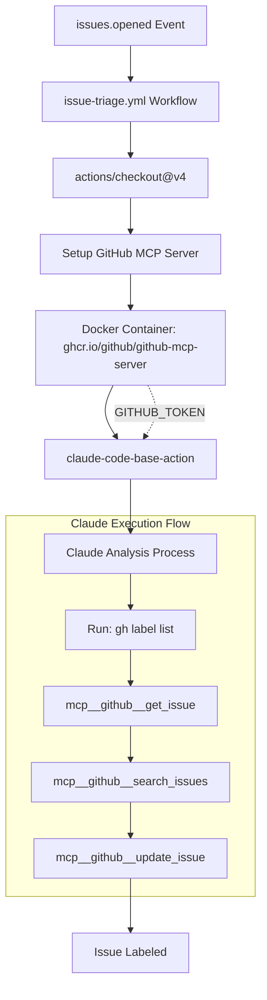
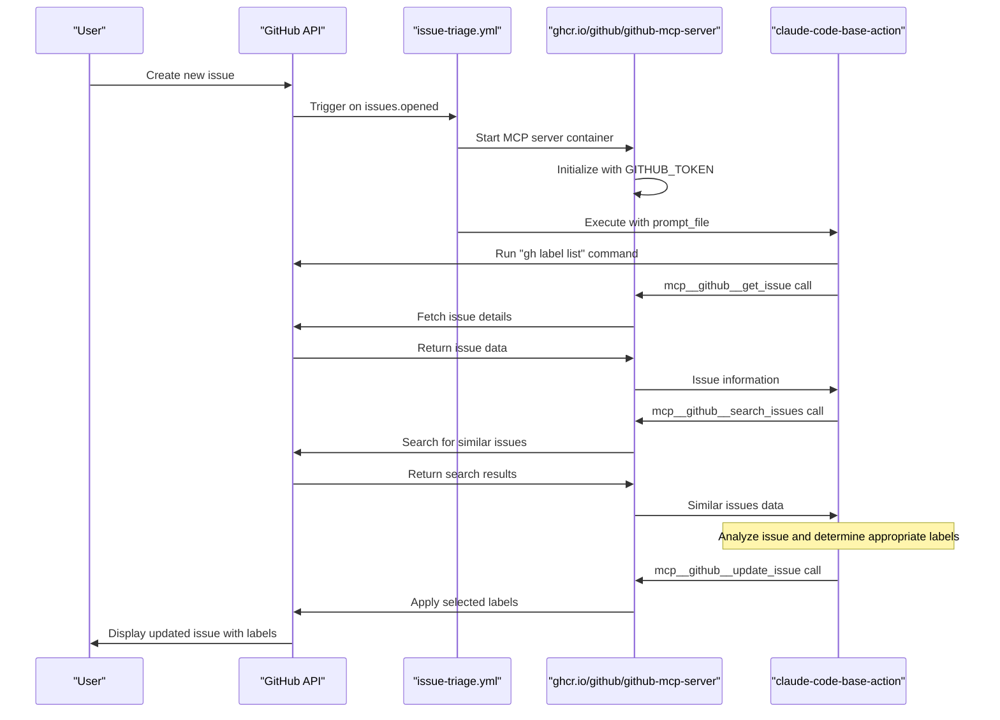
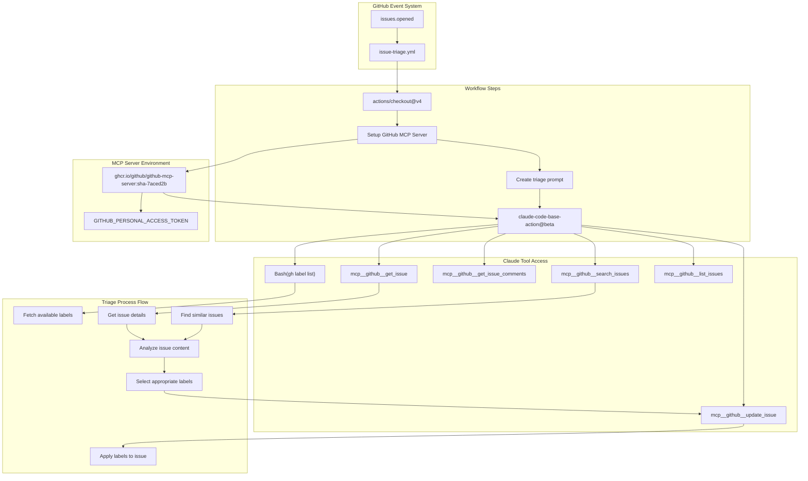

<!-- source: DeepWiki mcp.deepwiki.com · repo anthropics/claude-code-base-action · page 5.1 Automated Issue Triage · fetched 2026-10-26 -->

# Automated Issue Triage

<details>
<summary>Relevant source files</summary>

The following files were used as context for generating this wiki page:

- [MIRROR_DISCLAIMER.md](MIRROR_DISCLAIMER.md)
- [README.md](README.md)
- [examples/issue-triage.yml](examples/issue-triage.yml)

</details>


This document provides a detailed guide on implementing an automated issue triage workflow using the claude-code-base-action. The example demonstrates how Claude can automatically analyze new issues and apply appropriate labels using GitHub's MCP (Model Control Protocol) server integration.

The issue triage system uses Claude's understanding of repository context combined with direct GitHub API access through MCP servers to streamline repository management tasks.

## Overview

The issue triage workflow automatically analyzes new issues when they're opened. Using GitHub's MCP server, Claude can directly interact with GitHub's API to:

1. Fetch available repository labels using `gh label list`
2. Retrieve issue details using `mcp__github__get_issue`
3. Search for similar issues using `mcp__github__search_issues`
4. Apply appropriate labels using `mcp__github__update_issue`

The workflow is designed to operate autonomously without posting comments, focusing purely on accurate issue categorization through label application.

## System Architecture



Sources: [examples/issue-triage.yml:1-109]()

## Complete Workflow Implementation

The issue triage example demonstrates a streamlined approach using GitHub's MCP server for direct API integration:

### MCP Server Configuration

The workflow sets up a GitHub MCP server running in a Docker container:

```json
{
  "mcpServers": {
    "github": {
      "command": "docker",
      "args": [
        "run", "-i", "--rm", "-e", "GITHUB_PERSONAL_ACCESS_TOKEN",
        "ghcr.io/github/github-mcp-server:sha-7aced2b"
      ],
      "env": {
        "GITHUB_PERSONAL_ACCESS_TOKEN": "${{ secrets.GITHUB_TOKEN }}"
      }
    }
  }
}
```

### Available MCP Tools

Claude has access to these GitHub-specific tools through the MCP server:

| Tool | Purpose |
|------|---------|
| `mcp__github__get_issue` | Retrieve current issue details including title, description, and existing labels |
| `mcp__github__get_issue_comments` | Read issue discussion and comments for additional context |
| `mcp__github__update_issue` | Apply labels to issues (primary action for triage) |
| `mcp__github__search_issues` | Find similar issues for context and duplicate detection |
| `mcp__github__list_issues` | Understand repository labeling patterns |

### Complete Workflow File

The implementation follows the pattern defined in [examples/issue-triage.yml:1-109]():

```yaml
name: Claude Issue Triage Example
on:
  issues:
    types: [opened]

jobs:
  triage-issue:
    runs-on: ubuntu-latest
    timeout-minutes: 10
    permissions:
      contents: read
      issues: write

    steps:
      - name: Checkout repository
        uses: actions/checkout@11bd71901bbe5b1630ceea73d27597364c9af683
        with:
          fetch-depth: 0

      - name: Setup GitHub MCP Server
        run: |
          mkdir -p /tmp/mcp-config
          # MCP server configuration created here

      - name: Create triage prompt
        run: |
          mkdir -p /tmp/claude-prompts
          # Triage instructions created here

      - name: Run Claude Code for Issue Triage
        uses: anthropics/claude-code-base-action@beta
        with:
          prompt_file: /tmp/claude-prompts/triage-prompt.txt
          allowed_tools: "Bash(gh label list),mcp__github__get_issue,mcp__github__get_issue_comments,mcp__github__update_issue,mcp__github__search_issues,mcp__github__list_issues"
          mcp_config: /tmp/mcp-config/mcp-servers.json
          timeout_minutes: "5"
          anthropic_api_key: ${{ secrets.ANTHROPIC_API_KEY }}
```

Sources: [examples/issue-triage.yml:1-109]()

## MCP Integration Sequence

The triage process leverages direct GitHub API access through MCP servers:



Sources: [examples/issue-triage.yml:21-44](), [examples/issue-triage.yml:101-109]()

## Data Flow and Tool Integration



Sources: [examples/issue-triage.yml:22-43](), [examples/issue-triage.yml:104-106]()

## Configuration Reference

### Action Input Configuration

| Input | Value for Issue Triage | Purpose |
|-------|------------------------|---------|
| `prompt_file` | `/tmp/claude-prompts/triage-prompt.txt` | File containing detailed triage instructions |
| `allowed_tools` | `"Bash(gh label list),mcp__github__get_issue,mcp__github__get_issue_comments,mcp__github__update_issue,mcp__github__search_issues,mcp__github__list_issues"` | Restricts Claude to necessary GitHub operations |
| `mcp_config` | `/tmp/mcp-config/mcp-servers.json` | Path to MCP server configuration |
| `timeout_minutes` | `"5"` | Execution timeout limit |
| `anthropic_api_key` | `${{ secrets.ANTHROPIC_API_KEY }}` | Authentication for Anthropic API |

### MCP Server Configuration Structure

The MCP configuration follows this structure:

```json
{
  "mcpServers": {
    "github": {
      "command": "docker",
      "args": ["run", "-i", "--rm", "-e", "GITHUB_PERSONAL_ACCESS_TOKEN", "ghcr.io/github/github-mcp-server:sha-7aced2b"],
      "env": {
        "GITHUB_PERSONAL_ACCESS_TOKEN": "${{ secrets.GITHUB_TOKEN }}"
      }
    }
  }
}
```

Sources: [examples/issue-triage.yml:104-108](), [examples/issue-triage.yml:24-43]()

### Workflow Permissions

The workflow requires specific GitHub permissions:

| Permission | Level | Purpose |
|------------|-------|---------|
| `contents` | `read` | Access repository content |
| `issues` | `write` | Modify issue labels and properties |

### Environment Variables

| Variable | Source | Purpose |
|----------|--------|---------|
| `GITHUB_REPOSITORY` | GitHub context | Repository identification for issue operations |
| `GITHUB_TOKEN` | GitHub secrets | Authentication for MCP server API access |

Sources: [examples/issue-triage.yml:11-13](), [examples/issue-triage.yml:98-99]()

## Implementation Best Practices

### Prompt Design

The triage prompt in [examples/issue-triage.yml:48-97]() demonstrates effective prompt structure:

1. **Clear Instructions**: Explicitly state that Claude should only apply labels, not comment
2. **Step-by-Step Process**: Break down the triage process into numbered steps
3. **Tool Usage Guidelines**: Specify which MCP tools to use for each task
4. **Context Variables**: Include repository and issue number using GitHub context

### Security Considerations

1. **Token Scope**: Use `GITHUB_TOKEN` with minimal required permissions (`contents: read`, `issues: write`)
2. **Container Isolation**: MCP server runs in an isolated Docker container
3. **API Key Protection**: Store Anthropic API key in repository secrets
4. **Resource Limits**: Set appropriate `timeout-minutes` to prevent runaway executions

### Error Handling

1. **Container Startup**: Ensure Docker is available in the runner environment
2. **MCP Connection**: Verify MCP server starts successfully before Claude execution
3. **API Rate Limits**: GitHub API calls through MCP respect standard rate limiting
4. **Validation**: The workflow validates environment variables before execution

Sources: [examples/issue-triage.yml:48-97](), [examples/issue-triage.yml:11-13]()

## Triage Process Details

### Issue Analysis Workflow

The triage process follows a systematic approach defined in the prompt:

1. **Label Discovery**: Execute `gh label list` to fetch available repository labels
2. **Issue Retrieval**: Use `mcp__github__get_issue` to get complete issue details
3. **Context Gathering**: Optionally use `mcp__github__get_issue_comments` for additional context
4. **Similarity Search**: Use `mcp__github__search_issues` to find similar issues and detect duplicates
5. **Pattern Analysis**: Use `mcp__github__list_issues` to understand existing labeling patterns
6. **Label Application**: Use `mcp__github__update_issue` to apply selected labels

### Analysis Criteria

The prompt instructs Claude to consider:

- Issue title and description content
- Issue type classification (bug report, feature request, question, etc.)
- Technical areas and components mentioned
- Severity or priority indicators
- User impact assessment
- Potential duplicates of existing open issues

### Autonomous Operation

The workflow operates without human intervention by:

- Restricting Claude to label application only (no commenting)
- Using predefined tool allowlist for security
- Operating within GitHub's standard API rate limits
- Completing within the configured timeout period

Sources: [examples/issue-triage.yml:59-96]()

## Extending the Triage System

### Additional MCP Integrations

The GitHub MCP server supports additional operations that can enhance triage:

1. **Assignee Management**: Use `mcp__github__update_issue` to assign issues to team members
2. **Milestone Tracking**: Add issues to project milestones based on analysis
3. **Cross-Repository Analysis**: Search across multiple repositories for similar issues
4. **User History**: Analyze reporter's previous issues for context

### Custom Label Strategies

Extend labeling logic by:

1. **Priority Classification**: Implement urgency detection based on keywords and impact
2. **Component Mapping**: Map issue content to specific codebase components
3. **Effort Estimation**: Apply complexity labels based on issue scope analysis
4. **Duplicate Handling**: Automatically close duplicates of existing open issues

### Integration Patterns

The MCP-based approach enables:

1. **Multi-Repository Workflows**: Single triage system across organization repositories
2. **Custom MCP Servers**: Integrate additional services beyond GitHub
3. **Workflow Chaining**: Trigger subsequent workflows based on applied labels
4. **External Tool Integration**: Combine with project management and notification systems

Sources: [examples/issue-triage.yml:62-67](), [examples/issue-triage.yml:83-84]()

## Troubleshooting

If your issue triage workflow isn't working as expected:

1. Check the Claude execution log file for detailed information about the conversation.
2. Verify that your prompt is clear and explicitly requests the information in the format you need.
3. Ensure your GitHub tokens have sufficient permissions to apply labels and post comments.
4. Consider increasing the `timeout_minutes` if Claude is terminating before completing analysis.

Sources: [README.md:57-63]()

---

