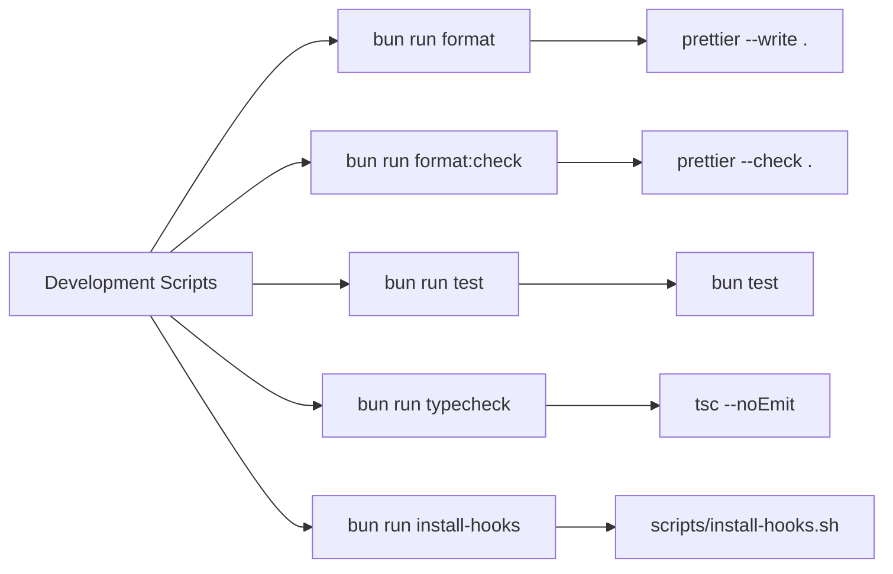
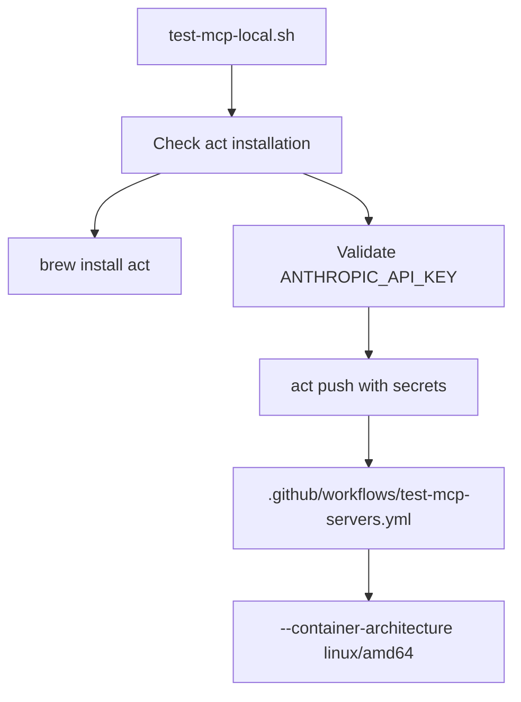
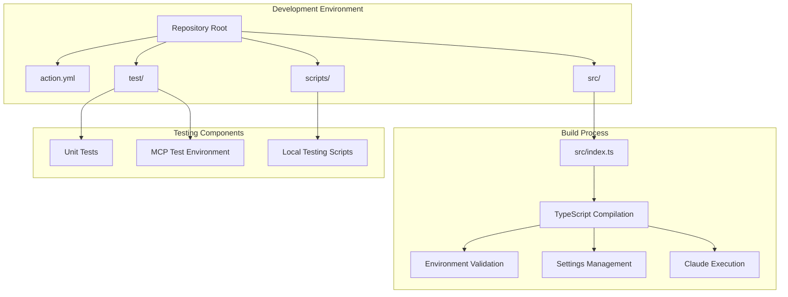
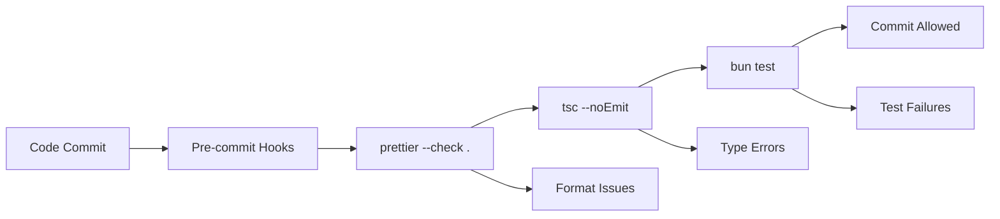

<!-- source: DeepWiki mcp.deepwiki.com · repo anthropics/claude-code-base-action · page 6 Development Guide · fetched 2026-10-26 -->

# Development Guide

Relevant source files

The following files were used as context for generating this wiki page:

- [bun.lock](bun.lock)
- [package.json](package.json)
- [test-mcp-local.sh](test-mcp-local.sh)

This guide provides comprehensive information for developers who want to contribute to or modify the claude-code-base-action. It covers the development environment setup, project structure, local testing, and contribution workflows.

For information about using the action in GitHub workflows, see [Getting Started](#2). For testing specific configurations and MCP server integrations, see [Setup and Local Testing](#6.1) and [Testing Infrastructure](#6.2).

## Development Environment Setup

The claude-code-base-action is built using modern JavaScript tooling with TypeScript and Bun as the primary runtime. The development environment requires several key components.

### Prerequisites and Runtime

The project uses Bun as its JavaScript runtime and package manager. The core dependencies are minimal and focused on GitHub Actions integration:

| Dependency | Purpose | Version |
|------------|---------|---------|
| `@actions/core` | GitHub Actions core functionality | ^1.10.1 |
| `typescript` | TypeScript compilation | ^5.8.3 |
| `prettier` | Code formatting | 3.5.3 |
| `@types/bun` | Bun type definitions | ^1.2.12 |
| `@types/node` | Node.js type definitions | ^20.0.0 |

### Development Scripts

The project includes several development scripts defined in [package.json:5-11]():

Sources: [package.json:5-11]()

### Local Testing Infrastructure

For local development and testing, the project provides the `test-mcp-local.sh` script that enables testing the action locally using the `act` tool:

The script performs environment validation by checking for the `ANTHROPIC_API_KEY` environment variable [test-mcp-local.sh:10-14]() and automatically installs the `act` tool if not present [test-mcp-local.sh:4-7]().

Sources: [test-mcp-local.sh:1-18]()

## Project Architecture for Development

### Composite Action Structure

The action follows GitHub's composite action pattern, orchestrating multiple steps in a single action. The development workflow mirrors this structure:

### Code Organization Patterns

The codebase follows a modular structure where each major functionality is separated into distinct modules:

- **Environment Validation**: Validates authentication and provider-specific environment variables
- **Settings Management**: Handles Claude Code settings configuration and merging
- **Claude Execution Engine**: Manages Claude Code process execution and output handling
- **Configuration Processing**: Processes various input formats (JSON, YAML, file paths)

Sources: Based on architectural analysis from provided diagrams

## Development Workflow

### Code Quality and Formatting

The project enforces consistent code style using Prettier configuration. All code changes must pass formatting checks:

The formatting configuration uses Prettier 3.5.3 with project-specific rules. Developers can auto-fix formatting issues using `bun run format`.

### Local Testing Strategy

Development testing follows a multi-tier approach:

1. **Unit Tests**: Run via `bun test` for individual component testing
2. **Type Checking**: TypeScript validation via `tsc --noEmit`
3. **Integration Testing**: Local GitHub Actions simulation via `act`
4. **MCP Server Testing**: Dedicated MCP server integration tests

The local testing script [test-mcp-local.sh]() provides a complete environment that mirrors the GitHub Actions runner environment, ensuring development changes work correctly in the actual deployment context.

Sources: [package.json:5-11](), [test-mcp-local.sh:1-18]()

## Build and Deployment Process

### TypeScript Compilation

The project uses TypeScript 5.8.3 with strict type checking enabled. The compilation process does not generate output files (using `--noEmit`), as Bun handles TypeScript execution directly.

### Dependency Management 

Dependencies are managed through Bun's package manager with lockfile versioning [bun.lock:1-44](). The minimal dependency footprint reduces potential security vulnerabilities and maintains fast installation times.

The action's runtime dependencies are deliberately minimal, with `@actions/core` being the primary external dependency for GitHub Actions integration.

### Container Architecture Considerations

Local testing uses `linux/amd64` container architecture [test-mcp-local.sh:18]() to match GitHub Actions runner environments. This ensures consistency between local development and production execution.

Sources: [bun.lock:1-44](), [package.json:12-20](), [test-mcp-local.sh:18]()

---

