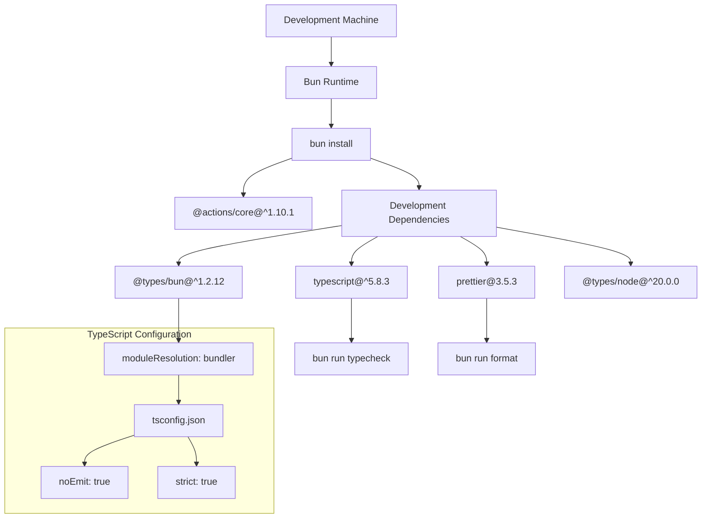
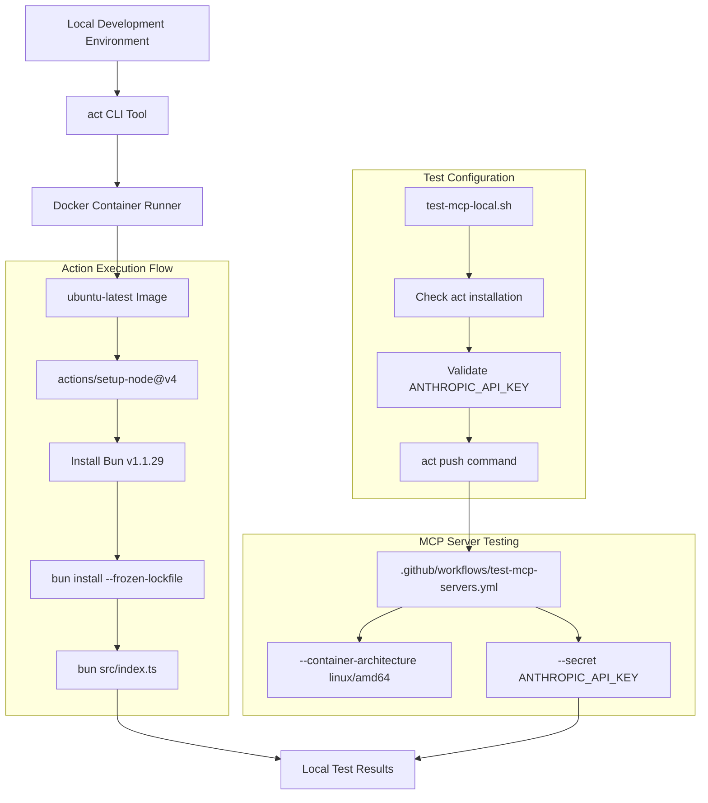
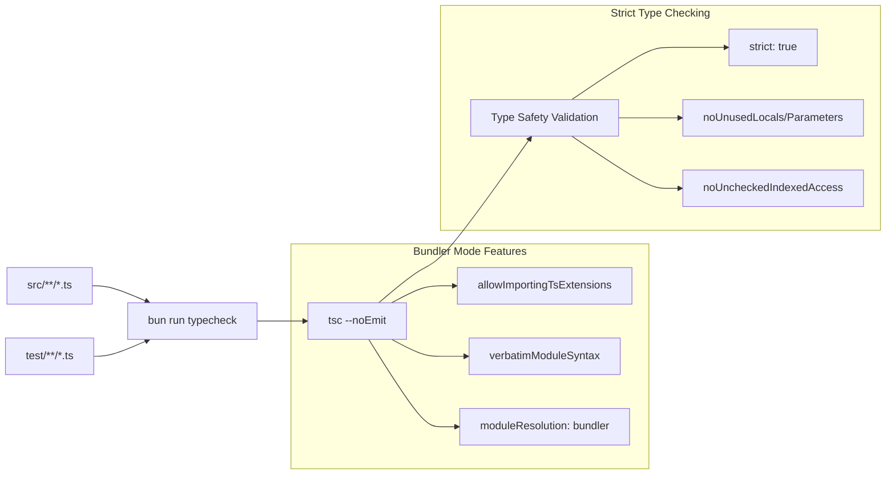

<!-- source: DeepWiki mcp.deepwiki.com · repo anthropics/claude-code-base-action · page 6.1 Setup and Local Testing · fetched 2026-10-26 -->

# Setup and Local Testing

<details>
<summary>Relevant source files</summary>

The following files were used as context for generating this wiki page:

- [bun.lock](bun.lock)
- [package.json](package.json)
- [test-mcp-local.sh](test-mcp-local.sh)
- [tsconfig.json](tsconfig.json)

</details>


This document covers how to set up a local development environment for contributing to the claude-code-base-action and how to test the action locally before submitting changes. This focuses on the development workflow for the action itself, not on using the action in your own GitHub workflows.

For information about configuring and using the action in your workflows, see [Action Configuration](#3). For details about the testing infrastructure and test suite, see [Testing Infrastructure](#6.2).

## Development Environment Setup

The claude-code-base-action is built using Bun as the JavaScript runtime and TypeScript for type safety. The development environment requires specific tooling to match the production execution environment.

### Prerequisites and Dependencies



The project uses Bun's bundler mode for module resolution, which allows importing TypeScript extensions directly without transpilation during development. The TypeScript configuration enforces strict type checking with additional flags like `noUnusedLocals` and `noUncheckedIndexedAccess`.

**Sources:** [package.json:1-22](), [bun.lock:1-45](), [tsconfig.json:1-31]()

### Package Scripts and Workflow Commands

The development workflow provides several npm/bun scripts for common tasks:

| Command | Purpose | Implementation |
|---------|---------|----------------|
| `bun run format` | Format code using Prettier | [package.json:6]() |
| `bun run format:check` | Check code formatting | [package.json:7]() |
| `bun run test` | Run test suite | [package.json:9]() |
| `bun run typecheck` | TypeScript type checking | [package.json:10]() |
| `bun run install-hooks` | Install Git hooks | [package.json:8]() |

The TypeScript configuration uses Bun-specific settings including `moduleResolution: "bundler"` and `allowImportingTsExtensions: true`, which enables direct imports of `.ts` files without compilation.

**Sources:** [package.json:5-11](), [tsconfig.json:12-15]()

## Local Testing with Act

The action provides local testing capabilities using GitHub's `act` tool, which simulates GitHub Actions runners on your local machine. This is essential for testing the composite action flow without pushing to GitHub.

### Act Testing Architecture



The local testing setup uses `act` to simulate the GitHub Actions environment, including the composite action steps defined in `action.yml`. The test script automatically handles `act` installation via Homebrew and validates required environment variables.

**Sources:** [test-mcp-local.sh:1-18]()

### MCP Server Local Testing

The `test-mcp-local.sh` script provides a streamlined way to test MCP server integration locally:

```bash
# Auto-install act if not present
if ! command -v act &> /dev/null; then
    echo "Installing act..."
    brew install act
fi

# Validate required API key
if [ -z "$ANTHROPIC_API_KEY" ]; then
    echo "Error: ANTHROPIC_API_KEY environment variable is not set"
    exit 1
fi

# Execute test workflow with secrets injection
act push --secret ANTHROPIC_API_KEY="$ANTHROPIC_API_KEY" \
    -W .github/workflows/test-mcp-servers.yml \
    --container-architecture linux/amd64
```

The script enforces the `linux/amd64` architecture to ensure compatibility with the GitHub Actions runner environment, and securely injects the Anthropic API key as a secret.

**Sources:** [test-mcp-local.sh:3-18]()

## Development Workflow Integration

The local development setup integrates with the broader testing infrastructure through several key mechanisms:

### TypeScript and Build Configuration



The TypeScript configuration is optimized for Bun's bundler mode, allowing direct imports of TypeScript files without a separate build step. The `noEmit: true` setting ensures type checking without output generation, as Bun handles runtime execution directly.

**Sources:** [tsconfig.json:2-30]()

### Code Quality and Formatting

The project enforces consistent code style using Prettier with the following workflow:

- `format:check` validates formatting before commits
- `format` applies automatic formatting fixes
- Git hooks can be installed via `install-hooks` script
- All source files in `src/` and `test/` directories are included

The Prettier configuration uses version 3.5.3 with default settings, ensuring consistent formatting across all TypeScript and JavaScript files.

**Sources:** [package.json:6-8](), [bun.lock:34]()

---

