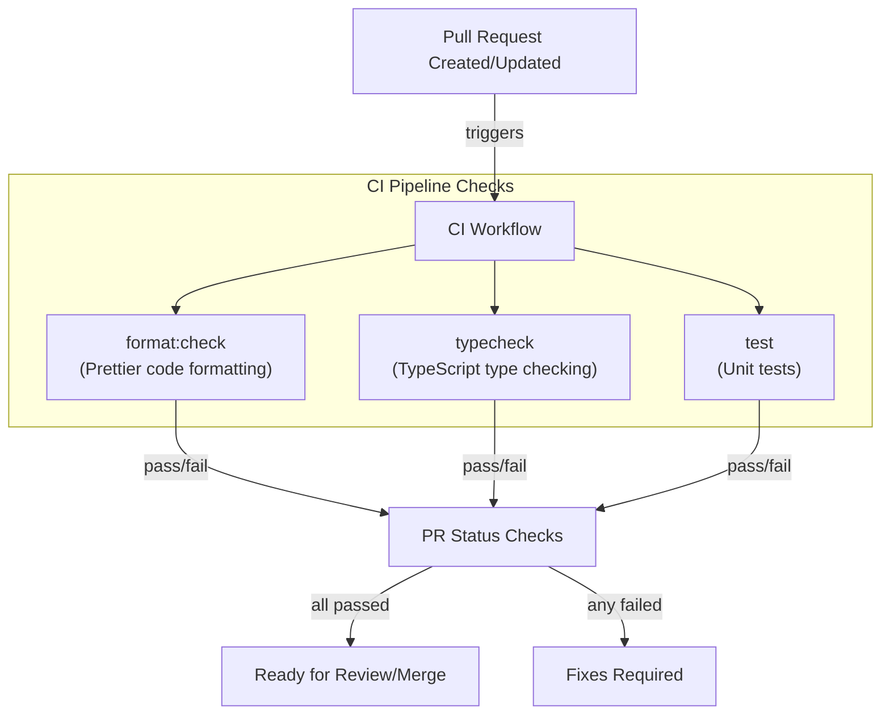
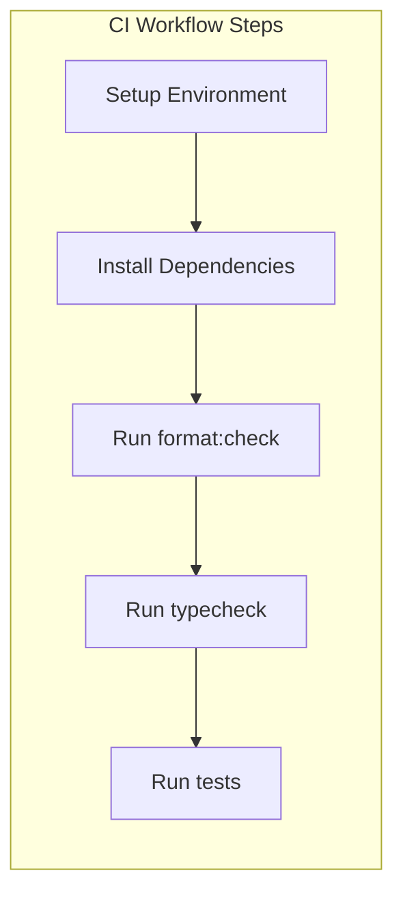
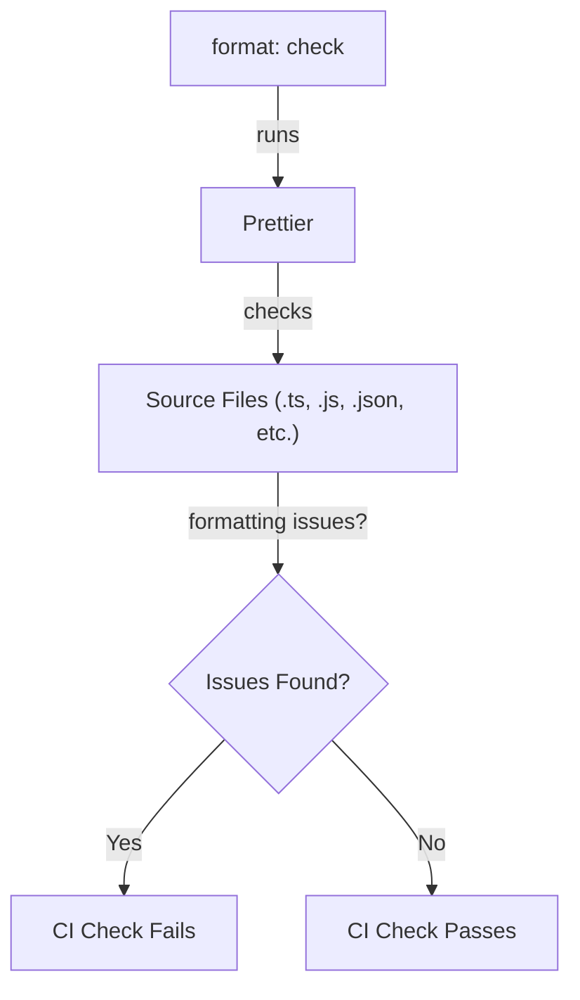
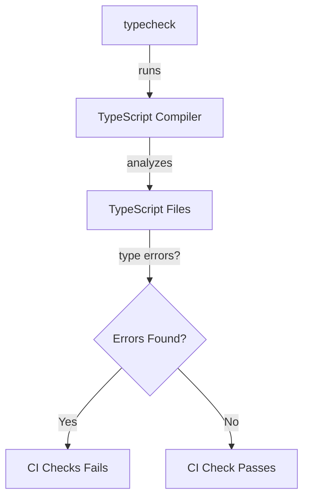
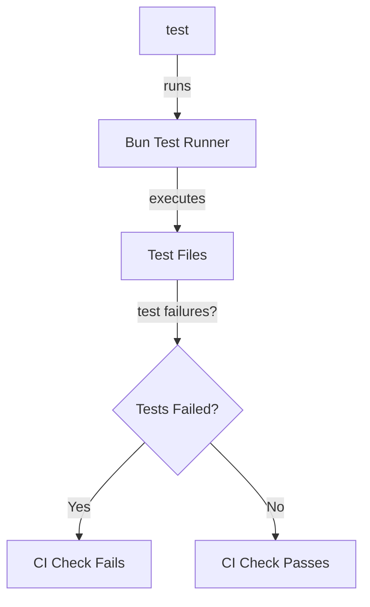
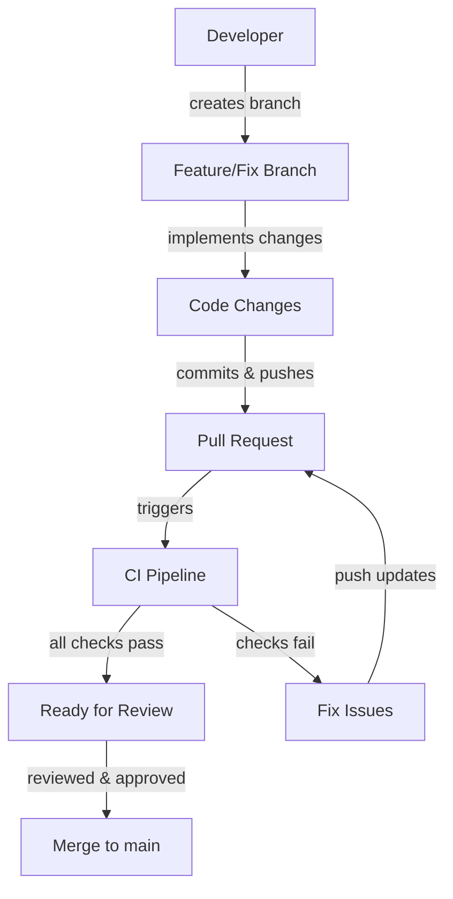
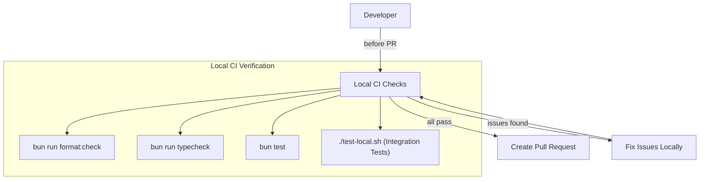
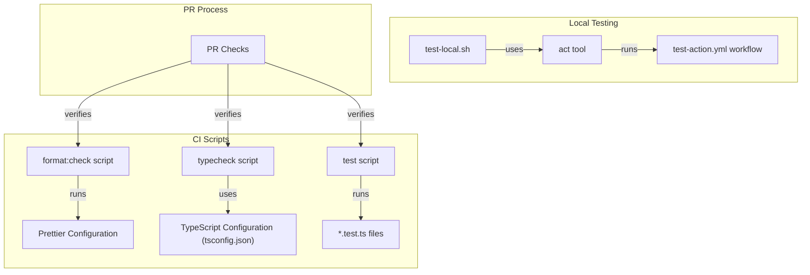
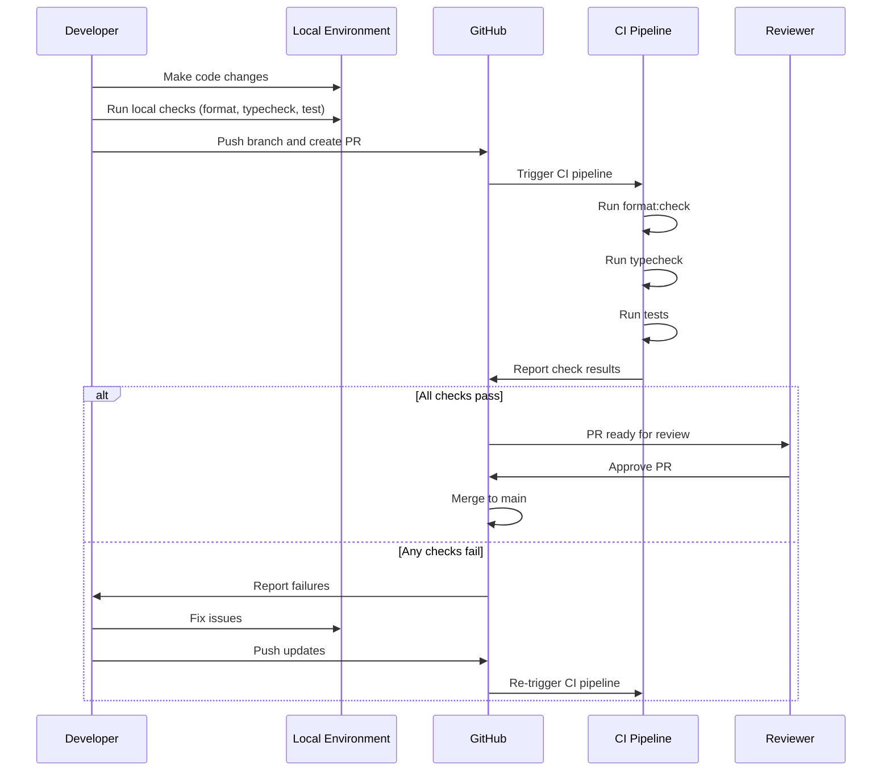

<!-- source: DeepWiki mcp.deepwiki.com · repo anthropics/claude-code-base-action · page 6.2 Testing Infrastructure · fetched 2026-10-26 -->

# CI Pipeline

Relevant source files

The following files were used as context for generating this wiki page:

- [src/run-claude.ts](src/run-claude.ts)
- [test/mcp-test/.mcp.json](test/mcp-test/.mcp.json)
- [test/mcp-test/package.json](test/mcp-test/package.json)
- [test/mcp-test/simple-mcp-server.ts](test/mcp-test/simple-mcp-server.ts)
- [test/run-claude.test.ts](test/run-claude.test.ts)

This page documents the Continuous Integration (CI) pipeline for the claude-code-base-action repository. It covers the automated checks that run on pull requests, how they're configured, and how to work with the pipeline during development. For information about local development and testing, see [Setup and Local Testing](#6.1).

## Pipeline Overview

The CI pipeline automatically runs whenever a pull request is created or updated. It ensures code quality and functionality by running a series of automated checks before code can be merged into the main branch.

Sources: [CONTRIBUTING.md:85-97]()

## CI Workflow Configuration

The CI workflow is defined in the GitHub Actions workflow configuration file. The workflow uses GitHub's Node.js environment to install dependencies and run the checks.

Each step in the workflow corresponds to one of the npm scripts defined in the project:

| Step | Command | Description |
|------|---------|-------------|
| Format Check | `bun run format:check` | Verifies code follows Prettier formatting standards |
| Type Check | `bun run typecheck` | Checks for TypeScript type errors |
| Tests | `bun test` | Runs unit tests |

Sources: [CONTRIBUTING.md:37-41]()

## CI Checks in Detail

### Format Check

The format check uses Prettier to verify that all code follows the project's formatting standards. This ensures consistent code style throughout the codebase.

If the format check fails, you can run `bun run format` locally to automatically fix formatting issues before pushing your changes.

Sources: [CONTRIBUTING.md:40-41]()

### Type Check

The type check runs the TypeScript compiler to verify type safety across the codebase. This helps catch potential runtime errors during the development process.

Sources: [CONTRIBUTING.md:39]()

### Tests

The test suite runs all unit tests to verify that the codebase functions correctly. This ensures that new changes don't break existing functionality.

Sources: [CONTRIBUTING.md:38]()

## Integration with Development Workflow

The CI pipeline is a critical part of the pull request process. Here's how it fits into the overall development workflow:

Sources: [CONTRIBUTING.md:67-98]()

## Local CI Verification

Before pushing changes or creating a pull request, you can run the same checks locally to catch issues early:

The local testing script (`test-local.sh`) uses the `act` tool to run GitHub Actions workflows locally, providing a way to test the entire pipeline before pushing changes.

Sources: [CONTRIBUTING.md:43-66](), [CONTRIBUTING.md:102-110]()

## Troubleshooting CI Issues

When CI checks fail, follow these steps to diagnose and fix the issues:

1. **Format Check Failures**: Run `bun run format` locally to automatically fix formatting issues.
2. **Type Check Failures**: Review the error messages in the CI log, which will point to specific files and line numbers with type errors.
3. **Test Failures**: Run `bun test` locally to reproduce and debug the failing tests.

For integration test failures using the local test script, check:
- Docker is running correctly (`docker ps`)
- Your `ANTHROPIC_API_KEY` is set correctly
- On Apple Silicon Macs, ensure architecture compatibility is handled (the script does this automatically)

Sources: [CONTRIBUTING.md:120-126](), [CONTRIBUTING.md:128-136]()

## CI Pipeline Components to Code Mapping

This diagram maps CI pipeline components to their corresponding code entities:

Sources: [CONTRIBUTING.md:37-41](), [CONTRIBUTING.md:43-66]()

## CI and PR Process Relationship

This diagram illustrates how the CI pipeline relates to the pull request process:

Sources: [CONTRIBUTING.md:67-98]()

---

