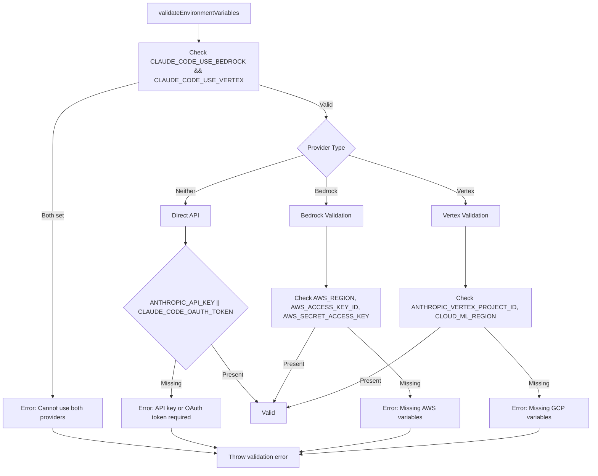
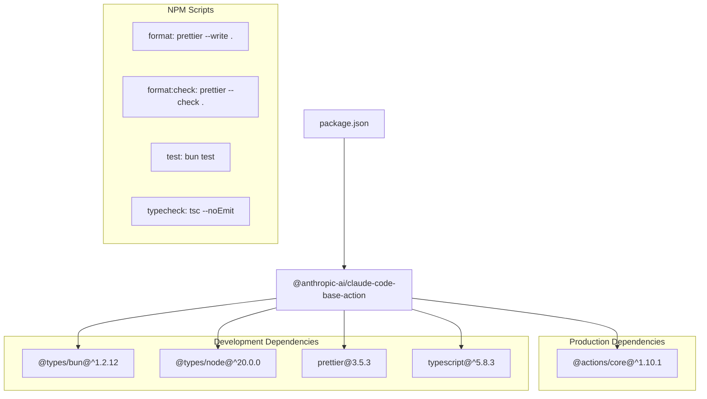
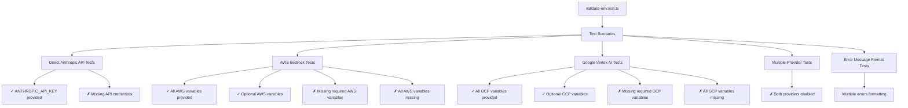
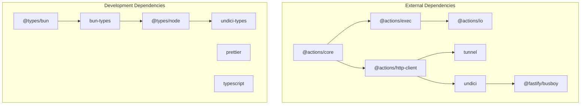
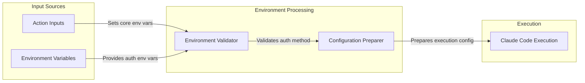
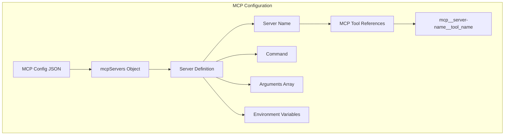
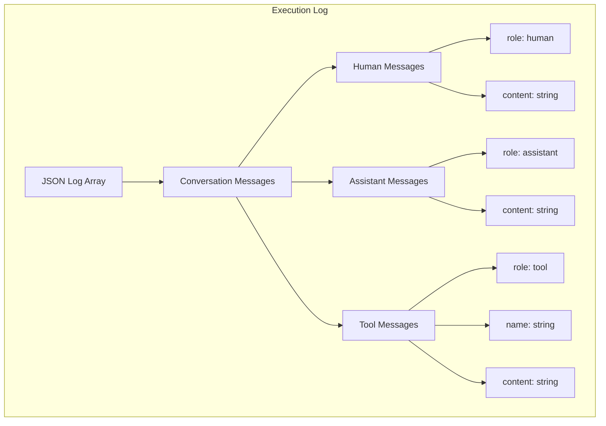

<!-- source: DeepWiki mcp.deepwiki.com · repo anthropics/claude-code-base-action · page 7 Reference · fetched 2026-10-26 -->

# Reference

<details>
<summary>Relevant source files</summary>

The following files were used as context for generating this wiki page:

- [bun.lock](bun.lock)
- [package.json](package.json)
- [src/validate-env.ts](src/validate-env.ts)
- [test/validate-env.test.ts](test/validate-env.test.ts)

</details>


This page provides technical reference documentation for environment variables, configuration files, and project structure used by the Claude Code Base Action. For getting started information, see [Getting Started](#2), and for detailed configuration guidance, see [Action Configuration](#3).

## Environment Variables Reference

The action uses environment variables for authentication, configuration, and runtime behavior control. The `validateEnvironmentVariables` function validates these based on the selected provider.

### Provider Control Variables

| Variable | Type | Description | Validation |
|----------|------|-------------|------------|
| `CLAUDE_CODE_USE_BEDROCK` | Flag | Set to `"1"` to enable AWS Bedrock | Mutually exclusive with Vertex AI |
| `CLAUDE_CODE_USE_VERTEX` | Flag | Set to `"1"` to enable Google Vertex AI | Mutually exclusive with Bedrock |

### Direct Anthropic API Variables

| Variable | Type | Description | Required |
|----------|------|-------------|----------|
| `ANTHROPIC_API_KEY` | String | Anthropic API key | When using direct API without OAuth |
| `CLAUDE_CODE_OAUTH_TOKEN` | String | Claude Code OAuth token | Alternative to API key |

### AWS Bedrock Variables

| Variable | Type | Description | Required | Default Behavior |
|----------|------|-------------|----------|------------------|
| `AWS_REGION` | String | AWS region for Bedrock service | Yes | Used to construct base URL |
| `AWS_ACCESS_KEY_ID` | String | AWS access key | Yes | - |
| `AWS_SECRET_ACCESS_KEY` | String | AWS secret access key | Yes | - |
| `AWS_SESSION_TOKEN` | String | AWS session token | No | For temporary credentials |
| `ANTHROPIC_BEDROCK_BASE_URL` | String | Custom Bedrock endpoint | No | Defaults to `https://bedrock-runtime.{region}.amazonaws.com` |

### Google Vertex AI Variables

| Variable | Type | Description | Required |
|----------|------|-------------|----------|
| `ANTHROPIC_VERTEX_PROJECT_ID` | String | GCP project ID | Yes |
| `CLOUD_ML_REGION` | String | GCP Cloud ML region | Yes |
| `GOOGLE_APPLICATION_CREDENTIALS` | String | Path to GCP service account JSON | No |
| `ANTHROPIC_VERTEX_BASE_URL` | String | Custom Vertex AI endpoint | No |

### Environment Validation Logic

The `validateEnvironmentVariables` function implements these rules:



Sources: [src/validate-env.ts:5-54](), [test/validate-env.test.ts:6-214]()

## Project Configuration Reference

### Package Configuration

The project uses Bun as the primary runtime and package manager:

| File | Description | Key Properties |
|------|-------------|----------------|
| `package.json` | Project metadata and dependencies | Runtime: Bun, TypeScript support |
| `bun.lock` | Dependency lockfile | Ensures consistent installs |
| `tsconfig.json` | TypeScript configuration | Type checking and compilation |

#### Dependencies Structure



Sources: [package.json:1-21](), [bun.lock:1-44]()

## Validation Error Handling

The validation system provides detailed error messages for debugging configuration issues.

### Error Message Format

Error messages follow this structure:
```
Environment variable validation failed:
  - {specific error 1}
  - {specific error 2}
  - {specific error N}
```

### Common Validation Errors

| Error Type | Example Error Message | Fix |
|------------|----------------------|-----|
| Missing API authentication | `Either ANTHROPIC_API_KEY or CLAUDE_CODE_OAUTH_TOKEN is required when using direct Anthropic API.` | Set one of the required API credentials |
| Provider conflict | `Cannot use both Bedrock and Vertex AI simultaneously. Please set only one provider.` | Remove one of the provider flags |
| Missing AWS variables | `AWS_REGION is required when using AWS Bedrock.` | Set all required AWS environment variables |
| Missing GCP variables | `ANTHROPIC_VERTEX_PROJECT_ID is required when using Google Vertex AI.` | Set all required GCP environment variables |

### Validation Test Coverage

The validation logic is comprehensively tested across multiple scenarios:



Sources: [test/validate-env.test.ts:32-214]()

## Project Structure Reference

### Core Implementation Files

| File Path | Purpose | Key Exports/Functions |
|-----------|---------|----------------------|
| `src/validate-env.ts` | Environment validation logic | `validateEnvironmentVariables()` |
| `src/index.ts` | Main action entry point | Action execution logic |

### Test Infrastructure

| File Path | Purpose | Test Coverage |
|-----------|---------|---------------|
| `test/validate-env.test.ts` | Environment validation tests | 14 test scenarios across 5 categories |

### Configuration Files

| File Path | Purpose | Key Settings |
|-----------|---------|-------------|
| `action.yml` | GitHub Action definition | Inputs, outputs, execution steps |
| `tsconfig.json` | TypeScript configuration | Compilation and type checking |
| `.prettierrc` | Code formatting rules | Consistent code style |

### Development Tools

| File Path | Purpose | Usage |
|-----------|---------|-------|
| `package.json` | Project dependencies and scripts | `bun test`, `prettier`, `tsc` |
| `bun.lock` | Dependency version lock | Ensures reproducible builds |

### Runtime Dependencies Map



Sources: [package.json:12-20](), [bun.lock:17-42]()

## Environment Variables Flow

The diagram below shows how environment variables are used in the authentication and execution flow:



Sources: [action.yml:101-129]()

## MCP Configuration Reference

MCP (Modular Computation Platform) allows defining custom server configurations that Claude Code can interact with. The MCP configuration can be provided as a JSON file path or directly as a JSON string.

### MCP Configuration Structure



### MCP Configuration Format

The MCP configuration should follow this structure:

```json
{
  "mcpServers": {
    "server-name": {
      "command": "executable",
      "args": ["arg1", "arg2"],
      "env": {
        "ENV_VAR1": "value1",
        "ENV_VAR2": "value2"
      }
    }
  }
}
```

To use a custom MCP tool, reference it in the `allowed_tools` input with the format: `mcp__server-name__tool_name`.

Sources: [README.md:64-106]()

## Tool Reference

The action supports various tools that Claude can use during execution:

### Standard Tools

| Tool | Description | Example Usage |
|------|-------------|--------------|
| `Bash` | Executes bash commands | `Bash(git:*)` or `Bash(ls -la)` |
| `View` | Views file contents | Used automatically by Claude |
| `GlobTool` | Lists files matching a pattern | Used automatically by Claude |
| `GrepTool` | Searches files for patterns | Used automatically by Claude |
| `BatchTool` | Processes multiple files | Used automatically by Claude |
| `Write` | Writes to files | `Write` |

### Custom MCP Tools

Custom MCP tools are referenced using the format `mcp__server-name__tool_name` in the `allowed_tools` input.

Sources: [README.md:11-36](), [README.md:102-104]()

## Execution Log Reference

The action produces an execution log file in JSON format, accessible via the `execution_file` output.

### Execution Log Structure



The execution log is an array of message objects, each with a `role` field (`human`, `assistant`, or `tool`) and content information. This log captures the entire conversation history with Claude, including tool usage.

Sources: [README.md:139-162]()

## Model Reference

Different authentication methods require different model name formats:

| Provider | Model Name Format | Example |
|----------|-------------------|---------|
| Direct Anthropic API | `claude-{version}` | `claude-3-7-sonnet-20250219` |
| AWS Bedrock | `anthropic.claude-{version}` | `anthropic.claude-3-7-sonnet-20250219-v1:0` |
| Google Vertex AI | `claude-{version}@{date}` | `claude-3-7-sonnet@20250219` |

Sources: [README.md:184-222]()

## Security Considerations

When using the Claude Code Base Action, follow these security best practices:

1. **Never commit API keys directly** in your repository or workflows
2. Always use GitHub Actions secrets for sensitive information
3. Use `${{ secrets.SECRET_NAME }}` syntax to reference secrets
4. Use short-lived tokens when possible, especially with OIDC authentication
5. Limit the allowed tools to only those necessary for your workflow

Sources: [README.md:264-299]()

---

