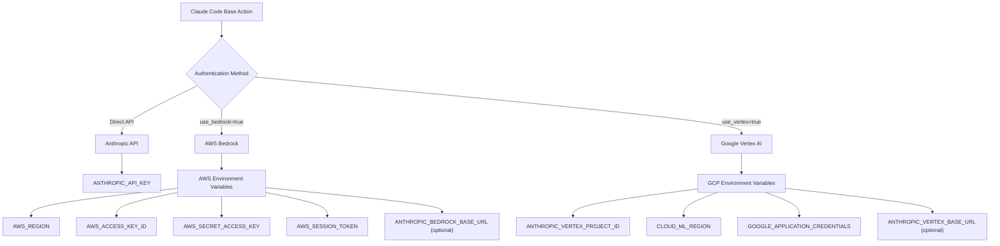
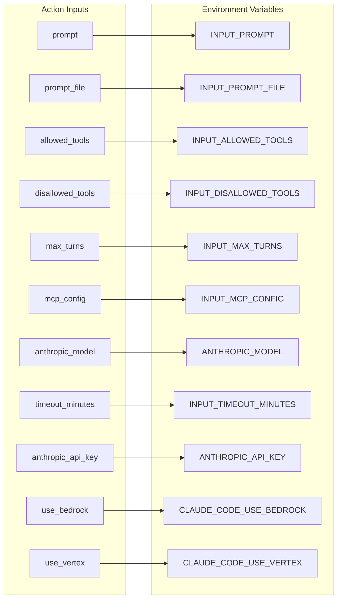
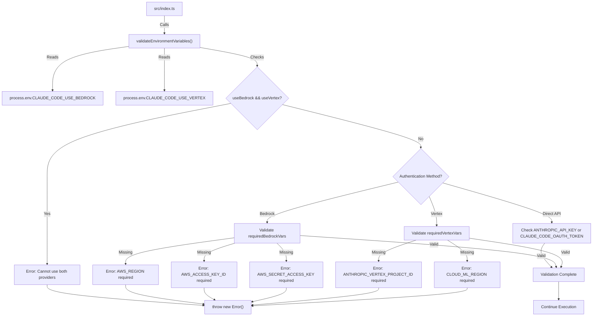

<!-- source: DeepWiki mcp.deepwiki.com · repo anthropics/claude-code-base-action · page 7.1 Environment Variables · fetched 2026-10-26 -->

# Environment Variables

<details>
<summary>Relevant source files</summary>

The following files were used as context for generating this wiki page:

- [action.yml](action.yml)
- [src/validate-env.ts](src/validate-env.ts)
- [test/validate-env.test.ts](test/validate-env.test.ts)

</details>


This document provides a comprehensive reference for all environment variables used by the Claude Code Base Action. These variables control authentication, model configuration, and execution behavior of the action.

For information about action configuration through workflow inputs, see [Action Configuration](#3) and [Inputs and Outputs](#3.1).

## Overview

Environment variables in Claude Code Base Action fall into four main categories:

1. **Model Configuration Variables**: Control how Claude executes and processes prompts
2. **Provider Configuration Variables**: Determine which AI provider to use
3. **AWS Configuration Variables**: Required when using AWS Bedrock
4. **GCP Configuration Variables**: Required when using Google Vertex AI

Most environment variables are set automatically based on the inputs provided to the action, while others must be configured in the GitHub Actions environment.

Sources: [action.yml:100-129]()

## Authentication Environment Variables

The following diagram illustrates the relationship between authentication methods and their required environment variables:



Sources: [action.yml:44-56](), [action.yml:112-129]()

## Input Mapping to Environment Variables

The action automatically converts workflow inputs to environment variables:



Sources: [action.yml:7-56](), [action.yml:100-129]()

## Detailed Environment Variable Reference

### Model Configuration Variables

These variables control how Claude processes your prompt and what capabilities it has access to.

| Variable | Description | Required | Default | Source |
|----------|-------------|----------|---------|--------|
| `CLAUDE_CODE_ACTION` | Marker indicating the action is running | Yes | `"1"` | Hard-coded |
| `ANTHROPIC_MODEL` | The Claude model to use | No | None | `model` or `anthropic_model` input |
| `INPUT_PROMPT` | The prompt to send to Claude | No* | `""` | `prompt` input |
| `INPUT_PROMPT_FILE` | Path to a file containing the prompt | No* | `""` | `prompt_file` input |
| `INPUT_ALLOWED_TOOLS` | Comma-separated list of allowed tools | No | `""` | `allowed_tools` input |
| `INPUT_DISALLOWED_TOOLS` | Comma-separated list of disallowed tools | No | `""` | `disallowed_tools` input |
| `INPUT_MAX_TURNS` | Maximum number of conversation turns | No | `""` (no limit) | `max_turns` input |
| `INPUT_MCP_CONFIG` | MCP configuration as JSON string or file path | No | `""` | `mcp_config` input |
| `INPUT_SETTINGS` | Claude Code settings as JSON string or file path | No | `""` | `settings` input |
| `INPUT_SYSTEM_PROMPT` | Override system prompt | No | `""` | `system_prompt` input |
| `INPUT_APPEND_SYSTEM_PROMPT` | Append to system prompt | No | `""` | `append_system_prompt` input |
| `INPUT_TIMEOUT_MINUTES` | Timeout in minutes for Claude execution | No | `"10"` | `timeout_minutes` input |
| `INPUT_CLAUDE_ENV` | Custom environment variables in YAML format | No | `""` | `claude_env` input |
| `INPUT_FALLBACK_MODEL` | Fallback model when default unavailable | No | `""` | `fallback_model` input |

*Either `INPUT_PROMPT` or `INPUT_PROMPT_FILE` must be set, but not both.

Sources: [action.yml:7-57](), [action.yml:133-145]()

### Provider Configuration Variables

These variables determine which AI provider to use for Claude.

| Variable | Description | Required | Default | Source |
|----------|-------------|----------|---------|--------|
| `ANTHROPIC_API_KEY` | API key for direct Anthropic API access | Yes (for direct API) | `""` | `anthropic_api_key` input |
| `CLAUDE_CODE_OAUTH_TOKEN` | OAuth token for direct API access | Yes (alternative to API key) | `""` | `claude_code_oauth_token` input |
| `ANTHROPIC_BASE_URL` | Custom Anthropic API base URL | No | None | GitHub environment |
| `CLAUDE_CODE_USE_BEDROCK` | Whether to use AWS Bedrock (set to "1" to enable) | No | `""` (false) | `use_bedrock` input |
| `CLAUDE_CODE_USE_VERTEX` | Whether to use Google Vertex AI (set to "1" to enable) | No | `""` (false) | `use_vertex` input |

Sources: [action.yml:66-81](), [action.yml:148-153]()

### AWS Configuration Variables

These variables are required when using AWS Bedrock (`CLAUDE_CODE_USE_BEDROCK` is set to `"1"`).

| Variable | Description | Required | Default | Source |
|----------|-------------|----------|---------|--------|
| `AWS_REGION` | AWS region where Bedrock is available | Yes | None | GitHub environment |
| `AWS_ACCESS_KEY_ID` | AWS access key ID | Yes | None | GitHub environment |
| `AWS_SECRET_ACCESS_KEY` | AWS secret access key | Yes | None | GitHub environment |
| `AWS_SESSION_TOKEN` | AWS session token | No (for temporary credentials) | None | GitHub environment |
| `ANTHROPIC_BEDROCK_BASE_URL` | Custom Bedrock endpoint URL | No | Auto-generated from `AWS_REGION` | GitHub environment |

**Note**: When `ANTHROPIC_BEDROCK_BASE_URL` is not provided, it is automatically constructed as `https://bedrock-runtime.{AWS_REGION}.amazonaws.com`.

Sources: [action.yml:156-160]()

### GCP Configuration Variables

These variables are required when using Google Vertex AI (`CLAUDE_CODE_USE_VERTEX` is set to `"1"`).

| Variable | Description | Required | Default | Source |
|----------|-------------|----------|---------|--------|
| `ANTHROPIC_VERTEX_PROJECT_ID` | GCP project ID | Yes | None | GitHub environment |
| `CLOUD_ML_REGION` | GCP region for Vertex AI | Yes | None | GitHub environment |
| `GOOGLE_APPLICATION_CREDENTIALS` | Path to GCP credentials file | No (with OIDC) | None | GitHub environment |
| `ANTHROPIC_VERTEX_BASE_URL` | Custom Vertex AI endpoint URL | No | None | GitHub environment |

Sources: [action.yml:163-166]()

### Execution Environment Variables

Additional variables that control the action's execution environment.

| Variable | Description | Required | Default | Source |
|----------|-------------|----------|---------|--------|
| `CLAUDE_WORKING_DIR` | Custom working directory for Claude execution | No | Current directory | GitHub environment |

Sources: [action.yml:124-128]()

## Environment Variable Validation Flow

The following diagram illustrates how environment variables are validated using the `validateEnvironmentVariables()` function:



Sources: [src/validate-env.ts:5-54](), [test/validate-env.test.ts:6-214]()

## Setting Environment Variables

There are two ways environment variables get set in the action:

1. **Automatically from inputs**: Most variables are set automatically based on the inputs provided in your workflow file.

2. **From GitHub environment**: For AWS and GCP authentication, variables need to be set in the GitHub Actions environment, typically using OIDC authentication.

### Example: Setting AWS Environment Variables with OIDC

```yaml
jobs:
  analyze:
    permissions:
      id-token: write  # Required for OIDC authentication
      contents: read
    steps:
      - name: Configure AWS credentials
        uses: aws-actions/configure-aws-credentials@v4
        with:
          role-to-assume: arn:aws:iam::123456789012:role/my-github-actions-role
          aws-region: us-west-2
      
      - name: Run Claude Code Base Action with Bedrock
        uses: anthropics/claude-code-base-action@main
        with:
          use_bedrock: true
          prompt: "Analyze this code repository and provide feedback."
```

### Example: Setting GCP Environment Variables with OIDC

```yaml
jobs:
  analyze:
    permissions:
      id-token: write  # Required for OIDC authentication
      contents: read
    steps:
      - name: Authenticate to Google Cloud
        uses: google-github-actions/auth@v2
        with:
          workload_identity_provider: projects/123456789012/locations/global/workloadIdentityPools/my-pool/providers/my-provider
          service_account: my-service-account@my-project.iam.gserviceaccount.com
      
      - name: Run Claude Code Base Action with Vertex AI
        uses: anthropics/claude-code-base-action@main
        env:
          ANTHROPIC_VERTEX_PROJECT_ID: my-gcp-project
          CLOUD_ML_REGION: us-central1
        with:
          use_vertex: true
          prompt: "Analyze this code repository and provide feedback."
```

Sources: [action.yml:44-56](), [action.yml:112-129]()

## Troubleshooting Environment Variables

Common issues related to environment variables include:

1. **Missing authentication credentials**: Ensure the required credentials for your chosen authentication method are set.

2. **Incorrect AWS region**: When using AWS Bedrock, ensure you're using a region where Claude is available.

3. **Permission issues**: When using OIDC authentication, ensure your GitHub Actions workflow has the necessary permissions.

4. **Model availability**: Different Claude models may be available on different providers. Ensure the specified model is available on your chosen provider.

If you encounter issues, check the action logs for specific error messages related to environment validation.

Sources: [action.yml:100-129]()

---

