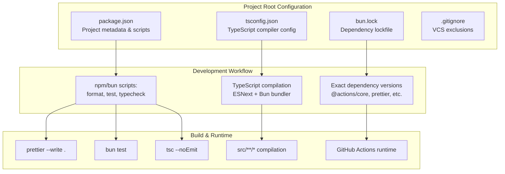
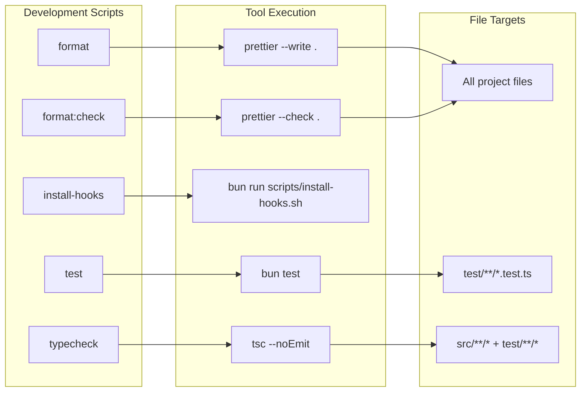
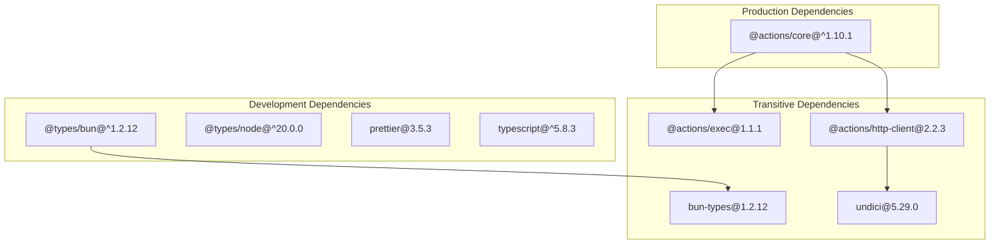
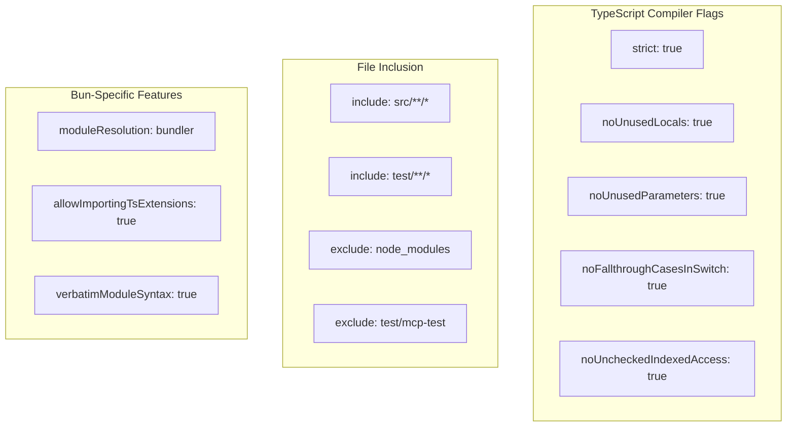
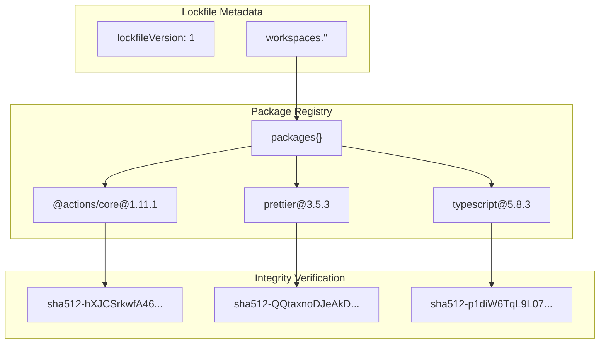
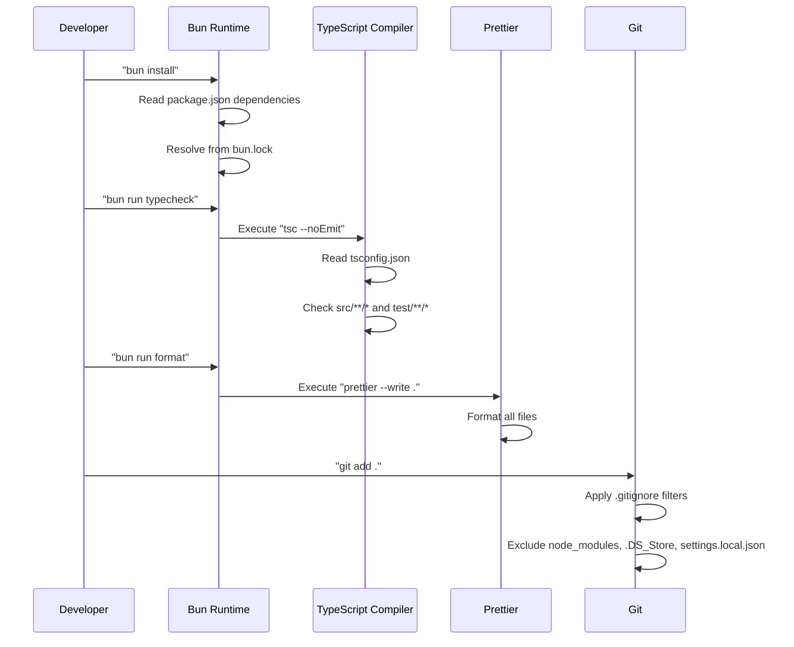

<!-- source: DeepWiki mcp.deepwiki.com · repo anthropics/claude-code-base-action · page 7.2 Project Configuration · fetched 2026-10-26 -->

# Project Configuration

Relevant source files

The following files were used as context for generating this wiki page:

- [.gitignore](.gitignore)
- [bun.lock](bun.lock)
- [package.json](package.json)
- [tsconfig.json](tsconfig.json)

This document provides a comprehensive reference for the project configuration files that control the build system, development environment, and dependencies for the claude-code-base-action GitHub Action. This covers the Node.js/Bun project setup, TypeScript compilation settings, dependency management, and development tooling.

For information about configuring the GitHub Action itself (inputs, authentication, settings), see [Action Configuration](#3). For environment variable configuration, see [Environment Variables](#7.1).

## Configuration File Overview

The project uses several configuration files that work together to define the development environment, build process, and runtime dependencies:

Sources: [package.json:1-21](), [tsconfig.json:1-30](), [bun.lock:1-44](), [.gitignore:1-5]()

## Package Configuration

The `package.json` defines the project as a private npm package with Bun runtime support:

| Property | Value | Purpose |
|----------|-------|---------|
| `name` | `@anthropic-ai/claude-code-base-action` | Package identifier |
| `version` | `1.0.0` | Semantic version |
| `private` | `true` | Prevents accidental publishing |

### Development Scripts

Sources: [package.json:5-10]()

### Dependency Structure

The project maintains a minimal dependency footprint with clear separation between production and development dependencies:

Sources: [package.json:12-20](), [bun.lock:17-42]()

## TypeScript Configuration

The `tsconfig.json` is optimized for Bun's bundler mode with strict type checking:

### Compilation Settings

| Setting | Value | Purpose |
|---------|--------|---------|
| `target` | `ESNext` | Latest JavaScript features |
| `module` | `ESNext` | ES modules |
| `moduleResolution` | `bundler` | Bun-specific resolution |
| `noEmit` | `true` | Type checking only |

### Strict Type Checking

The configuration enforces strict TypeScript rules:

Sources: [tsconfig.json:2-29]()

## Dependency Lockfile

The `bun.lock` file ensures reproducible builds by pinning exact dependency versions:

### Lock Structure

Sources: [bun.lock:1-44]()

## Version Control Configuration

The `.gitignore` file excludes generated files and local configurations:

| Pattern | Purpose |
|---------|---------|
| `.DS_Store` | macOS filesystem metadata |
| `node_modules` | npm/bun dependency directory |
| `**/.claude/settings.local.json` | Local Claude settings override |

The exclusion of `**/.claude/settings.local.json` is particularly important as this prevents local Claude Code settings from being committed to version control, allowing developers to maintain different local configurations.

Sources: [.gitignore:1-5]()

## Configuration Interaction Flow

Sources: [package.json:5-10](), [tsconfig.json:28-29](), [.gitignore:1-5]()