# Page: Overview

# Overview

<details>
<summary>Relevant source files</summary>

The following files were used as context for generating this wiki page:

- [MIRROR_DISCLAIMER.md](MIRROR_DISCLAIMER.md)
- [README.md](README.md)
- [action.yml](action.yml)

</details>


This document provides a high-level overview of the `claude-code-base-action` GitHub Action, which enables integration of Anthropic's Claude AI into GitHub Actions workflows. The action serves as a wrapper that orchestrates the execution of Claude Code within the GitHub Actions environment, handling authentication, configuration management, and output processing.

For detailed configuration options, see [Action Configuration](#3). For implementation specifics, see [Implementation Details](#4). For practical examples, see [Usage Examples](#5).

## Purpose and Architecture

The `claude-code-base-action` is a composite GitHub Action that provides a bridge between GitHub's workflow automation platform and Claude Code's AI capabilities. The action handles the complete lifecycle from environment setup to result processing, supporting multiple authentication providers and extensive configuration options.

### System Architecture

The action follows a multi-stage composite pattern that orchestrates several distinct phases:

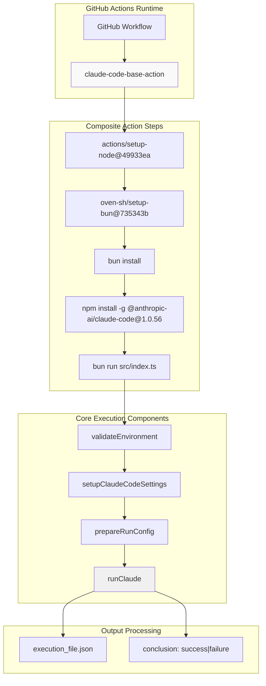

**Sources:** [action.yml:96-167](), [README.md:12-16]()

### Authentication Provider Architecture

The action supports multiple authentication mechanisms with mutual exclusion validation:

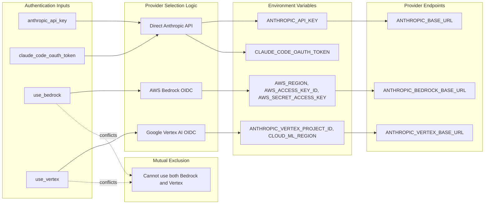

**Sources:** [action.yml:65-81](), [action.yml:147-166](), [README.md:398-454]()

## Core Execution Flow

The action's main execution occurs through the `src/index.ts` entry point, which coordinates several key processes:

### Configuration Management

The action processes multiple configuration sources in a specific order:

| Configuration Type | Input Parameter | Environment Variable | Processing Function |
|-------------------|----------------|---------------------|-------------------|
| Claude Settings | `settings` | `INPUT_SETTINGS` | `setupClaudeCodeSettings` |
| MCP Configuration | `mcp_config` | `INPUT_MCP_CONFIG` | (processed in settings) |
| Environment Variables | `claude_env` | `INPUT_CLAUDE_ENV` | YAML parsing |
| System Prompts | `system_prompt`, `append_system_prompt` | `INPUT_SYSTEM_PROMPT`, `INPUT_APPEND_SYSTEM_PROMPT` | Direct assignment |

**Sources:** [action.yml:29-57](), [action.yml:130-145]()

### Key Components and Their Roles

The action architecture centers around several core functions that map to specific responsibilities:

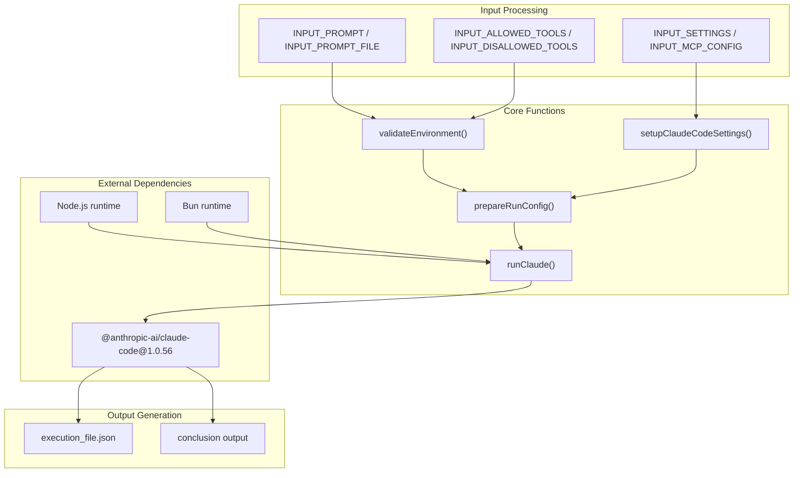

**Sources:** [action.yml:116-129](), [action.yml:88-94]()

### Environment Variable Processing

The action implements a comprehensive environment variable system that bridges GitHub Actions inputs to Claude Code execution context:

| Category | Key Variables | Purpose |
|----------|--------------|---------|
| Model Configuration | `ANTHROPIC_MODEL`, `INPUT_FALLBACK_MODEL` | Claude model selection |
| Tool Control | `INPUT_ALLOWED_TOOLS`, `INPUT_DISALLOWED_TOOLS` | Tool permission management |
| Execution Control | `INPUT_MAX_TURNS`, `INPUT_TIMEOUT_MINUTES` | Runtime constraints |
| Provider Flags | `CLAUDE_CODE_USE_BEDROCK`, `CLAUDE_CODE_USE_VERTEX` | Authentication provider selection |

**Sources:** [action.yml:131-154]()

### Runtime Dependencies

The action orchestrates several runtime dependencies through its composite structure:

- **Node.js Runtime**: Managed via `actions/setup-node@49933ea5288caeca8642d1e84afbd3f7d6820020`
- **Bun Runtime**: Managed via `oven-sh/setup-bun@735343b667d3e6f658f44d0eca948eb6282f2b76`  
- **Claude Code CLI**: Installed as `@anthropic-ai/claude-code@1.0.56`
- **Action Dependencies**: Installed via `bun install` from the action's directory

**Sources:** [action.yml:99-118]()

This architecture enables the action to serve as a robust integration point between GitHub's automation platform and Claude's AI capabilities, while maintaining security, configurability, and extensibility across multiple cloud providers.

---

# Page: Getting Started

# Getting Started

<details>
<summary>Relevant source files</summary>

The following files were used as context for generating this wiki page:

- [MIRROR_DISCLAIMER.md](MIRROR_DISCLAIMER.md)
- [README.md](README.md)
- [action.yml](action.yml)

</details>


This document provides a quick start guide for integrating the claude-code-base-action into your GitHub workflows. It covers the basic setup process, essential configuration options, and minimal working examples to get you running Claude Code in your CI/CD pipeline.

For comprehensive configuration details, see [Action Configuration](#3). For real-world usage scenarios, see [Usage Examples](#5).

## Prerequisites

Before using this action, ensure you have:

- A GitHub repository with Actions enabled
- An Anthropic API key or Claude Code OAuth token stored as a repository secret
- Basic familiarity with GitHub Actions workflow syntax

## Quick Setup

The simplest way to run Claude Code in your workflow is with a direct prompt and API key authentication:

```yaml
- name: "Run Claude Code"
  uses: anthropics/claude-code-base-action@beta
  with:
    prompt: "Review the codebase and suggest improvements"
    anthropic_api_key: ${{ secrets.ANTHROPIC_API_KEY }}
```

This minimal configuration will execute Claude Code with default settings in your repository context.

**Sources:** [action.yml:22-29](), [README.md:22-29]()

## Action Execution Flow

The following diagram shows how the GitHub Action orchestrates Claude Code execution:

**GitHub Action Composite Steps Flow**

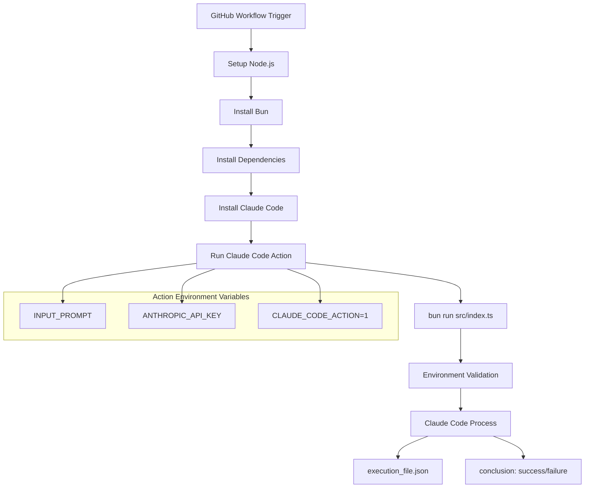

**Sources:** [action.yml:96-167](), [action.yml:120-129]()

## Input Configuration Mapping

This diagram shows how GitHub Action inputs map to internal environment variables:

**Input to Environment Variable Mapping**

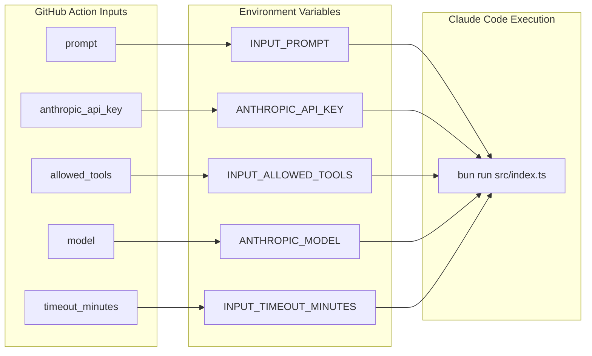

**Sources:** [action.yml:130-167](), [action.yml:7-86]()

## Essential Inputs

The most commonly used action inputs are:

| Input | Purpose | Example Value |
|-------|---------|---------------|
| `prompt` | Direct text prompt for Claude | `"Review this pull request"` |
| `prompt_file` | Path to prompt file | `".github/prompts/review.txt"` |
| `anthropic_api_key` | Anthropic API authentication | `${{ secrets.ANTHROPIC_API_KEY }}` |
| `allowed_tools` | Restrict tool usage | `"Bash(git:*),View,GlobTool"` |
| `model` | Specify Claude model | `"claude-3-7-sonnet-20250219"` |
| `timeout_minutes` | Execution timeout | `"15"` |

**Sources:** [action.yml:7-86](), [README.md:98-121]()

## Authentication Options

The action supports multiple authentication methods:

```yaml
# Option 1: Anthropic API Key (most common)
- uses: anthropics/claude-code-base-action@beta
  with:
    prompt: "Your task here"
    anthropic_api_key: ${{ secrets.ANTHROPIC_API_KEY }}

# Option 2: OAuth Token
- uses: anthropics/claude-code-base-action@beta
  with:
    prompt: "Your task here"
    claude_code_oauth_token: ${{ secrets.CLAUDE_CODE_OAUTH_TOKEN }}

# Option 3: AWS Bedrock (requires OIDC setup)
- uses: anthropics/claude-code-base-action@beta
  with:
    prompt: "Your task here"
    use_bedrock: "true"
    model: "anthropic.claude-3-7-sonnet-20250219-v1:0"
```

**Sources:** [action.yml:65-81](), [README.md:400-454]()

## Working with Outputs

The action provides two key outputs for workflow integration:

```yaml
- name: "Run Claude Code"
  id: claude_step
  uses: anthropics/claude-code-base-action@beta
  with:
    prompt: "Analyze the codebase"
    anthropic_api_key: ${{ secrets.ANTHROPIC_API_KEY }}

- name: "Check Result"
  if: steps.claude_step.outputs.conclusion == 'success'
  run: |
    echo "Claude execution completed successfully"
    cat "${{ steps.claude_step.outputs.execution_file }}"
```

The `execution_file` output contains the complete JSON conversation log, while `conclusion` indicates success or failure status.

**Sources:** [action.yml:88-94](), [README.md:123-128]()

## Basic Workflow Example

Here's a complete minimal workflow file:

```yaml
name: "Claude Code Review"
on:
  pull_request:
    types: [opened, synchronize]

jobs:
  review:
    runs-on: ubuntu-latest
    steps:
      - name: "Checkout"
        uses: actions/checkout@v4
        
      - name: "Run Claude Review"
        uses: anthropics/claude-code-base-action@beta
        with:
          prompt: "Review the changes in this pull request for code quality issues"
          allowed_tools: "Bash(git:*),View,GlobTool,GrepTool"
          anthropic_api_key: ${{ secrets.ANTHROPIC_API_KEY }}
          timeout_minutes: "10"
```

**Sources:** [README.md:341-395]()

## Next Steps

Once you have the basic action running:

1. **Configure Advanced Options** - See [Action Configuration](#3) for detailed input/output reference and authentication methods
2. **Add Tool Restrictions** - Use `allowed_tools` and `disallowed_tools` to control Claude's capabilities
3. **Integrate with Workflows** - Use the `conclusion` and `execution_file` outputs in subsequent steps
4. **Explore Examples** - Check [Usage Examples](#5) for real-world implementation patterns

For local development and testing, see [Development Guide](#6).

**Sources:** [README.md:1-535](), [action.yml:1-167]()

---

# Page: Action Configuration

# Action Configuration

<details>
<summary>Relevant source files</summary>

The following files were used as context for generating this wiki page:

- [action.yml](action.yml)

</details>


This document provides a comprehensive guide to configuring the `claude-code-base-action` GitHub Action. It covers all available inputs, outputs, and configuration options, showing how to customize the action's behavior for different use cases and authentication methods.

For specific details about individual inputs and outputs, see [Inputs and Outputs](#3.1). For authentication setup, see [Authentication Methods](#3.2). For advanced configuration including Claude Code settings and MCP servers, see [Settings and MCP Configuration](#3.3).

## Configuration Overview

The action accepts configuration through GitHub Action inputs defined in `action.yml`, which are then mapped to environment variables and passed to the underlying Claude Code execution system. The configuration system supports multiple authentication providers, flexible prompt handling, tool restrictions, and custom environment setup.

## Configuration Flow

The following diagram shows how configuration flows from GitHub workflow inputs through the action's internal systems:

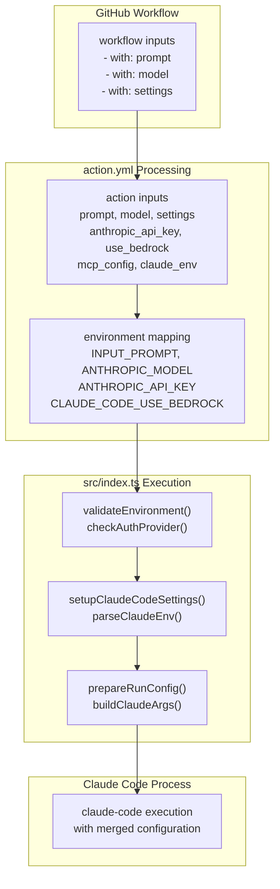

**Sources:** [action.yml:7-167]()

## Configuration Categories

The action's configuration is organized into several categories, each serving different aspects of the execution:

| Category | Purpose | Key Inputs |
|----------|---------|------------|
| **Prompt Configuration** | Define the task for Claude | `prompt`, `prompt_file`, `system_prompt`, `append_system_prompt` |
| **Model Configuration** | Control which AI model to use | `model`, `fallback_model` |
| **Tool Configuration** | Control Claude's available capabilities | `allowed_tools`, `disallowed_tools` |
| **Authentication** | Configure API access | `anthropic_api_key`, `use_bedrock`, `use_vertex` |
| **Execution Control** | Control runtime behavior | `timeout_minutes`, `max_turns` |
| **Advanced Configuration** | Custom settings and environment | `settings`, `mcp_config`, `claude_env` |

**Sources:** [action.yml:8-86]()

## Input Processing Architecture

This diagram shows how the action processes and validates different types of configuration inputs:

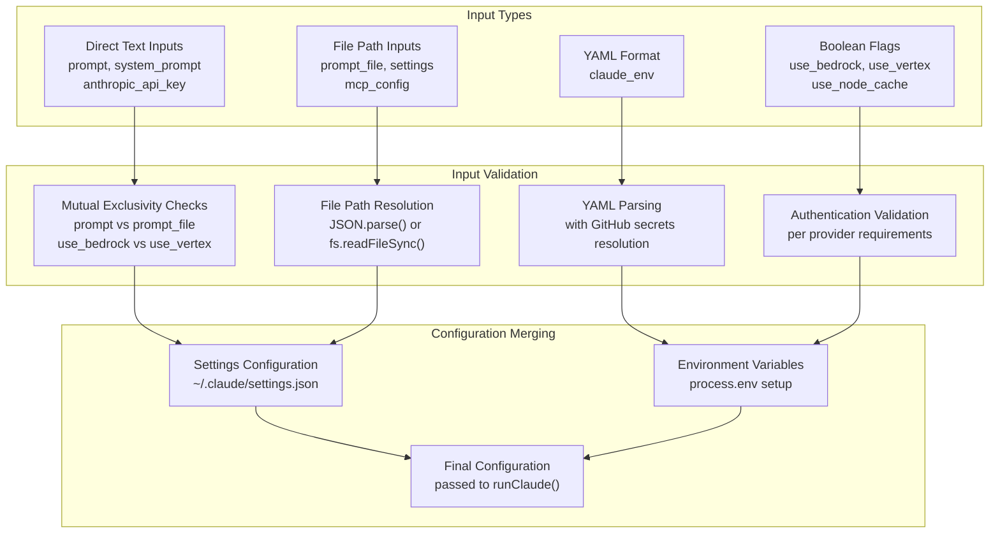

**Sources:** [action.yml:8-86]()

## Action Outputs

The action provides two primary outputs that workflows can access:

| Output | Description | Value Source |
|--------|-------------|--------------|
| `conclusion` | Execution status | `${{ steps.run_claude.outputs.conclusion }}` - either `'success'` or `'failure'` |
| `execution_file` | Path to execution log | `${{ steps.run_claude.outputs.execution_file }}` - JSON file with detailed execution data |

These outputs are generated by the `run_claude` step and can be used by subsequent workflow steps for conditional logic or artifact collection.

**Sources:** [action.yml:88-94]()

## Composite Action Structure  

The action uses GitHub's composite action pattern with the following execution steps:

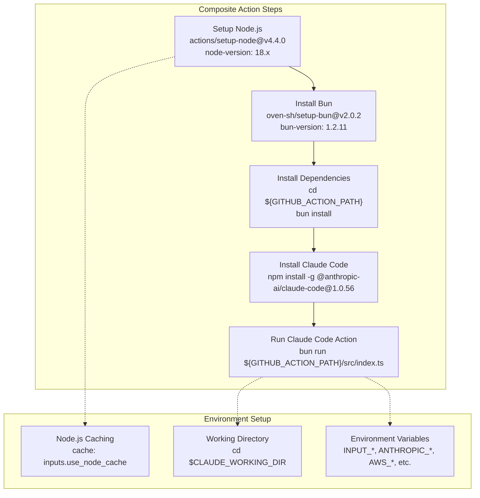

**Sources:** [action.yml:96-167]()

## Environment Variable Mapping

The action maps GitHub Action inputs to environment variables that the TypeScript execution code can access:

| Input Category | GitHub Input | Environment Variable |
|----------------|--------------|---------------------|
| **Prompt Configuration** | `prompt` | `INPUT_PROMPT` |
| **Model Configuration** | `model` | `ANTHROPIC_MODEL` |
| **Authentication** | `anthropic_api_key` | `ANTHROPIC_API_KEY` |
| **Provider Flags** | `use_bedrock` | `CLAUDE_CODE_USE_BEDROCK` |
| **Advanced Config** | `settings` | `INPUT_SETTINGS` |
| **Custom Environment** | `claude_env` | `INPUT_CLAUDE_ENV` |

The environment variable mapping follows a consistent pattern where action inputs are prefixed with `INPUT_` while provider-specific variables use their standard names (e.g., `ANTHROPIC_API_KEY`, `AWS_REGION`).

**Sources:** [action.yml:130-167]()

---

# Page: Inputs and Outputs

# Inputs and Outputs

<details>
<summary>Relevant source files</summary>

The following files were used as context for generating this wiki page:

- [MIRROR_DISCLAIMER.md](MIRROR_DISCLAIMER.md)
- [README.md](README.md)
- [action.yml](action.yml)

</details>


This document provides a detailed reference for all input parameters and output values supported by the claude-code-base-action GitHub Action. These parameters allow you to configure how Claude Code is executed within your GitHub workflows and retrieve the results of the execution.

For information about authentication methods, see [Authentication Methods](#3.2). For MCP configuration details, see [MCP Configuration](#3.3).

## Input Parameters

The claude-code-base-action accepts the following input parameters to configure its behavior:

```mermaid
flowchart TD
  subgraph InputParameters["Input Parameters"]
    direction TB
    subgraph PromptConfiguration["Prompt Configuration"]
      direction TB
      prompt[prompt]
      prompt_file[prompt_file]
    end
    subgraph ToolConfiguration["Tool Configuration"]
      direction TB
      allowed_tools[allowed_tools]
      disallowed_tools[disallowed_tools]
      mcp_config[mcp_config]
    end
    subgraph ModelConfiguration["Model Configuration"]
      direction TB
      anthropic_model[anthropic_model]
    end
    subgraph ExecutionConfiguration["Execution Configuration"]
      direction TB
      max_turns[max_turns]
      timeout_minutes[timeout_minutes]
      use_node_cache[use_node_cache]
    end
    subgraph AuthenticationConfiguration["Authentication Configuration"]
      direction TB
      anthropic_api_key[anthropic_api_key]
      use_bedrock[use_bedrock]
      use_vertex[use_vertex]
    end
  end

```

Sources: [action.yml:7-61](), [README.md:38-54]()

### Prompt Configuration

| Parameter | Description | Required | Default | Notes |
|-----------|-------------|----------|---------|-------|
| `prompt` | The prompt to send to Claude Code | No* | `""` | Mutually exclusive with `prompt_file` |
| `prompt_file` | Path to a file containing the prompt to send to Claude Code | No* | `""` | Mutually exclusive with `prompt` |

*Either `prompt` or `prompt_file` must be provided, but not both.

The prompt is the primary instruction given to Claude Code for analysis or task execution. You can provide it either inline in your workflow file using the `prompt` parameter or reference an external file using the `prompt_file` parameter.

Sources: [action.yml:9-16](), [README.md:42-43]()

### Tool Configuration

| Parameter | Description | Required | Default | Notes |
|-----------|-------------|----------|---------|-------|
| `allowed_tools` | Comma-separated list of allowed tools for Claude Code to use | No | `""` | Example: `"Bash(git:*),View,GlobTool"` |
| `disallowed_tools` | Comma-separated list of disallowed tools that Claude Code cannot use | No | `""` | Overrides `allowed_tools` when both are specified |
| `mcp_config` | MCP configuration as JSON string or path to MCP configuration JSON file | No | `""` | Used for custom MCP server configuration |

Tools determine what capabilities Claude Code can use to interact with your repository. Common tools include:
- `Bash`: Execute shell commands (can be scoped, e.g., `Bash(git:*)`)
- `View`: Read file contents
- `GlobTool`: Find files using glob patterns
- `GrepTool`: Search file contents
- `BatchTool`: Process files in batches
- `Write`: Write to files

Custom MCP tools follow the format `mcp__server-name__tool_name`.

Sources: [action.yml:17-32](), [README.md:44-47]()

### Model Configuration

| Parameter | Description | Required | Default | Notes |
|-----------|-------------|----------|---------|-------|
| `model` | Model to use | No | - | Provider-specific format required for Bedrock/Vertex |
| `anthropic_model` | DEPRECATED: Use 'model' instead | No | - | Maintained for backwards compatibility |
| `fallback_model` | Enable automatic fallback to specified model when default model is unavailable | No | `""` | Used for handling API errors/overload |

The model name format depends on the provider:
- Direct Anthropic API: `"claude-3-7-sonnet-20250219"` 
- AWS Bedrock: `"anthropic.claude-3-7-sonnet-20250219-v1:0"`
- Google Vertex AI: `"claude-3-7-sonnet@20250219"`

Sources: [action.yml:45-53](), [README.md:111-113]()

### Execution Configuration

| Parameter | Description | Required | Default | Notes |
|-----------|-------------|----------|---------|-------|
| `max_turns` | Maximum number of conversation turns | No | No limit | Limits the back-and-forth between the action and Claude |
| `timeout_minutes` | Timeout in minutes for Claude Code execution | No | `"10"` | Terminates execution if it exceeds this duration |
| `use_node_cache` | Whether to use Node.js dependency caching | No | `"false"` | Set to `"true"` only for Node.js projects with lock files |

Sources: [action.yml:25-29](), [action.yml:39-42](), [action.yml:58-61](), [README.md:46-49](), [README.md:53]()

### Authentication Configuration

| Parameter | Description | Required | Default | Notes |
|-----------|-------------|----------|---------|-------|
| `anthropic_api_key` | Anthropic API key | No* | `""` | Required for direct Anthropic API |
| `use_bedrock` | Use Amazon Bedrock with OIDC authentication | No | `"false"` | Mutually exclusive with direct API and Vertex |
| `use_vertex` | Use Google Vertex AI with OIDC authentication | No | `"false"` | Mutually exclusive with direct API and Bedrock |

*Required only if using direct Anthropic API (not using Bedrock or Vertex).

For OIDC authentication with AWS Bedrock or Google Vertex AI, additional setup steps are required before using this action. See [Authentication Methods](#3.2) for details.

Sources: [action.yml:45-56](), [README.md:50-52]()

## Input Parameter Mapping

The following diagram shows how input parameters are mapped to environment variables used by the action:

```mermaid
flowchart TD
    subgraph GitHub_Workflow["GitHub Workflow"]
        subgraph Action_Inputs["Action Inputs"]
            i_prompt["prompt"]
            i_prompt_file["prompt_file"]
            i_allowed_tools["allowed_tools"]
            i_disallowed_tools["disallowed_tools"]
            i_max_turns["max_turns"]
            i_mcp_config["mcp_config"]
            i_anthropic_model["anthropic_model"]
            i_timeout_minutes["timeout_minutes"]
            i_anthropic_api_key["anthropic_api_key"]
            i_use_bedrock["use_bedrock"]
            i_use_vertex["use_vertex"]
        end
    end

    subgraph Environment_Variables["Environment Variables"]
        e_prompt["INPUT_PROMPT"]
        e_prompt_file["INPUT_PROMPT_FILE"]
        e_allowed_tools["INPUT_ALLOWED_TOOLS"]
        e_disallowed_tools["INPUT_DISALLOWED_TOOLS"]
        e_max_turns["INPUT_MAX_TURNS"]
        e_mcp_config["INPUT_MCP_CONFIG"]
        e_anthropic_model["ANTHROPIC_MODEL"]
        e_timeout_minutes["INPUT_TIMEOUT_MINUTES"]
        e_anthropic_api_key["ANTHROPIC_API_KEY"]
        e_use_bedrock["CLAUDE_CODE_USE_BEDROCK"]
        e_use_vertex["CLAUDE_CODE_USE_VERTEX"]
    end

    i_prompt --> e_prompt
    i_prompt_file --> e_prompt_file
    i_allowed_tools --> e_allowed_tools
    i_disallowed_tools --> e_disallowed_tools
    i_max_turns --> e_max_turns
    i_mcp_config --> e_mcp_config
    i_anthropic_model --> e_anthropic_model
    i_timeout_minutes --> e_timeout_minutes
    i_anthropic_api_key --> e_anthropic_api_key
    i_use_bedrock --> e_use_bedrock
    i_use_vertex --> e_use_vertex

```

Sources: [action.yml:96-129]()

### Configuration and Environment

| Parameter | Description | Required | Default | Notes |
|-----------|-------------|----------|---------|-------|
| `settings` | Claude Code settings as JSON string or path to settings JSON file | No | `""` | Configures Claude Code behavior |
| `system_prompt` | Override system prompt | No | `""` | Replaces the default system prompt |
| `append_system_prompt` | Append to system prompt | No | `""` | Adds to the default system prompt |
| `claude_env` | Custom environment variables to pass to Claude Code execution (YAML multiline format) | No | `""` | YAML key-value pairs |

### Execution Configuration

| Parameter | Description | Required | Default | Notes |
|-----------|-------------|----------|---------|-------|
| `max_turns` | Maximum number of conversation turns | No | No limit | Limits the back-and-forth between the action and Claude |
| `timeout_minutes` | Timeout in minutes for Claude Code execution | No | `"10"` | Terminates execution if it exceeds this duration |
| `use_node_cache` | Whether to use Node.js dependency caching | No | `"false"` | Set to `"true"` only for Node.js projects with lock files |

Sources: [action.yml:25-28](), [action.yml:33-57](), [action.yml:60-63](), [action.yml:83-86](), [README.md:107-114]()

## Input Parameter Mapping to Environment Variables

The following diagram shows how action inputs are mapped to environment variables in the composite action execution environment:

```mermaid
flowchart TD
    subgraph Action_Inputs["GitHub Action Inputs"]
        i_prompt["prompt"]
        i_prompt_file["prompt_file"]
        i_allowed_tools["allowed_tools"]
        i_disallowed_tools["disallowed_tools"]
        i_max_turns["max_turns"]
        i_mcp_config["mcp_config"]
        i_settings["settings"]
        i_system_prompt["system_prompt"]
        i_append_system_prompt["append_system_prompt"]
        i_model["model"]
        i_anthropic_model["anthropic_model"]
        i_fallback_model["fallback_model"]
        i_claude_env["claude_env"]
        i_timeout_minutes["timeout_minutes"]
        i_anthropic_api_key["anthropic_api_key"]
        i_claude_code_oauth_token["claude_code_oauth_token"]
        i_use_bedrock["use_bedrock"]
        i_use_vertex["use_vertex"]
    end

    subgraph Composite_Action_Environment["Composite Action Environment Variables"]
        e_prompt["INPUT_PROMPT"]
        e_prompt_file["INPUT_PROMPT_FILE"]
        e_allowed_tools["INPUT_ALLOWED_TOOLS"]
        e_disallowed_tools["INPUT_DISALLOWED_TOOLS"]
        e_max_turns["INPUT_MAX_TURNS"]
        e_mcp_config["INPUT_MCP_CONFIG"]
        e_settings["INPUT_SETTINGS"]
        e_system_prompt["INPUT_SYSTEM_PROMPT"]
        e_append_system_prompt["INPUT_APPEND_SYSTEM_PROMPT"]
        e_anthropic_model["ANTHROPIC_MODEL"]
        e_fallback_model["INPUT_FALLBACK_MODEL"]
        e_claude_env["INPUT_CLAUDE_ENV"]
        e_timeout_minutes["INPUT_TIMEOUT_MINUTES"]
        e_anthropic_api_key["ANTHROPIC_API_KEY"]
        e_claude_code_oauth_token["CLAUDE_CODE_OAUTH_TOKEN"]
        e_use_bedrock["CLAUDE_CODE_USE_BEDROCK"]
        e_use_vertex["CLAUDE_CODE_USE_VERTEX"]
    end

    i_prompt --> e_prompt
    i_prompt_file --> e_prompt_file
    i_allowed_tools --> e_allowed_tools
    i_disallowed_tools --> e_disallowed_tools
    i_max_turns --> e_max_turns
    i_mcp_config --> e_mcp_config
    i_settings --> e_settings
    i_system_prompt --> e_system_prompt
    i_append_system_prompt --> e_append_system_prompt
    i_model --> e_anthropic_model
    i_anthropic_model --> e_anthropic_model
    i_fallback_model --> e_fallback_model
    i_claude_env --> e_claude_env
    i_timeout_minutes --> e_timeout_minutes
    i_anthropic_api_key --> e_anthropic_api_key
    i_claude_code_oauth_token --> e_claude_code_oauth_token
    i_use_bedrock --> e_use_bedrock
    i_use_vertex --> e_use_vertex
```

Note that both `model` and `anthropic_model` inputs map to the same `ANTHROPIC_MODEL` environment variable, with `model` taking precedence when both are provided.

Sources: [action.yml:130-167]()
</old_str>

<old_str>
## Output Parameters

The claude-code-base-action produces the following outputs after execution:

| Parameter | Description | Access Pattern |
|-----------|-------------|----------------|
| `conclusion` | Execution status of Claude Code ('success' or 'failure') | `${{ steps.<step-id>.outputs.conclusion }}` |
| `execution_file` | Path to the JSON file containing Claude Code execution log | `${{ steps.<step-id>.outputs.execution_file }}` |

The `execution_file` output contains a JSON representation of the entire conversation between your workflow and Claude, including all messages and tool executions. This file can be read and processed in subsequent steps of your workflow.

Sources: [action.yml:63-69](), [README.md:57-62]()
</old_str>
<new_str>
## Output Parameters

The claude-code-base-action produces the following outputs after execution:

### Action Outputs Reference

| Parameter | Description | Access Pattern | Source Step |
|-----------|-------------|----------------|-------------|
| `conclusion` | Execution status of Claude Code ('success' or 'failure') | `${{ steps.<step-id>.outputs.conclusion }}` | `steps.run_claude.outputs.conclusion` |
| `execution_file` | Path to the JSON file containing Claude Code execution log | `${{ steps.<step-id>.outputs.execution_file }}` | `steps.run_claude.outputs.execution_file` |

### Output Value Mapping

The outputs are generated by the `run_claude` composite action step and mapped as follows:

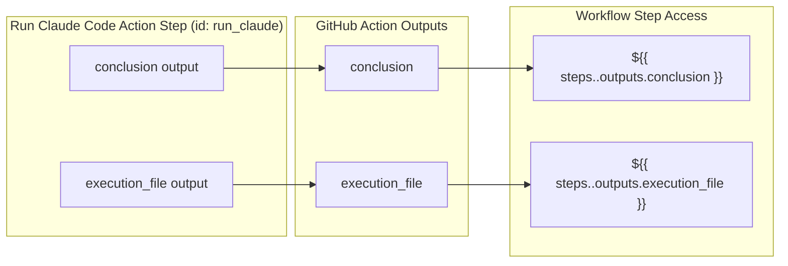

The `execution_file` output contains a JSON representation of the entire conversation between your workflow and Claude, including all messages and tool executions. This file can be read and processed in subsequent steps of your workflow.

Sources: [action.yml:88-94](), [action.yml:120-122](), [README.md:125-128]()

## Usage Examples

### Basic Usage with Direct Prompt

```yaml
- name: Run Claude Code with direct prompt
  id: claude-analysis
  uses: anthropics/claude-code-base-action@beta
  with:
    prompt: "Analyze the codebase for security vulnerabilities"
    allowed_tools: "Bash(git:*),View,GlobTool,GrepTool"
    anthropic_api_key: ${{ secrets.ANTHROPIC_API_KEY }}
```

### Using a Prompt File

```yaml
- name: Run Claude Code with prompt file
  id: claude-analysis
  uses: anthropics/claude-code-base-action@beta
  with:
    prompt_file: ".github/prompts/security-analysis.txt"
    allowed_tools: "Bash(git:*),View,GlobTool,GrepTool"
    anthropic_api_key: ${{ secrets.ANTHROPIC_API_KEY }}
```

### Limiting Conversation Turns

```yaml
- name: Run Claude Code with limited turns
  id: claude-analysis
  uses: anthropics/claude-code-base-action@beta
  with:
    prompt: "Analyze the codebase for security vulnerabilities"
    allowed_tools: "Bash(git:*),View,GlobTool,GrepTool"
    max_turns: "5"
    anthropic_api_key: ${{ secrets.ANTHROPIC_API_KEY }}
```

### Accessing and Using Outputs

```yaml
- name: Run Claude Code
  id: claude-analysis
  uses: anthropics/claude-code-base-action@beta
  with:
    prompt: "Analyze the codebase for security vulnerabilities"
    allowed_tools: "Bash(git:*),View,GlobTool,GrepTool,Write"
    anthropic_api_key: ${{ secrets.ANTHROPIC_API_KEY }}

- name: Process Claude Analysis Results
  if: steps.claude-analysis.outputs.conclusion == 'success'
  uses: actions/github-script@v7
  with:
    github-token: ${{ secrets.GITHUB_TOKEN }}
    script: |
      const fs = require('fs');
      const executionFile = '${{ steps.claude-analysis.outputs.execution_file }}';
      const executionLog = JSON.parse(fs.readFileSync(executionFile, 'utf8'));
      
      // Process the execution log
      let analysis = '';
      for (let i = executionLog.length - 1; i >= 0; i--) {
        if (executionLog[i].role === 'assistant') {
          analysis = executionLog[i].content;
          break;
        }
      }
      
      // Create an issue with the analysis
      if (analysis) {
        github.rest.issues.create({
          owner: context.repo.owner,
          repo: context.repo.repo,
          title: 'Security Analysis Report',
          body: analysis
        });
      }
```

Sources: [README.md:7-36](), [README.md:109-164]()

## Best Practices

1. **Prompt Selection**: Choose between `prompt` and `prompt_file` based on complexity. Use `prompt_file` for longer or more complex prompts.

2. **Tool Configuration**: Only provide the minimum tools required for the task to limit Claude's capabilities.

3. **Timeout Management**: Set `timeout_minutes` appropriately for your use case. Complex analyses might need longer timeouts.

4. **Error Handling**: Always check the `conclusion` output before processing the execution log.

5. **Security**: Never hardcode API keys or credentials in your workflow files. Always use GitHub Secrets.

```yaml
# ✅ CORRECT - Uses GitHub secrets
anthropic_api_key: ${{ secrets.ANTHROPIC_API_KEY }}

# ❌ WRONG - Exposes your API key
anthropic_api_key: "sk-ant-..."
```

6. **Authentication Method Selection**: Choose the appropriate authentication method based on your requirements and existing infrastructure.

7. **Model Selection**: Use the correct model name format based on your chosen provider.

Sources: [README.md:264-298]()

---

# Page: Authentication Methods

# Authentication Methods

<details>
<summary>Relevant source files</summary>

The following files were used as context for generating this wiki page:

- [action.yml](action.yml)
- [src/validate-env.ts](src/validate-env.ts)
- [test/validate-env.test.ts](test/validate-env.test.ts)

</details>


This document covers the authentication methods supported by the claude-code-base-action GitHub Action. The action supports four authentication methods to access Claude AI models through different providers: direct Anthropic API with API key, direct Anthropic API with OAuth token, AWS Bedrock with OIDC authentication, and Google Vertex AI with OIDC authentication.

For configuration of other action settings like MCP servers and system prompts, see [Settings and MCP Configuration](#3.3). For complete input/output reference, see [Inputs and Outputs](#3.1).

## Overview

The claude-code-base-action supports multiple authentication providers to maximize flexibility across different deployment environments. Each method has specific requirements and use cases:

**Authentication Provider Decision Flow**

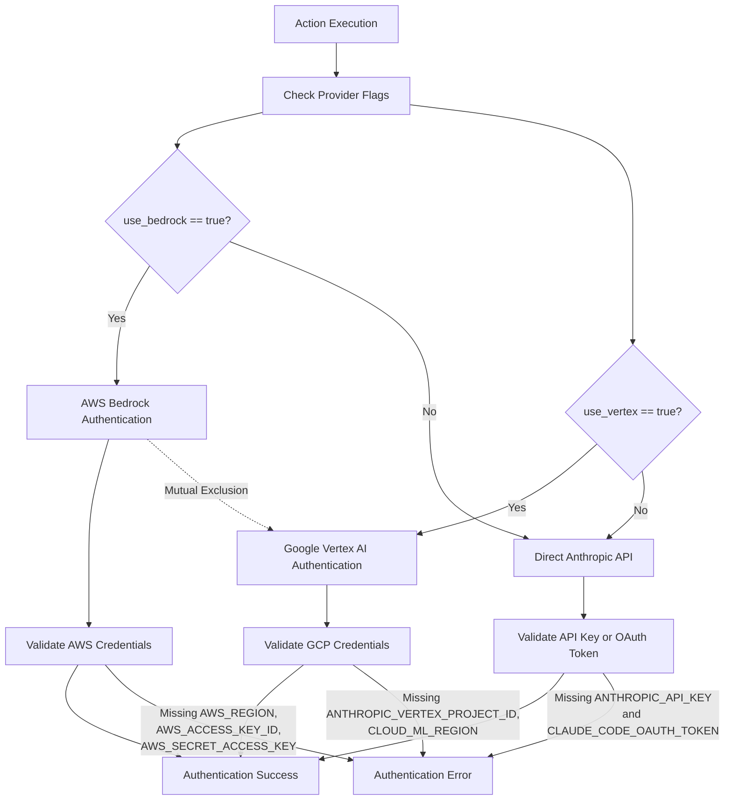

Sources: [action.yml:65-81](), [src/validate-env.ts:5-54]()

## Direct Anthropic API Authentication

The direct Anthropic API method supports two credential types: API keys and OAuth tokens. This is the default authentication method when neither `use_bedrock` nor `use_vertex` flags are set.

### API Key Authentication

Configure using the `anthropic_api_key` input:

```yaml
- uses: anthropics/claude-code-base-action@v1
  with:
    anthropic_api_key: ${{ secrets.ANTHROPIC_API_KEY }}
    prompt: "Analyze the codebase"
```

### OAuth Token Authentication

Configure using the `claude_code_oauth_token` input as an alternative to API keys:

```yaml
- uses: anthropics/claude-code-base-action@v1
  with:
    claude_code_oauth_token: ${{ secrets.CLAUDE_CODE_OAUTH_TOKEN }}
    prompt: "Analyze the codebase"
```

**Direct API Validation Logic**

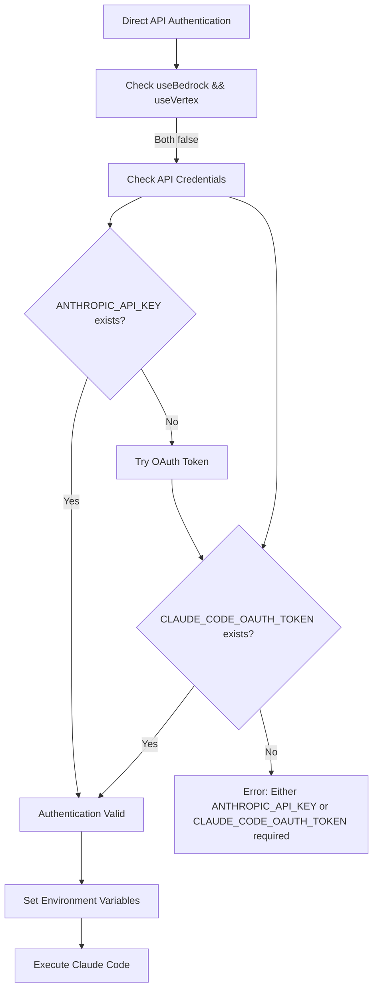

The validation logic is implemented in `validateEnvironmentVariables()` function which checks for either credential type when using direct API access.

Sources: [action.yml:66-73](), [src/validate-env.ts:19-24](), [test/validate-env.test.ts:32-44]()

## AWS Bedrock OIDC Authentication

AWS Bedrock authentication enables access to Claude models through Amazon Bedrock using OpenID Connect (OIDC) for secure, key-less authentication in GitHub Actions workflows.

### Configuration

Enable Bedrock authentication by setting `use_bedrock: true`:

```yaml
- uses: anthropics/claude-code-base-action@v1
  with:
    use_bedrock: true
    model: "anthropic.claude-3-5-sonnet-20241022-v2:0"  # Bedrock model format
    prompt: "Analyze the codebase"
  env:
    AWS_REGION: us-east-1
    # AWS credentials set via OIDC or long-term keys
```

### Required Environment Variables

| Variable | Description | Required |
|----------|-------------|----------|
| `AWS_REGION` | AWS region for Bedrock service | Yes |
| `AWS_ACCESS_KEY_ID` | AWS access key identifier | Yes |
| `AWS_SECRET_ACCESS_KEY` | AWS secret access key | Yes |
| `AWS_SESSION_TOKEN` | AWS session token | No |
| `ANTHROPIC_BEDROCK_BASE_URL` | Custom Bedrock endpoint URL | No |

**AWS Bedrock Environment Variable Flow**

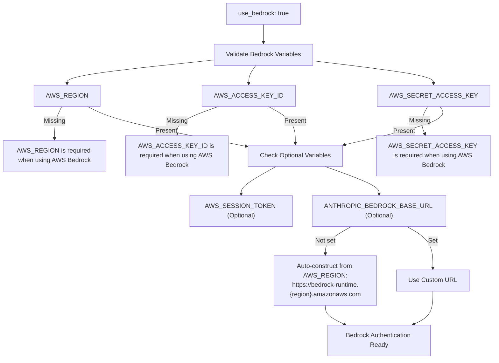

The action automatically constructs the Bedrock endpoint URL using the AWS region when `ANTHROPIC_BEDROCK_BASE_URL` is not explicitly provided.

Sources: [action.yml:74-77, 155-161](), [src/validate-env.ts:25-36](), [test/validate-env.test.ts:46-122]()

## Google Vertex AI OIDC Authentication

Google Vertex AI authentication provides access to Claude models through Google Cloud's Vertex AI platform using OIDC for secure authentication without long-term service account keys.

### Configuration

Enable Vertex AI authentication by setting `use_vertex: true`:

```yaml
- uses: anthropics/claude-code-base-action@v1
  with:
    use_vertex: true
    model: "claude-3-5-sonnet-v2@20241022"  # Vertex AI model format
    prompt: "Analyze the codebase"
  env:
    ANTHROPIC_VERTEX_PROJECT_ID: my-gcp-project
    CLOUD_ML_REGION: us-central1
```

### Required Environment Variables

| Variable | Description | Required |
|----------|-------------|----------|
| `ANTHROPIC_VERTEX_PROJECT_ID` | Google Cloud project ID | Yes |
| `CLOUD_ML_REGION` | Google Cloud ML region | Yes |
| `GOOGLE_APPLICATION_CREDENTIALS` | Path to service account credentials | No |
| `ANTHROPIC_VERTEX_BASE_URL` | Custom Vertex AI endpoint URL | No |

**Google Vertex AI Validation Flow**

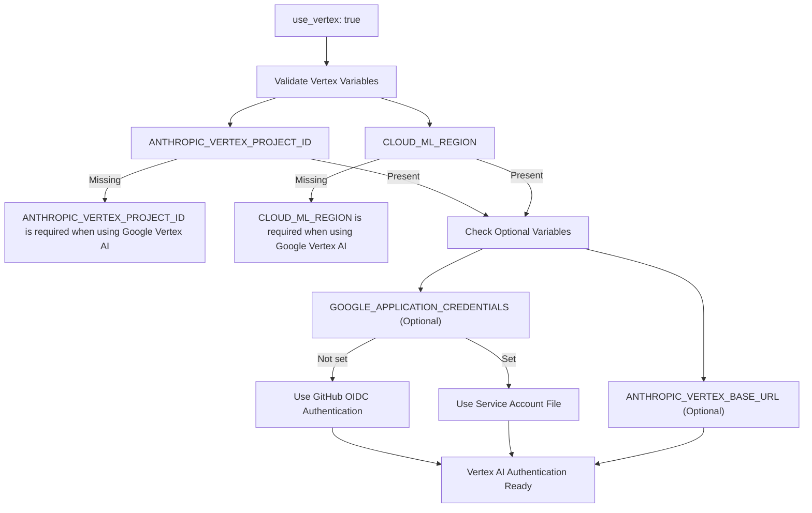

Sources: [action.yml:78-81, 162-167](), [src/validate-env.ts:37-48](), [test/validate-env.test.ts:124-168]()

## Authentication Validation and Mutual Exclusion

The action implements comprehensive validation to ensure proper authentication configuration and prevent conflicting provider settings.

### Validation Process

The `validateEnvironmentVariables()` function in `validate-env.ts` performs multi-step validation:

1. **Mutual Exclusion Check**: Prevents simultaneous use of Bedrock and Vertex AI
2. **Provider-Specific Validation**: Validates required variables for each provider
3. **Error Aggregation**: Collects and reports all validation errors together

**Complete Authentication Validation Logic**

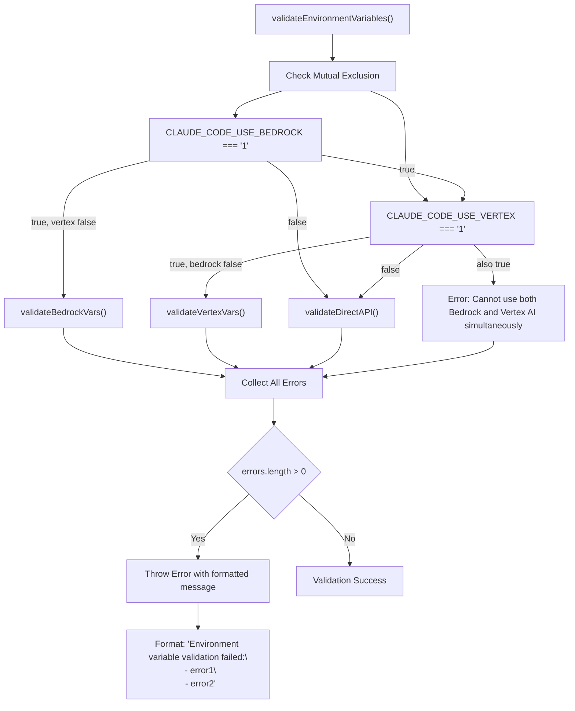

### Error Message Format

Validation errors are formatted with clear, actionable messages:

```
Environment variable validation failed:
  - AWS_REGION is required when using AWS Bedrock.
  - AWS_ACCESS_KEY_ID is required when using AWS Bedrock.
  - Cannot use both Bedrock and Vertex AI simultaneously. Please set only one provider.
```

Sources: [src/validate-env.ts:5-54](), [test/validate-env.test.ts:170-214]()

## Environment Variable Mapping

The action maps GitHub Action inputs to environment variables that are consumed by the Claude Code execution process:

| Input Parameter | Environment Variable | Provider |
|----------------|---------------------|----------|
| `anthropic_api_key` | `ANTHROPIC_API_KEY` | Direct API |
| `claude_code_oauth_token` | `CLAUDE_CODE_OAUTH_TOKEN` | Direct API |
| `use_bedrock` | `CLAUDE_CODE_USE_BEDROCK` | AWS Bedrock |
| `use_vertex` | `CLAUDE_CODE_USE_VERTEX` | Google Vertex |

Additional environment variables are inherited from the GitHub Actions environment for AWS and GCP configurations.

**Environment Variable Mapping in Action Execution**

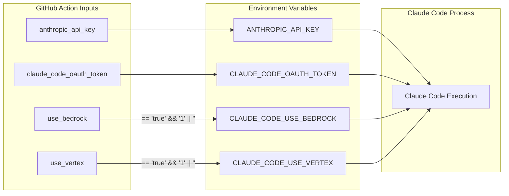

Note the special boolean conversion logic for provider flags: only string `"true"` values are converted to `"1"`, otherwise the environment variable is unset.

Sources: [action.yml:148-153](), [action.yml:120-167]()

---

# Page: Settings and MCP Configuration

# Settings and MCP Configuration

<details>
<summary>Relevant source files</summary>

The following files were used as context for generating this wiki page:

- [MIRROR_DISCLAIMER.md](MIRROR_DISCLAIMER.md)
- [README.md](README.md)
- [src/setup-claude-code-settings.ts](src/setup-claude-code-settings.ts)

</details>


This section covers the configuration systems that control Claude Code's behavior and capabilities within the GitHub Action. It explains how to configure Claude Code settings, MCP (Model Context Protocol) servers, environment variables, and system prompts through the action's inputs.

For authentication setup, see [Authentication Methods](#3.2). For complete input/output reference, see [Inputs and Outputs](#3.1).

## Settings Configuration System

The action supports Claude Code settings configuration through two methods: inline JSON strings or external configuration files. Settings control Claude Code's behavior, model selection, permissions, hooks, and other operational parameters.

### Settings Processing Flow

```mermaid
flowchart TD
    INPUT["`settings` input"] --> CHECK{"Is JSON string?"}
    CHECK -->|Yes| PARSE_JSON["Parse JSON directly"]
    CHECK -->|No| READ_FILE["Read from file path<br/>readFile(settingsInput)"]
    
    READ_FILE --> PARSE_FILE["Parse file content as JSON"]
    PARSE_JSON --> MERGE_SETTINGS["setupClaudeCodeSettings()"]
    PARSE_FILE --> MERGE_SETTINGS
    
    EXISTING["~/.claude/settings.json<br/>existing settings"] --> MERGE_SETTINGS
    MERGE_SETTINGS --> FORCE_MCP["settings.enableAllProjectMcpServers = true"]
    FORCE_MCP --> WRITE_SETTINGS["Write to ~/.claude/settings.json"]
    
    WRITE_SETTINGS --> CLAUDE_EXEC["Claude Code execution"]
```

Sources: [src/setup-claude-code-settings.ts:5-68](), [README.md:202-264]()

### Settings Configuration Methods

**Method 1: External Settings File**

```yaml
- name: Run Claude Code with settings file
  uses: anthropics/claude-code-base-action@beta
  with:
    settings: "path/to/settings.json"
    prompt: "Your prompt here"
```

**Method 2: Inline Settings JSON**

```yaml
- name: Run Claude Code with inline settings
  uses: anthropics/claude-code-base-action@beta
  with:
    settings: |
      {
        "model": "claude-opus-4-20250514",
        "env": {
          "DEBUG": "true"
        },
        "permissions": {
          "allow": ["Bash", "Read"],
          "deny": ["WebFetch"]
        }
      }
```

Sources: [README.md:206-262]()

### Settings Processing Implementation

The `setupClaudeCodeSettings` function handles all settings configuration:

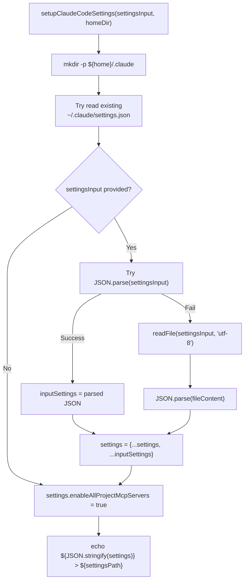

Sources: [src/setup-claude-code-settings.ts:5-68]()

## MCP Configuration System

MCP (Model Context Protocol) configuration enables Claude Code to interact with external services and tools through standardized server interfaces. The action supports both file-based and inline MCP configuration.

### MCP Configuration Structure

```mermaid
flowchart LR
    MCP_INPUT["`mcp_config` input"] --> PROCESS{"File path or JSON?"}
    PROCESS -->|File| READ_MCP_FILE["Read MCP config file"]
    PROCESS -->|JSON| PARSE_MCP_JSON["Parse inline JSON"]
    
    READ_MCP_FILE --> MCP_STRUCTURE["MCP Configuration Structure"]
    PARSE_MCP_JSON --> MCP_STRUCTURE
    
    MCP_STRUCTURE --> SERVERS["`mcpServers` object"]
    SERVERS --> SERVER_DEF["`server-name` definition"]
    SERVER_DEF --> COMMAND["`command`: executable path"]
    SERVER_DEF --> ARGS["`args`: command arguments"]
    SERVER_DEF --> ENV_VARS["`env`: environment variables"]
```

Sources: [README.md:265-336]()

### MCP Configuration Methods

**Method 1: External MCP Configuration File**

```yaml
- name: Run Claude Code with MCP config file
  uses: anthropics/claude-code-base-action@beta
  with:
    mcp_config: "path/to/mcp-config.json"
    prompt: "Your prompt here"
```

**Method 2: Inline MCP Configuration**

```yaml
- name: Run Claude Code with inline MCP config
  uses: anthropics/claude-code-base-action@beta
  with:
    mcp_config: |
      {
        "mcpServers": {
          "server-name": {
            "command": "node",
            "args": ["./server.js"],
            "env": {
              "API_KEY": "your-api-key"
            }
          }
        }
      }
```

Sources: [README.md:284-306]()

## Environment Variables Configuration

The `claude_env` input allows passing custom environment variables to Claude Code execution using YAML multiline format. These variables are available to Claude during its execution and can reference GitHub secrets.

### Environment Variables Processing

```mermaid
flowchart TD
    CLAUDE_ENV["`claude_env` YAML input"] --> PARSE_YAML["Parse YAML key-value pairs"]
    PARSE_YAML --> RESOLVE_SECRETS["Resolve GitHub secrets<br/>${{ secrets.SECRET_NAME }}"]
    RESOLVE_SECRETS --> SET_ENV_VARS["Set environment variables<br/>for Claude execution"]
    
    GITHUB_SECRETS["`${{ secrets.* }}`"] --> RESOLVE_SECRETS
    
    SET_ENV_VARS --> CLAUDE_RUNTIME["Claude Code runtime<br/>environment"]
    
    EXAMPLES["Examples:<br/>ENVIRONMENT: staging<br/>API_URL: https://api.com<br/>DEBUG: true"] --> PARSE_YAML
```

Sources: [README.md:150-200]()

### Environment Variables Usage Example

```yaml
- name: Run Claude Code with custom environment
  uses: anthropics/claude-code-base-action@beta
  with:
    prompt: "Deploy to staging environment"
    claude_env: |
      ENVIRONMENT: staging
      API_BASE_URL: https://api-staging.example.com
      DATABASE_URL: ${{ secrets.STAGING_DB_URL }}
      DEBUG: true
      LOG_LEVEL: debug
```

Sources: [README.md:157-169]()

## System Prompt Configuration

The action provides two inputs for customizing Claude's system prompt: `system_prompt` for complete override and `append_system_prompt` for extending the default prompt.

### System Prompt Configuration Flow

```mermaid
flowchart LR
    DEFAULT_PROMPT["Default Claude Code<br/>system prompt"] --> CHECK_OVERRIDE{"system_prompt provided?"}
    CHECK_OVERRIDE -->|Yes| OVERRIDE["Use system_prompt<br/>as complete prompt"]
    CHECK_OVERRIDE -->|No| CHECK_APPEND{"append_system_prompt<br/>provided?"}
    
    CHECK_APPEND -->|Yes| APPEND["Append to default:<br/>default + append_system_prompt"]
    CHECK_APPEND -->|No| USE_DEFAULT["Use default prompt"]
    
    OVERRIDE --> FINAL_PROMPT["Final system prompt<br/>for Claude execution"]
    APPEND --> FINAL_PROMPT
    USE_DEFAULT --> FINAL_PROMPT
```

Sources: [README.md:48-64]()

### System Prompt Examples

**Complete System Prompt Override:**

```yaml
- name: Run Claude Code with custom system prompt
  uses: anthropics/claude-code-base-action@beta
  with:
    prompt: "Build a REST API"
    system_prompt: "You are a senior backend engineer. Focus on security, performance, and maintainability."
```

**Appending to Default System Prompt:**

```yaml
- name: Run Claude Code with appended system prompt
  uses: anthropics/claude-code-base-action@beta
  with:
    prompt: "Create a database schema"
    append_system_prompt: "After writing code, be sure to code review yourself."
```

Sources: [README.md:48-64]()

## Configuration Merge and Processing

All configuration inputs are processed and merged during action execution to create the final Claude Code configuration.

### Complete Configuration Processing Flow

```mermaid
flowchart TD
    subgraph "Input Sources"
        SETTINGS_IN["`settings` input"]
        MCP_IN["`mcp_config` input"]  
        ENV_IN["`claude_env` input"]
        SYS_PROMPT["`system_prompt`<br/>`append_system_prompt`"]
    end
    
    subgraph "Processing Functions"
        SETTINGS_IN --> SETUP_SETTINGS["`setupClaudeCodeSettings()`<br/>src/setup-claude-code-settings.ts"]
        MCP_IN --> PROCESS_MCP["Process MCP config<br/>(file or JSON)"]
        ENV_IN --> PARSE_ENV_YAML["Parse YAML environment<br/>variables"]
        SYS_PROMPT --> PREPARE_PROMPTS["Prepare system prompts"]
    end
    
    subgraph "Configuration Merge"
        SETUP_SETTINGS --> HOME_SETTINGS["`~/.claude/settings.json`<br/>enableAllProjectMcpServers: true"]
        PROCESS_MCP --> MCP_CONFIG["MCP configuration object"]
        PARSE_ENV_YAML --> ENV_VARS["Environment variables"]
        PREPARE_PROMPTS --> PROMPT_CONFIG["System prompt configuration"]
    end
    
    subgraph "Final Configuration"
        HOME_SETTINGS --> FINAL_CONFIG["Final Claude Code configuration"]
        MCP_CONFIG --> FINAL_CONFIG
        ENV_VARS --> FINAL_CONFIG
        PROMPT_CONFIG --> FINAL_CONFIG
        FINAL_CONFIG --> CLAUDE_EXECUTION["Claude Code execution<br/>with merged configuration"]
    end
```

Sources: [src/setup-claude-code-settings.ts:5-68](), [README.md:150-336]()

### Key Configuration Behavior

| Configuration Type | Processing Method | Merge Behavior |
|-------------------|-------------------|----------------|
| **Settings** | File path or JSON string via `setupClaudeCodeSettings` | Merges with existing `~/.claude/settings.json`, forces `enableAllProjectMcpServers: true` |
| **MCP Config** | File path or JSON string | Parsed directly, defines `mcpServers` object |
| **Environment Variables** | YAML parsing with secret resolution | Set as environment variables for Claude execution |
| **System Prompts** | String processing | Override or append to default system prompt |

Sources: [src/setup-claude-code-settings.ts:57-64](), [README.md:150-336]()

## Integration Example

Here's a complete example showing all configuration types working together:

```yaml
- name: Run Claude Code with full configuration
  uses: anthropics/claude-code-base-action@beta
  with:
    prompt: "Deploy application with monitoring"
    
    # Settings configuration
    settings: |
      {
        "model": "claude-opus-4-20250514",
        "permissions": {
          "allow": ["Bash", "View", "Write"],
          "deny": ["WebFetch"]
        },
        "hooks": {
          "PreToolUse": [{
            "matcher": "Bash",
            "hooks": [{"type": "command", "command": "echo Starting deployment..."}]
          }]
        }
      }
    
    # MCP configuration
    mcp_config: |
      {
        "mcpServers": {
          "monitoring-server": {
            "command": "node",
            "args": ["./monitoring-mcp-server.js"],
            "env": {
              "MONITORING_API_KEY": "your-key"
            }
          }
        }
      }
    
    # Environment variables
    claude_env: |
      ENVIRONMENT: production
      API_URL: https://api.example.com
      DATABASE_URL: ${{ secrets.PROD_DB_URL }}
      REDIS_URL: ${{ secrets.REDIS_URL }}
      MONITORING_ENABLED: true
    
    # System prompt configuration
    append_system_prompt: "Ensure all deployments include health checks and monitoring setup."
    
    # Tool permissions
    allowed_tools: "Bash(git:*,docker:*),View,Write,mcp__monitoring-server__*"
    
    anthropic_api_key: ${{ secrets.ANTHROPIC_API_KEY }}
```

Sources: [README.md:202-336]()

---

# Page: Implementation Details

# Implementation Details

<details>
<summary>Relevant source files</summary>

The following files were used as context for generating this wiki page:

- [action.yml](action.yml)
- [src/index.ts](src/index.ts)

</details>


This document provides a deep dive into the internal architecture, execution flow, and technical implementation of the claude-code-base-action GitHub Action. It covers the composite action pattern, runtime environment setup, main execution flow, and key architectural decisions that enable AI integration in GitHub workflows.

For high-level system architecture and component relationships, see [Architecture Overview](#4.1). For detailed information about specific subsystems, see [Claude Execution Engine](#4.2), [Settings Management System](#4.3), and [Environment Validation](#4.4).

## Composite Action Architecture

The action is implemented as a GitHub composite action, defined in `action.yml`, which orchestrates multiple steps in sequence. This pattern provides better control over the execution environment and dependency management compared to container-based actions.

### Action Execution Flow

```mermaid
flowchart TD
    START["GitHub Workflow Trigger"] --> SETUP_NODE["Setup Node.js"]
    SETUP_NODE --> INSTALL_BUN["Install Bun"]
    INSTALL_BUN --> INSTALL_DEPS["Install Dependencies"]
    INSTALL_DEPS --> INSTALL_CLAUDE["Install Claude Code"]
    INSTALL_CLAUDE --> RUN_ACTION["Run Claude Code Action"]
    
    subgraph "Runtime Environment Setup"
        SETUP_NODE --> NODE_VERSION["node-version: 18.x"]
        SETUP_NODE --> NODE_CACHE["cache: npm (optional)"]
        INSTALL_BUN --> BUN_VERSION["bun-version: 1.2.11"]
        INSTALL_DEPS --> BUN_INSTALL["bun install"]
        INSTALL_CLAUDE --> NPM_GLOBAL["npm install -g @anthropic-ai/claude-code@1.0.56"]
    end
    
    subgraph "Action Execution"
        RUN_ACTION --> CHECK_WORKING_DIR["Check CLAUDE_WORKING_DIR"]
        CHECK_WORKING_DIR --> CHANGE_DIR["cd $CLAUDE_WORKING_DIR"]
        CHANGE_DIR --> EXECUTE_TS["bun run src/index.ts"]
    end
    
    subgraph "Environment Variables"
        RUN_ACTION --> ENV_INPUTS["INPUT_* variables"]
        RUN_ACTION --> ENV_AUTH["Authentication variables"]
        RUN_ACTION --> ENV_PROVIDERS["Provider configuration"]
    end
    
    EXECUTE_TS --> SET_OUTPUTS["Set conclusion and execution_file outputs"]
```

The composite action pattern ensures consistent runtime environment setup across different GitHub Actions runners, with specific pinned versions for Node.js (18.x), Bun (1.2.11), and Claude Code (1.0.56).

**Sources:** [action.yml:96-167]()

## Main Execution Entry Point

The core logic is implemented in TypeScript with `src/index.ts` serving as the main entry point. The execution follows a strict sequence with proper error handling and GitHub Actions output management.

### Core Function Flow

```mermaid
flowchart TD
    MAIN_ENTRY["run()"] --> VALIDATE["validateEnvironmentVariables()"]
    VALIDATE --> SETUP_SETTINGS["setupClaudeCodeSettings()"]
    SETUP_SETTINGS --> PREPARE_PROMPT["preparePrompt()"]
    PREPARE_PROMPT --> RUN_CLAUDE["runClaude()"]
    
    subgraph "Error Handling"
        ERROR_CATCH["catch(error)"] --> CORE_SET_FAILED["core.setFailed()"]
        CORE_SET_FAILED --> SET_CONCLUSION["core.setOutput('conclusion', 'failure')"]
        SET_CONCLUSION --> PROCESS_EXIT["process.exit(1)"]
    end
    
    subgraph "Input Processing"
        VALIDATE --> ENV_VALIDATION["Environment variable validation"]
        SETUP_SETTINGS --> SETTINGS_INPUT["process.env.INPUT_SETTINGS"]
        PREPARE_PROMPT --> PROMPT_CONFIG["promptConfig.path"]
        PREPARE_PROMPT --> PROMPT_ENV["process.env.INPUT_PROMPT"]
        PREPARE_PROMPT --> PROMPT_FILE_ENV["process.env.INPUT_PROMPT_FILE"]
    end
    
    subgraph "Claude Execution Config"
        RUN_CLAUDE --> ALLOWED_TOOLS["process.env.INPUT_ALLOWED_TOOLS"]
        RUN_CLAUDE --> DISALLOWED_TOOLS["process.env.INPUT_DISALLOWED_TOOLS"]
        RUN_CLAUDE --> MAX_TURNS["process.env.INPUT_MAX_TURNS"]
        RUN_CLAUDE --> MCP_CONFIG["process.env.INPUT_MCP_CONFIG"]
        RUN_CLAUDE --> SYSTEM_PROMPT["process.env.INPUT_SYSTEM_PROMPT"]
        RUN_CLAUDE --> APPEND_SYSTEM_PROMPT["process.env.INPUT_APPEND_SYSTEM_PROMPT"]
        RUN_CLAUDE --> CLAUDE_ENV["process.env.INPUT_CLAUDE_ENV"]
        RUN_CLAUDE --> FALLBACK_MODEL["process.env.INPUT_FALLBACK_MODEL"]
    end
    
    VALIDATE -.->|"validation fails"| ERROR_CATCH
    SETUP_SETTINGS -.->|"setup fails"| ERROR_CATCH
    PREPARE_PROMPT -.->|"prompt preparation fails"| ERROR_CATCH
    RUN_CLAUDE -.->|"claude execution fails"| ERROR_CATCH
```

The implementation uses a straightforward sequential execution model with comprehensive error handling. Each step must complete successfully before proceeding to the next, and any failure triggers the error handling flow that sets appropriate GitHub Actions outputs.

**Sources:** [src/index.ts:9-35]()

## Runtime Environment Configuration

The action's runtime environment is carefully configured to ensure consistent execution across different GitHub Actions runners. The setup process handles multiple package managers and specific version requirements.

### Environment Setup Strategy

| Component | Version/Configuration | Purpose |
|-----------|----------------------|---------|
| Node.js | 18.x (configurable via `NODE_VERSION`) | Base JavaScript runtime |
| Bun | 1.2.11 (pinned) | Fast package manager and TypeScript executor |
| npm cache | Optional (controlled by `use_node_cache` input) | Dependency caching for Node.js projects |
| Claude Code | 1.0.56 (pinned globally) | AI execution engine |

The action uses Bun for TypeScript execution and dependency management while maintaining compatibility with npm-based caching for performance optimization in Node.js projects.

**Sources:** [action.yml:99-119]()

## Input Processing Architecture

The action processes a wide variety of inputs through environment variables, following GitHub Actions conventions. All inputs are prefixed with `INPUT_` when converted to environment variables.

### Input Categories

```mermaid
graph TB
    subgraph "Core Claude Inputs"
        INPUT_PROMPT["INPUT_PROMPT"]
        INPUT_PROMPT_FILE["INPUT_PROMPT_FILE"]
        INPUT_ALLOWED_TOOLS["INPUT_ALLOWED_TOOLS"]
        INPUT_DISALLOWED_TOOLS["INPUT_DISALLOWED_TOOLS"]
        INPUT_MAX_TURNS["INPUT_MAX_TURNS"]
    end
    
    subgraph "Configuration Inputs"
        INPUT_MCP_CONFIG["INPUT_MCP_CONFIG"]
        INPUT_SETTINGS["INPUT_SETTINGS"]
        INPUT_SYSTEM_PROMPT["INPUT_SYSTEM_PROMPT"]
        INPUT_APPEND_SYSTEM_PROMPT["INPUT_APPEND_SYSTEM_PROMPT"]
        INPUT_CLAUDE_ENV["INPUT_CLAUDE_ENV"]
        INPUT_FALLBACK_MODEL["INPUT_FALLBACK_MODEL"]
    end
    
    subgraph "Authentication Inputs"
        ANTHROPIC_API_KEY["ANTHROPIC_API_KEY"]
        CLAUDE_CODE_OAUTH_TOKEN["CLAUDE_CODE_OAUTH_TOKEN"]
        CLAUDE_CODE_USE_BEDROCK["CLAUDE_CODE_USE_BEDROCK"]
        CLAUDE_CODE_USE_VERTEX["CLAUDE_CODE_USE_VERTEX"]
    end
    
    subgraph "Provider-Specific Inputs"
        AWS_REGION["AWS_REGION"]
        AWS_ACCESS_KEY_ID["AWS_ACCESS_KEY_ID"]
        AWS_SECRET_ACCESS_KEY["AWS_SECRET_ACCESS_KEY"]
        ANTHROPIC_VERTEX_PROJECT_ID["ANTHROPIC_VERTEX_PROJECT_ID"]
        CLOUD_ML_REGION["CLOUD_ML_REGION"]
    end
    
    INPUT_PROMPT --> PROMPT_PROCESSING["Prompt Processing Logic"]
    INPUT_MCP_CONFIG --> CONFIG_PROCESSING["Configuration Processing Logic"]
    ANTHROPIC_API_KEY --> AUTH_PROCESSING["Authentication Processing Logic"]
    AWS_REGION --> PROVIDER_PROCESSING["Provider Processing Logic"]
```

The input processing architecture separates concerns into distinct categories, each handled by specialized functions within the TypeScript implementation.

**Sources:** [action.yml:132-166](), [src/index.ts:15-29]()

## Output Management

The action produces two primary outputs that integrate with GitHub Actions workflows:

### Output Structure

| Output | Type | Source | Purpose |
|--------|------|--------|---------|
| `conclusion` | String (`success`/`failure`) | `steps.run_claude.outputs.conclusion` | Workflow decision making |
| `execution_file` | Path | `steps.run_claude.outputs.execution_file` | JSON execution log access |

The outputs are set through the `@actions/core` library's `setOutput` function, ensuring proper integration with GitHub Actions workflow syntax for conditional logic and artifact handling.

**Sources:** [action.yml:88-94](), [src/index.ts:31-32]()

## Modular Function Architecture

The implementation is structured as a collection of focused modules, each responsible for a specific aspect of the execution flow:

### Module Responsibilities

| Module | Function | Purpose |
|--------|----------|---------|
| `validate-env.ts` | `validateEnvironmentVariables()` | Authentication and provider validation |
| `setup-claude-code-settings.ts` | `setupClaudeCodeSettings()` | Configuration file management |
| `prepare-prompt.ts` | `preparePrompt()` | Prompt processing and file handling |
| `run-claude.ts` | `runClaude()` | Claude Code process execution |

This modular design enables focused testing, clear separation of concerns, and easier maintenance of complex authentication and configuration logic.

**Sources:** [src/index.ts:3-7](), [src/index.ts:11-29]()

---

# Page: Architecture Overview

# Architecture Overview

<details>
<summary>Relevant source files</summary>

The following files were used as context for generating this wiki page:

- [MIRROR_DISCLAIMER.md](MIRROR_DISCLAIMER.md)
- [README.md](README.md)
- [action.yml](action.yml)
- [src/index.ts](src/index.ts)

</details>


This document provides a technical overview of the claude-code-base-action architecture, explaining the core components, their interactions, and the execution flow. It focuses on the internal structure of the action and how different parts work together to enable Claude AI integration in GitHub workflows. For configuration details, see [Action Configuration](#3), and for detailed execution information, see [Claude Execution](#4.3).

## System Components

The claude-code-base-action is implemented as a GitHub composite action that orchestrates multiple setup steps and executes TypeScript components to run Claude AI in various provider environments.

### Composite Action Architecture

```mermaid
graph TD
  subgraph "GitHub Actions Runner"
    ActionYml["action.yml<br/>Composite Action Definition"]
    ActionYml -->|step 1| SetupNode["Setup Node.js"]
    SetupNode -->|step 2| InstallBun["Install Bun"]
    InstallBun -->|step 3| InstallDeps["Install Dependencies"]
    InstallDeps -->|step 4| InstallClaude["Install Claude Code"]
    InstallClaude -->|step 5| RunAction["Run Claude Code Action"]
    RunAction -->|executes| IndexTs["bun run src/index.ts"]
  end

  subgraph "TypeScript Execution Layer"
    IndexTs -->|calls| ValidateEnv["validateEnvironmentVariables()"]
    IndexTs -->|calls| SetupSettings["setupClaudeCodeSettings()"]
    IndexTs -->|calls| PreparePrompt["preparePrompt()"]
    IndexTs -->|calls| RunClaude["runClaude()"]
  end

  subgraph "External Dependencies"
    SetupSettings -->|configures| ClaudeSettings["~/.claude/settings.json"]
    RunClaude -->|spawns| ClaudeProcess["claude-code CLI process"]
    ClaudeProcess -->|outputs| ExecutionFile["/tmp/claude-execution-output.json"]
  end
```

Sources: [action.yml:96-129](), [src/index.ts:9-35]()

### Core TypeScript Components

The action's business logic is implemented through several focused TypeScript modules:

| Module | Primary Function | Key Responsibilities |
|--------|-----------------|---------------------|
| `src/index.ts` | `run()` | Main orchestration, error handling, GitHub Actions integration |
| `src/validate-env.ts` | `validateEnvironmentVariables()` | Authentication method validation, required environment variable checks |
| `src/setup-claude-code-settings.ts` | `setupClaudeCodeSettings()` | Claude settings configuration, MCP server enablement |
| `src/prepare-prompt.ts` | `preparePrompt()` | Prompt processing from inline strings or files |
| `src/run-claude.ts` | `runClaude()` | Claude process execution, argument preparation, output capture |

Sources: [src/index.ts:1-40]()

## Component Details

### Action Definition (`action.yml`)

The action definition serves as the entry point for GitHub workflows, defining inputs, outputs, and the execution steps. It uses the composite action pattern to orchestrate multiple steps.

Key aspects:
- Defines available inputs such as `prompt`, `prompt_file`, `allowed_tools`, etc.
- Configures environment variables for authentication
- Sets up the execution environment
- Defines outputs including `conclusion` and `execution_file`

Sources: [CLAUDE.md:24]()

### Core Execution Logic (`src/index.ts`)

The main TypeScript file that orchestrates the entire process:
1. Validates environment variables
2. Prepares the prompt (from inline or file)
3. Executes Claude with the appropriate configuration
4. Captures and processes the output

Sources: [CLAUDE.md:25]()

## Execution Flow

The execution flow demonstrates the complete lifecycle from GitHub workflow trigger to Claude AI response processing:

### Main Execution Sequence

```mermaid
sequenceDiagram
    participant Workflow as "GitHub Workflow"
    participant Composite as "action.yml<br/>Composite Steps"
    participant IndexTs as "src/index.ts<br/>run()"
    participant ValidateEnv as "validateEnvironmentVariables()"
    participant SetupSettings as "setupClaudeCodeSettings()"
    participant PreparePrompt as "preparePrompt()"
    participant RunClaude as "runClaude()"
    participant ClaudeCLI as "claude-code CLI"

    Workflow->>Composite: Trigger with inputs
    Composite->>Composite: Setup Node.js, Bun, Dependencies
    Composite->>IndexTs: Execute bun run src/index.ts
    IndexTs->>ValidateEnv: Check auth method & env vars
    ValidateEnv-->>IndexTs: Validation complete
    IndexTs->>SetupSettings: Configure ~/.claude/settings.json
    SetupSettings-->>IndexTs: Settings prepared
    IndexTs->>PreparePrompt: Process INPUT_PROMPT/INPUT_PROMPT_FILE
    PreparePrompt-->>IndexTs: Return {path: string}
    IndexTs->>RunClaude: Execute with prompt path + options
    RunClaude->>RunClaude: prepareRunConfig() - build CLI args
    RunClaude->>ClaudeCLI: Spawn claude-code process with timeout
    ClaudeCLI-->>RunClaude: Stream JSON to /tmp/claude-execution-output.json
    RunClaude-->>IndexTs: Process completion
    IndexTs-->>Composite: Set outputs (conclusion, execution_file)
    Composite-->>Workflow: Return action outputs
```

Sources: [action.yml:96-167](), [src/index.ts:9-35]()

### Error Handling Flow

```mermaid
graph TD
    RunFunction["run()"] --> TryBlock["try block"]
    TryBlock --> ValidateStep["validateEnvironmentVariables()"]
    TryBlock --> SetupStep["setupClaudeCodeSettings()"]  
    TryBlock --> PrepareStep["preparePrompt()"]
    TryBlock --> RunStep["runClaude()"]
    
    ValidateStep -->|throws| CatchBlock["catch (error)"]
    SetupStep -->|throws| CatchBlock
    PrepareStep -->|throws| CatchBlock
    RunStep -->|throws| CatchBlock
    
    CatchBlock --> SetFailed["core.setFailed()"]
    CatchBlock --> SetOutput["core.setOutput('conclusion', 'failure')"]
    CatchBlock --> ProcessExit["process.exit(1)"]
```

Sources: [src/index.ts:30-34]()

## Authentication Architecture

The action implements a multi-provider authentication system with mutual exclusion validation and comprehensive environment variable checking.

### Provider Selection and Validation

| Authentication Method | Trigger Condition | Required Environment Variables | Provider-Specific Features |
|----------------------|------------------|------------------------------|---------------------------|
| **Anthropic API** (default) | Neither `use_bedrock` nor `use_vertex` | `ANTHROPIC_API_KEY` or `CLAUDE_CODE_OAUTH_TOKEN` | Direct API access with OAuth token support |
| **AWS Bedrock** | `CLAUDE_CODE_USE_BEDROCK=1` | `AWS_REGION`, `AWS_ACCESS_KEY_ID`, `AWS_SECRET_ACCESS_KEY` | OIDC authentication, cross-region inference profiles |
| **Google Vertex AI** | `CLAUDE_CODE_USE_VERTEX=1` | `ANTHROPIC_VERTEX_PROJECT_ID`, `CLOUD_ML_REGION`, `GOOGLE_APPLICATION_CREDENTIALS` | OIDC authentication, regional model deployment |

### Validation Logic Flow

```mermaid
graph TD
    ValidateEnv["validateEnvironmentVariables()"] --> CheckConflicts["Check provider conflicts"]
    CheckConflicts -->|use_bedrock && use_vertex| ThrowError["Throw: Cannot use both Bedrock and Vertex"]
    CheckConflicts -->|no conflict| DetermineProvider["Determine authentication provider"]
    
    DetermineProvider -->|CLAUDE_CODE_USE_BEDROCK| BedrockValidation["Validate Bedrock Environment"]
    DetermineProvider -->|CLAUDE_CODE_USE_VERTEX| VertexValidation["Validate Vertex Environment"]
    DetermineProvider -->|default| AnthropicValidation["Validate Anthropic API"]
    
    BedrockValidation -->|check| AWSRegion["AWS_REGION required"]
    BedrockValidation -->|check| AWSKeyId["AWS_ACCESS_KEY_ID required"]
    BedrockValidation -->|check| AWSSecret["AWS_SECRET_ACCESS_KEY required"]
    BedrockValidation -->|optional| AWSSession["AWS_SESSION_TOKEN"]
    BedrockValidation -->|auto-construct| BedrockURL["ANTHROPIC_BEDROCK_BASE_URL"]
    
    VertexValidation -->|check| VertexProject["ANTHROPIC_VERTEX_PROJECT_ID required"]
    VertexValidation -->|check| MLRegion["CLOUD_ML_REGION required"]
    VertexValidation -->|check| GoogleCreds["GOOGLE_APPLICATION_CREDENTIALS required"]
    VertexValidation -->|optional| VertexURL["ANTHROPIC_VERTEX_BASE_URL"]
    
    AnthropicValidation -->|check| APIAuth["ANTHROPIC_API_KEY OR CLAUDE_CODE_OAUTH_TOKEN"]
```

### Environment Variable Mapping

The composite action maps GitHub Action inputs to environment variables with specific handling for boolean flags:

```yaml
# Provider flags use conditional mapping to avoid truthy "false" strings
CLAUDE_CODE_USE_BEDROCK: ${{ inputs.use_bedrock == 'true' && '1' || '' }}
CLAUDE_CODE_USE_VERTEX: ${{ inputs.use_vertex == 'true' && '1' || '' }}

# Auto-constructed URLs with fallback logic
ANTHROPIC_BEDROCK_BASE_URL: ${{ env.ANTHROPIC_BEDROCK_BASE_URL || (env.AWS_REGION && format('https://bedrock-runtime.{0}.amazonaws.com', env.AWS_REGION)) }}
```

Sources: [action.yml:147-166]()

## Configuration and Settings Management

The action implements a layered configuration system that merges multiple input sources into a unified Claude execution environment.

### Configuration Flow

```mermaid
graph TD
    subgraph "GitHub Action Inputs"
        SettingsInput["INPUT_SETTINGS<br/>(JSON string or file path)"]
        McpConfigInput["INPUT_MCP_CONFIG<br/>(JSON string or file path)"]
        ClaudeEnvInput["INPUT_CLAUDE_ENV<br/>(YAML format)"]
        SystemPromptInput["INPUT_SYSTEM_PROMPT<br/>INPUT_APPEND_SYSTEM_PROMPT"]
    end
    
    subgraph "Configuration Processing"
        SetupSettings["setupClaudeCodeSettings()"] -->|writes to| ClaudeSettings["~/.claude/settings.json"]
        SetupSettings -->|forces| EnableMCP["enableAllProjectMcpServers: true"]
        
        PreparePrompt["preparePrompt()"] -->|processes| PromptConfig["Prompt Configuration"]
        PromptConfig -->|INPUT_PROMPT| InlinePrompt["Write to temp file"]
        PromptConfig -->|INPUT_PROMPT_FILE| FilePrompt["Validate file exists"]
        
        RunClaude["runClaude()"] -->|calls| PrepareConfig["prepareRunConfig()"]
        PrepareConfig -->|builds| ClaudeArgs["Claude CLI Arguments Array"]
    end
    
    subgraph "Runtime Configuration"
        ClaudeArgs -->|includes| ToolsConfig["--allowed-tools, --disallowed-tools"]
        ClaudeArgs -->|includes| ModelConfig["--model, --fallback-model"]  
        ClaudeArgs -->|includes| TurnsConfig["--max-turns"]
        ClaudeArgs -->|includes| SystemConfig["--system-prompt, --append-system-prompt"]
        ClaudeArgs -->|includes| McpConfig["--mcp-config"]
    end
    
    SettingsInput --> SetupSettings
    McpConfigInput --> PrepareConfig
    ClaudeEnvInput --> PrepareConfig
    SystemPromptInput --> PrepareConfig
```

### Environment Variable Processing

The action processes custom environment variables from YAML format with GitHub secrets resolution:

```yaml
# Example INPUT_CLAUDE_ENV processing
claude_env: |
  ENVIRONMENT: staging
  API_URL: https://api-staging.example.com  
  DATABASE_URL: ${{ secrets.STAGING_DB_URL }}
  DEBUG: true
```

This YAML input gets parsed and injected into the Claude execution environment, enabling runtime access to configuration values and secrets.

Sources: [action.yml:54-57](), [action.yml:131-167]()

## Process Execution Architecture  

The action uses sophisticated process management with named pipes, timeout handling, and JSON output streaming:

### Claude Process Management

```mermaid
graph LR
    subgraph "Process Setup"
        PrepareConfig["prepareRunConfig()"] -->|builds| ArgsArray["CLI Arguments Array"]
        ArgsArray -->|includes| PromptPath["--prompt-file /path/to/prompt"]
        ArgsArray -->|includes| OutputFile["--output-file /tmp/claude-execution-output.json"]
        ArgsArray -->|includes| TimeoutArg["timeout ${INPUT_TIMEOUT_MINUTES}m"]
    end
    
    subgraph "Process Execution"
        RunClaude["runClaude()"] -->|spawns| ClaudeProcess["claude-code CLI"]
        ClaudeProcess -->|streams to| JsonOutput["/tmp/claude-execution-output.json"]
        ClaudeProcess -->|respects| TimeoutWrapper["timeout command wrapper"]
        TimeoutWrapper -->|enforces| TimeoutMinutes["INPUT_TIMEOUT_MINUTES limit"]
    end
    
    subgraph "Output Processing"
        JsonOutput -->|contains| ExecutionLog["Conversation JSON Log"]
        ExecutionLog -->|returned as| ActionOutput["execution_file output"]
        ActionOutput -->|enables| DownstreamProcessing["Downstream workflow processing"]
    end
```

Sources: [action.yml:120-129]()

## Key Design Patterns

The architecture demonstrates several patterns optimized for GitHub Actions integration and multi-provider AI access:

### 1. Composite Action Orchestration
The action uses GitHub's composite action pattern to separate environment setup from business logic:
- **Infrastructure Steps**: Node.js setup, Bun installation, dependency management
- **Business Logic**: Delegated to TypeScript modules for testability and maintainability
- **Output Integration**: Proper GitHub Actions output handling with `core.setOutput()`

### 2. Multi-Provider Authentication Strategy  
Implements a plugin-like architecture for different AI providers:
- **Mutual Exclusion Validation**: Prevents conflicting authentication methods
- **Environment-Based Selection**: Uses environment variables to determine provider
- **Provider-Specific Configuration**: Tailored validation logic for each authentication method

### 3. Configuration Layering and Merging
Supports multiple configuration input methods with precedence rules:
- **Settings JSON**: File-based or inline Claude Code settings
- **MCP Configuration**: Server configuration for Model Context Protocol
- **Environment Variables**: YAML-formatted custom environment injection
- **Forced Overrides**: Critical settings like `enableAllProjectMcpServers: true`

### 4. Process Isolation and Timeout Management
Robust process execution with failure isolation:
- **CLI Process Spawning**: Executes `claude-code` as separate process 
- **Timeout Wrapper**: Uses `timeout` command for hard execution limits
- **JSON Output Streaming**: Standardized output format for downstream processing
- **Error Boundary**: Comprehensive catch blocks with proper GitHub Actions failure reporting

### 5. Input Validation and Fail-Fast Philosophy
Validates all inputs before expensive operations:
- **Environment Validation**: Checks authentication requirements upfront
- **Prompt Validation**: Ensures exactly one prompt source (inline or file)
- **Configuration Validation**: Validates JSON parsing and file existence
- **Early Exit**: Fails immediately on validation errors with descriptive messages

Sources: [action.yml:96-167](), [src/index.ts:9-39]()

## Development and Testing Infrastructure

The action uses Bun as its runtime for both development and execution. The development infrastructure includes:

- TypeScript for type checking (`bun run typecheck`)
- Formatting via Prettier (`bun run format`)
- Unit tests (`bun test`)

For local testing, the repository provides:
- `test-local.sh` script using the `act` tool to run GitHub Actions locally
- Integration tests defined in `.github/workflows/test-action.yml`

Sources: [CLAUDE.md:5-16](), [CLAUDE.md:43-54]()

## Conclusion

The claude-code-base-action architecture is designed to be flexible, supporting multiple authentication methods while providing a consistent interface for executing Claude AI within GitHub workflows. The core components work together to validate the environment, prepare prompts, execute Claude, and process the results, with design patterns that ensure efficiency and maintainability.

For more detailed information on specific aspects of the system, refer to the related wiki pages:
- [Prompt Handling](#4.2) for details on how prompts are processed
- [Claude Execution](#4.3) for in-depth execution information
- [Development Guide](#6) for information on contributing to the project

---

# Page: Claude Execution Engine

# Claude Execution Engine

<details>
<summary>Relevant source files</summary>

The following files were used as context for generating this wiki page:

- [src/run-claude.ts](src/run-claude.ts)
- [test/run-claude.test.ts](test/run-claude.test.ts)

</details>


The Claude Execution Engine is responsible for executing the Claude Code CLI process within the GitHub Actions environment. This system handles argument preparation, process spawning, inter-process communication via named pipes, output parsing, and timeout management. 

This page covers the low-level execution mechanics of running Claude Code. For information about settings configuration, see [Settings Management System](#4.3). For environment validation, see [Environment Validation](#4.4).

## Execution Flow Overview

The Claude execution process follows a structured pipeline from argument preparation through process cleanup:

```mermaid
flowchart TD
    A[prepareRunConfig] --> B["Validate maxTurns/timeoutMinutes"]
    B --> C["Build claudeArgs array"]
    C --> D["Parse claudeEnv YAML"]
    D --> E["Create PreparedConfig"]
    
    E --> F[runClaude]
    F --> G["Create named pipe at PIPE_PATH"]
    G --> H["Spawn cat process for prompt input"]
    H --> I["Spawn claude process"]
    I --> J["Spawn cat process for pipe reading"]
    
    J --> K["Stream JSON output parsing"]
    K --> L["Apply timeout management"]
    L --> M["Wait for process completion"]
    
    M --> N{"Exit code == 0?"}
    N -->|Yes| O["Process output with jq"]
    N -->|No| P["Set failure conclusion"]
    
    O --> Q["Write EXECUTION_FILE"]
    P --> Q
    Q --> R["Cleanup processes and pipes"]
```

**Sources:** [src/run-claude.ts:64-114](), [src/run-claude.ts:116-327]()

## Argument Preparation System

The `prepareRunConfig` function transforms action inputs into Claude CLI arguments and environment configuration:

### Base Configuration

The system starts with base arguments and conditionally adds options:

```mermaid
flowchart LR
    A["BASE_ARGS"] --> B["\"-p\""]
    A --> C["\"--verbose\""]
    A --> D["\"--output-format\""]
    A --> E["\"stream-json\""]
    
    F["ClaudeOptions"] --> G["allowedTools"]
    F --> H["disallowedTools"]
    F --> I["maxTurns"]
    F --> J["mcpConfig"]
    F --> K["systemPrompt"]
    F --> L["appendSystemPrompt"]
    F --> M["fallbackModel"]
    F --> N["timeoutMinutes"]
    F --> O["claudeEnv"]
    
    G --> P["--allowedTools"]
    H --> Q["--disallowedTools"]
    I --> R["--max-turns"]
    J --> S["--mcp-config"]
    K --> T["--system-prompt"]
    L --> U["--append-system-prompt"]
    M --> V["--fallback-model"]
```

**Sources:** [src/run-claude.ts:12](), [src/run-claude.ts:14-24](), [src/run-claude.ts:68-96]()

### Environment Variable Processing

The `parseCustomEnvVars` function processes YAML-format environment variables:

| Input Format | Processing Rule | Output |
|--------------|-----------------|---------|
| `KEY: value` | Parse key-value pairs | `{KEY: "value"}` |
| Empty lines | Skip | Ignored |
| `# comments` | Skip | Ignored |
| No colon | Skip | Ignored |
| Whitespace | Trim both key and value | Clean strings |

**Sources:** [src/run-claude.ts:32-62](), [test/run-claude.test.ts:232-296]()

## Process Management and IPC

The execution system uses multiple processes coordinated through named pipes:

```mermaid
sequenceDiagram
    participant RC as runClaude
    participant PIPE as "Named Pipe (PIPE_PATH)"
    participant CAT1 as "cat prompt-file"
    participant CAT2 as "cat named-pipe"
    participant CLAUDE as "claude process"
    
    RC->>PIPE: Create named pipe with mkfifo
    RC->>CAT1: spawn("cat", [promptPath])
    RC->>CLAUDE: spawn("claude", claudeArgs)
    RC->>CAT2: spawn("cat", [PIPE_PATH])
    
    CAT1->>PIPE: Write prompt content
    CAT2->>CLAUDE: Pipe content to stdin
    
    CLAUDE->>RC: Stream JSON output to stdout
    RC->>RC: Parse and format JSON lines
    
    Note over RC: Process completes or times out
    RC->>CAT1: kill("SIGTERM")
    RC->>CAT2: kill("SIGTERM") 
    RC->>PIPE: unlink(PIPE_PATH)
```

**Sources:** [src/run-claude.ts:10-11](), [src/run-claude.ts:119-127](), [src/run-claude.ts:150-154](), [src/run-claude.ts:161-167](), [src/run-claude.ts:211-218]()

## Output Handling and JSON Streaming

The system processes Claude's streaming JSON output with real-time parsing and formatting:

### JSON Stream Processing

```mermaid
flowchart TD
    A["claudeProcess.stdout"] --> B["data event"]
    B --> C["Split by newlines"]
    C --> D{"For each line"}
    
    D --> E{"Line empty?"}
    E -->|Yes| F["Skip line"]
    E -->|No| G["Try JSON.parse"]
    
    G --> H{"Valid JSON?"}
    H -->|Yes| I["JSON.stringify with indent 2"]
    H -->|No| J["Write line as-is"]
    
    I --> K["Write to process.stdout"]
    J --> K
    K --> L["Append to output buffer"]
```

**Sources:** [src/run-claude.ts:175-203]()

### Output Processing Pipeline

Upon completion, the system processes the accumulated output:

| Step | Command | Purpose | File Location |
|------|---------|---------|---------------|
| 1 | Write output buffer | Save raw output | `output.txt` |
| 2 | `jq -s '.' output.txt` | Convert to JSON array | Processed in memory |
| 3 | Write JSON | Save execution metrics | `EXECUTION_FILE` |
| 4 | Set GitHub outputs | Return conclusion and file path | Action outputs |

**Sources:** [src/run-claude.ts:295-309](), [src/run-claude.ts:314-323]()

## Timeout and Cleanup Management

The system implements comprehensive timeout handling with graceful cleanup:

### Timeout Configuration

```mermaid
flowchart LR
    A["Timeout Sources"] --> B["options.timeoutMinutes"]
    A --> C["INPUT_TIMEOUT_MINUTES env"]
    A --> D["Default: 10 minutes"]
    
    B --> E{"Valid number?"}
    C --> F{"Valid number?"}
    
    E -->|Yes| G["Use option value"]
    E -->|No| H["Throw validation error"]
    F -->|Yes| I["Use env value"]
    F -->|No| J["Throw validation error"]
    
    G --> K["Calculate timeoutMs"]
    I --> K
    D --> K
```

**Sources:** [src/run-claude.ts:221-232](), [src/run-claude.ts:97-104]()

### Process Cleanup Sequence

The cleanup process ensures all spawned processes and resources are properly terminated:

```mermaid
sequenceDiagram
    participant TIMEOUT as "Timeout Handler"
    participant CLAUDE as "Claude Process"
    participant CAT1 as "Cat Process 1"
    participant CAT2 as "Cat Process 2" 
    participant PIPE as "Named Pipe"
    
    Note over TIMEOUT: Timeout or completion triggered
    
    TIMEOUT->>CLAUDE: kill("SIGTERM")
    Note over CLAUDE: 5 second grace period
    TIMEOUT->>CLAUDE: kill("SIGKILL") if still running
    
    TIMEOUT->>CAT1: kill("SIGTERM")
    TIMEOUT->>CAT2: kill("SIGTERM")
    
    TIMEOUT->>PIPE: unlink(PIPE_PATH)
    
    Note over TIMEOUT: All resources cleaned up
```

**Sources:** [src/run-claude.ts:237-254](), [src/run-claude.ts:274-291]()

## Error Handling and Exit Codes

The execution engine handles various error scenarios and maps them to appropriate GitHub Actions outputs:

### Exit Code Mapping

| Exit Code | Meaning | Action Output | Execution File |
|-----------|---------|---------------|----------------|
| 0 | Success | `conclusion: success` | Created with metrics |
| 124 | Timeout | `conclusion: failure` | Created if output exists |
| Other | Claude error | `conclusion: failure` | Created if output exists |

**Sources:** [src/run-claude.ts:294-326]()

### Error Handling Points

```mermaid
flowchart TD
    A["Error Sources"] --> B["Claude process spawn error"]
    A --> C["Named pipe creation error"]
    A --> D["Prompt file read error"]
    A --> E["Output parsing error"]
    A --> F["Process timeout"]
    
    B --> G["Log error, exit 1"]
    C --> H["Propagate to caller"]
    D --> I["Log error, destroy pipe"]
    E --> J["Warning only, continue"]
    F --> K["Kill processes, exit 124"]
    
    G --> L["Set conclusion: failure"]
    H --> L
    I --> L
    K --> L
    J --> M["Set conclusion: success"]
```

**Sources:** [src/run-claude.ts:156-159](), [src/run-claude.ts:170-173](), [src/run-claude.ts:206-208](), [src/run-claude.ts:215-218](), [src/run-claude.ts:264-271]()

---

# Page: Settings Management System

# Prompt Handling

<details>
<summary>Relevant source files</summary>

The following files were used as context for generating this wiki page:

- [src/setup-claude-code-settings.ts](src/setup-claude-code-settings.ts)
- [test/setup-claude-code-settings.test.ts](test/setup-claude-code-settings.test.ts)

</details>


## Purpose and Scope

This document details how the claude-code-base-action processes and prepares prompts for execution by Claude. It covers the input methods for prompts, the preparation workflow, and how prompts are delivered to the Claude execution engine. For information about how Claude actually executes the prepared prompts, see [Claude Execution](#4.3).

## Prompt Input Methods

The action supports two primary methods for providing prompts to Claude:

1. **Inline Prompts**: Prompts provided directly in the GitHub workflow file using the `prompt` input parameter
2. **Prompt Files**: Prompts stored in external files and referenced through the `prompt_file` input parameter

```mermaid
flowchart TD
  subgraph "Workflow Configuration"
    A["GitHub Workflow YAML"] --> B{"Prompt Source"}
    B -->|prompt: parameter| C["Inline Prompt"]
    B -->|prompt_file: parameter| D["External Prompt File"]
  end

  subgraph "Action Processing"
    C --> E["preparePrompt()"]
    D --> E
    E --> F["Temporary Prompt File"]
    F --> G["Claude Execution"]
  end

```

Sources: CLAUDE.md:25-26

## Prompt Preparation Process

Prompt preparation transforms user-provided prompts into a format that can be efficiently consumed by the Claude execution engine. This process is primarily handled by the `preparePrompt()` function in `src/prepare-prompt.ts`.

The preparation process includes:

1. **Input Validation**: Ensuring either `prompt` or `prompt_file` (but not both) is provided
2. **Source Processing**: Reading prompt content from the appropriate source
3. **Temporary File Creation**: Creating temporary files when needed
4. **Pipe Configuration**: Setting up the named pipe for communication with Claude

```mermaid
sequenceDiagram
    participant A as "GitHub Action"
    participant P as "preparePrompt()"
    participant FS as "File System"
    participant E as "Claude Execution"

    A->>P: Pass prompt configuration

    alt Inline Prompt
        P->>P: Process inline prompt content
    else Prompt File
        P->>FS: Read prompt file
        FS-->>P: Return file content
    end

    P->>FS: Create temporary file(s) if needed
    P->>FS: Create named pipe (mkfifo)
    P-->>A: Return prompt configuration
    A->>E: Pass prepared prompt configuration

```

Sources: CLAUDE.md:25-26, CLAUDE.md:30-31, CLAUDE.md:57-58

## Named Pipes for Prompt Delivery

The action uses named pipes (created with `mkfifo`) as an inter-process communication (IPC) mechanism to efficiently deliver prompts to the Claude process. This approach:

1. Enables streaming of potentially large prompts
2. Avoids memory limitations from loading entire prompts into memory
3. Creates a unidirectional data flow from the prompt source to Claude

```mermaid
graph LR
  subgraph PromptPreparation["Prompt Preparation"]
    A[preparePrompt()] --> B[Create Named Pipe]
  end
  subgraph FileSystem["File System"]
    B --> C[Named Pipe (FIFO)]
  end
  subgraph ClaudeExecution["Claude Execution"]
    C --> D[runClaude()]
    D --> E[Claude Process]
  end
  subgraph OutputProcessing["Output Processing"]
    E --> F[JSON Output Stream]
    F --> G[Execution Log File]
  end

```

Sources: CLAUDE.md:30-31, CLAUDE.md:57-58

## Prompt Configuration Components

The diagram below shows the relationship between different code components involved in prompt handling:

```mermaid
flowchart TD
  subgraph entry["Entry Point"]
    A["src/index.ts"] --> B["validateEnvironmentVariables()"]
    A --> C["preparePrompt()"]
    A --> D["runClaude()"]
  end

  subgraph prompt["Prompt Handling"]
    C --> E["process inline prompt"]
    C --> F["read prompt_file"]
    C --> G["create named pipe"]
    C --> H["prepare prompt configuration"]
  end

  subgraph claude["Claude Execution"]
    H --> D
    D --> I["Claude Process"]
    I --> J["/tmp/claude-execution-output.json"]
  end

```

Sources: CLAUDE.md:24-25, CLAUDE.md:57-59

## Configuration Options for Prompt Handling

The action provides several configuration options that affect prompt handling:

| Option | Description | Default | Effect on Prompt Handling |
|--------|-------------|---------|----------------------------|
| `prompt` | Inline prompt text | - | Direct prompt content used for Claude |
| `prompt_file` | Path to a file containing the prompt | - | File content used as prompt |
| `allowed_tools` | Tools Claude is allowed to use | - | Included in prompt context |
| `disallowed_tools` | Tools Claude is not allowed to use | - | Excluded from prompt context |
| `max_turns` | Maximum conversation turns | `10` | Limits prompt-response iterations |
| `timeout_minutes` | Maximum execution time | `30` | Sets time limit for prompt processing |
| `mcp_config` | MCP server configuration | - | Configures custom tool access in prompts |

Sources: CLAUDE.md:55-60

## Advanced: Input/Output Flow

This diagram shows the complete flow of prompt data from configuration to output:

```mermaid
graph TD
    subgraph GitHub_Workflow
        A["action.yml"] --> B["Inputs"]
        B --> C["prompt"]
        B --> D["prompt_file"]
        B --> E["Other Configuration"]
    end
    subgraph Prompt_Processing
        C --> F["src/prepare-prompt.ts"]
        D --> F
        F --> G["Named Pipe"]
    end
    subgraph Claude_Execution
        G --> H["src/run-claude.ts"]
        E --> H
        H --> I["Claude Process"]
    end
    subgraph Output_Handling
        I --> J["JSON Stream"]
        J --> K["/tmp/claude-execution-output.json"]
        K --> L["Action Outputs"]
    end

```

Sources: CLAUDE.md:24-26, CLAUDE.md:30-31, CLAUDE.md:57-59

## Technical Implementation Notes

- The prompt preparation process creates temporary files that are cleaned up after execution
- Named pipes (`mkfifo`) provide an efficient one-way communication channel for prompts
- Timeout enforcement wraps the Claude execution to prevent hung processes
- The `preparePrompt()` function centralizes all prompt handling logic
- The execution output is saved as JSON to `/tmp/claude-execution-output.json`

Sources: CLAUDE.md:57-60

---

# Page: Environment Validation

# Environment Validation

<details>
<summary>Relevant source files</summary>

The following files were used as context for generating this wiki page:

- [src/validate-env.ts](src/validate-env.ts)
- [test/validate-env.test.ts](test/validate-env.test.ts)

</details>


This document covers the environment variable validation system that ensures proper authentication credentials and configuration are available before executing Claude Code. The validation system supports three authentication providers and enforces mutual exclusivity between cloud providers.

For information about the overall execution flow, see [Architecture Overview](#4.1). For details about authentication configuration, see [Authentication Methods](#3.2).

## Purpose and Scope

The Environment Validation system validates that all required environment variables are present and correctly configured based on the selected authentication provider. It runs early in the execution flow to fail fast if authentication requirements are not met.

The validation system:
- Detects which authentication provider is being used
- Validates required environment variables for each provider
- Enforces mutual exclusion between AWS Bedrock and Google Vertex AI
- Provides detailed error messages for missing or invalid configurations

Sources: [src/validate-env.ts:1-54]()

## Validation Flow

```mermaid
flowchart TD
    START["validateEnvironmentVariables()"] --> DETECT["Detect Provider Configuration"]
    
    DETECT --> CHECK_BEDROCK["useBedrock = CLAUDE_CODE_USE_BEDROCK === '1'"]
    DETECT --> CHECK_VERTEX["useVertex = CLAUDE_CODE_USE_VERTEX === '1'"]
    
    CHECK_BEDROCK --> MUTUAL_EXCLUSION["Check Mutual Exclusion"]
    CHECK_VERTEX --> MUTUAL_EXCLUSION
    
    MUTUAL_EXCLUSION --> BOTH_SET{"useBedrock && useVertex"}
    BOTH_SET -->|Yes| ERROR_MUTUAL["Add mutual exclusion error"]
    BOTH_SET -->|No| PROVIDER_VALIDATION["Validate Provider-Specific Variables"]
    
    ERROR_MUTUAL --> COLLECT_ERRORS["Collect All Errors"]
    
    PROVIDER_VALIDATION --> DIRECT_API{"!useBedrock && !useVertex"}
    PROVIDER_VALIDATION --> BEDROCK{"useBedrock"}
    PROVIDER_VALIDATION --> VERTEX{"useVertex"}
    
    DIRECT_API --> VALIDATE_ANTHROPIC["Validate ANTHROPIC_API_KEY or CLAUDE_CODE_OAUTH_TOKEN"]
    BEDROCK --> VALIDATE_AWS["Validate AWS_REGION, AWS_ACCESS_KEY_ID, AWS_SECRET_ACCESS_KEY"]
    VERTEX --> VALIDATE_GCP["Validate ANTHROPIC_VERTEX_PROJECT_ID, CLOUD_ML_REGION"]
    
    VALIDATE_ANTHROPIC --> COLLECT_ERRORS
    VALIDATE_AWS --> COLLECT_ERRORS
    VALIDATE_GCP --> COLLECT_ERRORS
    
    COLLECT_ERRORS --> HAS_ERRORS{"errors.length > 0"}
    HAS_ERRORS -->|Yes| THROW_ERROR["Throw formatted error message"]
    HAS_ERRORS -->|No| SUCCESS["Validation successful"]
```

Sources: [src/validate-env.ts:5-54](), [test/validate-env.test.ts:6-214]()

## Provider Detection and Configuration

The validation system detects the intended authentication provider based on specific environment variable flags:

| Provider | Detection Variable | Value |
|----------|-------------------|-------|
| Direct Anthropic API | Default behavior | Neither Bedrock nor Vertex flags set |
| AWS Bedrock | `CLAUDE_CODE_USE_BEDROCK` | `"1"` |
| Google Vertex AI | `CLAUDE_CODE_USE_VERTEX` | `"1"` |

```mermaid
graph LR
    subgraph "Provider Detection Logic"
        ENV_VARS["Environment Variables"] --> BEDROCK_FLAG["CLAUDE_CODE_USE_BEDROCK"]
        ENV_VARS --> VERTEX_FLAG["CLAUDE_CODE_USE_VERTEX"]
        
        BEDROCK_FLAG --> BEDROCK_CHECK{"value === '1'"}
        VERTEX_FLAG --> VERTEX_CHECK{"value === '1'"}
        
        BEDROCK_CHECK -->|true| BEDROCK_PROVIDER["AWS Bedrock Provider"]
        VERTEX_CHECK -->|true| VERTEX_PROVIDER["Google Vertex AI Provider"]
        
        BEDROCK_CHECK -->|false| DEFAULT_CHECK["Check for default"]
        VERTEX_CHECK -->|false| DEFAULT_CHECK
        
        DEFAULT_CHECK --> NEITHER{"!useBedrock && !useVertex"}
        NEITHER -->|true| DIRECT_PROVIDER["Direct Anthropic API Provider"]
    end
    
    subgraph "Validation Targets"
        DIRECT_PROVIDER --> ANTHROPIC_VARS["ANTHROPIC_API_KEY or CLAUDE_CODE_OAUTH_TOKEN"]
        BEDROCK_PROVIDER --> AWS_VARS["AWS_REGION, AWS_ACCESS_KEY_ID, AWS_SECRET_ACCESS_KEY"]
        VERTEX_PROVIDER --> GCP_VARS["ANTHROPIC_VERTEX_PROJECT_ID, CLOUD_ML_REGION"]
    end
```

Sources: [src/validate-env.ts:6-7](), [test/validate-env.test.ts:48](), [test/validate-env.test.ts:126]()

## Required Environment Variables

### Direct Anthropic API

When neither Bedrock nor Vertex flags are set, the system validates direct Anthropic API authentication:

- **Required**: Either `ANTHROPIC_API_KEY` or `CLAUDE_CODE_OAUTH_TOKEN`
- **Optional**: None

### AWS Bedrock Provider

When `CLAUDE_CODE_USE_BEDROCK="1"` is set:

- **Required**: 
  - `AWS_REGION` 
  - `AWS_ACCESS_KEY_ID`
  - `AWS_SECRET_ACCESS_KEY`
- **Optional**:
  - `AWS_SESSION_TOKEN`
  - `ANTHROPIC_BEDROCK_BASE_URL`

### Google Vertex AI Provider

When `CLAUDE_CODE_USE_VERTEX="1"` is set:

- **Required**:
  - `ANTHROPIC_VERTEX_PROJECT_ID`
  - `CLOUD_ML_REGION`
- **Optional**:
  - `GOOGLE_APPLICATION_CREDENTIALS`
  - `ANTHROPIC_VERTEX_BASE_URL`

Sources: [src/validate-env.ts:19-48](), [test/validate-env.test.ts:32-168]()

## Mutual Exclusion Validation

The system enforces that AWS Bedrock and Google Vertex AI cannot be used simultaneously:

```mermaid
flowchart TD
    VALIDATION_START["validateEnvironmentVariables()"] --> MUTUAL_CHECK["Mutual Exclusion Check"]
    
    MUTUAL_CHECK --> BEDROCK_VAR["CLAUDE_CODE_USE_BEDROCK"]
    MUTUAL_CHECK --> VERTEX_VAR["CLAUDE_CODE_USE_VERTEX"]
    
    BEDROCK_VAR --> BEDROCK_VALUE{"=== '1'"}
    VERTEX_VAR --> VERTEX_VALUE{"=== '1'"}
    
    BEDROCK_VALUE -->|true| BEDROCK_TRUE["useBedrock = true"]
    BEDROCK_VALUE -->|false| BEDROCK_FALSE["useBedrock = false"]
    
    VERTEX_VALUE -->|true| VERTEX_TRUE["useVertex = true"]
    VERTEX_VALUE -->|false| VERTEX_FALSE["useVertex = false"]
    
    BEDROCK_TRUE --> BOTH_CHECK["useBedrock && useVertex"]
    VERTEX_TRUE --> BOTH_CHECK
    BEDROCK_FALSE --> BOTH_CHECK
    VERTEX_FALSE --> BOTH_CHECK
    
    BOTH_CHECK -->|true| MUTUAL_ERROR["Add error: 'Cannot use both Bedrock and Vertex AI simultaneously'"]
    BOTH_CHECK -->|false| CONTINUE_VALIDATION["Continue with provider-specific validation"]
    
    MUTUAL_ERROR --> ERROR_COLLECTION["errors.push()"]
```

Sources: [src/validate-env.ts:13-17](), [test/validate-env.test.ts:170-185]()

## Error Collection and Reporting

The validation system collects all validation errors and reports them in a structured format:

### Error Collection Process

1. **Initialize**: Empty `errors: string[]` array
2. **Mutual Exclusion**: Add error if both providers are enabled
3. **Provider Validation**: Add errors for missing required variables
4. **Error Formatting**: Format all errors into a single exception

### Error Message Format

```
Environment variable validation failed:
  - <error message 1>
  - <error message 2>
  - ...
```

### Provider-Specific Error Messages

| Provider | Missing Variable | Error Message |
|----------|------------------|---------------|
| Direct API | `ANTHROPIC_API_KEY` and `CLAUDE_CODE_OAUTH_TOKEN` | "Either ANTHROPIC_API_KEY or CLAUDE_CODE_OAUTH_TOKEN is required when using direct Anthropic API." |
| AWS Bedrock | `AWS_REGION` | "AWS_REGION is required when using AWS Bedrock." |
| AWS Bedrock | `AWS_ACCESS_KEY_ID` | "AWS_ACCESS_KEY_ID is required when using AWS Bedrock." |
| AWS Bedrock | `AWS_SECRET_ACCESS_KEY` | "AWS_SECRET_ACCESS_KEY is required when using AWS Bedrock." |
| Google Vertex | `ANTHROPIC_VERTEX_PROJECT_ID` | "ANTHROPIC_VERTEX_PROJECT_ID is required when using Google Vertex AI." |
| Google Vertex | `CLOUD_ML_REGION` | "CLOUD_ML_REGION is required when using Google Vertex AI." |

```mermaid
flowchart LR
    subgraph "Error Processing Pipeline"
        ERRORS_ARRAY["errors: string[]"] --> HAS_ERRORS{"errors.length > 0"}
        HAS_ERRORS -->|false| SUCCESS["Validation Success"]
        HAS_ERRORS -->|true| FORMAT_MESSAGE["Format Error Message"]
        
        FORMAT_MESSAGE --> ERROR_HEADER["'Environment variable validation failed:'"]
        FORMAT_MESSAGE --> MAP_ERRORS["errors.map(e => `  - ${e}`).join('\\n')"]
        
        ERROR_HEADER --> FINAL_MESSAGE["errorMessage"]
        MAP_ERRORS --> FINAL_MESSAGE
        
        FINAL_MESSAGE --> THROW_ERROR["throw new Error(errorMessage)"]
    end
```

Sources: [src/validate-env.ts:50-54](), [test/validate-env.test.ts:187-213]()

---

# Page: Usage Examples

# Usage Examples

<details>
<summary>Relevant source files</summary>

The following files were used as context for generating this wiki page:

- [examples/issue-triage.yml](examples/issue-triage.yml)

</details>


This document provides real-world examples demonstrating how to use `claude-code-base-action` in GitHub workflows. These examples show practical implementations covering common automation scenarios, configuration patterns, and integration approaches.

For detailed configuration options, see [Action Configuration](#3). For implementation details about how these examples work internally, see [Implementation Details](#4).

## Basic Usage Pattern

All uses of `claude-code-base-action` follow this general workflow structure:

```mermaid
graph TD
    TRIGGER["GitHub Event Trigger"] --> CHECKOUT["actions/checkout@v4"]
    CHECKOUT --> SETUP["Setup Dependencies<br/>(MCP servers, prompts, config)"]
    SETUP --> CLAUDE["anthropics/claude-code-base-action@beta"]
    CLAUDE --> OUTPUTS["Action Outputs<br/>(conclusion, execution_file)"]
    
    CLAUDE --> VALIDATE["validateEnvironment()"]
    VALIDATE --> SETTINGS["setupClaudeCodeSettings()"]
    SETTINGS --> RUN["runClaude()"]
    RUN --> OUTPUTS
```

**Sources:** [examples/issue-triage.yml:15-109]()

## Automated Issue Triage Example

The most comprehensive example demonstrates automated GitHub issue labeling using Claude Code with GitHub MCP server integration.

### Workflow Trigger and Permissions

```yaml
on:
  issues:
    types: [opened]

jobs:
  triage-issue:
    runs-on: ubuntu-latest
    permissions:
      contents: read
      issues: write
```

This workflow triggers when new issues are opened and requires `issues: write` permission for label application.

**Sources:** [examples/issue-triage.yml:3-13]()

### MCP Server Configuration Flow

```mermaid
sequenceDiagram
    participant WF as "GitHub Workflow"
    participant MCP as "GitHub MCP Server Setup"
    participant DOCKER as "Docker Container"
    participant ACTION as "claude-code-base-action"
    participant CLAUDE as "Claude Code Process"

    WF->>MCP: "mkdir -p /tmp/mcp-config"
    MCP->>MCP: "Create mcp-servers.json"
    MCP->>DOCKER: "Configure ghcr.io/github/github-mcp-server:sha-7aced2b"
    DOCKER->>MCP: "Set GITHUB_PERSONAL_ACCESS_TOKEN env"
    WF->>ACTION: "Pass mcp_config: /tmp/mcp-config/mcp-servers.json"
    ACTION->>CLAUDE: "Start with GitHub MCP server available"
    CLAUDE->>DOCKER: "Access via mcp__github__* tools"
```

The MCP server configuration creates a containerized GitHub API interface:

| Component | Configuration | Purpose |
|-----------|---------------|---------|
| `mcpServers.github.command` | `docker` | Run GitHub MCP server in container |
| `mcpServers.github.args` | Docker run parameters | Containerization settings |
| `mcpServers.github.env.GITHUB_PERSONAL_ACCESS_TOKEN` | `${{ secrets.GITHUB_TOKEN }}` | GitHub API authentication |

**Sources:** [examples/issue-triage.yml:21-43]()

### Prompt Engineering and Tool Selection

The example creates a structured prompt file with specific tool permissions:

```yaml
- name: Create triage prompt
  run: |
    mkdir -p /tmp/claude-prompts
    cat > /tmp/claude-prompts/triage-prompt.txt << 'EOF'
    # Detailed prompt content...
    EOF

- name: Run Claude Code for Issue Triage
  uses: anthropics/claude-code-base-action@beta
  with:
    prompt_file: /tmp/claude-prompts/triage-prompt.txt
    allowed_tools: "Bash(gh label list),mcp__github__get_issue,mcp__github__get_issue_comments,mcp__github__update_issue,mcp__github__search_issues,mcp__github__list_issues"
```

**Tool Access Pattern:**

```mermaid
graph TB
    PROMPT["Triage Prompt"] --> BASH["Bash(gh label list)"]
    PROMPT --> GET_ISSUE["mcp__github__get_issue"]
    PROMPT --> GET_COMMENTS["mcp__github__get_issue_comments"]
    PROMPT --> UPDATE_ISSUE["mcp__github__update_issue"]
    PROMPT --> SEARCH_ISSUES["mcp__github__search_issues"]
    PROMPT --> LIST_ISSUES["mcp__github__list_issues"]
    
    BASH --> LABELS["Available Repository Labels"]
    GET_ISSUE --> ANALYSIS["Issue Content Analysis"]
    GET_COMMENTS --> ANALYSIS
    SEARCH_ISSUES --> ANALYSIS
    LIST_ISSUES --> ANALYSIS
    ANALYSIS --> UPDATE_ISSUE
    UPDATE_ISSUE --> APPLIED["Labels Applied to Issue"]
```

**Sources:** [examples/issue-triage.yml:45-105]()

### Action Configuration Details

The action configuration demonstrates key integration patterns:

| Input | Value | Purpose |
|-------|--------|---------|
| `prompt_file` | `/tmp/claude-prompts/triage-prompt.txt` | File-based prompt input |
| `allowed_tools` | Comma-separated tool list | Restrict Claude's available actions |
| `mcp_config` | `/tmp/mcp-config/mcp-servers.json` | Enable GitHub MCP server |
| `timeout_minutes` | `"5"` | Limit execution time |
| `anthropic_api_key` | `${{ secrets.ANTHROPIC_API_KEY }}` | Direct Anthropic API authentication |

**Sources:** [examples/issue-triage.yml:101-108]()

## Configuration Variations

### Authentication Methods

The action supports multiple authentication approaches:

```yaml
# Direct Anthropic API
- uses: anthropics/claude-code-base-action@beta
  with:
    anthropic_api_key: ${{ secrets.ANTHROPIC_API_KEY }}

# AWS Bedrock with OIDC
- uses: anthropics/claude-code-base-action@beta
  with:
    use_bedrock: "true"
  env:
    AWS_REGION: us-west-2

# Google Vertex AI with OIDC  
- uses: anthropics/claude-code-base-action@beta
  with:
    use_vertex: "true"
  env:
    ANTHROPIC_VERTEX_PROJECT_ID: my-project
    CLOUD_ML_REGION: us-central1
```

For complete authentication setup, see [Authentication Methods](#3.2).

### Settings Configuration Examples

```yaml
# Inline JSON settings
- uses: anthropics/claude-code-base-action@beta
  with:
    settings: |
      {
        "enableAllProjectMcpServers": true,
        "defaultModel": "claude-3-5-sonnet-20241022"
      }

# File-based settings
- run: |
    cat > /tmp/claude-settings.json << 'EOF'
    {
      "enableAllProjectMcpServers": true,
      "mcpServers": {...}
    }
    EOF
- uses: anthropics/claude-code-base-action@beta
  with:
    settings: /tmp/claude-settings.json
```

For complete settings reference, see [Settings and MCP Configuration](#3.3).

## Common Integration Patterns

### Environment Variable Injection

```yaml
- uses: anthropics/claude-code-base-action@beta
  with:
    claude_env: |
      DATABASE_URL: ${{ secrets.DATABASE_URL }}
      API_ENDPOINT: https://api.example.com
      FEATURE_FLAGS: |
        - experimental_feature: true
        - beta_testing: false
```

### System Prompt Customization

```yaml
- uses: anthropics/claude-code-base-action@beta
  with:
    system_prompt: "You are a code reviewer specializing in security analysis."
    append_system_prompt: "Focus on identifying potential vulnerabilities."
    prompt: "Review the recent commits for security issues."
```

### Output Processing

```yaml
- uses: anthropics/claude-code-base-action@beta
  id: claude_analysis
  with:
    prompt: "Analyze this repository"

- name: Process Results  
  if: steps.claude_analysis.outputs.conclusion == 'success'
  run: |
    echo "Analysis completed successfully"
    cat ${{ steps.claude_analysis.outputs.execution_file }}
```

**Sources:** [src/index.ts](), [action.yml]()

---

# Page: Automated Issue Triage

# Automated Issue Triage

<details>
<summary>Relevant source files</summary>

The following files were used as context for generating this wiki page:

- [MIRROR_DISCLAIMER.md](MIRROR_DISCLAIMER.md)
- [README.md](README.md)
- [examples/issue-triage.yml](examples/issue-triage.yml)

</details>


This document provides a detailed guide on implementing an automated issue triage workflow using the claude-code-base-action. The example demonstrates how Claude can automatically analyze new issues and apply appropriate labels using GitHub's MCP (Model Control Protocol) server integration.

The issue triage system uses Claude's understanding of repository context combined with direct GitHub API access through MCP servers to streamline repository management tasks.

## Overview

The issue triage workflow automatically analyzes new issues when they're opened. Using GitHub's MCP server, Claude can directly interact with GitHub's API to:

1. Fetch available repository labels using `gh label list`
2. Retrieve issue details using `mcp__github__get_issue`
3. Search for similar issues using `mcp__github__search_issues`
4. Apply appropriate labels using `mcp__github__update_issue`

The workflow is designed to operate autonomously without posting comments, focusing purely on accurate issue categorization through label application.

## System Architecture

```mermaid
flowchart TD
    A["issues.opened Event"] --> B["issue-triage.yml Workflow"]
    B --> C["actions/checkout@v4"]
    C --> D["Setup GitHub MCP Server"]
    D --> E["Docker Container: ghcr.io/github/github-mcp-server"]
    E --> F["claude-code-base-action"]
    F --> G["Claude Analysis Process"]
    
    subgraph "Claude Execution Flow"
        G --> H["Run: gh label list"]
        H --> I["mcp__github__get_issue"]
        I --> J["mcp__github__search_issues"]
        J --> K["mcp__github__update_issue"]
    end
    
    K --> L["Issue Labeled"]

    E -.->|"GITHUB_TOKEN"| F
```

Sources: [examples/issue-triage.yml:1-109]()

## Complete Workflow Implementation

The issue triage example demonstrates a streamlined approach using GitHub's MCP server for direct API integration:

### MCP Server Configuration

The workflow sets up a GitHub MCP server running in a Docker container:

```json
{
  "mcpServers": {
    "github": {
      "command": "docker",
      "args": [
        "run", "-i", "--rm", "-e", "GITHUB_PERSONAL_ACCESS_TOKEN",
        "ghcr.io/github/github-mcp-server:sha-7aced2b"
      ],
      "env": {
        "GITHUB_PERSONAL_ACCESS_TOKEN": "${{ secrets.GITHUB_TOKEN }}"
      }
    }
  }
}
```

### Available MCP Tools

Claude has access to these GitHub-specific tools through the MCP server:

| Tool | Purpose |
|------|---------|
| `mcp__github__get_issue` | Retrieve current issue details including title, description, and existing labels |
| `mcp__github__get_issue_comments` | Read issue discussion and comments for additional context |
| `mcp__github__update_issue` | Apply labels to issues (primary action for triage) |
| `mcp__github__search_issues` | Find similar issues for context and duplicate detection |
| `mcp__github__list_issues` | Understand repository labeling patterns |

### Complete Workflow File

The implementation follows the pattern defined in [examples/issue-triage.yml:1-109]():

```yaml
name: Claude Issue Triage Example
on:
  issues:
    types: [opened]

jobs:
  triage-issue:
    runs-on: ubuntu-latest
    timeout-minutes: 10
    permissions:
      contents: read
      issues: write

    steps:
      - name: Checkout repository
        uses: actions/checkout@11bd71901bbe5b1630ceea73d27597364c9af683
        with:
          fetch-depth: 0

      - name: Setup GitHub MCP Server
        run: |
          mkdir -p /tmp/mcp-config
          # MCP server configuration created here

      - name: Create triage prompt
        run: |
          mkdir -p /tmp/claude-prompts
          # Triage instructions created here

      - name: Run Claude Code for Issue Triage
        uses: anthropics/claude-code-base-action@beta
        with:
          prompt_file: /tmp/claude-prompts/triage-prompt.txt
          allowed_tools: "Bash(gh label list),mcp__github__get_issue,mcp__github__get_issue_comments,mcp__github__update_issue,mcp__github__search_issues,mcp__github__list_issues"
          mcp_config: /tmp/mcp-config/mcp-servers.json
          timeout_minutes: "5"
          anthropic_api_key: ${{ secrets.ANTHROPIC_API_KEY }}
```

Sources: [examples/issue-triage.yml:1-109]()

## MCP Integration Sequence

The triage process leverages direct GitHub API access through MCP servers:

```mermaid
sequenceDiagram
    participant User as "User"  
    participant GitHub as "GitHub API"
    participant Workflow as "issue-triage.yml"
    participant Docker as "ghcr.io/github/github-mcp-server"
    participant Claude as "claude-code-base-action"
    
    User->>GitHub: Create new issue
    GitHub->>Workflow: Trigger on issues.opened
    Workflow->>Docker: Start MCP server container
    Docker->>Docker: Initialize with GITHUB_TOKEN
    Workflow->>Claude: Execute with prompt_file
    Claude->>GitHub: Run "gh label list" command
    Claude->>Docker: mcp__github__get_issue call
    Docker->>GitHub: Fetch issue details
    GitHub->>Docker: Return issue data  
    Docker->>Claude: Issue information
    Claude->>Docker: mcp__github__search_issues call
    Docker->>GitHub: Search for similar issues
    GitHub->>Docker: Return search results
    Docker->>Claude: Similar issues data
    Note over Claude: Analyze issue and determine appropriate labels
    Claude->>Docker: mcp__github__update_issue call
    Docker->>GitHub: Apply selected labels
    GitHub->>User: Display updated issue with labels
```

Sources: [examples/issue-triage.yml:21-44](), [examples/issue-triage.yml:101-109]()

## Data Flow and Tool Integration

```mermaid
graph TD
    subgraph "GitHub Event System"
        A["issues.opened"] --> B["issue-triage.yml"]
    end
    
    subgraph "Workflow Steps"
        B --> C["actions/checkout@v4"]
        C --> D["Setup GitHub MCP Server"]
        D --> E["Create triage prompt"]
        E --> F["claude-code-base-action@beta"]
    end
    
    subgraph "MCP Server Environment"
        G["ghcr.io/github/github-mcp-server:sha-7aced2b"]
        H["GITHUB_PERSONAL_ACCESS_TOKEN"]
        G --> H
    end
    
    subgraph "Claude Tool Access"
        F --> I["Bash(gh label list)"]
        F --> J["mcp__github__get_issue"]  
        F --> K["mcp__github__get_issue_comments"]
        F --> L["mcp__github__update_issue"]
        F --> M["mcp__github__search_issues"] 
        F --> N["mcp__github__list_issues"]
    end
    
    subgraph "Triage Process Flow"
        I --> O["Fetch available labels"]
        J --> P["Get issue details"]
        M --> Q["Find similar issues"]
        P --> R["Analyze issue content"]
        Q --> R
        R --> S["Select appropriate labels"]
        S --> L
        L --> T["Apply labels to issue"]
    end
    
    D --> G
    G --> F
```

Sources: [examples/issue-triage.yml:22-43](), [examples/issue-triage.yml:104-106]()

## Configuration Reference

### Action Input Configuration

| Input | Value for Issue Triage | Purpose |
|-------|------------------------|---------|
| `prompt_file` | `/tmp/claude-prompts/triage-prompt.txt` | File containing detailed triage instructions |
| `allowed_tools` | `"Bash(gh label list),mcp__github__get_issue,mcp__github__get_issue_comments,mcp__github__update_issue,mcp__github__search_issues,mcp__github__list_issues"` | Restricts Claude to necessary GitHub operations |
| `mcp_config` | `/tmp/mcp-config/mcp-servers.json` | Path to MCP server configuration |
| `timeout_minutes` | `"5"` | Execution timeout limit |
| `anthropic_api_key` | `${{ secrets.ANTHROPIC_API_KEY }}` | Authentication for Anthropic API |

### MCP Server Configuration Structure

The MCP configuration follows this structure:

```json
{
  "mcpServers": {
    "github": {
      "command": "docker",
      "args": ["run", "-i", "--rm", "-e", "GITHUB_PERSONAL_ACCESS_TOKEN", "ghcr.io/github/github-mcp-server:sha-7aced2b"],
      "env": {
        "GITHUB_PERSONAL_ACCESS_TOKEN": "${{ secrets.GITHUB_TOKEN }}"
      }
    }
  }
}
```

Sources: [examples/issue-triage.yml:104-108](), [examples/issue-triage.yml:24-43]()

### Workflow Permissions

The workflow requires specific GitHub permissions:

| Permission | Level | Purpose |
|------------|-------|---------|
| `contents` | `read` | Access repository content |
| `issues` | `write` | Modify issue labels and properties |

### Environment Variables

| Variable | Source | Purpose |
|----------|--------|---------|
| `GITHUB_REPOSITORY` | GitHub context | Repository identification for issue operations |
| `GITHUB_TOKEN` | GitHub secrets | Authentication for MCP server API access |

Sources: [examples/issue-triage.yml:11-13](), [examples/issue-triage.yml:98-99]()

## Implementation Best Practices

### Prompt Design

The triage prompt in [examples/issue-triage.yml:48-97]() demonstrates effective prompt structure:

1. **Clear Instructions**: Explicitly state that Claude should only apply labels, not comment
2. **Step-by-Step Process**: Break down the triage process into numbered steps
3. **Tool Usage Guidelines**: Specify which MCP tools to use for each task
4. **Context Variables**: Include repository and issue number using GitHub context

### Security Considerations

1. **Token Scope**: Use `GITHUB_TOKEN` with minimal required permissions (`contents: read`, `issues: write`)
2. **Container Isolation**: MCP server runs in an isolated Docker container
3. **API Key Protection**: Store Anthropic API key in repository secrets
4. **Resource Limits**: Set appropriate `timeout-minutes` to prevent runaway executions

### Error Handling

1. **Container Startup**: Ensure Docker is available in the runner environment
2. **MCP Connection**: Verify MCP server starts successfully before Claude execution
3. **API Rate Limits**: GitHub API calls through MCP respect standard rate limiting
4. **Validation**: The workflow validates environment variables before execution

Sources: [examples/issue-triage.yml:48-97](), [examples/issue-triage.yml:11-13]()

## Triage Process Details

### Issue Analysis Workflow

The triage process follows a systematic approach defined in the prompt:

1. **Label Discovery**: Execute `gh label list` to fetch available repository labels
2. **Issue Retrieval**: Use `mcp__github__get_issue` to get complete issue details
3. **Context Gathering**: Optionally use `mcp__github__get_issue_comments` for additional context
4. **Similarity Search**: Use `mcp__github__search_issues` to find similar issues and detect duplicates
5. **Pattern Analysis**: Use `mcp__github__list_issues` to understand existing labeling patterns
6. **Label Application**: Use `mcp__github__update_issue` to apply selected labels

### Analysis Criteria

The prompt instructs Claude to consider:

- Issue title and description content
- Issue type classification (bug report, feature request, question, etc.)
- Technical areas and components mentioned
- Severity or priority indicators
- User impact assessment
- Potential duplicates of existing open issues

### Autonomous Operation

The workflow operates without human intervention by:

- Restricting Claude to label application only (no commenting)
- Using predefined tool allowlist for security
- Operating within GitHub's standard API rate limits
- Completing within the configured timeout period

Sources: [examples/issue-triage.yml:59-96]()

## Extending the Triage System

### Additional MCP Integrations

The GitHub MCP server supports additional operations that can enhance triage:

1. **Assignee Management**: Use `mcp__github__update_issue` to assign issues to team members
2. **Milestone Tracking**: Add issues to project milestones based on analysis
3. **Cross-Repository Analysis**: Search across multiple repositories for similar issues
4. **User History**: Analyze reporter's previous issues for context

### Custom Label Strategies

Extend labeling logic by:

1. **Priority Classification**: Implement urgency detection based on keywords and impact
2. **Component Mapping**: Map issue content to specific codebase components
3. **Effort Estimation**: Apply complexity labels based on issue scope analysis
4. **Duplicate Handling**: Automatically close duplicates of existing open issues

### Integration Patterns

The MCP-based approach enables:

1. **Multi-Repository Workflows**: Single triage system across organization repositories
2. **Custom MCP Servers**: Integrate additional services beyond GitHub
3. **Workflow Chaining**: Trigger subsequent workflows based on applied labels
4. **External Tool Integration**: Combine with project management and notification systems

Sources: [examples/issue-triage.yml:62-67](), [examples/issue-triage.yml:83-84]()

## Troubleshooting

If your issue triage workflow isn't working as expected:

1. Check the Claude execution log file for detailed information about the conversation.
2. Verify that your prompt is clear and explicitly requests the information in the format you need.
3. Ensure your GitHub tokens have sufficient permissions to apply labels and post comments.
4. Consider increasing the `timeout_minutes` if Claude is terminating before completing analysis.

Sources: [README.md:57-63]()

---

# Page: Development Guide

# Development Guide

<details>
<summary>Relevant source files</summary>

The following files were used as context for generating this wiki page:

- [bun.lock](bun.lock)
- [package.json](package.json)
- [test-mcp-local.sh](test-mcp-local.sh)

</details>


This guide provides comprehensive information for developers who want to contribute to or modify the claude-code-base-action. It covers the development environment setup, project structure, local testing, and contribution workflows.

For information about using the action in GitHub workflows, see [Getting Started](#2). For testing specific configurations and MCP server integrations, see [Setup and Local Testing](#6.1) and [Testing Infrastructure](#6.2).

## Development Environment Setup

The claude-code-base-action is built using modern JavaScript tooling with TypeScript and Bun as the primary runtime. The development environment requires several key components.

### Prerequisites and Runtime

The project uses Bun as its JavaScript runtime and package manager. The core dependencies are minimal and focused on GitHub Actions integration:

| Dependency | Purpose | Version |
|------------|---------|---------|
| `@actions/core` | GitHub Actions core functionality | ^1.10.1 |
| `typescript` | TypeScript compilation | ^5.8.3 |
| `prettier` | Code formatting | 3.5.3 |
| `@types/bun` | Bun type definitions | ^1.2.12 |
| `@types/node` | Node.js type definitions | ^20.0.0 |

### Development Scripts

The project includes several development scripts defined in [package.json:5-11]():

```mermaid
graph LR
    DEV["Development Scripts"] --> FORMAT["bun run format"]
    DEV --> CHECK["bun run format:check"]
    DEV --> TEST["bun run test"]
    DEV --> TYPE["bun run typecheck"]
    DEV --> HOOKS["bun run install-hooks"]
    
    FORMAT --> PRETTIER["prettier --write ."]
    CHECK --> PRETTIERCHECK["prettier --check ."]
    TEST --> BUNTEST["bun test"]
    TYPE --> TSC["tsc --noEmit"]
    HOOKS --> SCRIPT["scripts/install-hooks.sh"]
```

Sources: [package.json:5-11]()

### Local Testing Infrastructure

For local development and testing, the project provides the `test-mcp-local.sh` script that enables testing the action locally using the `act` tool:

```mermaid
graph TB
    LOCALTEST["test-mcp-local.sh"] --> CHECKACT["Check act installation"]
    CHECKACT --> INSTALLACT["brew install act"]
    CHECKACT --> VALIDATEAPI["Validate ANTHROPIC_API_KEY"]
    VALIDATEAPI --> RUNACT["act push with secrets"]
    RUNACT --> WORKFLOW[".github/workflows/test-mcp-servers.yml"]
    WORKFLOW --> CONTAINER["--container-architecture linux/amd64"]
```

The script performs environment validation by checking for the `ANTHROPIC_API_KEY` environment variable [test-mcp-local.sh:10-14]() and automatically installs the `act` tool if not present [test-mcp-local.sh:4-7]().

Sources: [test-mcp-local.sh:1-18]()

## Project Architecture for Development

### Composite Action Structure

The action follows GitHub's composite action pattern, orchestrating multiple steps in a single action. The development workflow mirrors this structure:

```mermaid
graph TB
    subgraph "Development Environment"
        REPO["Repository Root"] --> ACTIONYML["action.yml"]
        REPO --> SRCDIR["src/"]
        REPO --> TESTDIR["test/"]
        REPO --> SCRIPTS["scripts/"]
    end
    
    subgraph "Build Process"
        SRCDIR --> INDEXTS["src/index.ts"]
        INDEXTS --> COMPILE["TypeScript Compilation"]
        COMPILE --> VALIDATE["Environment Validation"]
        COMPILE --> SETTINGS["Settings Management"]  
        COMPILE --> CLAUDE["Claude Execution"]
    end
    
    subgraph "Testing Components"
        TESTDIR --> UNITTESTS["Unit Tests"]
        TESTDIR --> MCPTEST["MCP Test Environment"]
        SCRIPTS --> LOCALTESTING["Local Testing Scripts"]
    end
```

### Code Organization Patterns

The codebase follows a modular structure where each major functionality is separated into distinct modules:

- **Environment Validation**: Validates authentication and provider-specific environment variables
- **Settings Management**: Handles Claude Code settings configuration and merging
- **Claude Execution Engine**: Manages Claude Code process execution and output handling
- **Configuration Processing**: Processes various input formats (JSON, YAML, file paths)

Sources: Based on architectural analysis from provided diagrams

## Development Workflow

### Code Quality and Formatting

The project enforces consistent code style using Prettier configuration. All code changes must pass formatting checks:

```mermaid
graph LR
    COMMIT["Code Commit"] --> PRECOMMIT["Pre-commit Hooks"]
    PRECOMMIT --> FORMATCHECK["prettier --check ."]
    FORMATCHECK --> TYPECHECK["tsc --noEmit"]
    TYPECHECK --> TESTS["bun test"]
    TESTS --> SUCCESS["Commit Allowed"]
    
    FORMATCHECK --> FAIL["Format Issues"]
    TYPECHECK --> TYPEFAIL["Type Errors"]
    TESTS --> TESTFAIL["Test Failures"]
```

The formatting configuration uses Prettier 3.5.3 with project-specific rules. Developers can auto-fix formatting issues using `bun run format`.

### Local Testing Strategy

Development testing follows a multi-tier approach:

1. **Unit Tests**: Run via `bun test` for individual component testing
2. **Type Checking**: TypeScript validation via `tsc --noEmit`
3. **Integration Testing**: Local GitHub Actions simulation via `act`
4. **MCP Server Testing**: Dedicated MCP server integration tests

The local testing script [test-mcp-local.sh]() provides a complete environment that mirrors the GitHub Actions runner environment, ensuring development changes work correctly in the actual deployment context.

Sources: [package.json:5-11](), [test-mcp-local.sh:1-18]()

## Build and Deployment Process

### TypeScript Compilation

The project uses TypeScript 5.8.3 with strict type checking enabled. The compilation process does not generate output files (using `--noEmit`), as Bun handles TypeScript execution directly.

### Dependency Management 

Dependencies are managed through Bun's package manager with lockfile versioning [bun.lock:1-44](). The minimal dependency footprint reduces potential security vulnerabilities and maintains fast installation times.

The action's runtime dependencies are deliberately minimal, with `@actions/core` being the primary external dependency for GitHub Actions integration.

### Container Architecture Considerations

Local testing uses `linux/amd64` container architecture [test-mcp-local.sh:18]() to match GitHub Actions runner environments. This ensures consistency between local development and production execution.

Sources: [bun.lock:1-44](), [package.json:12-20](), [test-mcp-local.sh:18]()

---

# Page: Setup and Local Testing

# Setup and Local Testing

<details>
<summary>Relevant source files</summary>

The following files were used as context for generating this wiki page:

- [bun.lock](bun.lock)
- [package.json](package.json)
- [test-mcp-local.sh](test-mcp-local.sh)
- [tsconfig.json](tsconfig.json)

</details>


This document covers how to set up a local development environment for contributing to the claude-code-base-action and how to test the action locally before submitting changes. This focuses on the development workflow for the action itself, not on using the action in your own GitHub workflows.

For information about configuring and using the action in your workflows, see [Action Configuration](#3). For details about the testing infrastructure and test suite, see [Testing Infrastructure](#6.2).

## Development Environment Setup

The claude-code-base-action is built using Bun as the JavaScript runtime and TypeScript for type safety. The development environment requires specific tooling to match the production execution environment.

### Prerequisites and Dependencies

```mermaid
graph TD
    DEV_MACHINE["Development Machine"] --> BUN_RUNTIME["Bun Runtime"]
    BUN_RUNTIME --> INSTALL_DEPS["bun install"]
    INSTALL_DEPS --> CORE_DEPS["@actions/core@^1.10.1"]
    INSTALL_DEPS --> DEV_DEPS["Development Dependencies"]
    
    DEV_DEPS --> TYPESCRIPT["typescript@^5.8.3"]
    DEV_DEPS --> PRETTIER["prettier@3.5.3"]
    DEV_DEPS --> BUN_TYPES["@types/bun@^1.2.12"]
    DEV_DEPS --> NODE_TYPES["@types/node@^20.0.0"]
    
    TYPESCRIPT --> TYPECHECK["bun run typecheck"]
    PRETTIER --> FORMAT["bun run format"]
    BUN_TYPES --> BUNDLER_MODE["moduleResolution: bundler"]
    
    subgraph "TypeScript Configuration"
        BUNDLER_MODE --> TSCONFIG["tsconfig.json"]
        TSCONFIG --> NO_EMIT["noEmit: true"]
        TSCONFIG --> STRICT["strict: true"]
    end
```

The project uses Bun's bundler mode for module resolution, which allows importing TypeScript extensions directly without transpilation during development. The TypeScript configuration enforces strict type checking with additional flags like `noUnusedLocals` and `noUncheckedIndexedAccess`.

**Sources:** [package.json:1-22](), [bun.lock:1-45](), [tsconfig.json:1-31]()

### Package Scripts and Workflow Commands

The development workflow provides several npm/bun scripts for common tasks:

| Command | Purpose | Implementation |
|---------|---------|----------------|
| `bun run format` | Format code using Prettier | [package.json:6]() |
| `bun run format:check` | Check code formatting | [package.json:7]() |
| `bun run test` | Run test suite | [package.json:9]() |
| `bun run typecheck` | TypeScript type checking | [package.json:10]() |
| `bun run install-hooks` | Install Git hooks | [package.json:8]() |

The TypeScript configuration uses Bun-specific settings including `moduleResolution: "bundler"` and `allowImportingTsExtensions: true`, which enables direct imports of `.ts` files without compilation.

**Sources:** [package.json:5-11](), [tsconfig.json:12-15]()

## Local Testing with Act

The action provides local testing capabilities using GitHub's `act` tool, which simulates GitHub Actions runners on your local machine. This is essential for testing the composite action flow without pushing to GitHub.

### Act Testing Architecture

```mermaid
graph TB
    LOCAL_DEV["Local Development Environment"] --> ACT_TOOL["act CLI Tool"]
    ACT_TOOL --> DOCKER_RUNNER["Docker Container Runner"]
    DOCKER_RUNNER --> UBUNTU_IMAGE["ubuntu-latest Image"]
    
    subgraph "Action Execution Flow"
        UBUNTU_IMAGE --> SETUP_NODE["actions/setup-node@v4"]
        SETUP_NODE --> INSTALL_BUN["Install Bun v1.1.29"]
        INSTALL_BUN --> BUN_INSTALL["bun install --frozen-lockfile"]
        BUN_INSTALL --> RUN_ACTION["bun src/index.ts"]
    end
    
    subgraph "Test Configuration"
        TEST_SCRIPT["test-mcp-local.sh"] --> CHECK_ACT["Check act installation"]
        CHECK_ACT --> VALIDATE_API_KEY["Validate ANTHROPIC_API_KEY"]
        VALIDATE_API_KEY --> ACT_COMMAND["act push command"]
    end
    
    subgraph "MCP Server Testing"
        ACT_COMMAND --> MCP_WORKFLOW[".github/workflows/test-mcp-servers.yml"]
        MCP_WORKFLOW --> DOCKER_ARCH["--container-architecture linux/amd64"]
        MCP_WORKFLOW --> SECRET_INJECT["--secret ANTHROPIC_API_KEY"]
    end
    
    RUN_ACTION --> TEST_OUTPUT["Local Test Results"]
    SECRET_INJECT --> TEST_OUTPUT
```

The local testing setup uses `act` to simulate the GitHub Actions environment, including the composite action steps defined in `action.yml`. The test script automatically handles `act` installation via Homebrew and validates required environment variables.

**Sources:** [test-mcp-local.sh:1-18]()

### MCP Server Local Testing

The `test-mcp-local.sh` script provides a streamlined way to test MCP server integration locally:

```bash
# Auto-install act if not present
if ! command -v act &> /dev/null; then
    echo "Installing act..."
    brew install act
fi

# Validate required API key
if [ -z "$ANTHROPIC_API_KEY" ]; then
    echo "Error: ANTHROPIC_API_KEY environment variable is not set"
    exit 1
fi

# Execute test workflow with secrets injection
act push --secret ANTHROPIC_API_KEY="$ANTHROPIC_API_KEY" \
    -W .github/workflows/test-mcp-servers.yml \
    --container-architecture linux/amd64
```

The script enforces the `linux/amd64` architecture to ensure compatibility with the GitHub Actions runner environment, and securely injects the Anthropic API key as a secret.

**Sources:** [test-mcp-local.sh:3-18]()

## Development Workflow Integration

The local development setup integrates with the broader testing infrastructure through several key mechanisms:

### TypeScript and Build Configuration

```mermaid
graph LR
    SOURCE_FILES["src/**/*.ts"] --> TYPECHECK_CMD["bun run typecheck"]
    TEST_FILES["test/**/*.ts"] --> TYPECHECK_CMD
    
    TYPECHECK_CMD --> TSC_NO_EMIT["tsc --noEmit"]
    TSC_NO_EMIT --> TYPE_VALIDATION["Type Safety Validation"]
    
    subgraph "Bundler Mode Features"
        TSC_NO_EMIT --> IMPORT_TS["allowImportingTsExtensions"]
        TSC_NO_EMIT --> VERBATIM_SYNTAX["verbatimModuleSyntax"]
        TSC_NO_EMIT --> BUNDLER_RESOLUTION["moduleResolution: bundler"]
    end
    
    subgraph "Strict Type Checking"
        TYPE_VALIDATION --> STRICT_MODE["strict: true"]
        TYPE_VALIDATION --> NO_UNUSED["noUnusedLocals/Parameters"]
        TYPE_VALIDATION --> NO_UNCHECKED["noUncheckedIndexedAccess"]
    end
```

The TypeScript configuration is optimized for Bun's bundler mode, allowing direct imports of TypeScript files without a separate build step. The `noEmit: true` setting ensures type checking without output generation, as Bun handles runtime execution directly.

**Sources:** [tsconfig.json:2-30]()

### Code Quality and Formatting

The project enforces consistent code style using Prettier with the following workflow:

- `format:check` validates formatting before commits
- `format` applies automatic formatting fixes
- Git hooks can be installed via `install-hooks` script
- All source files in `src/` and `test/` directories are included

The Prettier configuration uses version 3.5.3 with default settings, ensuring consistent formatting across all TypeScript and JavaScript files.

**Sources:** [package.json:6-8](), [bun.lock:34]()

---

# Page: Testing Infrastructure

# CI Pipeline

<details>
<summary>Relevant source files</summary>

The following files were used as context for generating this wiki page:

- [src/run-claude.ts](src/run-claude.ts)
- [test/mcp-test/.mcp.json](test/mcp-test/.mcp.json)
- [test/mcp-test/package.json](test/mcp-test/package.json)
- [test/mcp-test/simple-mcp-server.ts](test/mcp-test/simple-mcp-server.ts)
- [test/run-claude.test.ts](test/run-claude.test.ts)

</details>


This page documents the Continuous Integration (CI) pipeline for the claude-code-base-action repository. It covers the automated checks that run on pull requests, how they're configured, and how to work with the pipeline during development. For information about local development and testing, see [Setup and Local Testing](#6.1).

## Pipeline Overview

The CI pipeline automatically runs whenever a pull request is created or updated. It ensures code quality and functionality by running a series of automated checks before code can be merged into the main branch.

```mermaid
flowchart TD
    PR["Pull Request Created/Updated"] -->|triggers| CIWorkflow["CI Workflow"]

    subgraph CI_Pipeline ["CI Pipeline Checks"]
        CIWorkflow --> Format["format:check<br>(Prettier code formatting)"]
        CIWorkflow --> TypeCheck["typecheck<br>(TypeScript type checking)"]
        CIWorkflow --> Tests["test<br>(Unit tests)"]
    end

    Format -->|pass/fail| Status["PR Status Checks"]
    TypeCheck -->|pass/fail| Status
    Tests -->|pass/fail| Status

    Status -->|all passed| ReadyMerge["Ready for Review/Merge"]
    Status -->|any failed| FixRequired["Fixes Required"]

```

Sources: [CONTRIBUTING.md:85-97]()

## CI Workflow Configuration

The CI workflow is defined in the GitHub Actions workflow configuration file. The workflow uses GitHub's Node.js environment to install dependencies and run the checks.

```mermaid
flowchart LR
    subgraph CIWorkflow [CI Workflow Steps]
        Setup["Setup Environment"] --> Install["Install Dependencies"]
        Install --> FormatCheck["Run format:check"]
        FormatCheck --> TypeCheck["Run typecheck"]
        TypeCheck --> RunTests["Run tests"]
    end

```

Each step in the workflow corresponds to one of the npm scripts defined in the project:

| Step | Command | Description |
|------|---------|-------------|
| Format Check | `bun run format:check` | Verifies code follows Prettier formatting standards |
| Type Check | `bun run typecheck` | Checks for TypeScript type errors |
| Tests | `bun test` | Runs unit tests |

Sources: [CONTRIBUTING.md:37-41]()

## CI Checks in Detail

### Format Check

The format check uses Prettier to verify that all code follows the project's formatting standards. This ensures consistent code style throughout the codebase.

```mermaid
flowchart TD
    FormatCheck["format: check"] -->|runs| Prettier["Prettier"]
    Prettier -->|checks| SourceFiles["Source Files (.ts, .js, .json, etc.)"]
    SourceFiles -->|formatting issues?| Decision{Issues Found?}
    Decision -->|Yes| Fail["CI Check Fails"]
    Decision -->|No| Pass["CI Check Passes"]

```

If the format check fails, you can run `bun run format` locally to automatically fix formatting issues before pushing your changes.

Sources: [CONTRIBUTING.md:40-41]()

### Type Check

The type check runs the TypeScript compiler to verify type safety across the codebase. This helps catch potential runtime errors during the development process.

```mermaid
flowchart TD
    TypeCheck["typecheck"] -->|runs| TSC["TypeScript Compiler"]
    TSC -->|analyzes| TSFiles["TypeScript Files"]
    TSFiles -->|type errors?| Decision{Errors Found?}
    Decision -->|Yes| Fail["CI Checks Fails"]
    Decision -->|No| Pass["CI Check Passes"]

```

Sources: [CONTRIBUTING.md:39]()

### Tests

The test suite runs all unit tests to verify that the codebase functions correctly. This ensures that new changes don't break existing functionality.

```mermaid
flowchart TD
    TestRun["test"] -->|runs| BunTest["Bun Test Runner"]
    BunTest -->|executes| TestFiles["Test Files"]
    TestFiles -->|test failures?| Decision{"Tests Failed?"}
    Decision -->|Yes| Fail["CI Check Fails"]
    Decision -->|No| Pass["CI Check Passes"]

```

Sources: [CONTRIBUTING.md:38]()

## Integration with Development Workflow

The CI pipeline is a critical part of the pull request process. Here's how it fits into the overall development workflow:

```mermaid
graph TD
    Dev["Developer"] -->|creates branch| Branch["Feature/Fix Branch"]
    Branch -->|implements changes| Changes["Code Changes"]
    Changes -->|commits & pushes| PR["Pull Request"]
    PR -->|triggers| CI["CI Pipeline"]
    CI -->|all checks pass| ReviewReady["Ready for Review"]
    CI -->|checks fail| FixIssues["Fix Issues"]
    FixIssues -->|push updates| PR
    ReviewReady -->|reviewed & approved| Merge["Merge to main"]

```

Sources: [CONTRIBUTING.md:67-98]()

## Local CI Verification

Before pushing changes or creating a pull request, you can run the same checks locally to catch issues early:

```mermaid
flowchart TD
    Dev["Developer"] -->|before PR| LocalChecks["Local CI Checks"]

    subgraph LocalCIVerification["Local CI Verification"]
        FormatCheck["bun run format:check"]
        TypeCheck["bun run typecheck"]
        Tests["bun test"]
        IntegrationTest["./test-local.sh (Integration Tests)"]
        LocalChecks --> FormatCheck
        LocalChecks --> TypeCheck
        LocalChecks --> Tests
        LocalChecks --> IntegrationTest
    end

    LocalChecks -->|all pass| CreatePR["Create Pull Request"]
    LocalChecks -->|issues found| FixLocal["Fix Issues Locally"]
    FixLocal --> LocalChecks

```

The local testing script (`test-local.sh`) uses the `act` tool to run GitHub Actions workflows locally, providing a way to test the entire pipeline before pushing changes.

Sources: [CONTRIBUTING.md:43-66](), [CONTRIBUTING.md:102-110]()

## Troubleshooting CI Issues

When CI checks fail, follow these steps to diagnose and fix the issues:

1. **Format Check Failures**: Run `bun run format` locally to automatically fix formatting issues.
2. **Type Check Failures**: Review the error messages in the CI log, which will point to specific files and line numbers with type errors.
3. **Test Failures**: Run `bun test` locally to reproduce and debug the failing tests.

For integration test failures using the local test script, check:
- Docker is running correctly (`docker ps`)
- Your `ANTHROPIC_API_KEY` is set correctly
- On Apple Silicon Macs, ensure architecture compatibility is handled (the script does this automatically)

Sources: [CONTRIBUTING.md:120-126](), [CONTRIBUTING.md:128-136]()

## CI Pipeline Components to Code Mapping

This diagram maps CI pipeline components to their corresponding code entities:

```mermaid
flowchart TD
  subgraph CI_SCRIPTS["CI Scripts"]
    FormatCheck["format:check script"] -->|runs| PrettierConfig["Prettier Configuration"]
    TypeCheck["typecheck script"] -->|uses| TSConfig["TypeScript Configuration (tsconfig.json)"]
    Test["test script"] -->|runs| TestFiles["*.test.ts files"]
  end

  subgraph LOCAL_TESTING["Local Testing"]
    TestLocal["test-local.sh"] -->|uses| Act["act tool"]
    Act -->|runs| TestWorkflow["test-action.yml workflow"]
  end

  subgraph PR_PROCESS["PR Process"]
    PRChecks["PR Checks"] -->|verifies| FormatCheck
    PRChecks -->|verifies| TypeCheck
    PRChecks -->|verifies| Test
  end

```

Sources: [CONTRIBUTING.md:37-41](), [CONTRIBUTING.md:43-66]()

## CI and PR Process Relationship

This diagram illustrates how the CI pipeline relates to the pull request process:

```mermaid
sequenceDiagram
    participant Dev as Developer
    participant Local as Local Environment
    participant GitHub as GitHub
    participant CI as CI Pipeline
    participant Reviewer as Reviewer

    Dev->>Local: Make code changes
    Dev->>Local: Run local checks (format, typecheck, test)
    Dev->>GitHub: Push branch and create PR
    GitHub->>CI: Trigger CI pipeline
    CI->>CI: Run format:check
    CI->>CI: Run typecheck
    CI->>CI: Run tests
    CI->>GitHub: Report check results

    alt All checks pass
        GitHub->>Reviewer: PR ready for review
        Reviewer->>GitHub: Approve PR
        GitHub->>GitHub: Merge to main
    else Any checks fail
        GitHub->>Dev: Report failures
        Dev->>Local: Fix issues
        Dev->>GitHub: Push updates
        GitHub->>CI: Re-trigger CI pipeline
    end

```

Sources: [CONTRIBUTING.md:67-98]()

---

# Page: Reference

# Reference

<details>
<summary>Relevant source files</summary>

The following files were used as context for generating this wiki page:

- [bun.lock](bun.lock)
- [package.json](package.json)
- [src/validate-env.ts](src/validate-env.ts)
- [test/validate-env.test.ts](test/validate-env.test.ts)

</details>


This page provides technical reference documentation for environment variables, configuration files, and project structure used by the Claude Code Base Action. For getting started information, see [Getting Started](#2), and for detailed configuration guidance, see [Action Configuration](#3).

## Environment Variables Reference

The action uses environment variables for authentication, configuration, and runtime behavior control. The `validateEnvironmentVariables` function validates these based on the selected provider.

### Provider Control Variables

| Variable | Type | Description | Validation |
|----------|------|-------------|------------|
| `CLAUDE_CODE_USE_BEDROCK` | Flag | Set to `"1"` to enable AWS Bedrock | Mutually exclusive with Vertex AI |
| `CLAUDE_CODE_USE_VERTEX` | Flag | Set to `"1"` to enable Google Vertex AI | Mutually exclusive with Bedrock |

### Direct Anthropic API Variables

| Variable | Type | Description | Required |
|----------|------|-------------|----------|
| `ANTHROPIC_API_KEY` | String | Anthropic API key | When using direct API without OAuth |
| `CLAUDE_CODE_OAUTH_TOKEN` | String | Claude Code OAuth token | Alternative to API key |

### AWS Bedrock Variables

| Variable | Type | Description | Required | Default Behavior |
|----------|------|-------------|----------|------------------|
| `AWS_REGION` | String | AWS region for Bedrock service | Yes | Used to construct base URL |
| `AWS_ACCESS_KEY_ID` | String | AWS access key | Yes | - |
| `AWS_SECRET_ACCESS_KEY` | String | AWS secret access key | Yes | - |
| `AWS_SESSION_TOKEN` | String | AWS session token | No | For temporary credentials |
| `ANTHROPIC_BEDROCK_BASE_URL` | String | Custom Bedrock endpoint | No | Defaults to `https://bedrock-runtime.{region}.amazonaws.com` |

### Google Vertex AI Variables

| Variable | Type | Description | Required |
|----------|------|-------------|----------|
| `ANTHROPIC_VERTEX_PROJECT_ID` | String | GCP project ID | Yes |
| `CLOUD_ML_REGION` | String | GCP Cloud ML region | Yes |
| `GOOGLE_APPLICATION_CREDENTIALS` | String | Path to GCP service account JSON | No |
| `ANTHROPIC_VERTEX_BASE_URL` | String | Custom Vertex AI endpoint | No |

### Environment Validation Logic

The `validateEnvironmentVariables` function implements these rules:

```mermaid
graph TD
    start[validateEnvironmentVariables] --> checkMutex["Check CLAUDE_CODE_USE_BEDROCK && CLAUDE_CODE_USE_VERTEX"]
    checkMutex -->|Both set| error1["Error: Cannot use both providers"]
    checkMutex -->|Valid| checkProvider{Provider Type}
    
    checkProvider -->|Neither| directAPI["Direct API"]
    checkProvider -->|Bedrock| bedrockValidation["Bedrock Validation"]
    checkProvider -->|Vertex| vertexValidation["Vertex Validation"]
    
    directAPI --> checkAuth{"ANTHROPIC_API_KEY || CLAUDE_CODE_OAUTH_TOKEN"}
    checkAuth -->|Missing| error2["Error: API key or OAuth token required"]
    checkAuth -->|Present| success[Valid]
    
    bedrockValidation --> checkAWS["Check AWS_REGION, AWS_ACCESS_KEY_ID, AWS_SECRET_ACCESS_KEY"]
    checkAWS -->|Missing| error3["Error: Missing AWS variables"]
    checkAWS -->|Present| success
    
    vertexValidation --> checkGCP["Check ANTHROPIC_VERTEX_PROJECT_ID, CLOUD_ML_REGION"]
    checkGCP -->|Missing| error4["Error: Missing GCP variables"]
    checkGCP -->|Present| success
    
    error1 --> throw[Throw validation error]
    error2 --> throw
    error3 --> throw
    error4 --> throw
```

Sources: [src/validate-env.ts:5-54](), [test/validate-env.test.ts:6-214]()

## Project Configuration Reference

### Package Configuration

The project uses Bun as the primary runtime and package manager:

| File | Description | Key Properties |
|------|-------------|----------------|
| `package.json` | Project metadata and dependencies | Runtime: Bun, TypeScript support |
| `bun.lock` | Dependency lockfile | Ensures consistent installs |
| `tsconfig.json` | TypeScript configuration | Type checking and compilation |

#### Dependencies Structure

```mermaid
graph TD
    package["package.json"] --> runtime["@anthropic-ai/claude-code-base-action"]
    
    subgraph Production["Production Dependencies"]
        core["@actions/core@^1.10.1"]
    end
    
    subgraph Development["Development Dependencies"]
        bunTypes["@types/bun@^1.2.12"]
        nodeTypes["@types/node@^20.0.0"] 
        prettier["prettier@3.5.3"]
        typescript["typescript@^5.8.3"]
    end
    
    runtime --> core
    runtime --> bunTypes
    runtime --> nodeTypes
    runtime --> prettier
    runtime --> typescript
    
    subgraph Scripts["NPM Scripts"]
        format["format: prettier --write ."]
        formatCheck["format:check: prettier --check ."]
        test["test: bun test"]
        typecheck["typecheck: tsc --noEmit"]
    end
```

Sources: [package.json:1-21](), [bun.lock:1-44]()

## Validation Error Handling

The validation system provides detailed error messages for debugging configuration issues.

### Error Message Format

Error messages follow this structure:
```
Environment variable validation failed:
  - {specific error 1}
  - {specific error 2}
  - {specific error N}
```

### Common Validation Errors

| Error Type | Example Error Message | Fix |
|------------|----------------------|-----|
| Missing API authentication | `Either ANTHROPIC_API_KEY or CLAUDE_CODE_OAUTH_TOKEN is required when using direct Anthropic API.` | Set one of the required API credentials |
| Provider conflict | `Cannot use both Bedrock and Vertex AI simultaneously. Please set only one provider.` | Remove one of the provider flags |
| Missing AWS variables | `AWS_REGION is required when using AWS Bedrock.` | Set all required AWS environment variables |
| Missing GCP variables | `ANTHROPIC_VERTEX_PROJECT_ID is required when using Google Vertex AI.` | Set all required GCP environment variables |

### Validation Test Coverage

The validation logic is comprehensively tested across multiple scenarios:

```mermaid
graph TD
    testSuite["validate-env.test.ts"] --> scenarios["Test Scenarios"]
    
    scenarios --> directAPI["Direct Anthropic API Tests"]
    scenarios --> bedrock["AWS Bedrock Tests"]  
    scenarios --> vertex["Google Vertex AI Tests"]
    scenarios --> multiProvider["Multiple Provider Tests"]
    scenarios --> errorFormat["Error Message Format Tests"]
    
    directAPI --> apiKeyPass["✓ ANTHROPIC_API_KEY provided"]
    directAPI --> apiKeyFail["✗ Missing API credentials"]
    
    bedrock --> bedrockPass["✓ All AWS variables provided"]
    bedrock --> bedrockOptional["✓ Optional AWS variables"]
    bedrock --> bedrockMissing["✗ Missing required AWS variables"]
    bedrock --> bedrockAll["✗ All AWS variables missing"]
    
    vertex --> vertexPass["✓ All GCP variables provided"]
    vertex --> vertexOptional["✓ Optional GCP variables"]
    vertex --> vertexMissing["✗ Missing required GCP variables"]
    vertex --> vertexAll["✗ All GCP variables missing"]
    
    multiProvider --> conflictTest["✗ Both providers enabled"]
    
    errorFormat --> multiError["Multiple errors formatting"]
```

Sources: [test/validate-env.test.ts:32-214]()

## Project Structure Reference

### Core Implementation Files

| File Path | Purpose | Key Exports/Functions |
|-----------|---------|----------------------|
| `src/validate-env.ts` | Environment validation logic | `validateEnvironmentVariables()` |
| `src/index.ts` | Main action entry point | Action execution logic |

### Test Infrastructure

| File Path | Purpose | Test Coverage |
|-----------|---------|---------------|
| `test/validate-env.test.ts` | Environment validation tests | 14 test scenarios across 5 categories |

### Configuration Files

| File Path | Purpose | Key Settings |
|-----------|---------|-------------|
| `action.yml` | GitHub Action definition | Inputs, outputs, execution steps |
| `tsconfig.json` | TypeScript configuration | Compilation and type checking |
| `.prettierrc` | Code formatting rules | Consistent code style |

### Development Tools

| File Path | Purpose | Usage |
|-----------|---------|-------|
| `package.json` | Project dependencies and scripts | `bun test`, `prettier`, `tsc` |
| `bun.lock` | Dependency version lock | Ensures reproducible builds |

### Runtime Dependencies Map

```mermaid
graph TD
    subgraph External["External Dependencies"]
        actionsCore["@actions/core"]
        actionsExec["@actions/exec"] 
        actionsIO["@actions/io"]
        actionsHttp["@actions/http-client"]
        undici["undici"]
        tunnel["tunnel"]
        fastifyBusboy["@fastify/busboy"]
    end
    
    subgraph DevDeps["Development Dependencies"]
        bunTypesMain["@types/bun"]
        bunTypesPackage["bun-types"]
        nodeTypes["@types/node"]
        undiciTypes["undici-types"]
        prettierMain["prettier"]
        typescriptMain["typescript"]
    end
    
    actionsCore --> actionsExec
    actionsCore --> actionsHttp
    actionsExec --> actionsIO
    actionsHttp --> tunnel
    actionsHttp --> undici
    undici --> fastifyBusboy
    
    bunTypesMain --> bunTypesPackage
    bunTypesPackage --> nodeTypes
    nodeTypes --> undiciTypes
```

Sources: [package.json:12-20](), [bun.lock:17-42]()

## Environment Variables Flow

The diagram below shows how environment variables are used in the authentication and execution flow:

```mermaid
flowchart LR
    subgraph InputSources["Input Sources"]
        actionInputs["Action Inputs"]
        envVars["Environment Variables"]
    end

    subgraph EnvProcessing["Environment Processing"]
        validateEnv["Environment Validator"]
        prepConfig["Configuration Preparer"]
    end

    subgraph Execution["Execution"]
        claudeRun["Claude Code Execution"]
    end

    actionInputs -->|Sets core env vars| validateEnv
    envVars -->|Provides auth env vars| validateEnv

    validateEnv -->|Validates auth method| prepConfig
    prepConfig -->|Prepares execution config| claudeRun

```

Sources: [action.yml:101-129]()

## MCP Configuration Reference

MCP (Modular Computation Platform) allows defining custom server configurations that Claude Code can interact with. The MCP configuration can be provided as a JSON file path or directly as a JSON string.

### MCP Configuration Structure

```mermaid
flowchart TD
  subgraph MCP_Configuration["MCP Configuration"]
    mcpConfig["MCP Config JSON"]
    mcpConfig --> mcpServers["mcpServers Object"]
    mcpServers --> serverDef["Server Definition"]
    serverDef --> serverName["Server Name"]
    serverDef --> command["Command"]
    serverDef --> args["Arguments Array"]
    serverDef --> env["Environment Variables"]
    serverName --> tools["MCP Tool References"]
    tools --> toolFormat["mcp__server-name__tool_name"]
  end

```

### MCP Configuration Format

The MCP configuration should follow this structure:

```json
{
  "mcpServers": {
    "server-name": {
      "command": "executable",
      "args": ["arg1", "arg2"],
      "env": {
        "ENV_VAR1": "value1",
        "ENV_VAR2": "value2"
      }
    }
  }
}
```

To use a custom MCP tool, reference it in the `allowed_tools` input with the format: `mcp__server-name__tool_name`.

Sources: [README.md:64-106]()

## Tool Reference

The action supports various tools that Claude can use during execution:

### Standard Tools

| Tool | Description | Example Usage |
|------|-------------|--------------|
| `Bash` | Executes bash commands | `Bash(git:*)` or `Bash(ls -la)` |
| `View` | Views file contents | Used automatically by Claude |
| `GlobTool` | Lists files matching a pattern | Used automatically by Claude |
| `GrepTool` | Searches files for patterns | Used automatically by Claude |
| `BatchTool` | Processes multiple files | Used automatically by Claude |
| `Write` | Writes to files | `Write` |

### Custom MCP Tools

Custom MCP tools are referenced using the format `mcp__server-name__tool_name` in the `allowed_tools` input.

Sources: [README.md:11-36](), [README.md:102-104]()

## Execution Log Reference

The action produces an execution log file in JSON format, accessible via the `execution_file` output.

### Execution Log Structure

```mermaid
graph TD
  subgraph executionLog[Execution Log]
    log[JSON Log Array]
    messages[Conversation Messages]
    humanMsg[Human Messages]
    humanRole[role: human]
    humanContent[content: string]
    assistantMsg[Assistant Messages]
    assistantRole[role: assistant]
    assistantContent[content: string]
    toolMsg[Tool Messages]
    toolRole[role: tool]
    toolName[name: string]
    toolContent[content: string]

    log --> messages
    messages --> humanMsg
    humanMsg --> humanRole
    humanMsg --> humanContent
    messages --> assistantMsg
    assistantMsg --> assistantRole
    assistantMsg --> assistantContent
    messages --> toolMsg
    toolMsg --> toolRole
    toolMsg --> toolName
    toolMsg --> toolContent
  end

```

The execution log is an array of message objects, each with a `role` field (`human`, `assistant`, or `tool`) and content information. This log captures the entire conversation history with Claude, including tool usage.

Sources: [README.md:139-162]()

## Model Reference

Different authentication methods require different model name formats:

| Provider | Model Name Format | Example |
|----------|-------------------|---------|
| Direct Anthropic API | `claude-{version}` | `claude-3-7-sonnet-20250219` |
| AWS Bedrock | `anthropic.claude-{version}` | `anthropic.claude-3-7-sonnet-20250219-v1:0` |
| Google Vertex AI | `claude-{version}@{date}` | `claude-3-7-sonnet@20250219` |

Sources: [README.md:184-222]()

## Security Considerations

When using the Claude Code Base Action, follow these security best practices:

1. **Never commit API keys directly** in your repository or workflows
2. Always use GitHub Actions secrets for sensitive information
3. Use `${{ secrets.SECRET_NAME }}` syntax to reference secrets
4. Use short-lived tokens when possible, especially with OIDC authentication
5. Limit the allowed tools to only those necessary for your workflow

Sources: [README.md:264-299]()

---

# Page: Environment Variables

# Environment Variables

<details>
<summary>Relevant source files</summary>

The following files were used as context for generating this wiki page:

- [action.yml](action.yml)
- [src/validate-env.ts](src/validate-env.ts)
- [test/validate-env.test.ts](test/validate-env.test.ts)

</details>


This document provides a comprehensive reference for all environment variables used by the Claude Code Base Action. These variables control authentication, model configuration, and execution behavior of the action.

For information about action configuration through workflow inputs, see [Action Configuration](#3) and [Inputs and Outputs](#3.1).

## Overview

Environment variables in Claude Code Base Action fall into four main categories:

1. **Model Configuration Variables**: Control how Claude executes and processes prompts
2. **Provider Configuration Variables**: Determine which AI provider to use
3. **AWS Configuration Variables**: Required when using AWS Bedrock
4. **GCP Configuration Variables**: Required when using Google Vertex AI

Most environment variables are set automatically based on the inputs provided to the action, while others must be configured in the GitHub Actions environment.

Sources: [action.yml:100-129]()

## Authentication Environment Variables

The following diagram illustrates the relationship between authentication methods and their required environment variables:

```mermaid
graph TD
    A["Claude Code Base Action"] --> B{"Authentication Method"}
    B -->|"Direct API"| C["Anthropic API"]
    B -->|"use_bedrock=true"| D["AWS Bedrock"]
    B -->|"use_vertex=true"| E["Google Vertex AI"]
    C --> F["ANTHROPIC_API_KEY"]
    D --> G["AWS Environment Variables"]
    G --> H["AWS_REGION"]
    G --> I["AWS_ACCESS_KEY_ID"]
    G --> J["AWS_SECRET_ACCESS_KEY"]
    G --> K["AWS_SESSION_TOKEN"]
    G --> L["ANTHROPIC_BEDROCK_BASE_URL (optional)"]
    E --> M["GCP Environment Variables"]
    M --> N["ANTHROPIC_VERTEX_PROJECT_ID"]
    M --> O["CLOUD_ML_REGION"]
    M --> P["GOOGLE_APPLICATION_CREDENTIALS"]
    M --> Q["ANTHROPIC_VERTEX_BASE_URL (optional)"]

```

Sources: [action.yml:44-56](), [action.yml:112-129]()

## Input Mapping to Environment Variables

The action automatically converts workflow inputs to environment variables:

```mermaid
graph LR
    subgraph Action_Inputs ["Action Inputs"]
        A1["prompt"]
        A2["prompt_file"]
        A3["allowed_tools"]
        A4["disallowed_tools"]
        A5["max_turns"]
        A6["mcp_config"]
        A7["anthropic_model"]
        A8["timeout_minutes"]
        A9["anthropic_api_key"]
        A10["use_bedrock"]
        A11["use_vertex"]
    end

    subgraph Environment_Variables ["Environment Variables"]
        E1["INPUT_PROMPT"]
        E2["INPUT_PROMPT_FILE"]
        E3["INPUT_ALLOWED_TOOLS"]
        E4["INPUT_DISALLOWED_TOOLS"]
        E5["INPUT_MAX_TURNS"]
        E6["INPUT_MCP_CONFIG"]
        E7["ANTHROPIC_MODEL"]
        E8["INPUT_TIMEOUT_MINUTES"]
        E9["ANTHROPIC_API_KEY"]
        E10["CLAUDE_CODE_USE_BEDROCK"]
        E11["CLAUDE_CODE_USE_VERTEX"]
    end

    A1 --> E1
    A2 --> E2
    A3 --> E3
    A4 --> E4
    A5 --> E5
    A6 --> E6
    A7 --> E7
    A8 --> E8
    A9 --> E9
    A10 --> E10
    A11 --> E11

```

Sources: [action.yml:7-56](), [action.yml:100-129]()

## Detailed Environment Variable Reference

### Model Configuration Variables

These variables control how Claude processes your prompt and what capabilities it has access to.

| Variable | Description | Required | Default | Source |
|----------|-------------|----------|---------|--------|
| `CLAUDE_CODE_ACTION` | Marker indicating the action is running | Yes | `"1"` | Hard-coded |
| `ANTHROPIC_MODEL` | The Claude model to use | No | None | `model` or `anthropic_model` input |
| `INPUT_PROMPT` | The prompt to send to Claude | No* | `""` | `prompt` input |
| `INPUT_PROMPT_FILE` | Path to a file containing the prompt | No* | `""` | `prompt_file` input |
| `INPUT_ALLOWED_TOOLS` | Comma-separated list of allowed tools | No | `""` | `allowed_tools` input |
| `INPUT_DISALLOWED_TOOLS` | Comma-separated list of disallowed tools | No | `""` | `disallowed_tools` input |
| `INPUT_MAX_TURNS` | Maximum number of conversation turns | No | `""` (no limit) | `max_turns` input |
| `INPUT_MCP_CONFIG` | MCP configuration as JSON string or file path | No | `""` | `mcp_config` input |
| `INPUT_SETTINGS` | Claude Code settings as JSON string or file path | No | `""` | `settings` input |
| `INPUT_SYSTEM_PROMPT` | Override system prompt | No | `""` | `system_prompt` input |
| `INPUT_APPEND_SYSTEM_PROMPT` | Append to system prompt | No | `""` | `append_system_prompt` input |
| `INPUT_TIMEOUT_MINUTES` | Timeout in minutes for Claude execution | No | `"10"` | `timeout_minutes` input |
| `INPUT_CLAUDE_ENV` | Custom environment variables in YAML format | No | `""` | `claude_env` input |
| `INPUT_FALLBACK_MODEL` | Fallback model when default unavailable | No | `""` | `fallback_model` input |

*Either `INPUT_PROMPT` or `INPUT_PROMPT_FILE` must be set, but not both.

Sources: [action.yml:7-57](), [action.yml:133-145]()

### Provider Configuration Variables

These variables determine which AI provider to use for Claude.

| Variable | Description | Required | Default | Source |
|----------|-------------|----------|---------|--------|
| `ANTHROPIC_API_KEY` | API key for direct Anthropic API access | Yes (for direct API) | `""` | `anthropic_api_key` input |
| `CLAUDE_CODE_OAUTH_TOKEN` | OAuth token for direct API access | Yes (alternative to API key) | `""` | `claude_code_oauth_token` input |
| `ANTHROPIC_BASE_URL` | Custom Anthropic API base URL | No | None | GitHub environment |
| `CLAUDE_CODE_USE_BEDROCK` | Whether to use AWS Bedrock (set to "1" to enable) | No | `""` (false) | `use_bedrock` input |
| `CLAUDE_CODE_USE_VERTEX` | Whether to use Google Vertex AI (set to "1" to enable) | No | `""` (false) | `use_vertex` input |

Sources: [action.yml:66-81](), [action.yml:148-153]()

### AWS Configuration Variables

These variables are required when using AWS Bedrock (`CLAUDE_CODE_USE_BEDROCK` is set to `"1"`).

| Variable | Description | Required | Default | Source |
|----------|-------------|----------|---------|--------|
| `AWS_REGION` | AWS region where Bedrock is available | Yes | None | GitHub environment |
| `AWS_ACCESS_KEY_ID` | AWS access key ID | Yes | None | GitHub environment |
| `AWS_SECRET_ACCESS_KEY` | AWS secret access key | Yes | None | GitHub environment |
| `AWS_SESSION_TOKEN` | AWS session token | No (for temporary credentials) | None | GitHub environment |
| `ANTHROPIC_BEDROCK_BASE_URL` | Custom Bedrock endpoint URL | No | Auto-generated from `AWS_REGION` | GitHub environment |

**Note**: When `ANTHROPIC_BEDROCK_BASE_URL` is not provided, it is automatically constructed as `https://bedrock-runtime.{AWS_REGION}.amazonaws.com`.

Sources: [action.yml:156-160]()

### GCP Configuration Variables

These variables are required when using Google Vertex AI (`CLAUDE_CODE_USE_VERTEX` is set to `"1"`).

| Variable | Description | Required | Default | Source |
|----------|-------------|----------|---------|--------|
| `ANTHROPIC_VERTEX_PROJECT_ID` | GCP project ID | Yes | None | GitHub environment |
| `CLOUD_ML_REGION` | GCP region for Vertex AI | Yes | None | GitHub environment |
| `GOOGLE_APPLICATION_CREDENTIALS` | Path to GCP credentials file | No (with OIDC) | None | GitHub environment |
| `ANTHROPIC_VERTEX_BASE_URL` | Custom Vertex AI endpoint URL | No | None | GitHub environment |

Sources: [action.yml:163-166]()

### Execution Environment Variables

Additional variables that control the action's execution environment.

| Variable | Description | Required | Default | Source |
|----------|-------------|----------|---------|--------|
| `CLAUDE_WORKING_DIR` | Custom working directory for Claude execution | No | Current directory | GitHub environment |

Sources: [action.yml:124-128]()

## Environment Variable Validation Flow

The following diagram illustrates how environment variables are validated using the `validateEnvironmentVariables()` function:

```mermaid
flowchart TD
    A["src/index.ts"] -->|Calls| B["validateEnvironmentVariables()"]
    B -->|Reads| C["process.env.CLAUDE_CODE_USE_BEDROCK"]
    B -->|Reads| D["process.env.CLAUDE_CODE_USE_VERTEX"]
    B -->|Checks| E{"useBedrock && useVertex?"}
    E -->|Yes| F["Error: Cannot use both providers"]
    E -->|No| G{"Authentication Method?"}
    G -->|Direct API| H["Check ANTHROPIC_API_KEY or CLAUDE_CODE_OAUTH_TOKEN"]
    G -->|Bedrock| I["Validate requiredBedrockVars"]
    G -->|Vertex| J["Validate requiredVertexVars"]
    I -->|Missing| K["Error: AWS_REGION required"]
    I -->|Missing| L["Error: AWS_ACCESS_KEY_ID required"]
    I -->|Missing| M["Error: AWS_SECRET_ACCESS_KEY required"]
    J -->|Missing| N["Error: ANTHROPIC_VERTEX_PROJECT_ID required"]
    J -->|Missing| O["Error: CLOUD_ML_REGION required"]
    H -->|Valid| P["Validation Complete"]
    I -->|Valid| P
    J -->|Valid| P
    F --> Q["throw new Error()"]
    K --> Q
    L --> Q
    M --> Q
    N --> Q
    O --> Q
    P --> R["Continue Execution"]
```

Sources: [src/validate-env.ts:5-54](), [test/validate-env.test.ts:6-214]()

## Setting Environment Variables

There are two ways environment variables get set in the action:

1. **Automatically from inputs**: Most variables are set automatically based on the inputs provided in your workflow file.

2. **From GitHub environment**: For AWS and GCP authentication, variables need to be set in the GitHub Actions environment, typically using OIDC authentication.

### Example: Setting AWS Environment Variables with OIDC

```yaml
jobs:
  analyze:
    permissions:
      id-token: write  # Required for OIDC authentication
      contents: read
    steps:
      - name: Configure AWS credentials
        uses: aws-actions/configure-aws-credentials@v4
        with:
          role-to-assume: arn:aws:iam::123456789012:role/my-github-actions-role
          aws-region: us-west-2
      
      - name: Run Claude Code Base Action with Bedrock
        uses: anthropics/claude-code-base-action@main
        with:
          use_bedrock: true
          prompt: "Analyze this code repository and provide feedback."
```

### Example: Setting GCP Environment Variables with OIDC

```yaml
jobs:
  analyze:
    permissions:
      id-token: write  # Required for OIDC authentication
      contents: read
    steps:
      - name: Authenticate to Google Cloud
        uses: google-github-actions/auth@v2
        with:
          workload_identity_provider: projects/123456789012/locations/global/workloadIdentityPools/my-pool/providers/my-provider
          service_account: my-service-account@my-project.iam.gserviceaccount.com
      
      - name: Run Claude Code Base Action with Vertex AI
        uses: anthropics/claude-code-base-action@main
        env:
          ANTHROPIC_VERTEX_PROJECT_ID: my-gcp-project
          CLOUD_ML_REGION: us-central1
        with:
          use_vertex: true
          prompt: "Analyze this code repository and provide feedback."
```

Sources: [action.yml:44-56](), [action.yml:112-129]()

## Troubleshooting Environment Variables

Common issues related to environment variables include:

1. **Missing authentication credentials**: Ensure the required credentials for your chosen authentication method are set.

2. **Incorrect AWS region**: When using AWS Bedrock, ensure you're using a region where Claude is available.

3. **Permission issues**: When using OIDC authentication, ensure your GitHub Actions workflow has the necessary permissions.

4. **Model availability**: Different Claude models may be available on different providers. Ensure the specified model is available on your chosen provider.

If you encounter issues, check the action logs for specific error messages related to environment validation.

Sources: [action.yml:100-129]()

---

# Page: Project Configuration

# Project Configuration

<details>
<summary>Relevant source files</summary>

The following files were used as context for generating this wiki page:

- [.gitignore](.gitignore)
- [bun.lock](bun.lock)
- [package.json](package.json)
- [tsconfig.json](tsconfig.json)

</details>


This document provides a comprehensive reference for the project configuration files that control the build system, development environment, and dependencies for the claude-code-base-action GitHub Action. This covers the Node.js/Bun project setup, TypeScript compilation settings, dependency management, and development tooling.

For information about configuring the GitHub Action itself (inputs, authentication, settings), see [Action Configuration](#3). For environment variable configuration, see [Environment Variables](#7.1).

## Configuration File Overview

The project uses several configuration files that work together to define the development environment, build process, and runtime dependencies:

```mermaid
graph TB
    subgraph "Project Root Configuration"
        PACKAGE["package.json<br/>Project metadata & scripts"]
        TSCONFIG["tsconfig.json<br/>TypeScript compiler config"]
        BUNLOCK["bun.lock<br/>Dependency lockfile"]
        GITIGNORE[".gitignore<br/>VCS exclusions"]
    end
    
    subgraph "Development Workflow"
        PACKAGE --> SCRIPTS["npm/bun scripts:<br/>format, test, typecheck"]
        TSCONFIG --> COMPILATION["TypeScript compilation<br/>ESNext + Bun bundler"]
        BUNLOCK --> DEPS["Exact dependency versions<br/>@actions/core, prettier, etc."]
    end
    
    subgraph "Build & Runtime"
        SCRIPTS --> FORMAT["prettier --write ."]
        SCRIPTS --> TEST["bun test"]
        SCRIPTS --> TYPECHECK["tsc --noEmit"]
        COMPILATION --> SRCFILES["src/**/* compilation"]
        DEPS --> RUNTIME["GitHub Actions runtime"]
    end
```

Sources: [package.json:1-21](), [tsconfig.json:1-30](), [bun.lock:1-44](), [.gitignore:1-5]()

## Package Configuration

The `package.json` defines the project as a private npm package with Bun runtime support:

| Property | Value | Purpose |
|----------|-------|---------|
| `name` | `@anthropic-ai/claude-code-base-action` | Package identifier |
| `version` | `1.0.0` | Semantic version |
| `private` | `true` | Prevents accidental publishing |

### Development Scripts

```mermaid
graph LR
    subgraph "Development Scripts"
        FORMAT_CMD["format"]
        FORMAT_CHECK["format:check"] 
        HOOKS["install-hooks"]
        TEST_CMD["test"]
        TYPE_CMD["typecheck"]
    end
    
    subgraph "Tool Execution"
        FORMAT_CMD --> PRETTIER_WRITE["prettier --write ."]
        FORMAT_CHECK --> PRETTIER_CHECK["prettier --check ."]
        HOOKS --> HOOK_SCRIPT["bun run scripts/install-hooks.sh"]
        TEST_CMD --> BUN_TEST["bun test"]
        TYPE_CMD --> TSC_CHECK["tsc --noEmit"]
    end
    
    subgraph "File Targets"
        PRETTIER_WRITE --> ALL_FILES["All project files"]
        PRETTIER_CHECK --> ALL_FILES
        BUN_TEST --> TEST_FILES["test/**/*.test.ts"]
        TSC_CHECK --> TS_FILES["src/**/* + test/**/*"]
    end
```

Sources: [package.json:5-10]()

### Dependency Structure

The project maintains a minimal dependency footprint with clear separation between production and development dependencies:

```mermaid
graph TD
    subgraph "Production Dependencies"
        ACTIONS_CORE["@actions/core@^1.10.1"]
    end
    
    subgraph "Development Dependencies"
        TYPES_BUN["@types/bun@^1.2.12"]
        TYPES_NODE["@types/node@^20.0.0"]
        PRETTIER["prettier@3.5.3"]
        TYPESCRIPT["typescript@^5.8.3"]
    end
    
    subgraph "Transitive Dependencies"
        ACTIONS_CORE --> ACTIONS_EXEC["@actions/exec@1.1.1"]
        ACTIONS_CORE --> HTTP_CLIENT["@actions/http-client@2.2.3"]
        TYPES_BUN --> BUN_TYPES["bun-types@1.2.12"]
        HTTP_CLIENT --> UNDICI["undici@5.29.0"]
    end
```

Sources: [package.json:12-20](), [bun.lock:17-42]()

## TypeScript Configuration

The `tsconfig.json` is optimized for Bun's bundler mode with strict type checking:

### Compilation Settings

| Setting | Value | Purpose |
|---------|--------|---------|
| `target` | `ESNext` | Latest JavaScript features |
| `module` | `ESNext` | ES modules |
| `moduleResolution` | `bundler` | Bun-specific resolution |
| `noEmit` | `true` | Type checking only |

### Strict Type Checking

The configuration enforces strict TypeScript rules:

```mermaid
graph TB
    subgraph "TypeScript Compiler Flags"
        STRICT["strict: true"]
        NO_UNUSED_LOCALS["noUnusedLocals: true"]
        NO_UNUSED_PARAMS["noUnusedParameters: true"]
        NO_FALLTHROUGH["noFallthroughCasesInSwitch: true"]
        NO_UNCHECKED["noUncheckedIndexedAccess: true"]
    end
    
    subgraph "File Inclusion"
        INCLUDE_SRC["include: src/**/*"]
        INCLUDE_TEST["include: test/**/*"]
        EXCLUDE_MODULES["exclude: node_modules"]
        EXCLUDE_MCP["exclude: test/mcp-test"]
    end
    
    subgraph "Bun-Specific Features"
        BUNDLER_MODE["moduleResolution: bundler"]
        ALLOW_TS_EXT["allowImportingTsExtensions: true"]
        VERBATIM["verbatimModuleSyntax: true"]
    end
```

Sources: [tsconfig.json:2-29]()

## Dependency Lockfile

The `bun.lock` file ensures reproducible builds by pinning exact dependency versions:

### Lock Structure

```mermaid
graph TD
    subgraph "Lockfile Metadata"
        VERSION["lockfileVersion: 1"]
        WORKSPACE["workspaces.''"]
    end
    
    subgraph "Package Registry"
        WORKSPACE --> PACKAGES["packages{}"]
        PACKAGES --> CORE_PKG["@actions/core@1.11.1"]
        PACKAGES --> PRETTIER_PKG["prettier@3.5.3"]
        PACKAGES --> TS_PKG["typescript@5.8.3"]
    end
    
    subgraph "Integrity Verification"
        CORE_PKG --> CORE_HASH["sha512-hXJCSrkwfA46..."]
        PRETTIER_PKG --> PRETTIER_HASH["sha512-QQtaxnoDJeAkD..."]
        TS_PKG --> TS_HASH["sha512-p1diW6TqL9L07..."]
    end
```

Sources: [bun.lock:1-44]()

## Version Control Configuration

The `.gitignore` file excludes generated files and local configurations:

| Pattern | Purpose |
|---------|---------|
| `.DS_Store` | macOS filesystem metadata |
| `node_modules` | npm/bun dependency directory |
| `**/.claude/settings.local.json` | Local Claude settings override |

The exclusion of `**/.claude/settings.local.json` is particularly important as this prevents local Claude Code settings from being committed to version control, allowing developers to maintain different local configurations.

Sources: [.gitignore:1-5]()

## Configuration Interaction Flow

```mermaid
sequenceDiagram
    participant DEV as Developer
    participant BUN as Bun Runtime
    participant TSC as TypeScript Compiler
    participant PRETTIER as Prettier
    participant GIT as Git

    DEV->>BUN: "bun install"
    BUN->>BUN: Read package.json dependencies
    BUN->>BUN: Resolve from bun.lock
    
    DEV->>BUN: "bun run typecheck"
    BUN->>TSC: Execute "tsc --noEmit"
    TSC->>TSC: Read tsconfig.json
    TSC->>TSC: Check src/**/* and test/**/*
    
    DEV->>BUN: "bun run format"
    BUN->>PRETTIER: Execute "prettier --write ."
    PRETTIER->>PRETTIER: Format all files
    
    DEV->>GIT: "git add ."
    GIT->>GIT: Apply .gitignore filters
    GIT->>GIT: Exclude node_modules, .DS_Store, settings.local.json
```

Sources: [package.json:5-10](), [tsconfig.json:28-29](), [.gitignore:1-5]()