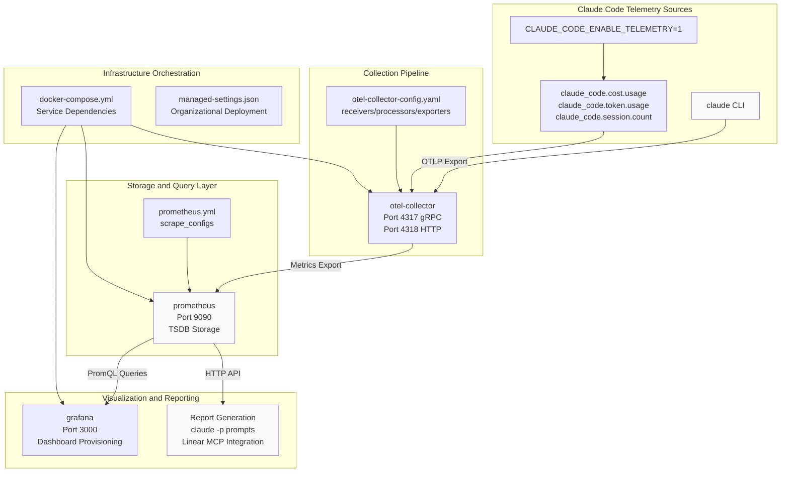
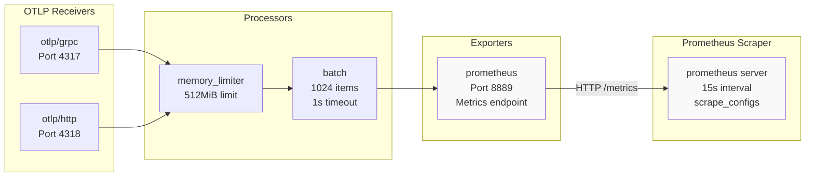
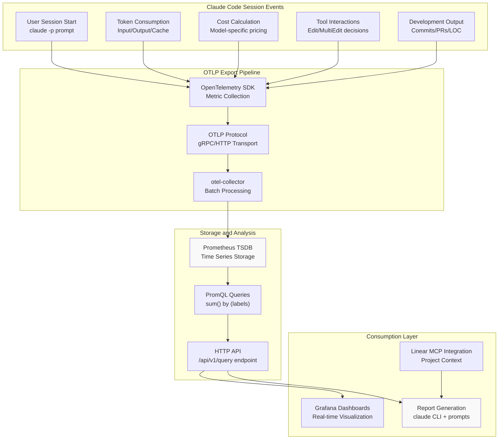

<!-- source: DeepWiki mcp.deepwiki.com · repo anthropics/claude-code-monitoring-guide · page 1 Claude Code ROI Measurement System Overview · fetched 2026-10-26 -->

# Claude Code ROI Measurement System Overview

<details>
<summary>Relevant source files</summary>

The following files were used as context for generating this wiki page:

- [README.md](README.md)
- [claude_code_roi_full.md](claude_code_roi_full.md)

</details>


## Purpose and Scope

This document provides a comprehensive overview of the Claude Code ROI Measurement System, which collects telemetry data from Claude Code CLI usage, processes it through an observability pipeline, and generates automated reports to measure developer productivity and return on investment. The system combines Claude Code usage metrics with project management data to provide data-driven insights for engineering leadership.

For detailed installation procedures, see [Installation and Setup](#2). For specific telemetry configuration, see [Telemetry Collection Pipeline](#3). For report generation and Linear integration, see [Automated Reporting System](#5).

## System Architecture Overview

The Claude Code ROI Measurement System consists of four primary subsystems that work together to provide comprehensive usage analytics and ROI measurement capabilities.

**System Architecture**



Sources: [docker-compose.yml](), [otel-collector-config.yaml](), [prometheus.yml](), [claude_code_roi_full.md:66-82]()

## Core Components

### Claude Code CLI Telemetry

The Claude Code CLI serves as the primary data source, emitting OpenTelemetry metrics when `CLAUDE_CODE_ENABLE_TELEMETRY=1` is configured. The CLI exports metrics via OTLP protocol to the collection pipeline.

| Component | Configuration | Purpose |
|-----------|---------------|---------|
| `claude` CLI | `OTEL_METRICS_EXPORTER=otlp` | Primary telemetry source |
| OTLP Endpoint | `OTEL_EXPORTER_OTLP_ENDPOINT=http://localhost:4317` | Export destination |
| Protocol | `OTEL_EXPORTER_OTLP_PROTOCOL=grpc` | Transport mechanism |

### OpenTelemetry Collector Pipeline

The collector processes telemetry data through a configured pipeline defined in `otel-collector-config.yaml`. It receives OTLP data, applies processing, and exports to Prometheus.

**Telemetry Collection Pipeline**



Sources: [otel-collector-config.yaml](), [prometheus.yml](), [claude_code_roi_full.md:55-82]()

### Metrics Storage and Query Engine

Prometheus serves as the time-series database, storing Claude Code metrics and providing PromQL query capabilities for analysis and visualization.

### Visualization and Reporting Layer

Grafana provides real-time dashboards, while the automated reporting system uses the Claude CLI with Linear MCP integration to generate comprehensive ROI reports.

## Data Flow and Metric Types

The system collects and processes several categories of metrics from Claude Code sessions:

| Metric Name | Type | Labels | Purpose |
|-------------|------|--------|---------|
| `claude_code_cost_usage_USD_total` | Counter | `user.id`, `session.id`, `model` | Track costs per session |
| `claude_code_token_usage_tokens_total` | Counter | `type` (input/output/cache), `user_email`, `model` | Monitor token consumption |
| `claude_code_session_count` | Counter | `user.id` | Track tool adoption |
| `claude_code_pull_request_count` | Counter | `user.id` | Measure development output |
| `claude_code_code_edit_tool_decision` | Counter | `decision` (accept/reject) | Tool effectiveness |

**Metric Data Flow Architecture**



Sources: [claude_code_roi_full.md:94-121](), [claude_code_roi_full.md:200-217]()

## Integration Points

### Linear MCP Integration

The system integrates with Linear project management through the MCP (Model Context Protocol) to combine development metrics with project velocity data.

Configuration in `.claude.json`:
```json
{
  "mcpServers": {
    "linear": {
      "type": "stdio", 
      "command": "npx",
      "args": ["-y", "mcp-remote", "https://mcp.linear.app/sse"]
    }
  }
}
```

### Prometheus Query Interface

Key PromQL queries for ROI analysis:

| Query Purpose | PromQL Expression |
|---------------|-------------------|
| Total cost | `sum(claude_code_cost_usage_USD_total)` |
| Cost by model | `sum(claude_code_cost_usage_USD_total) by (model)` |
| Token efficiency | `sum(claude_code_token_usage_tokens_total) by (type)` |
| User adoption | `sum(claude_code_token_usage_tokens_total) by (user_email)` |

### Organizational Deployment

The system supports enterprise deployment through `managed-settings.json` configuration, enabling centralized telemetry collection across development teams with consistent OTLP endpoint configuration and authentication.

Sources: [claude_code_roi_full.md:410-437](), [claude_code_roi_full.md:504-528](), [README.md:17-22]()

---

