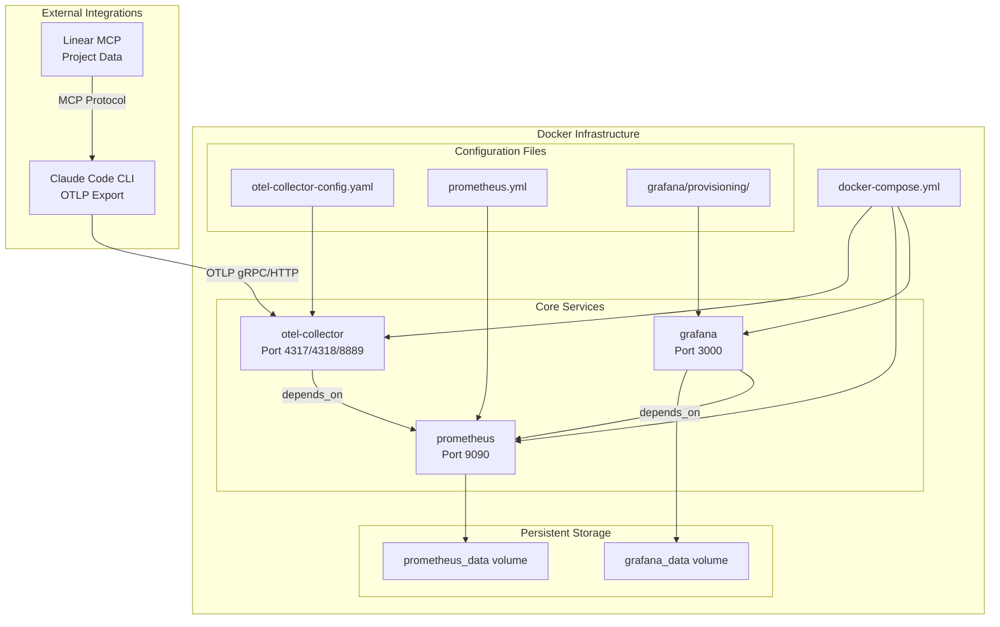
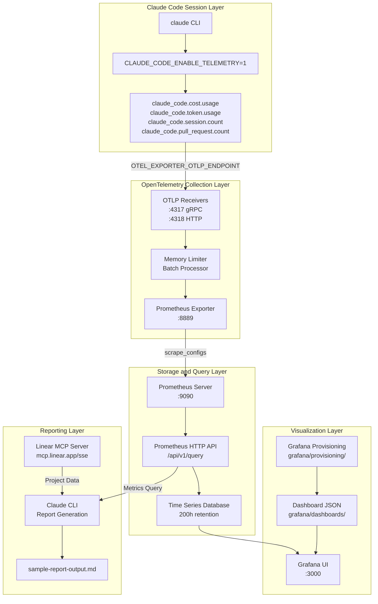
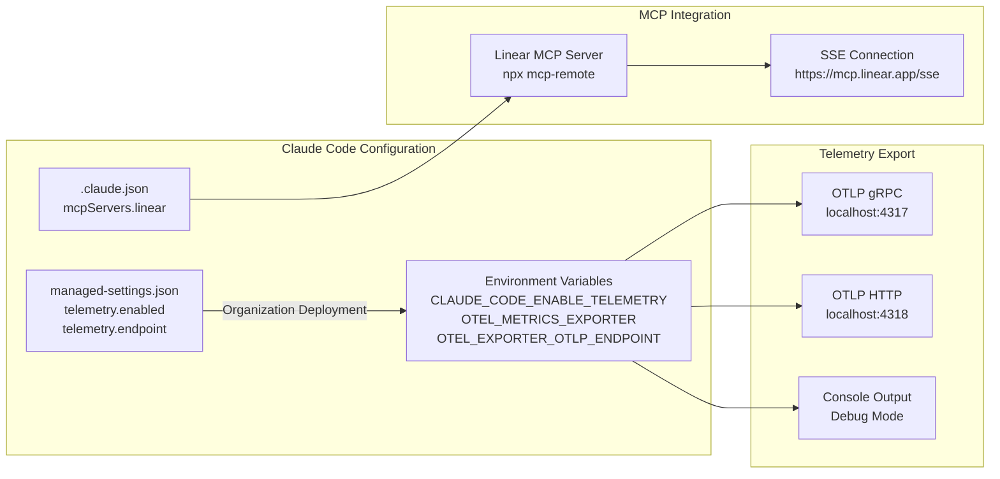
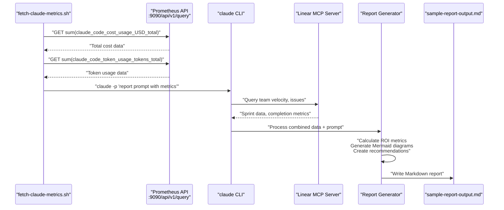

<!-- source: DeepWiki mcp.deepwiki.com · repo anthropics/claude-code-monitoring-guide · page 1.1 System Architecture · fetched 2026-10-26 -->

# System Architecture

<details>
<summary>Relevant source files</summary>

The following files were used as context for generating this wiki page:

- [README.md](README.md)
- [claude_code_roi_full.md](claude_code_roi_full.md)
- [docker-compose.yml](docker-compose.yml)

</details>


## Purpose and Scope

This document describes the technical architecture of the Claude Code ROI Measurement System, including component relationships, data flow, and configuration structures. It covers the core infrastructure services (`otel-collector`, `prometheus`, `grafana`) and their integration with Claude Code CLI telemetry.

For setup and deployment procedures, see [Installation and Setup](#2). For specific telemetry configuration details, see [Telemetry Collection Pipeline](#3). For monitoring dashboards, see [Monitoring and Visualization](#4).

## Overview

The Claude Code ROI Measurement System implements a multi-tier observability architecture that collects telemetry from Claude Code CLI sessions, processes metrics through OpenTelemetry pipelines, stores time-series data in Prometheus, and provides visualization through Grafana dashboards. The system also supports automated report generation by combining telemetry data with Linear project management data via MCP integration.

## Core Architecture Components

### Infrastructure Orchestration

The system deploys as containerized services orchestrated by Docker Compose, with three primary infrastructure components and their dependencies:



Sources: [docker-compose.yml:1-49](), [claude_code_roi_full.md:54-64]()

### Telemetry Data Flow Architecture

The telemetry pipeline processes Claude Code metrics through a multi-stage collection and storage architecture:



Sources: [claude_code_roi_full.md:66-82](), [docker-compose.yml:3-13](), [claude_code_roi_full.md:91-121]()

## Configuration Architecture

### Service Configuration Hierarchy

The system uses a layered configuration approach where Docker Compose orchestrates services, and each service loads its specific configuration files:

| Configuration File | Service Target | Key Settings | Purpose |
|-------------------|----------------|-------------|---------|
| `docker-compose.yml` | Docker Engine | Service definitions, port mappings, volumes | Orchestrates all infrastructure services |
| `otel-collector-config.yaml` | `otel-collector` | Receivers, processors, exporters | Defines telemetry pipeline processing |
| `prometheus.yml` | `prometheus` | Scrape configs, retention settings | Controls metrics collection and storage |
| `grafana/provisioning/` | `grafana` | Datasource configs, dashboard automation | Provisions visualization components |

Sources: [docker-compose.yml:1-49](), [claude_code_roi_full.md:54-64]()

### Claude Code Integration Points

The Claude Code CLI integrates with the telemetry infrastructure through environment variable configuration and OTLP export:



Sources: [claude_code_roi_full.md:19-24](), [claude_code_roi_full.md:66-82](), [claude_code_roi_full.md:414-436](), [claude_code_roi_full.md:508-527]()

## Metrics and Data Model

### Core Telemetry Metrics

The system collects and processes the following primary metrics from Claude Code sessions:

| Metric Name | Type | Labels | Description |
|-------------|------|--------|-------------|
| `claude_code_cost_usage_USD_total` | Counter | `user.id`, `session.id`, `model` | Total cost per session in USD |
| `claude_code_token_usage_tokens_total` | Counter | `type` (`input`/`output`/`cacheCreation`/`cacheRead`) | Token consumption by type |
| `claude_code_session_count` | Counter | `user.account_uuid` | Number of CLI sessions initiated |
| `claude_code_pull_request_count` | Counter | `user.account_uuid` | PRs created during Claude sessions |
| `claude_code_commit_count` | Counter | `user.account_uuid` | Commits made with Claude assistance |
| `claude_code_code_edit_tool_decision` | Counter | `decision` (`accept`/`reject`) | Code editing tool permission decisions |

Sources: [claude_code_roi_full.md:95-121](), [claude_code_roi_full.md:200-217](), [claude_code_roi_full.md:26-52]()

### Prometheus Query Patterns

The system supports various PromQL query patterns for extracting business insights:

```mermaid
graph TD
    subgraph "Cost Analysis Queries"
        totalcost["sum(claude_code_cost_usage_USD_total)"]
        costbymodel["sum(claude_code_cost_usage_USD_total) by (model)"]
        costbyuser["sum(claude_code_cost_usage_USD_total) by (user_email)"]
    end
    
    subgraph "Usage Pattern Queries"
        tokenrate["rate(claude_code_token_usage_tokens_total[5m])"]
        tokensbytype["sum(claude_code_token_usage_tokens_total) by (type)"]
        acceptance["sum(claude_code_code_edit_tool_decision{decision=\"accept\"}) / sum(claude_code_code_edit_tool_decision)"]
    end
    
    subgraph "Productivity Metrics"
        costperpr["sum(claude_code_cost_usage_USD_total) / sum(claude_code_pull_request_count)"]
        sessionefficiency["sum(claude_code_pull_request_count) / sum(claude_code_session_count)"]
        commitrate["rate(claude_code_commit_count[1h])"]
    end
    
    subgraph "Business Intelligence"
        roicalc["(totalDevCost * productivityGain) - claudeCodeCost"]
        usagetrends["increase(claude_code_session_count[30d])"]
        adoptionrate["count(distinct user.account_uuid) by (time_period)"]
    end
```

Sources: [claude_code_roi_full.md:95-121](), [claude_code_roi_full.md:248-295]()

## Automated Reporting Architecture

### Report Generation Pipeline

The system supports automated report generation that combines Prometheus metrics with Linear project data through Claude CLI and MCP integration:



Sources: [claude_code_roi_full.md:458-477](), [claude_code_roi_full.md:414-436](), [claude_code_roi_full.md:482-500]()

## Deployment Architecture Patterns

### Development vs Production Configurations

The system supports multiple deployment patterns with different endpoint configurations:

| Environment | OTLP Endpoint | Use Case | Configuration Source |
|-------------|---------------|----------|---------------------|
| Local Development | `http://localhost:4317` | Individual developer testing | Environment variables |
| Kubernetes | `http://otel-collector.monitoring.svc.cluster.local:4317` | Clustered deployment | ConfigMap/Secret |
| Cloud Provider | Application Load Balancer endpoint | Managed infrastructure | Cloud-specific configuration |
| SaaS Integration | `https://otlp.datadoghq.com` or `https://api.honeycomb.io:443` | External observability platforms | Managed settings |

The system uses `managed-settings.json` for organization-wide deployment, ensuring consistent telemetry collection across all Claude Code installations without user-configurable overrides.

Sources: [claude_code_roi_full.md:84-90](), [claude_code_roi_full.md:508-527](), [docker-compose.yml:8-11]()

---

