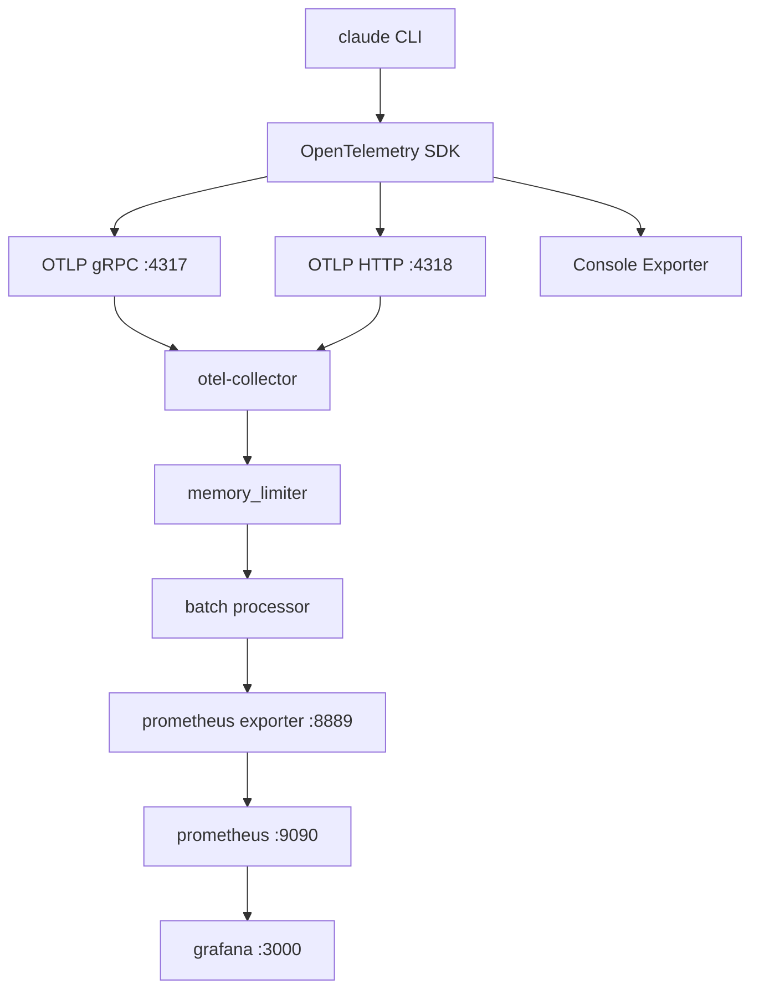
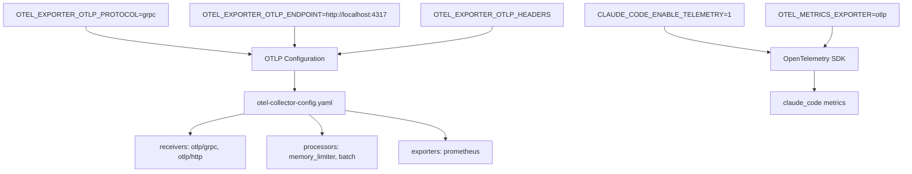
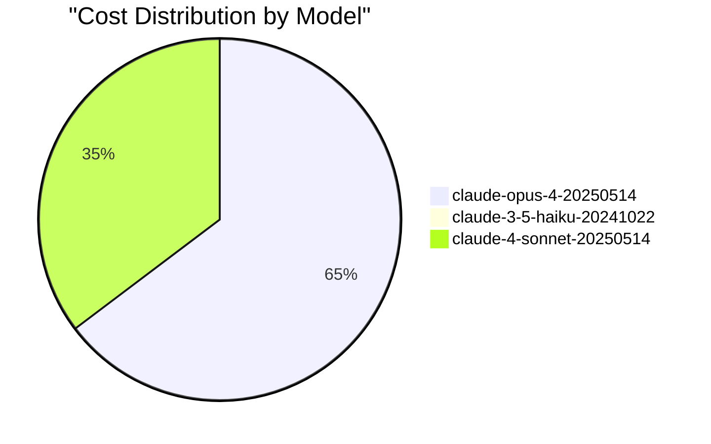
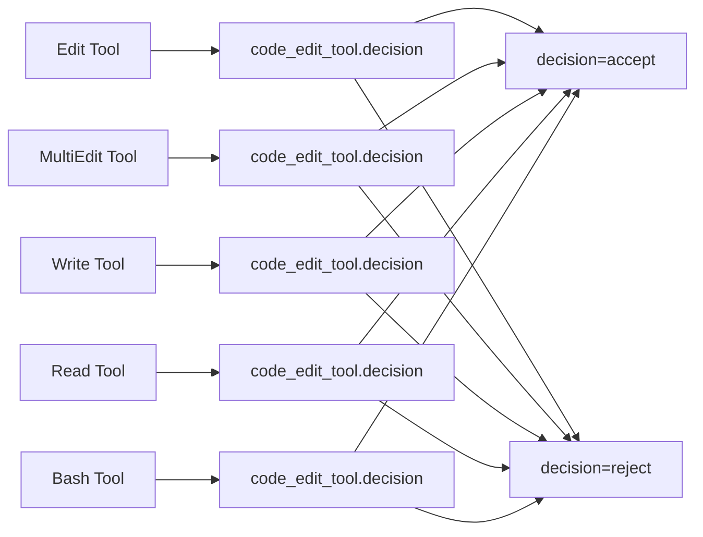
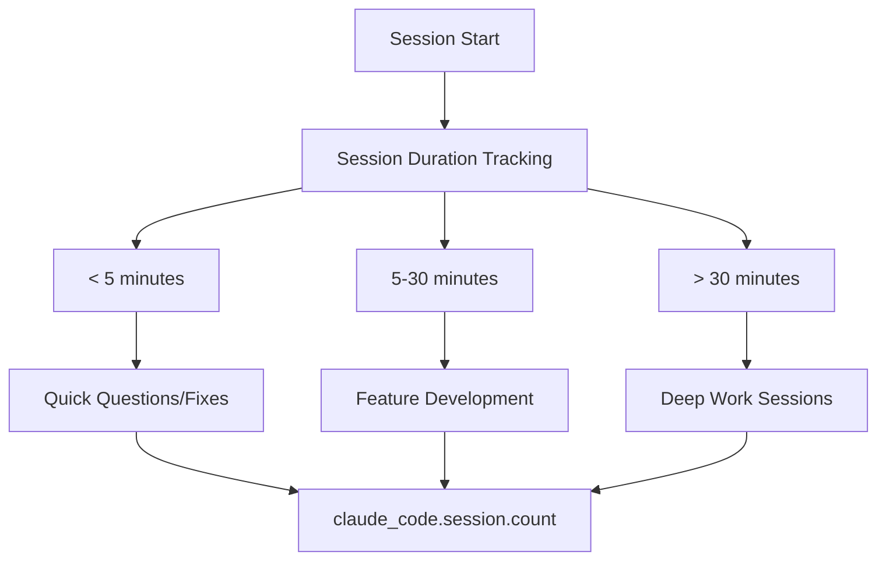
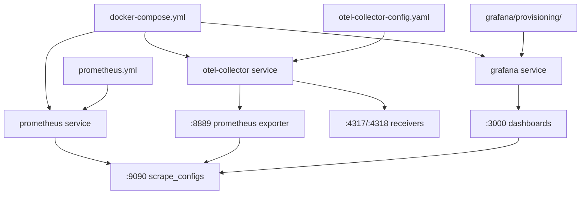
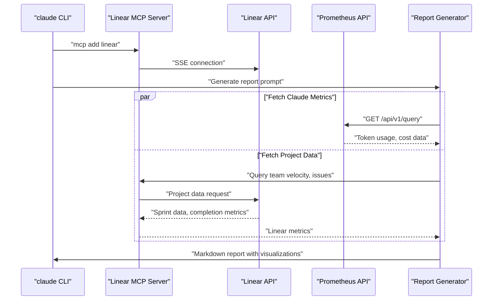
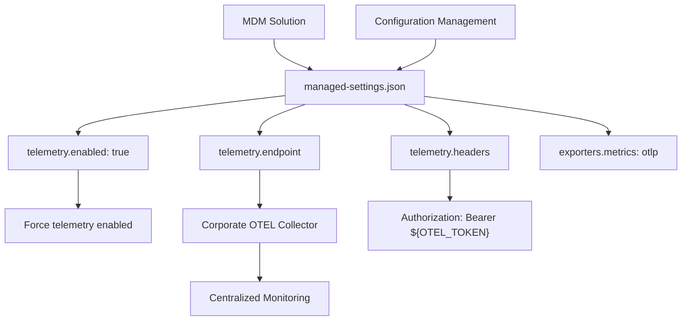

<!-- source: DeepWiki mcp.deepwiki.com · repo anthropics/claude-code-monitoring-guide · page 1.2 Key Features and Capabilities · fetched 2026-10-26 -->

# Key Features and Capabilities

<details>
<summary>Relevant source files</summary>

The following files were used as context for generating this wiki page:

- [claude_code_roi_full.md](claude_code_roi_full.md)
- [sample-report-output.md](sample-report-output.md)

</details>


This document describes the core features and capabilities of the Claude Code ROI Measurement System, including telemetry collection, cost analysis, productivity tracking, and automated reporting functionalities. For system architecture and component relationships, see [System Architecture](#1.1). For installation and configuration procedures, see [Installation and Setup](#2).

## Core Telemetry Collection

The system provides comprehensive telemetry collection capabilities through OpenTelemetry integration, capturing real-time usage data from Claude Code sessions.

### Metric Collection Pipeline



**Core Metrics Collected:**

| Metric Name | Type | Description | Labels |
|-------------|------|-------------|--------|
| `claude_code.cost.usage` | Counter | Cost per session in USD | `user.id`, `session.id`, `model` |
| `claude_code.token.usage` | Counter | Token consumption by type | `type` (input/output/cacheCreation/cacheRead), `user.email`, `model` |
| `claude_code.session.count` | Counter | Number of CLI sessions started | `user.id`, `session.duration` |
| `claude_code.code_edit_tool.decision` | Counter | Tool permission decisions | `decision` (accept/reject), `tool` (Edit/MultiEdit/Write/Read/Bash) |

Sources: [claude_code_roi_full.md:27-51](), [claude_code_roi_full.md:134-217]()

### Environment Configuration

The telemetry system is controlled through specific environment variables that configure collection and export behavior:



Sources: [claude_code_roi_full.md:68-82](), [claude_code_roi_full.md:511-527]()

## Cost Analysis and Optimization

The system provides detailed cost tracking and analysis capabilities for different Claude models and usage patterns.

### Multi-Model Cost Tracking



**Model Pricing Structure:**

| Model | Input Tokens (per 1M) | Output Tokens (per 1M) | Use Case |
|-------|----------------------|------------------------|----------|
| `claude-3-5-haiku-20241022` | $0.80 | $4.00 | Fast, cost-effective queries |
| `claude-4-sonnet-20250514` | $3.00 | $15.00 | Balanced performance |
| `claude-opus-4-20250514` | $15.00 | $75.00 | Most capable, complex analysis |

### Cost Analysis Queries

The system supports sophisticated cost analysis through PromQL queries:

```promql
# Total cost across all sessions
sum(claude_code_cost_usage_USD_total)

# Cost by model type  
sum(claude_code_cost_usage_USD_total) by (model)

# Token usage by type
sum(claude_code_token_usage_tokens_total) by (type)

# Cost per user
sum(claude_code_cost_usage_USD_total) by (user_email)
```

Sources: [claude_code_roi_full.md:91-121](), [claude_code_roi_full.md:168-173]()

## Productivity Measurement

The system tracks multiple productivity indicators to measure developer effectiveness and tool adoption.

### Tool Usage Tracking



**Productivity Metrics Reliability:**

| Metric | Reliability | Use Case |
|--------|-------------|----------|
| `claude_code.pull_request.count` | High | Feature completion tracking |
| `claude_code.commit.count` | Medium | Development velocity (varies by team practices) |
| `claude_code.lines_of_code.count` | Low | Code volume (can be misleading) |
| `claude_code.code_edit_tool.decision` | High | Tool adoption and effectiveness |

Sources: [claude_code_roi_full.md:200-217](), [claude_code_roi_full.md:220-241]()

### Session Analysis

The system tracks session patterns to identify optimal usage scenarios:



Sources: [claude_code_roi_full.md:182-193]()

## Real-time Monitoring and Visualization

The system provides comprehensive real-time monitoring through Grafana dashboards connected to Prometheus time-series data.

### Monitoring Stack Configuration



**Key Dashboard Visualizations:**

- Cost per model pie charts
- Token usage time series
- User activity tables sorted by cost
- Tool acceptance rate trends
- Session duration distributions

Sources: [claude_code_roi_full.md:54-64](), [claude_code_roi_full.md:123-128]()

## Automated Reporting System

The system generates comprehensive reports combining Claude Code metrics with project management data through Linear MCP integration.

### Linear MCP Integration Architecture



### Report Generation Configuration

The MCP integration is configured through `.claude.json`:

```json
{
  "mcpServers": {
    "linear": {
      "type": "stdio", 
      "command": "npx",
      "args": ["-y", "mcp-remote", "https://mcp.linear.app/sse"]
    }
  }
}
```

**Generated Report Components:**

- Executive summary with velocity improvements
- Mermaid visualizations for tool usage and costs
- Linear ticket analysis with priority breakdown
- Actionable recommendations based on usage patterns
- Cost breakdowns and ROI calculations

Sources: [claude_code_roi_full.md:410-453](), [claude_code_roi_full.md:424-436](), [sample-report-output.md:1-158]()

## Enterprise Deployment Features

The system supports enterprise-wide deployment through managed settings and centralized configuration.

### Managed Settings Configuration



**Deployment Endpoints:**

| Environment | Endpoint | Protocol |
|-------------|----------|----------|
| Local Development | `http://localhost:4317` | gRPC |
| Kubernetes | `http://otel-collector.monitoring.svc.cluster.local:4317` | gRPC |
| AWS | Application Load Balancer endpoint | gRPC/HTTP |
| DataDog | `https://otlp.datadoghq.com` | OTLP |
| Honeycomb | `https://api.honeycomb.io:443` | OTLP |

Sources: [claude_code_roi_full.md:503-528](), [claude_code_roi_full.md:84-90]()

---

