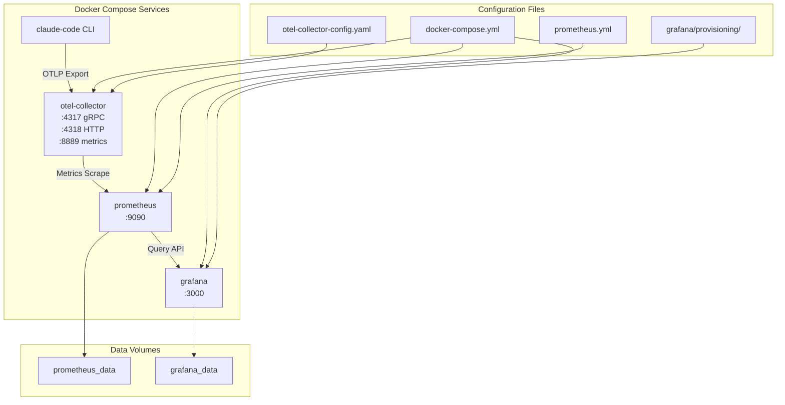
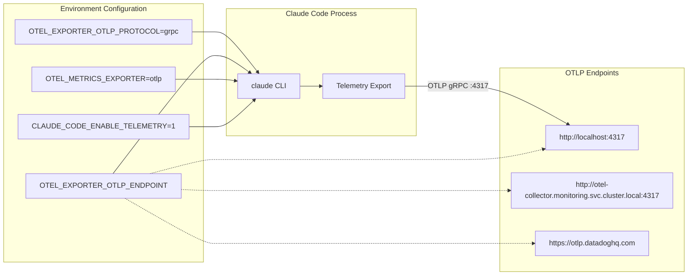

<!-- source: DeepWiki mcp.deepwiki.com · repo anthropics/claude-code-monitoring-guide · page 2 Installation and Setup · fetched 2026-10-26 -->

# Installation and Setup

<details>
<summary>Relevant source files</summary>

The following files were used as context for generating this wiki page:

- [claude_code_roi_full.md](claude_code_roi_full.md)
- [docker-compose.yml](docker-compose.yml)

</details>


This document provides a comprehensive guide for setting up the Claude Code ROI measurement system infrastructure. It covers the installation of the telemetry collection pipeline, configuration of Claude Code to emit metrics, and verification of the complete system.

For detailed telemetry configuration and pipeline management, see [Telemetry Collection Pipeline](#3). For monitoring dashboard setup, see [Grafana Dashboard Setup](#4.1). For troubleshooting installation issues, see [Troubleshooting Guide](#6.1).

## Prerequisites

Before installing the Claude Code ROI measurement system, ensure your environment meets these requirements:

| Component | Requirement | Purpose |
|-----------|-------------|---------|
| **Docker** | Docker Engine 20.10+ | Container orchestration for monitoring stack |
| **Docker Compose** | v2.0+ | Service deployment and management |
| **Claude Code CLI** | Latest version | Source of telemetry data |
| **Network Access** | Ports 3000, 4317, 4318, 8889, 9090 | Service communication and web interfaces |
| **Storage** | 2GB minimum | Prometheus time-series data and Grafana dashboards |

## Infrastructure Deployment

### Docker Compose Stack Architecture

The monitoring infrastructure consists of three primary services orchestrated through Docker Compose:



Sources: [docker-compose.yml:1-49]()

### Deployment Steps

1. **Clone Configuration Repository**
   ```bash
   git clone https://github.com/anthropics/claude-code-monitoring-guide
   cd claude-code-monitoring-guide
   ```

2. **Deploy Infrastructure Stack**
   ```bash
   docker-compose up -d
   ```

3. **Verify Service Status**
   ```bash
   docker-compose ps
   ```

The [docker-compose.yml:1-49]() file defines three services with specific dependencies:
- `otel-collector` depends on `prometheus` [docker-compose.yml:12-13]()
- `grafana` depends on `prometheus` [docker-compose.yml:44-45]()
- Volumes `prometheus_data` and `grafana_data` provide persistent storage [docker-compose.yml:47-49]()

Sources: [docker-compose.yml:1-49]()

## Claude Code Telemetry Configuration

### Environment Variable Setup

Configure Claude Code to emit telemetry data to the monitoring infrastructure:



Sources: [claude_code_roi_full.md:68-82]()

### Basic Configuration

Set the following environment variables for local development:

```bash
export CLAUDE_CODE_ENABLE_TELEMETRY=1
export OTEL_METRICS_EXPORTER=otlp
export OTEL_EXPORTER_OTLP_PROTOCOL=grpc
export OTEL_EXPORTER_OTLP_ENDPOINT=http://localhost:4317
```

For production deployments with authentication:
```bash
export OTEL_EXPORTER_OTLP_HEADERS="Authorization=Bearer your-token"
```

### Endpoint Configuration Options

| Environment | OTLP Endpoint | Use Case |
|-------------|---------------|----------|
| **Local Development** | `http://localhost:4317` | Docker Compose stack |
| **Kubernetes** | `http://otel-collector.monitoring.svc.cluster.local:4317` | Cluster deployment |
| **DataDog** | `https://otlp.datadoghq.com` | SaaS integration |
| **Honeycomb** | `https://api.honeycomb.io:443` | SaaS integration |

Sources: [claude_code_roi_full.md:84-89]()

## Verification and Testing

### Console Output Verification

Before connecting to the full monitoring stack, verify telemetry is working with console output:

```bash
export CLAUDE_CODE_ENABLE_TELEMETRY=1
export OTEL_METRICS_EXPORTER=console
export OTEL_METRIC_EXPORT_INTERVAL=1000
claude -p "hello world"
```

Expected output includes metric descriptors for:
- `claude_code.cost.usage` with attributes `user.id`, `session.id`, `model` [claude_code_roi_full.md:32-51]()
- Token usage metrics by type (`input`, `output`, `cacheCreation`, `cacheRead`)
- Cost values in USD

Sources: [claude_code_roi_full.md:16-52]()

### Service Health Checks

Verify each component is operational:

| Service | Health Check | Expected Response |
|---------|--------------|-------------------|
| **OpenTelemetry Collector** | `curl http://localhost:8889/metrics` | Prometheus format metrics |
| **Prometheus** | `curl http://localhost:9090/-/healthy` | HTTP 200 OK |
| **Grafana** | `curl http://localhost:3000/api/health` | JSON health status |

### End-to-End Data Flow Test

1. **Generate Test Data**
   ```bash
   # With OTLP configuration active
   claude -p "test telemetry data generation"
   ```

2. **Query Prometheus Metrics**
   ```bash
   curl -s "http://localhost:9090/api/v1/query?query=claude_code_cost_usage_USD_total"
   ```

3. **Verify Grafana Data Source**
   - Access Grafana at `http://localhost:3000`
   - Default credentials: `admin` / `admin` [docker-compose.yml:39]()
   - Confirm Prometheus data source connectivity

Sources: [claude_code_roi_full.md:91-121](), [docker-compose.yml:38-39]()

## Service Configuration Files

### OpenTelemetry Collector Configuration

The system requires `otel-collector-config.yaml` mounted at `/etc/otel-collector-config.yaml` [docker-compose.yml:7]() containing:
- OTLP receivers on ports 4317 (gRPC) and 4318 (HTTP)
- Memory limiter and batch processors
- Prometheus exporter on port 8889

### Prometheus Configuration

The `prometheus.yml` file [docker-compose.yml:22]() must include:
- Scrape configuration for OpenTelemetry Collector endpoint `:8889`
- Retention settings (default 200h) [docker-compose.yml:29]()
- Data storage path `/prometheus` [docker-compose.yml:26]()

### Grafana Provisioning

Grafana configuration includes:
- Provisioning directory mounted at `/etc/grafana/provisioning` [docker-compose.yml:42]()
- Dashboard directory at `/var/lib/grafana/dashboards` [docker-compose.yml:43]()
- Persistent data volume for configuration and dashboards

Sources: [docker-compose.yml:6-43]()

## Next Steps

After successful installation:

1. **Configure Advanced Telemetry**: See [OpenTelemetry Collector Configuration](#3.1) for pipeline optimization
2. **Set Up Monitoring Dashboards**: Follow [Grafana Dashboard Setup](#4.1) for visualization configuration  
3. **Enable Automated Reporting**: Configure [Linear MCP Integration](#5.2) for comprehensive reports
4. **Production Deployment**: Review [Security and Best Practices](#6.3) for production considerations

For troubleshooting installation issues, consult [Troubleshooting Guide](#6.1).

---

