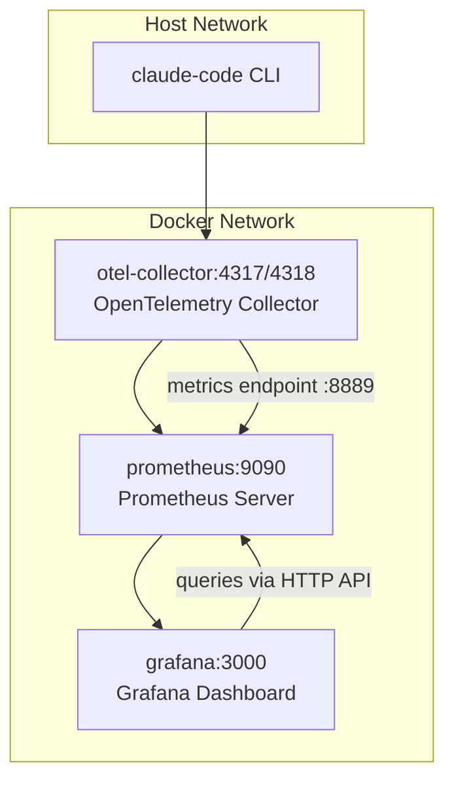
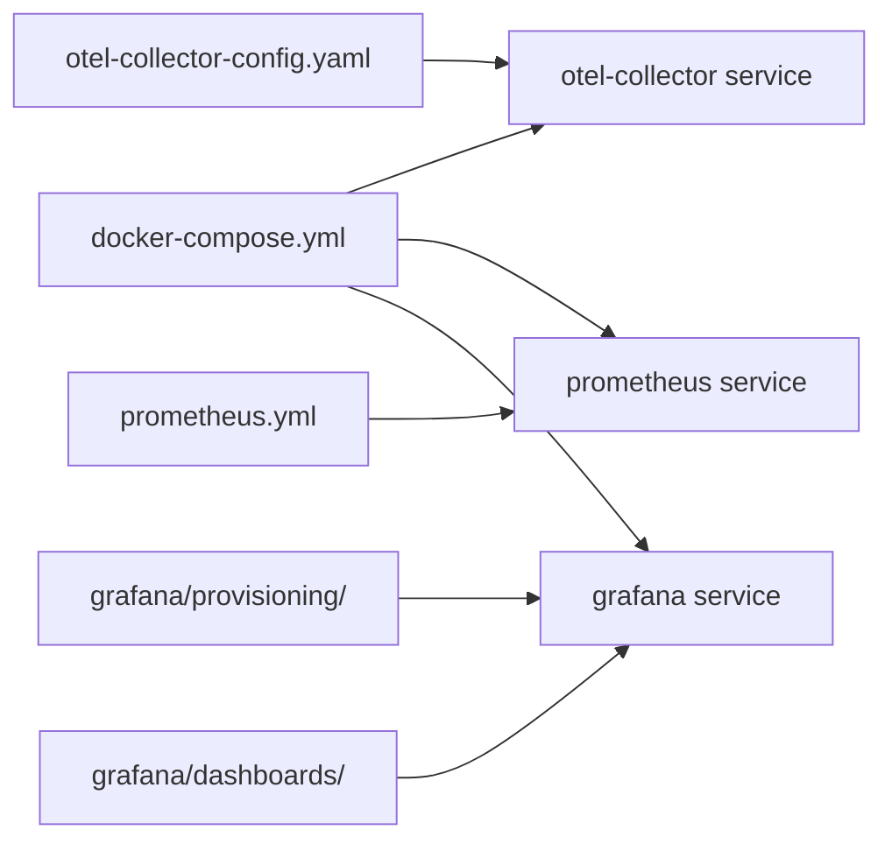
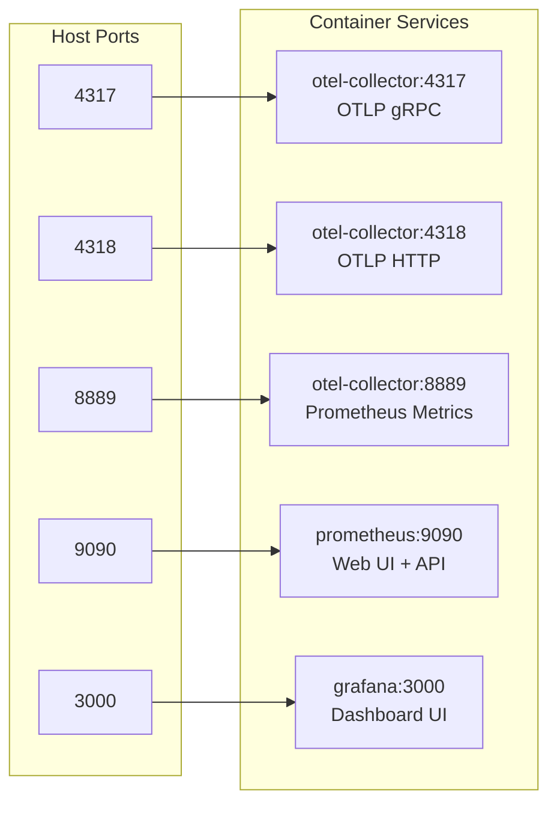
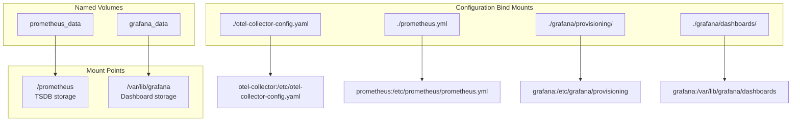

<!-- source: DeepWiki mcp.deepwiki.com · repo anthropics/claude-code-monitoring-guide · page 2.1 Docker Infrastructure Setup · fetched 2026-10-26 -->

# Docker Infrastructure Setup

<details>
<summary>Relevant source files</summary>

The following files were used as context for generating this wiki page:

- [docker-compose.yml](docker-compose.yml)
- [otel-collector-config.yaml](otel-collector-config.yaml)
- [prometheus.yml](prometheus.yml)

</details>


This document covers the deployment and configuration of the observability stack using Docker Compose. The infrastructure consists of three core services: OpenTelemetry Collector for telemetry ingestion, Prometheus for metrics storage, and Grafana for visualization. For configuring Claude Code to send telemetry to this infrastructure, see [Claude Code Telemetry Configuration](#2.2). For details on the OpenTelemetry Collector's internal configuration, see [OpenTelemetry Collector Configuration](#3.1).

## Service Architecture

The Docker infrastructure provides a complete observability stack with well-defined service dependencies and communication patterns.

### Service Dependencies and Communication



Sources: [docker-compose.yml:1-49]()

The architecture implements a linear data flow where the `otel-collector` service depends on `prometheus` ([docker-compose.yml:12-13]()), and `grafana` depends on `prometheus` ([docker-compose.yml:44-45]()). This ensures proper startup ordering and prevents connection failures during initialization.

### Service Configuration Structure



Sources: [docker-compose.yml:7](), [docker-compose.yml:22](), [docker-compose.yml:42-43]()

## Service Definitions

### OpenTelemetry Collector Service

The `otel-collector` service runs the `otel/opentelemetry-collector-contrib:latest` image ([docker-compose.yml:4]()) and provides OTLP endpoints for receiving telemetry data from Claude Code.

| Configuration | Value | Purpose |
|---------------|-------|---------|
| Image | `otel/opentelemetry-collector-contrib:latest` | Includes all receivers and exporters |
| Config File | `./otel-collector-config.yaml:/etc/otel-collector-config.yaml` | Pipeline configuration |
| OTLP gRPC Port | `4317:4317` | Receives OTLP gRPC telemetry |
| OTLP HTTP Port | `4318:4318` | Receives OTLP HTTP telemetry |  
| Metrics Port | `8889:8889` | Exposes Prometheus metrics |

Sources: [docker-compose.yml:3-13]()

The collector processes telemetry through a pipeline defined in `otel-collector-config.yaml` with `memory_limiter` and `batch` processors ([otel-collector-config.yaml:13-15](), [otel-collector-config.yaml:10-12]()) before exporting to Prometheus format.

### Prometheus Service

The `prometheus` service provides time-series storage and querying capabilities using the `prom/prometheus:latest` image ([docker-compose.yml:17]()).

| Configuration | Value | Purpose |
|---------------|-------|---------|
| Container Name | `prometheus` | Service discovery reference |
| Port | `9090:9090` | Web UI and HTTP API |
| Config File | `./prometheus.yml:/etc/prometheus/prometheus.yml` | Scrape configuration |
| Data Volume | `prometheus_data:/prometheus` | Persistent storage |
| Retention | `--storage.tsdb.retention.time=200h` | Data retention period |

Sources: [docker-compose.yml:15-30]()

Prometheus scrapes metrics from the OpenTelemetry Collector at `otel-collector:8889` ([prometheus.yml:11-13]()) with a 15-second interval ([prometheus.yml:2]()).

### Grafana Service

The `grafana` service provides dashboard visualization using the `grafana/grafana:latest` image ([docker-compose.yml:34]()).

| Configuration | Value | Purpose |
|---------------|-------|---------|
| Container Name | `grafana` | Service reference |
| Port | `3000:3000` | Web interface |
| Admin Password | `admin` | Default authentication |
| Data Volume | `grafana_data:/var/lib/grafana` | Dashboard persistence |
| Provisioning | `./grafana/provisioning:/etc/grafana/provisioning` | Automated configuration |
| Dashboards | `./grafana/dashboards:/var/lib/grafana/dashboards` | Dashboard definitions |

Sources: [docker-compose.yml:32-45]()

## Network and Port Configuration

### Port Mappings



Sources: [docker-compose.yml:8-11](), [docker-compose.yml:19-20](), [docker-compose.yml:36-37]()

The port mappings expose all necessary endpoints for external access while maintaining internal service communication through Docker's network.

### Internal Service Communication

| Source Service | Target Service | Endpoint | Protocol |
|----------------|----------------|----------|----------|
| `prometheus` | `otel-collector` | `otel-collector:8889` | HTTP (scraping) |
| `grafana` | `prometheus` | `prometheus:9090` | HTTP (queries) |
| External | `otel-collector` | `localhost:4317/4318` | OTLP |

Sources: [prometheus.yml:13](), [docker-compose.yml:44-45]()

## Volume Management

### Persistent Storage

The infrastructure defines two named volumes for data persistence:



Sources: [docker-compose.yml:47-49](), [docker-compose.yml:21-23](), [docker-compose.yml:40-43]()

Named volumes ensure data persistence across container restarts, while bind mounts provide direct access to configuration files for easy modification.

## Deployment Commands

### Starting the Infrastructure

```bash
# Start all services in background
docker-compose up -d

# Start with logs visible
docker-compose up

# Start specific service
docker-compose up prometheus
```

### Service Management

```bash
# Check service status
docker-compose ps

# View logs
docker-compose logs otel-collector
docker-compose logs prometheus  
docker-compose logs grafana

# Restart specific service
docker-compose restart otel-collector

# Stop all services
docker-compose down

# Stop and remove volumes
docker-compose down -v
```

### Verification

After deployment, verify services are accessible:

- OpenTelemetry Collector: `curl http://localhost:8889/metrics`
- Prometheus: `http://localhost:9090` 
- Grafana: `http://localhost:3000` (admin/admin)

Sources: [docker-compose.yml:8-11](), [docker-compose.yml:19-20](), [docker-compose.yml:36-37]()

---

