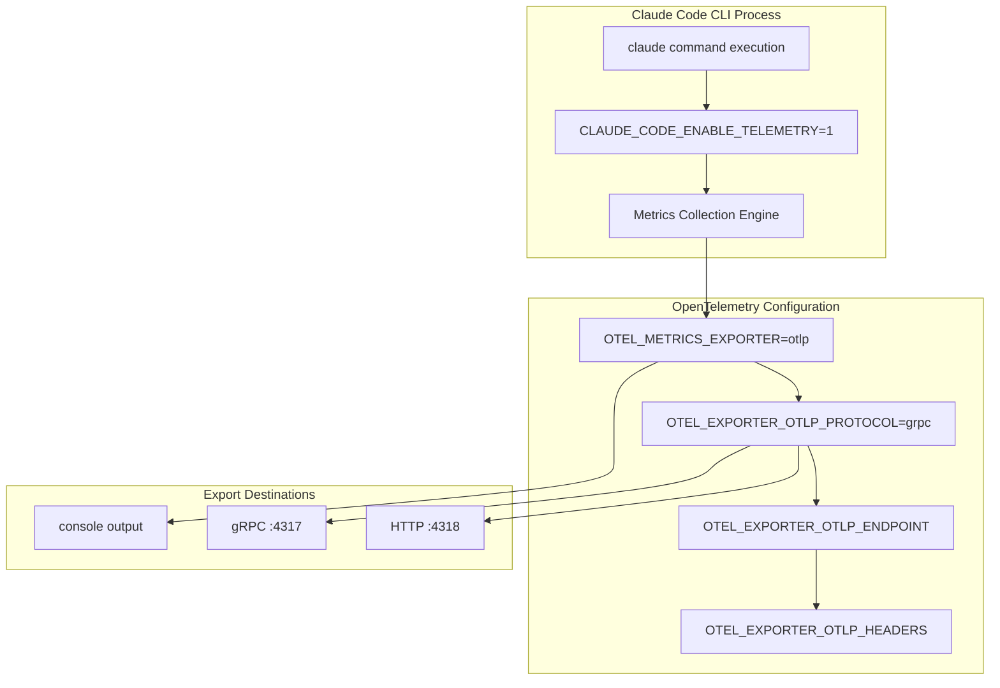
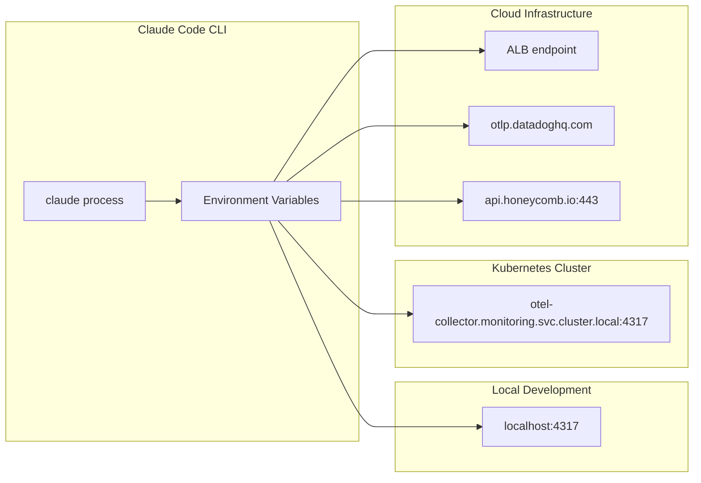
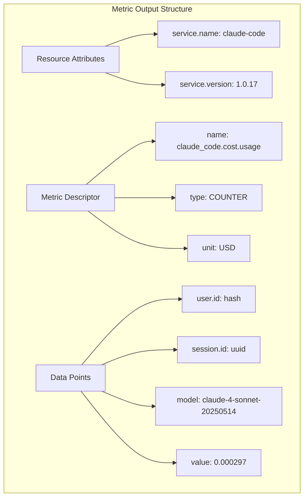

<!-- source: DeepWiki mcp.deepwiki.com · repo anthropics/claude-code-monitoring-guide · page 2.2 Claude Code Telemetry Configuration · fetched 2026-10-26 -->

# Claude Code Telemetry Configuration

<details>
<summary>Relevant source files</summary>

The following files were used as context for generating this wiki page:

- [claude_code_roi_full.md](claude_code_roi_full.md)
- [troubleshooting.md](troubleshooting.md)

</details>


This document covers the configuration of the Claude Code CLI tool to emit telemetry data to the OpenTelemetry Collector. It focuses specifically on the client-side configuration required to enable metrics collection and export.

For Docker infrastructure setup of the monitoring stack, see [Docker Infrastructure Setup](#2.1). For OpenTelemetry Collector configuration details, see [OpenTelemetry Collector Configuration](#3.1). For information about available metrics and their structure, see [Available Metrics and Data Model](#3.3).

## Environment Variable Configuration

Claude Code telemetry is controlled through standard OpenTelemetry environment variables. The primary configuration involves enabling telemetry and specifying the export destination.

### Basic Telemetry Enablement

The fundamental requirement is enabling telemetry collection in the Claude Code CLI:

| Environment Variable | Value | Purpose |
|---------------------|-------|---------|
| `CLAUDE_CODE_ENABLE_TELEMETRY` | `1` | Activates telemetry collection in Claude Code |
| `OTEL_METRICS_EXPORTER` | `otlp` or `console` | Specifies the export mechanism |
| `OTEL_METRIC_EXPORT_INTERVAL` | `1000` (milliseconds) | Controls export frequency |

### OTLP Protocol Configuration

For production deployments, the OTLP exporter connects Claude Code to the monitoring infrastructure:

| Environment Variable | Example Value | Description |
|---------------------|---------------|-------------|
| `OTEL_EXPORTER_OTLP_PROTOCOL` | `grpc` | Transport protocol (`grpc` or `http/protobuf`) |
| `OTEL_EXPORTER_OTLP_ENDPOINT` | `http://localhost:4317` | Collector endpoint URL |
| `OTEL_EXPORTER_OTLP_HEADERS` | `Authorization=Bearer token` | Authentication headers |

### Configuration Flow Diagram



**Sources:** [claude_code_roi_full.md:20-82]()

## OTLP Endpoint Configuration

The `OTEL_EXPORTER_OTLP_ENDPOINT` environment variable determines where Claude Code sends telemetry data. The endpoint configuration varies by infrastructure deployment.

### Endpoint Format and Protocols

Claude Code supports both gRPC and HTTP protocols for OTLP export:

| Protocol | Default Port | URL Format | Use Case |
|----------|-------------|------------|----------|
| `grpc` | `:4317` | `http://host:4317` | High-performance, binary protocol |
| `http/protobuf` | `:4318` | `http://host:4318/v1/metrics` | HTTP-based, firewall-friendly |

### Infrastructure-Specific Endpoints

Different deployment environments require specific endpoint configurations:



**Sources:** [claude_code_roi_full.md:84-90]()

## Verification and Testing

Before configuring production endpoints, verify telemetry functionality using console output.

### Console Output Verification

Console export provides immediate feedback for telemetry validation:

```bash
export CLAUDE_CODE_ENABLE_TELEMETRY=1
export OTEL_METRICS_EXPORTER=console
export OTEL_METRIC_EXPORT_INTERVAL=1000
claude -p "hello world"
```

Expected console output includes metric descriptors and data points with attributes like `user.id`, `session.id`, and `model`.

### Metric Data Structure

The console output reveals the telemetry data structure:



**Sources:** [claude_code_roi_full.md:16-52]()

## Authentication and Headers

Production OTLP endpoints often require authentication through HTTP headers.

### Header Configuration

The `OTEL_EXPORTER_OTLP_HEADERS` environment variable supports multiple authentication schemes:

| Authentication Type | Header Format | Example |
|-------------------|---------------|---------|
| Bearer Token | `Authorization=Bearer token` | API key authentication |
| Custom Headers | `X-API-Key=key,X-Org=org` | Multiple header pairs |
| DataDog | `DD-API-KEY=key` | DataDog-specific authentication |

### Secure Configuration

For production deployments, avoid hardcoding credentials in environment variables:

```bash
# Use environment variable substitution
export OTEL_TOKEN="your-secure-token"
export OTEL_EXPORTER_OTLP_HEADERS="Authorization=Bearer ${OTEL_TOKEN}"
```

**Sources:** [claude_code_roi_full.md:77-78]()

## Common Infrastructure Endpoints

Different monitoring platforms provide OTLP-compatible endpoints with specific configuration requirements.

### Platform-Specific Configuration

| Platform | Endpoint | Protocol | Authentication |
|----------|----------|----------|----------------|
| Local Development | `http://localhost:4317` | gRPC | None |
| Kubernetes | `http://otel-collector.monitoring.svc.cluster.local:4317` | gRPC | Service mesh |
| DataDog | `https://otlp.datadoghq.com` | HTTPS | DD-API-KEY header |
| Honeycomb | `https://api.honeycomb.io:443` | HTTPS | x-honeycomb-team header |
| AWS Load Balancer | Custom ALB endpoint | gRPC/HTTPS | IAM or API key |

### Configuration Examples

Complete configuration examples for common scenarios:

```bash
# Local development
export CLAUDE_CODE_ENABLE_TELEMETRY=1
export OTEL_METRICS_EXPORTER=otlp
export OTEL_EXPORTER_OTLP_PROTOCOL=grpc
export OTEL_EXPORTER_OTLP_ENDPOINT=http://localhost:4317

# Kubernetes deployment
export CLAUDE_CODE_ENABLE_TELEMETRY=1
export OTEL_METRICS_EXPORTER=otlp
export OTEL_EXPORTER_OTLP_PROTOCOL=grpc
export OTEL_EXPORTER_OTLP_ENDPOINT=http://otel-collector.monitoring.svc.cluster.local:4317

# DataDog integration
export CLAUDE_CODE_ENABLE_TELEMETRY=1
export OTEL_METRICS_EXPORTER=otlp
export OTEL_EXPORTER_OTLP_PROTOCOL=grpc
export OTEL_EXPORTER_OTLP_ENDPOINT=https://otlp.datadoghq.com
export OTEL_EXPORTER_OTLP_HEADERS="DD-API-KEY=your-datadog-api-key"
```

**Sources:** [claude_code_roi_full.md:84-90]()

## Troubleshooting Configuration Issues

Common telemetry configuration problems and their resolution.

### Configuration Validation

Verify all required environment variables are set correctly:

```bash
echo $CLAUDE_CODE_ENABLE_TELEMETRY  # Should be 1
echo $OTEL_METRICS_EXPORTER          # Should be otlp
echo $OTEL_EXPORTER_OTLP_ENDPOINT    # Should be your collector endpoint
```

### Connectivity Testing

Test endpoint accessibility before configuring Claude Code:

```bash
# Test gRPC endpoint
curl -v http://localhost:4317

# Test HTTP endpoint  
curl -v http://localhost:4318/v1/metrics
```

### Common Issues and Solutions

| Issue | Symptom | Solution |
|-------|---------|----------|
| No metrics in Prometheus | Empty dashboards | Verify `CLAUDE_CODE_ENABLE_TELEMETRY=1` |
| Claude Code hanging | Process unresponsive | Clean installation and config reset |
| Authentication failures | 401/403 errors | Verify `OTEL_EXPORTER_OTLP_HEADERS` format |
| Network connectivity | Connection timeouts | Check firewall rules and endpoint URL |

### Configuration Reset Process

For persistent issues, reset Claude Code configuration:

```bash
# Clean installation
npm uninstall -g @anthropic-ai/claude-code
npm install -g @anthropic-ai/claude-code

# Clear configuration cache
rm -rf ~/.config/claude-code/

# Restart with fresh configuration
claude
```

**Sources:** [troubleshooting.md:7-35](), [claude_code_roi_full.md:175]()

---

