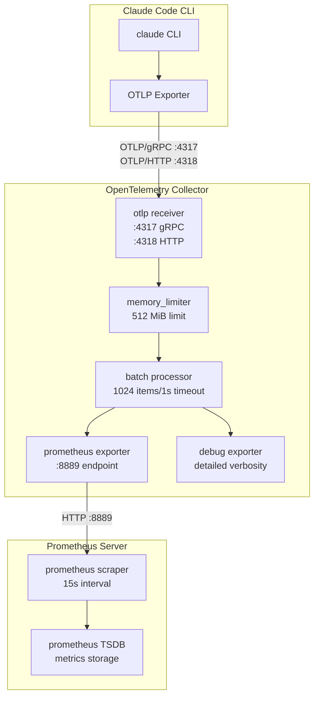
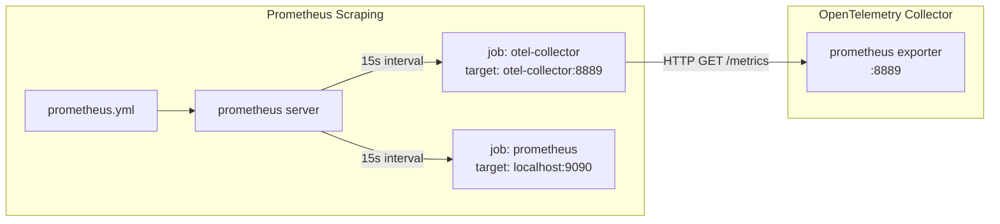
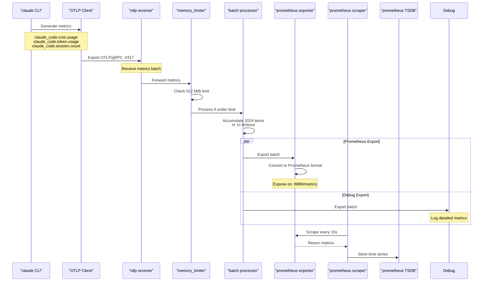

<!-- source: DeepWiki mcp.deepwiki.com · repo anthropics/claude-code-monitoring-guide · page 3 Telemetry Collection Pipeline · fetched 2026-10-26 -->

# Telemetry Collection Pipeline

<details>
<summary>Relevant source files</summary>

The following files were used as context for generating this wiki page:

- [claude_code_roi_full.md](claude_code_roi_full.md)
- [otel-collector-config.yaml](otel-collector-config.yaml)
- [prometheus.yml](prometheus.yml)

</details>


This document details the telemetry collection infrastructure that receives, processes, and stores metrics from Claude Code CLI sessions. The pipeline consists of an OpenTelemetry Collector that receives OTLP data and exports it to Prometheus for storage and querying.

For Claude Code CLI telemetry configuration, see [Claude Code Telemetry Configuration](#2.2). For visualization and dashboards, see [Monitoring and Visualization](#4). For automated report generation using collected metrics, see [Automated Reporting System](#5).

## Pipeline Architecture Overview

The telemetry collection pipeline implements a standard observability stack using OpenTelemetry and Prometheus components. Claude Code CLI exports metrics via OTLP protocol to the collector, which processes and forwards them to Prometheus for time-series storage.

### Core Pipeline Components



**Sources:** [otel-collector-config.yaml:1-40](), [prometheus.yml:9-18]()

### Network Endpoints and Protocols

| Component | Endpoint | Protocol | Purpose |
|-----------|----------|----------|---------|
| `otlp` receiver | `0.0.0.0:4317` | gRPC | Primary OTLP ingestion |
| `otlp` receiver | `0.0.0.0:4318` | HTTP | Alternative OTLP ingestion |
| `prometheus` exporter | `0.0.0.0:8889` | HTTP | Metrics exposition |
| `prometheus` scraper | `otel-collector:8889` | HTTP | Metrics collection |
| `prometheus` server | `localhost:9090` | HTTP | Query interface |

**Sources:** [otel-collector-config.yaml:4-7, 18-19](), [prometheus.yml:13, 18]()

## OpenTelemetry Collector Configuration

The collector uses a pipeline architecture with receivers, processors, and exporters defined in [otel-collector-config.yaml]().

### Receiver Configuration

The `otlp` receiver accepts telemetry data from Claude Code CLI on dual protocols:

```yaml
receivers:
  otlp:
    protocols:
      grpc:
        endpoint: 0.0.0.0:4317
      http:
        endpoint: 0.0.0.0:4318
```

**Sources:** [otel-collector-config.yaml:1-7]()

### Processing Pipeline

Two processors handle resource management and batching:

#### Memory Limiter Processor
Prevents memory exhaustion with a 512 MiB limit and 1-second check intervals:

```yaml
memory_limiter:
  check_interval: 1s
  limit_mib: 512
```

#### Batch Processor
Optimizes export efficiency by batching metrics with 1024-item batches or 1-second timeouts:

```yaml
batch:
  timeout: 1s
  send_batch_size: 1024
```

**Sources:** [otel-collector-config.yaml:9-15]()

### Export Configuration

The collector exports processed metrics to two destinations:

#### Prometheus Exporter
Exposes metrics in Prometheus format with OpenMetrics support and 180-minute expiration:

```yaml
prometheus:
  endpoint: "0.0.0.0:8889"
  send_timestamps: true
  metric_expiration: 180m
  enable_open_metrics: true
```

#### Debug Exporter
Provides detailed logging for troubleshooting with sampling configuration:

```yaml
debug:
  verbosity: detailed
  sampling_initial: 5
  sampling_thereafter: 200
```

**Sources:** [otel-collector-config.yaml:17-27]()

## Prometheus Integration

Prometheus scrapes metrics from the OpenTelemetry Collector's export endpoint and stores them in its time-series database.

### Scrape Configuration



The scrape configuration defines two jobs with 15-second intervals:

| Job Name | Target | Purpose |
|----------|--------|---------|
| `otel-collector` | `otel-collector:8889` | Scrape Claude Code metrics |
| `prometheus` | `localhost:9090` | Self-monitoring |

**Sources:** [prometheus.yml:1-3, 9-18]()

### Global Configuration

Prometheus uses consistent timing across scraping and evaluation:

```yaml
global:
  scrape_interval: 15s
  evaluation_interval: 15s
```

**Sources:** [prometheus.yml:1-3]()

## Data Flow and Processing

The complete data flow from Claude Code CLI to Prometheus storage follows this sequence:



**Sources:** [otel-collector-config.yaml:29-34](), [prometheus.yml:11-13]()

### Pipeline Service Definition

The collector service pipeline connects components in sequence:

```yaml
service:
  pipelines:
    metrics:
      receivers: [otlp]
      processors: [memory_limiter, batch]
      exporters: [prometheus, debug]
```

Processing order ensures memory protection before batching, with parallel export to both Prometheus and debug outputs.

**Sources:** [otel-collector-config.yaml:29-34]()

### Telemetry Logging

The collector itself logs at debug level for troubleshooting pipeline issues:

```yaml
telemetry:
  logs:
    level: "debug"
```

**Sources:** [otel-collector-config.yaml:38-40]()

## Supported Metrics

The pipeline processes Claude Code metrics in standard OpenTelemetry format, converting them to Prometheus metrics for storage and querying. Key metric types include:

| Metric Name | Type | Description | Labels |
|-------------|------|-------------|---------|
| `claude_code_cost_usage_USD_total` | Counter | Session cost in USD | `user.id`, `session.id`, `model` |
| `claude_code_token_usage_tokens_total` | Counter | Token consumption | `user.id`, `session.id`, `model`, `type` |
| `claude_code_session_count_total` | Counter | Session count | `user.id` |

Token types include `input`, `output`, `cacheCreation`, and `cacheRead` for detailed usage analysis.

**Sources:** [claude_code_roi_full.md:96-121]()

---

