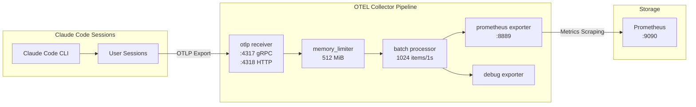
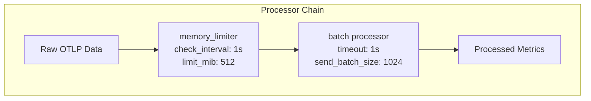
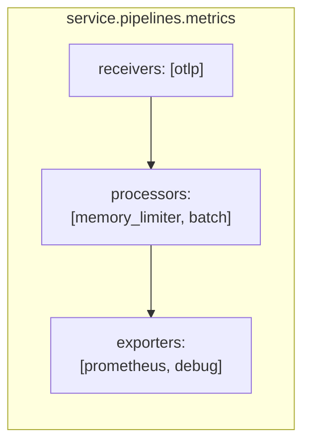
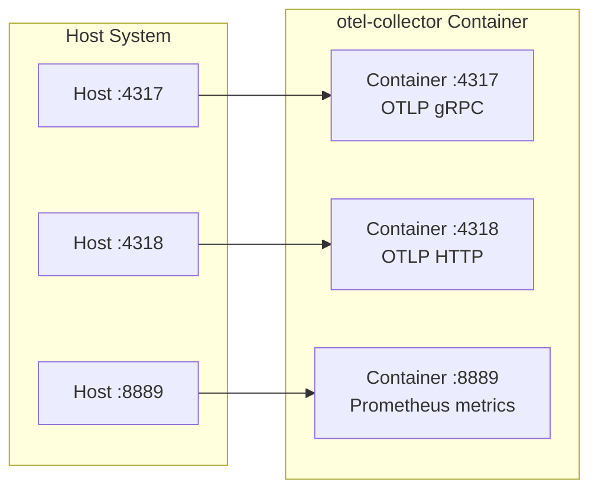

<!-- source: DeepWiki mcp.deepwiki.com · repo anthropics/claude-code-monitoring-guide · page 3.1 OpenTelemetry Collector Configuration · fetched 2026-10-26 -->

# OpenTelemetry Collector Configuration

<details>
<summary>Relevant source files</summary>

The following files were used as context for generating this wiki page:

- [docker-compose.yml](docker-compose.yml)
- [otel-collector-config.yaml](otel-collector-config.yaml)

</details>


This document covers the configuration and deployment of the OpenTelemetry Collector within the Claude Code ROI measurement system. The collector serves as the central telemetry processing hub, receiving OTLP data from Claude Code sessions and transforming it into Prometheus metrics for storage and analysis.

For information about Prometheus configuration and metrics storage, see [Prometheus Configuration and Metrics Storage](#3.2). For details about available metrics and their structure, see [Available Metrics and Data Model](#3.3).

## Architecture Overview

The OpenTelemetry Collector acts as a bridge between Claude Code's telemetry emission and the monitoring stack. It receives raw telemetry data via OTLP protocols and processes it through a configurable pipeline before exporting to Prometheus.

### Collector Data Flow



Sources: [otel-collector-config.yaml:1-40](), [docker-compose.yml:3-13]()

## Receiver Configuration

The collector is configured with OTLP receivers to accept telemetry data from Claude Code sessions on both gRPC and HTTP protocols.

### OTLP Protocol Support

| Protocol | Port | Endpoint | Usage |
|----------|------|----------|-------|
| gRPC | 4317 | `0.0.0.0:4317` | Primary telemetry ingestion |
| HTTP | 4318 | `0.0.0.0:4318` | Alternative telemetry ingestion |

The `otlp` receiver configuration accepts both protocols simultaneously:

```yaml
receivers:
  otlp:
    protocols:
      grpc:
        endpoint: 0.0.0.0:4317
      http:
        endpoint: 0.0.0.0:4318
```

Sources: [otel-collector-config.yaml:1-7](), [docker-compose.yml:9-10]()

## Processing Pipeline

The collector implements a two-stage processing pipeline to manage memory usage and optimize batch export operations.

### Pipeline Components



### Memory Limiter

The `memory_limiter` processor prevents OOM conditions by monitoring memory usage:

- **Check Interval**: 1 second monitoring frequency
- **Memory Limit**: 512 MiB maximum memory usage
- **Behavior**: Drops data when limit approached

### Batch Processor  

The `batch` processor optimizes export efficiency:

- **Timeout**: 1 second maximum batch wait time
- **Batch Size**: 1024 items per batch
- **Purpose**: Reduces export overhead and improves throughput

Sources: [otel-collector-config.yaml:9-16]()

## Export Configuration

The collector exports processed metrics to two destinations: Prometheus for storage and debug output for troubleshooting.

### Prometheus Exporter

The `prometheus` exporter configuration exposes metrics for Prometheus scraping:

| Parameter | Value | Purpose |
|-----------|-------|---------|
| `endpoint` | `0.0.0.0:8889` | Metrics exposure endpoint |
| `send_timestamps` | `true` | Include original timestamps |
| `metric_expiration` | `180m` | Metric cleanup interval |
| `enable_open_metrics` | `true` | OpenMetrics format support |

### Debug Exporter

The `debug` exporter provides detailed logging for troubleshooting:

- **Verbosity**: Detailed output level
- **Sampling Initial**: First 5 messages logged
- **Sampling Thereafter**: Every 200th message logged

Sources: [otel-collector-config.yaml:17-28]()

## Service Pipeline Definition

The collector service defines how components connect in the metrics processing pipeline.

### Pipeline Architecture



The pipeline configuration explicitly defines the data flow:

```yaml
service:
  pipelines:
    metrics:
      receivers: [otlp]
      processors: [memory_limiter, batch]
      exporters: [prometheus, debug]
```

Sources: [otel-collector-config.yaml:29-35]()

## Docker Deployment

The collector is deployed as a Docker container with specific configuration and port mappings.

### Container Configuration

The `otel-collector` service in Docker Compose provides:

| Aspect | Configuration | Purpose |
|--------|---------------|---------|
| Image | `otel/opentelemetry-collector-contrib:latest` | Full feature collector distribution |
| Config Mount | `./otel-collector-config.yaml:/etc/otel-collector-config.yaml` | Configuration file binding |
| Dependencies | `depends_on: [prometheus]` | Startup ordering |

### Port Mappings



Sources: [docker-compose.yml:3-13]()

## Telemetry and Logging

The collector itself emits telemetry about its operation and processing performance.

### Logging Configuration

Debug-level logging is enabled for troubleshooting:

```yaml
telemetry:
  logs:
    level: "debug"
```

This provides detailed information about:
- Data ingestion rates
- Processing pipeline performance  
- Export success/failure rates
- Memory usage patterns

Sources: [otel-collector-config.yaml:38-40]()

## Configuration Best Practices

### Memory Management

The 512 MiB memory limit is configured to handle typical Claude Code usage patterns while preventing resource exhaustion. Monitor memory usage and adjust based on actual telemetry volumes.

### Batch Processing

The 1-second timeout and 1024-item batch size balance latency with throughput. For high-volume environments, consider increasing batch sizes.

### Metric Retention

The 180-minute metric expiration prevents unbounded memory growth from stale metrics while maintaining reasonable freshness for dashboard queries.

Sources: [otel-collector-config.yaml:10-22]()

---

