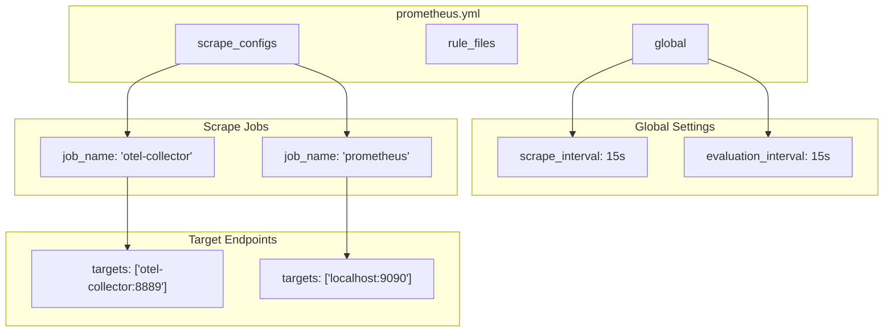
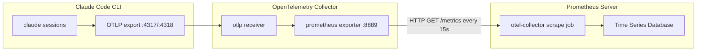
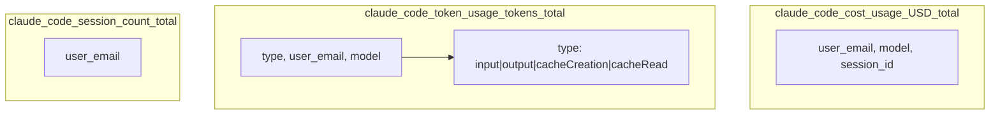

<!-- source: DeepWiki mcp.deepwiki.com · repo anthropics/claude-code-monitoring-guide · page 3.2 Prometheus Configuration and Metrics Storage · fetched 2026-10-26 -->

# Prometheus Configuration and Metrics Storage

<details>
<summary>Relevant source files</summary>

The following files were used as context for generating this wiki page:

- [claude_code_roi_full.md](claude_code_roi_full.md)
- [prometheus.yml](prometheus.yml)

</details>


This document covers the configuration of Prometheus as the time-series database for storing Claude Code telemetry metrics scraped from the OpenTelemetry Collector. It includes scrape configuration, storage settings, and essential queries for ROI analysis.

For OpenTelemetry Collector setup and pipeline configuration, see [OpenTelemetry Collector Configuration](#3.1). For detailed metric definitions and data models, see [Available Metrics and Data Model](#3.3).

## Configuration File Structure

Prometheus is configured through the `prometheus.yml` file which defines global settings, scrape targets, and storage behavior. The configuration follows a hierarchical structure with global defaults and job-specific overrides.

**Prometheus Configuration Architecture**


Sources: [prometheus.yml:1-23]()

## Scrape Target Configuration

The primary scrape configuration targets the OpenTelemetry Collector's metrics endpoint where Claude Code telemetry is exported. The collector exposes metrics on port 8889 using the Prometheus exposition format.

| Configuration Key | Value | Purpose |
|------------------|-------|---------|
| `scrape_interval` | `15s` | Frequency of metric collection from targets |
| `evaluation_interval` | `15s` | Frequency of rule evaluation (if rules are configured) |
| `job_name: 'otel-collector'` | `otel-collector:8889` | Primary target for Claude Code metrics |
| `job_name: 'prometheus'` | `localhost:9090` | Self-monitoring of Prometheus instance |

The OpenTelemetry Collector target configuration uses Docker Compose service name resolution where `otel-collector` resolves to the collector container's internal IP address.

**Scrape Target Data Flow**


Sources: [prometheus.yml:9-18](), [claude_code_roi_full.md:54-90]()

## Metrics Storage and Retention

Prometheus stores Claude Code metrics as time-series data with default retention policies. The storage engine uses a local time-series database optimized for high-cardinality metrics with label-based querying.

### Storage Characteristics

| Aspect | Configuration | Impact |
|--------|---------------|--------|
| **Retention Period** | Default 15 days | Configurable via `--storage.tsdb.retention.time` |
| **Scrape Frequency** | 15 seconds | Defined in `scrape_interval` |
| **Data Points per Day** | 5,760 per metric | (24 hours × 60 minutes × 4 scrapes/minute) |
| **Label Cardinality** | Variable | Based on user count, models, session IDs |

### Key Storage Considerations

- **High Cardinality**: Claude Code metrics include labels for `user.id`, `session.id`, and `model` which create unique time-series
- **Cost Tracking Precision**: USD values stored with sub-cent precision for accurate cost aggregation
- **Token Counting**: Large integer values for cumulative token usage across sessions

Sources: [prometheus.yml:1-4](), [claude_code_roi_full.md:91-121]()

## Key Claude Code Metrics in Prometheus

Claude Code exports several metric families that appear in Prometheus with specific naming conventions. The OTEL Collector transforms OTLP metrics into Prometheus-compatible format with appropriate suffixes.

### Primary Metric Families

| Prometheus Metric Name | Type | Labels | Purpose |
|----------------------|------|--------|---------|
| `claude_code_cost_usage_USD_total` | Counter | `user_email`, `model`, `session_id` | Cumulative cost tracking |
| `claude_code_token_usage_tokens_total` | Counter | `type`, `user_email`, `model` | Token consumption by type |
| `claude_code_session_count_total` | Counter | `user_email` | Session initiation tracking |
| `claude_code_pull_request_count_total` | Counter | `user_email` | Development velocity indicator |

### Label Dimensions

The metrics include several important label dimensions for segmentation:

- **`user_email`**: Identifies individual developers for per-user analysis
- **`model`**: Tracks usage across different Claude models (`claude-4-sonnet-20250514`, `claude-3-5-haiku-20241022`)
- **`type`**: For token metrics, distinguishes `input`, `output`, `cacheCreation`, `cacheRead`
- **`session_id`**: Unique identifier for individual Claude Code sessions

**Metrics Label Structure**


Sources: [claude_code_roi_full.md:95-121]()

## Essential Queries for ROI Analysis

Prometheus Query Language (PromQL) enables powerful aggregation and analysis of Claude Code usage patterns. These queries form the foundation for cost analysis, productivity measurement, and resource planning.

### Cost Analysis Queries

```promql
# Total organizational spend
sum(claude_code_cost_usage_USD_total)

# Cost breakdown by model
sum(claude_code_cost_usage_USD_total) by (model)

# Top spending users
topk(10, sum(claude_code_cost_usage_USD_total) by (user_email))

# Daily cost rate (requires time range)
rate(claude_code_cost_usage_USD_total[24h])
```

### Token Usage Analysis

```promql
# Total tokens by type
sum(claude_code_token_usage_tokens_total) by (type)

# Cache efficiency ratio
sum(claude_code_token_usage_tokens_total{type="cacheRead"}) / 
sum(claude_code_token_usage_tokens_total{type="cacheCreation"})

# Input vs output token ratio per user
sum(claude_code_token_usage_tokens_total{type="output"}) by (user_email) /
sum(claude_code_token_usage_tokens_total{type="input"}) by (user_email)
```

### Productivity Queries

```promql
# Sessions per user
sum(claude_code_session_count_total) by (user_email)

# Cost per session
sum(claude_code_cost_usage_USD_total) by (user_email) /
sum(claude_code_session_count_total) by (user_email)

# Active users in time window
count(count by (user_email) (rate(claude_code_session_count_total[7d])))
```

Sources: [claude_code_roi_full.md:95-121]()

## Integration with OTEL Collector Pipeline

Prometheus operates as the storage backend in the telemetry pipeline, receiving processed metrics from the OpenTelemetry Collector. The integration relies on the collector's Prometheus exporter which transforms OTLP metrics into Prometheus exposition format.

**Complete Pipeline Integration**

```mermaid
flowchart LR
    subgraph "Claude Code"
        sessions["Sessions with telemetry enabled"]
        otlp_client["OTLP client export"]
    end
    
    subgraph "OpenTelemetry Collector :4317/:4318"
        receivers["OTLP receivers"]
        processors["Memory limiter + Batch processor"]
        exporters["Prometheus exporter :8889"]
    end
    
    subgraph "Prometheus :9090"
        scraper["Scraper job: otel-collector"]
        storage["TSDB storage"]
        query_api["Query API /api/v1/query"]
    end
    
    subgraph "Downstream Consumers"
        grafana["Grafana dashboards"]
        report_gen["Report generation scripts"]
    end
    
    sessions --> otlp_client
    otlp_client -->|"gRPC/HTTP OTLP"| receivers
    receivers --> processors
    processors --> exporters
    exporters -->|"Prometheus metrics format"| scraper
    scraper --> storage
    storage --> query_api
    query_api --> grafana
    query_api --> report_gen
```


### Configuration Dependencies

The Prometheus configuration must align with the OpenTelemetry Collector's exporter configuration:

- **Exporter Endpoint**: Collector exposes metrics on `:8889` which matches the scrape target
- **Service Discovery**: Uses Docker Compose service name `otel-collector` for container-to-container communication
- **Metric Format**: Collector transforms OTLP metrics to Prometheus exposition format automatically

Sources: [prometheus.yml:10-14](), [claude_code_roi_full.md:54-90]()

## Storage Optimization and Scaling

For production deployments, Prometheus storage requires consideration of metric cardinality and retention policies. Claude Code metrics can generate high cardinality due to unique session IDs and user identifiers.

### Cardinality Management

- **Session ID Impact**: Each Claude Code session creates a unique `session_id` label value
- **User Scaling**: Label cardinality increases linearly with user count
- **Model Variants**: Different Claude models create additional label combinations

### Retention Strategies

```bash
# Configure retention via command line flags
--storage.tsdb.retention.time=200h   # Retain ~8 days of data
--storage.tsdb.retention.size=10GB   # Size-based retention limit
```

For large deployments, consider implementing recording rules to pre-aggregate frequently queried metrics and reduce query load.

Sources: [claude_code_roi_full.md:54-64]()

---

