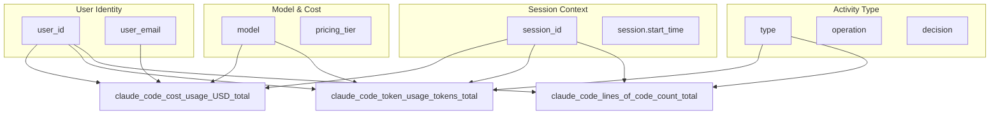
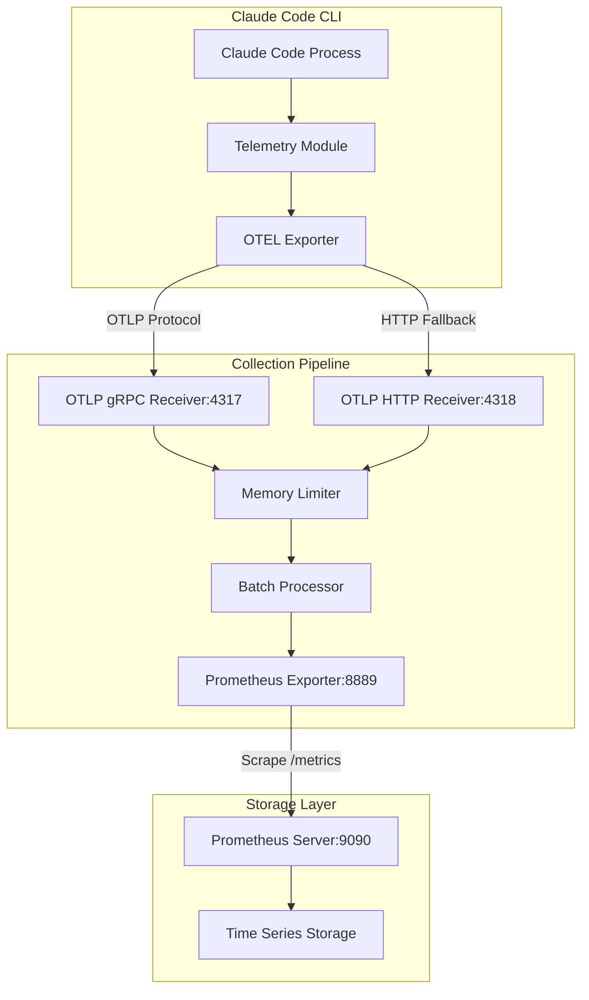

<!-- source: DeepWiki mcp.deepwiki.com · repo anthropics/claude-code-monitoring-guide · page 3.3 Available Metrics and Data Model · fetched 2026-10-26 -->

# Available Metrics and Data Model

<details>
<summary>Relevant source files</summary>

The following files were used as context for generating this wiki page:

- [claude_code_roi_full.md](claude_code_roi_full.md)
- [grafana/dashboards/working-dashboard.json](grafana/dashboards/working-dashboard.json)

</details>


This document describes the complete data model and metric schema for Claude Code telemetry collection in the ROI measurement system. It covers the structure of OpenTelemetry metrics emitted by Claude Code CLI, their labels and dimensions, and how they're stored and queried in Prometheus.

For information about configuring telemetry collection, see [OpenTelemetry Collector Configuration](#3.1). For visualization and dashboard setup, see [Grafana Dashboard Setup](#4.1).

## Metric Naming Convention and Structure

Claude Code follows OpenTelemetry semantic conventions with a standardized naming pattern. All metrics use the `claude_code` prefix and are exported as counters to track cumulative values over time.

### Metric Name Pattern
```
claude_code.<domain>.<metric_name>_<unit>_total
```

The Prometheus exporter automatically appends `_total` suffix to counter metrics and converts units to standardized forms (e.g., `USD` for currency, `tokens` for token counts).

**Core Metric Domains:**
- `cost` - Financial tracking for API usage
- `token` - Token consumption and caching metrics  
- `session` - Session lifecycle and duration
- `lines_of_code` - Code modification tracking
- `pull_request` - Development productivity indicators
- `commit` - Version control activity
- `code_edit_tool` - Tool interaction and acceptance rates

Sources: [claude_code_roi_full.md:34-51](), [grafana/dashboards/working-dashboard.json:82-87]()

## Core Metrics Schema

### Cost Tracking Metrics

#### `claude_code_cost_usage_USD_total`
Cumulative cost counter tracking API usage charges in USD.

```promql
# Metric structure
claude_code_cost_usage_USD_total{
  user_id="7b673f5715f2da49af2cdd341e0cad17fb3274f32d4ceed00d57d53da4e76fb2",
  session_id="092d99fc-ac17-4ee7-b310-57d387777c91", 
  model="claude-4-sonnet-20250514",
  user_email="user@company.com"
}
```

**Labels:**
- `user_id` - SHA256 hash of user identifier for privacy
- `session_id` - UUID for individual Claude Code sessions
- `model` - Claude model used (haiku, sonnet, opus variants)
- `user_email` - User email for organizational reporting

Sources: [claude_code_roi_full.md:44-48](), [grafana/dashboards/working-dashboard.json:343-348]()

### Token Usage Metrics

#### `claude_code_token_usage_tokens_total`
Cumulative token counter with breakdown by usage type and caching efficiency.

```promql
# Token types and their meanings
claude_code_token_usage_tokens_total{type="input"}         # User prompt tokens
claude_code_token_usage_tokens_total{type="output"}        # Claude response tokens  
claude_code_token_usage_tokens_total{type="cacheCreation"} # New cache entries
claude_code_token_usage_tokens_total{type="cacheRead"}     # Cache hits
```

**Cache Efficiency Analysis:**
Cache efficiency can be calculated as `cacheRead / (cacheCreation + cacheRead)` ratio. High cache hit ratios (>90%) indicate effective prompt caching and cost optimization.

Sources: [claude_code_roi_full.md:101-105](), [grafana/dashboards/working-dashboard.json:411-416]()

### Development Productivity Metrics

#### `claude_code_lines_of_code_count_total`
Code modification tracking with operation type classification.

```promql
claude_code_lines_of_code_count_total{type="added"}    # New code lines
claude_code_lines_of_code_count_total{type="modified"} # Changed lines
claude_code_lines_of_code_count_total{type="deleted"}  # Removed lines
```

#### `claude_code_pull_request_count_total`
Pull request creation counter indicating feature completion velocity.

#### `claude_code_commit_count_total` 
Commit activity tracking for development workflow analysis.

Sources: [claude_code_roi_full.md:203-205](), [grafana/dashboards/working-dashboard.json:275-281]()

## Label Taxonomy and Cardinality

### High-Cardinality Labels
Labels that create many unique time series and require careful monitoring:

**User Dimensions:**
- `user_id` - Unique per developer (cardinality: number of active developers)
- `session_id` - Unique per CLI session (cardinality: sessions per day × retention period)
- `user_email` - For organizational reporting (cardinality: team size)

**Model Dimensions:**
- `model` - Claude model variants (cardinality: ~10-15 model versions)

### Low-Cardinality Labels
Stable dimensions suitable for grouping and filtering:

**Type Classifications:**
- `type` - Token types, edit operations, decision outcomes (cardinality: 2-5 per metric)

### Label Structure Diagram



Sources: [claude_code_roi_full.md:44-48](), [grafana/dashboards/working-dashboard.json:343-348]()

## Data Collection Flow

### Telemetry Pipeline Architecture



Sources: [claude_code_roi_full.md:69-82]()

### Metric Emission Trigger Points

Claude Code emits metrics at specific lifecycle events:

**Session Metrics:**
- Session start: `claude_code_session_count_total`
- Session end: Duration and summary metrics

**Cost Metrics:**
- API request completion: `claude_code_cost_usage_USD_total`
- Token consumption: `claude_code_token_usage_tokens_total`

**Development Metrics:**
- Code edit tool usage: `claude_code_code_edit_tool_decision`
- File modifications: `claude_code_lines_of_code_count_total`
- Git operations: `claude_code_commit_count_total`, `claude_code_pull_request_count_total`

Sources: [claude_code_roi_full.md:214-217]()

## Common Query Patterns

### Cost Analysis Queries

```promql
# Total cost across all sessions
sum(claude_code_cost_usage_USD_total)

# Cost by model type
sum by (model)(claude_code_cost_usage_USD_total)

# Cost per user (top spenders)
sum by (user_email)(claude_code_cost_usage_USD_total)

# Cost rate over time (hourly spend)
rate(claude_code_cost_usage_USD_total[1h])
```

### Token Usage Analytics

```promql
# Token distribution by type
sum by (type)(claude_code_token_usage_tokens_total)

# Cache efficiency ratio
sum(claude_code_token_usage_tokens_total{type="cacheRead"}) / 
sum(claude_code_token_usage_tokens_total{type=~"cache.*"})

# Input vs output token ratio
sum(claude_code_token_usage_tokens_total{type="output"}) /
sum(claude_code_token_usage_tokens_total{type="input"})
```

### Productivity Metrics

```promql
# Active user count
count(count by (user_id)(claude_code_cost_usage_USD_total))

# Lines of code by operation type  
sum by (type)(claude_code_lines_of_code_count_total)

# Cost per pull request
sum(claude_code_cost_usage_USD_total) / 
sum(claude_code_pull_request_count_total)
```

Sources: [claude_code_roi_full.md:95-121](), [grafana/dashboards/working-dashboard.json:82-87]()

## Data Retention and Storage Considerations

### Prometheus Configuration
The system uses default Prometheus retention of 15 days with 15-second scrape intervals. For longer-term analysis, consider:

**Retention Policy:**
- Raw metrics: 15 days (default)
- Aggregated hourly: 90 days  
- Daily summaries: 1 year

**Cardinality Management:**
- Monitor `user_id` and `session_id` cardinality growth
- Use recording rules for frequently-queried aggregations
- Consider metric relabeling for high-cardinality cleanup

### Query Performance Optimization

**Recording Rules Example:**
```yaml
# Pre-computed cost aggregations
groups:
  - name: claude_code_aggregations
    interval: 60s
    rules:
      - record: claude_code:cost_by_user:rate5m
        expr: sum by (user_email)(rate(claude_code_cost_usage_USD_total[5m]))
      
      - record: claude_code:tokens_by_type:rate5m  
        expr: sum by (type)(rate(claude_code_token_usage_tokens_total[5m]))
```

Sources: [grafana/dashboards/working-dashboard.json:82-87](), [claude_code_roi_full.md:95-121]()

---

