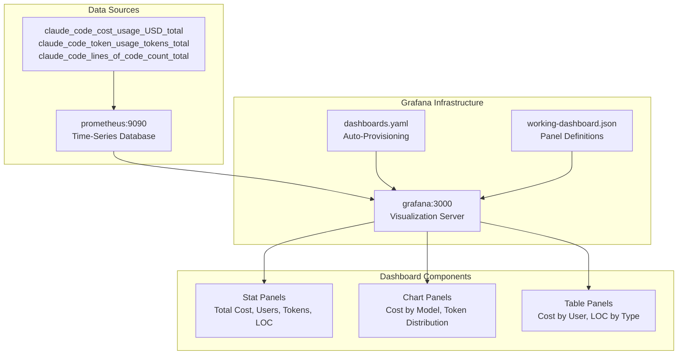
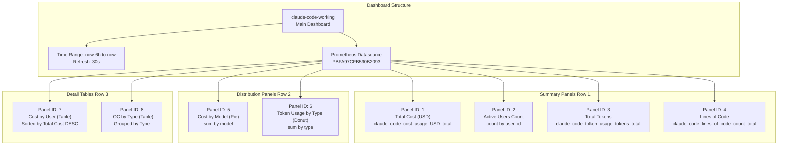
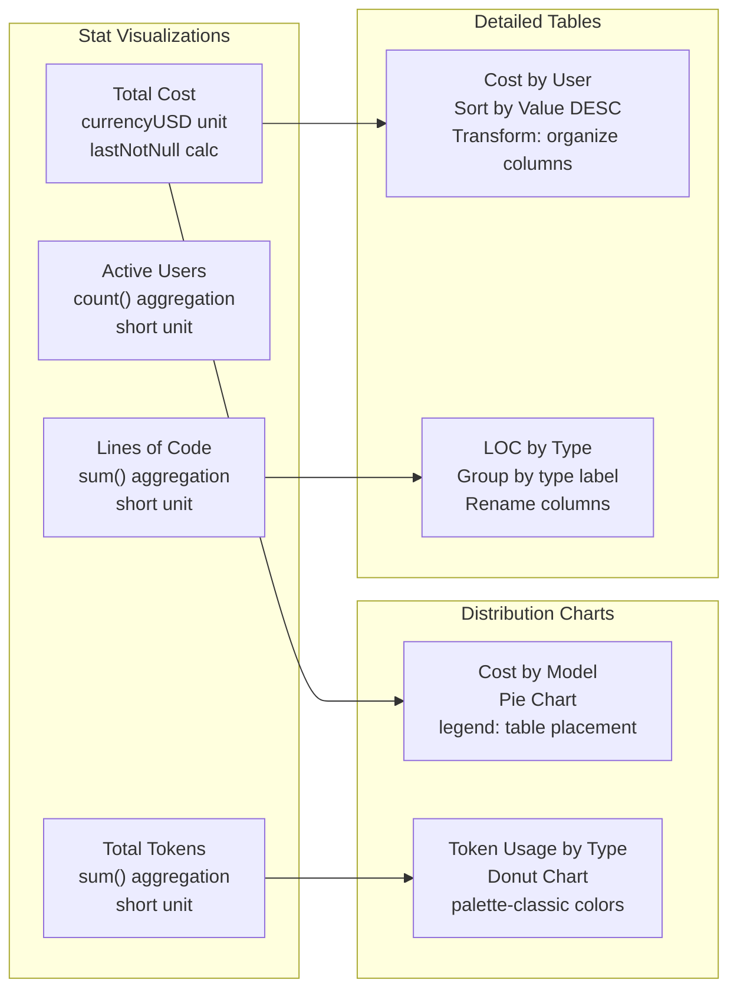
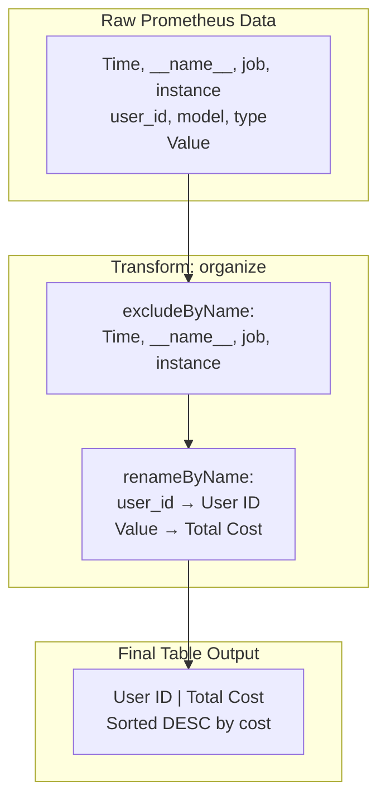
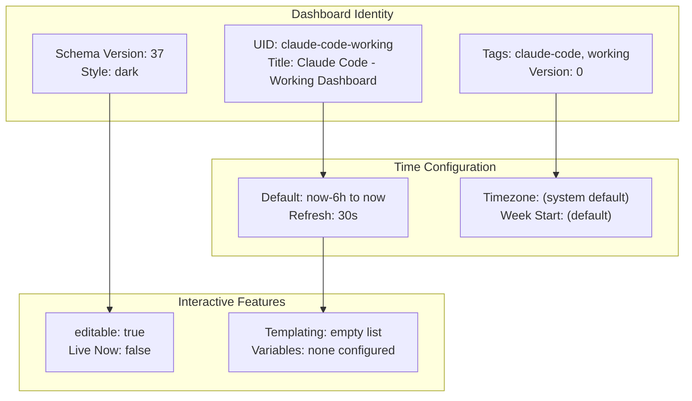
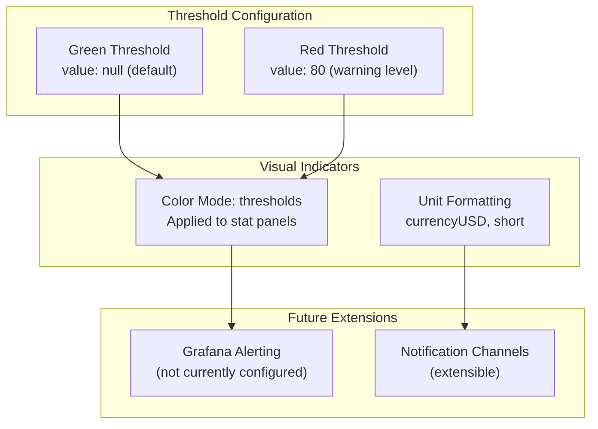

<!-- source: DeepWiki mcp.deepwiki.com · repo anthropics/claude-code-monitoring-guide · page 4 Monitoring and Visualization · fetched 2026-10-26 -->

# Monitoring and Visualization

Relevant source files

The following files were used as context for generating this wiki page:

- [grafana/dashboards/working-dashboard.json](grafana/dashboards/working-dashboard.json)
- [grafana/provisioning/dashboards/dashboards.yaml](grafana/provisioning/dashboards/dashboards.yaml)

This document covers the real-time monitoring and visualization capabilities of the Claude Code ROI measurement system. It explains how to access, interpret, and customize the Grafana dashboards that provide insights into Claude Code usage patterns, costs, and productivity metrics.

For information about setting up the underlying telemetry collection infrastructure, see [Telemetry Collection Pipeline](#3). For details on automated report generation, see [Automated Reporting System](#5).

## Monitoring Infrastructure Overview

The monitoring and visualization system provides real-time insights into Claude Code usage through a Grafana-based dashboard system. The infrastructure automatically provisions dashboards and connects to Prometheus for time-series data visualization.

Sources: [grafana/dashboards/working-dashboard.json:1-647](), [grafana/provisioning/dashboards/dashboards.yaml:1-12]()

## Dashboard Architecture and Components

The system uses a working dashboard that provides comprehensive monitoring of Claude Code usage across multiple dimensions. The dashboard is automatically provisioned and refreshes every 30 seconds to provide near real-time insights.

Sources: [grafana/dashboards/working-dashboard.json:59-89](), [grafana/dashboards/working-dashboard.json:120-157](), [grafana/dashboards/working-dashboard.json:637-640]()

## Metrics and Visualization Types

The dashboard leverages multiple Claude Code metrics to provide different analytical perspectives. Each visualization type serves specific monitoring and analysis purposes.

### Key Metrics Tracked

| Metric Name | Purpose | Query Pattern | Units |
|-------------|---------|---------------|-------|
| `claude_code_cost_usage_USD_total` | Track spending across users and models | `sum(increase(...[$__range]))` | USD Currency |
| `claude_code_token_usage_tokens_total` | Monitor token consumption by type | `sum by (type)(increase(...))` | Token Count |
| `claude_code_lines_of_code_count_total` | Measure code generation productivity | `sum by (type)(increase(...))` | Line Count |

### Visualization Components

Sources: [grafana/dashboards/working-dashboard.json:76-87](), [grafana/dashboards/working-dashboard.json:336-348](), [grafana/dashboards/working-dashboard.json:494-507]()

## Query Patterns and Data Aggregation

The dashboard uses specific PromQL query patterns to aggregate Claude Code metrics across different dimensions. Understanding these patterns helps in customizing and extending the monitoring capabilities.

### Core Query Patterns

| Panel Type | Query Pattern | Purpose |
|------------|---------------|---------|
| Total Cost | `sum(increase(claude_code_cost_usage_USD_total[$__range]))` | Aggregate all costs over time range |
| Active Users | `count(count by (user_id)(increase(claude_code_cost_usage_USD_total[$__range]) > 0))` | Count unique users with activity |
| Cost by Model | `sum by (model)(increase(claude_code_cost_usage_USD_total[$__range]))` | Group costs by Claude model |
| Token Distribution | `sum by (type)(increase(claude_code_token_usage_tokens_total[$__range]))` | Breakdown tokens by input/output/cache |

### Table Transformations

The dashboard applies data transformations to improve readability:

Sources: [grafana/dashboards/working-dashboard.json:510-527](), [grafana/dashboards/working-dashboard.json:606-623]()

## Dashboard Provisioning and Management

The system uses automated dashboard provisioning to ensure consistent deployment and updates. The provisioning configuration allows for version-controlled dashboard management.

### Provisioning Configuration

The dashboard provisioning is configured through [grafana/provisioning/dashboards/dashboards.yaml:1-12]() with the following settings:

| Setting | Value | Purpose |
|---------|--------|---------|
| `name` | `claude-code-dashboards` | Provider identifier |
| `folder` | `Claude Code` | Grafana folder organization |
| `updateIntervalSeconds` | `10` | Check for updates every 10 seconds |
| `allowUiUpdates` | `true` | Enable manual dashboard editing |
| `path` | `/var/lib/grafana/dashboards` | Dashboard JSON file location |

### Dashboard Metadata

Sources: [grafana/dashboards/working-dashboard.json:18-19](), [grafana/dashboards/working-dashboard.json:627-647]()

## Real-time Monitoring Capabilities

The monitoring system provides near real-time visibility into Claude Code usage patterns with automatic refresh capabilities and responsive data updates.

### Refresh and Update Behavior

- **Automatic Refresh**: Every 30 seconds for live monitoring
- **Default Time Range**: Last 6 hours of activity  
- **Query Range Variable**: `$__range` adapts to selected time window
- **Data Freshness**: Depends on Prometheus scrape interval (typically 15 seconds)

### Threshold and Alert Configuration

While the current dashboard focuses on visualization, it includes threshold configurations that can be extended for alerting:

Sources: [grafana/dashboards/working-dashboard.json:36-50](), [grafana/dashboards/working-dashboard.json:104-116]()

---

