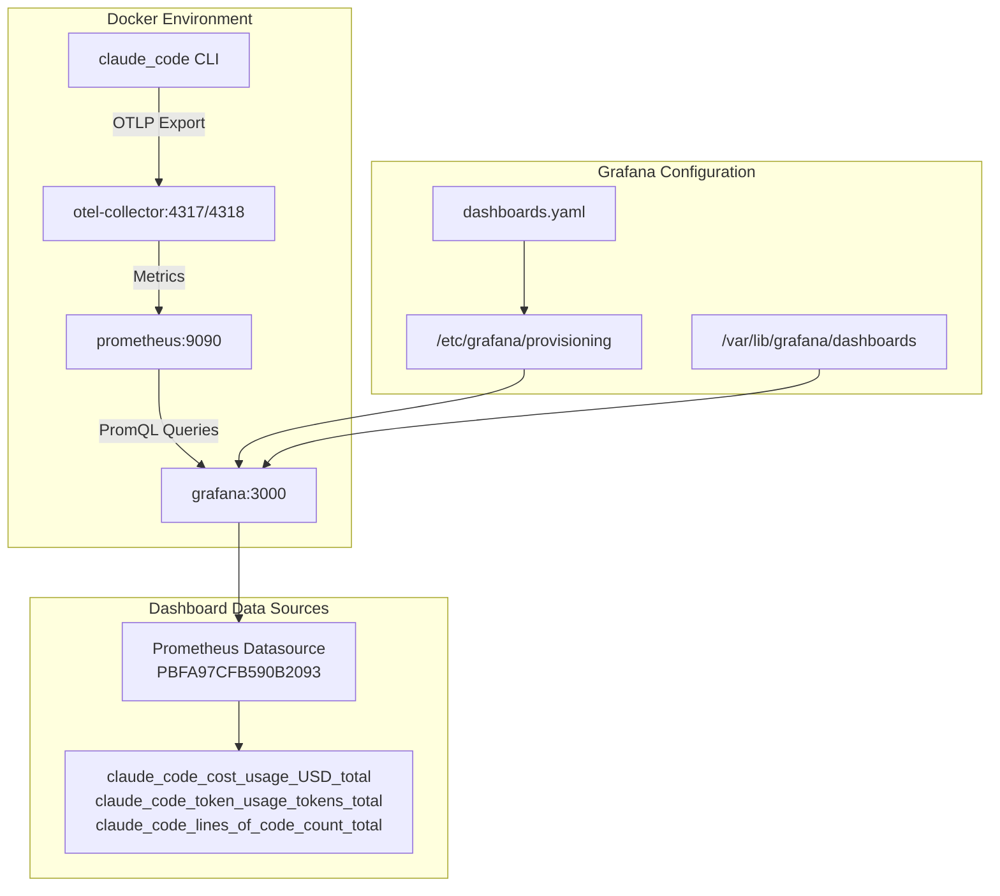
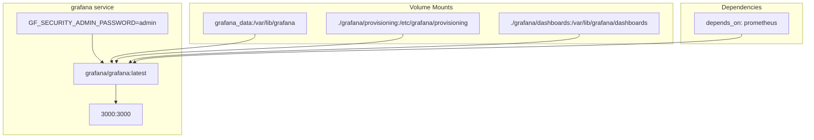
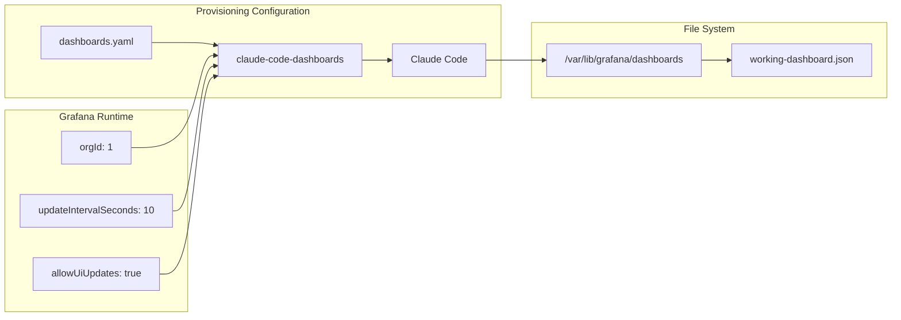
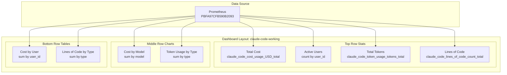
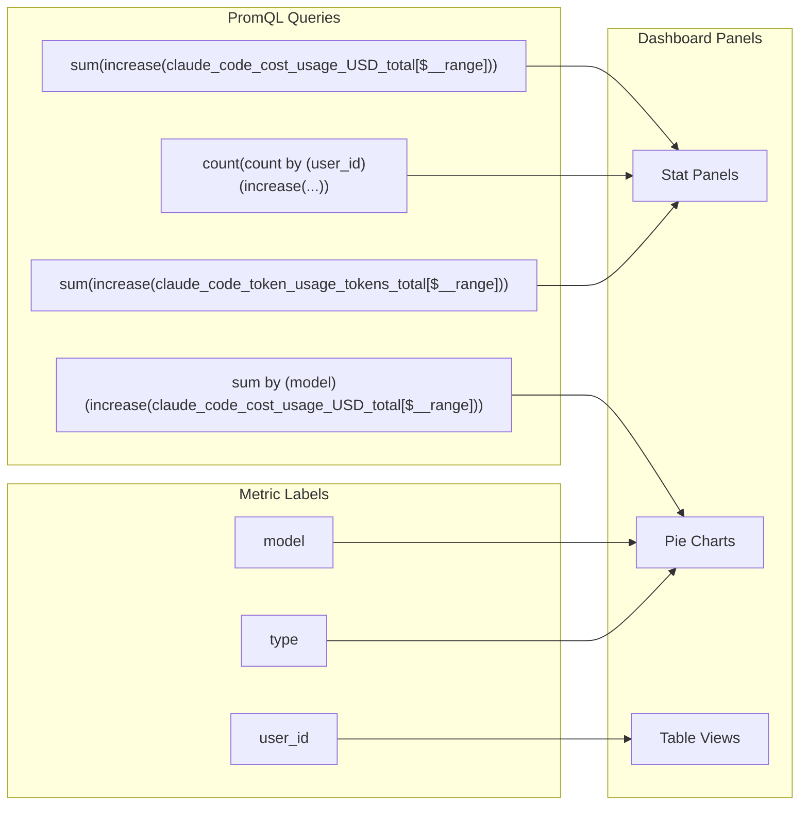

<!-- source: DeepWiki mcp.deepwiki.com · repo anthropics/claude-code-monitoring-guide · page 4.1 Grafana Dashboard Setup · fetched 2026-10-26 -->

# Grafana Dashboard Setup

Relevant source files

The following files were used as context for generating this wiki page:

- [docker-compose.yml](docker-compose.yml)
- [grafana/dashboards/working-dashboard.json](grafana/dashboards/working-dashboard.json)
- [grafana/provisioning/dashboards/dashboards.yaml](grafana/provisioning/dashboards/dashboards.yaml)

This document covers the configuration and setup of Grafana dashboards for visualizing Claude Code usage metrics, costs, and productivity data. The dashboard system provides real-time monitoring capabilities by querying metrics stored in Prometheus and presenting them through various visualization panels.

For information about configuring the underlying Prometheus metrics storage, see [Prometheus Configuration and Metrics Storage](#3.2). For details on interpreting the dashboard visualizations, see [Cost and Usage Visualizations](#4.2).

## System Integration Overview

Grafana serves as the visualization layer in the Claude Code ROI measurement pipeline, consuming metrics from Prometheus and presenting them through interactive dashboards.

Sources: [docker-compose.yml:32-46](), [grafana/provisioning/dashboards/dashboards.yaml:1-12](), [grafana/dashboards/working-dashboard.json:26-28]()

## Docker Compose Configuration

The Grafana service is defined in the Docker Compose stack with specific volume mounts for provisioning and dashboard persistence.

Sources: [docker-compose.yml:32-46]()

The key configuration elements include:

| Configuration | Value | Purpose |
|---------------|-------|---------|
| Image | `grafana/grafana:latest` | Official Grafana container |
| Port | `3000:3000` | Web interface access |
| Admin Password | `admin` | Default login credentials |
| Provisioning Mount | `./grafana/provisioning:/etc/grafana/provisioning` | Auto-configuration |
| Dashboard Mount | `./grafana/dashboards:/var/lib/grafana/dashboards` | Dashboard JSON files |

## Dashboard Provisioning

Dashboard provisioning is configured through the `dashboards.yaml` file, enabling automatic dashboard loading and updates.

Sources: [grafana/provisioning/dashboards/dashboards.yaml:1-12]()

The provisioning configuration includes:

- **Provider Name**: `claude-code-dashboards`
- **Organization**: `orgId: 1` 
- **Folder**: `Claude Code`
- **Update Interval**: `10 seconds`
- **UI Updates**: `allowUiUpdates: true`
- **Path**: `/var/lib/grafana/dashboards`

## Dashboard Structure and Panels

The main dashboard (`working-dashboard.json`) contains multiple visualization panels organized to provide comprehensive Claude Code usage insights.

Sources: [grafana/dashboards/working-dashboard.json:24-625]()

### Panel Configuration Details

| Panel | Type | Query | Grid Position |
|-------|------|-------|---------------|
| Total Cost | `stat` | `sum(increase(claude_code_cost_usage_USD_total[$__range]))` | `h:8, w:6, x:0, y:0` |
| Active Users | `stat` | `count(count by (user_id)(increase(claude_code_cost_usage_USD_total[$__range]) > 0))` | `h:8, w:6, x:6, y:0` |
| Total Tokens | `stat` | `sum(increase(claude_code_token_usage_tokens_total[$__range]))` | `h:8, w:6, x:12, y:0` |
| Lines of Code | `stat` | `sum(increase(claude_code_lines_of_code_count_total[$__range]))` | `h:8, w:6, x:18, y:0` |

Sources: [grafana/dashboards/working-dashboard.json:75-283]()

### Visualization Types

The dashboard employs several visualization types:

- **Stat Panels**: For key metrics display with currency/numeric formatting
- **Pie Charts**: For proportional data (cost by model, token usage by type)
- **Tables**: For detailed breakdowns with sorting capabilities
- **Donut Charts**: For token type distribution visualization

Sources: [grafana/dashboards/working-dashboard.json:314-419]()

## Dashboard Access and Configuration

### Access Credentials

- **URL**: `http://localhost:3000`
- **Username**: `admin`
- **Password**: `admin` (configured via `GF_SECURITY_ADMIN_PASSWORD`)

### Time Range Configuration

The dashboard is configured with:
- **Default Range**: `now-6h` to `now`
- **Refresh Rate**: `30s` auto-refresh
- **Timezone**: Uses browser default

Sources: [grafana/dashboards/working-dashboard.json:637-641](), [grafana/dashboards/working-dashboard.json:627]()

### Dashboard Metadata

| Property | Value |
|----------|-------|
| Title | `Claude Code - Working Dashboard` |
| UID | `claude-code-working` |
| Tags | `["claude-code", "working"]` |
| Schema Version | `37` |
| Style | `dark` |

Sources: [grafana/dashboards/working-dashboard.json:630-646]()

## Prometheus Data Source Integration

The dashboard connects to Prometheus using a pre-configured data source with UID `PBFA97CFB590B2093`. All panels query this data source using PromQL expressions to aggregate Claude Code metrics.

Sources: [grafana/dashboards/working-dashboard.json:82](), [grafana/dashboards/working-dashboard.json:343](), [grafana/dashboards/working-dashboard.json:501]()

---

