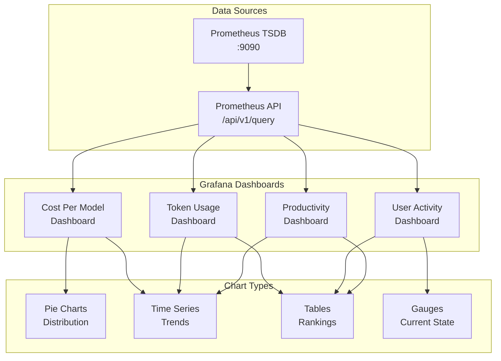
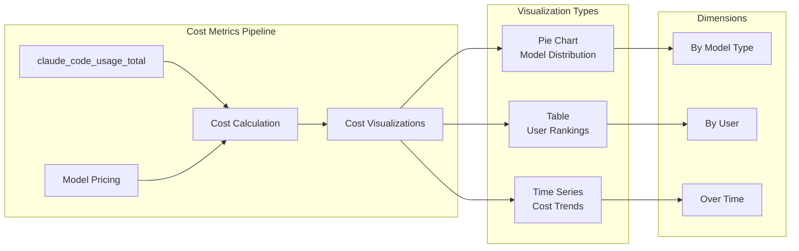
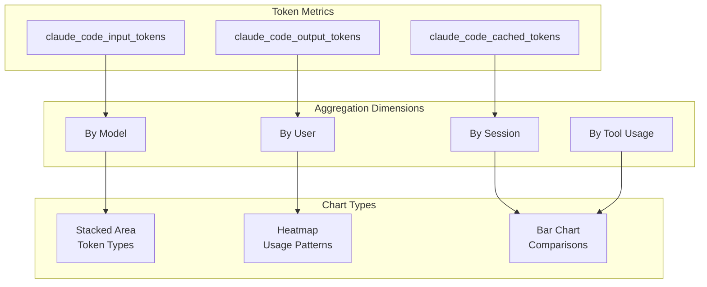
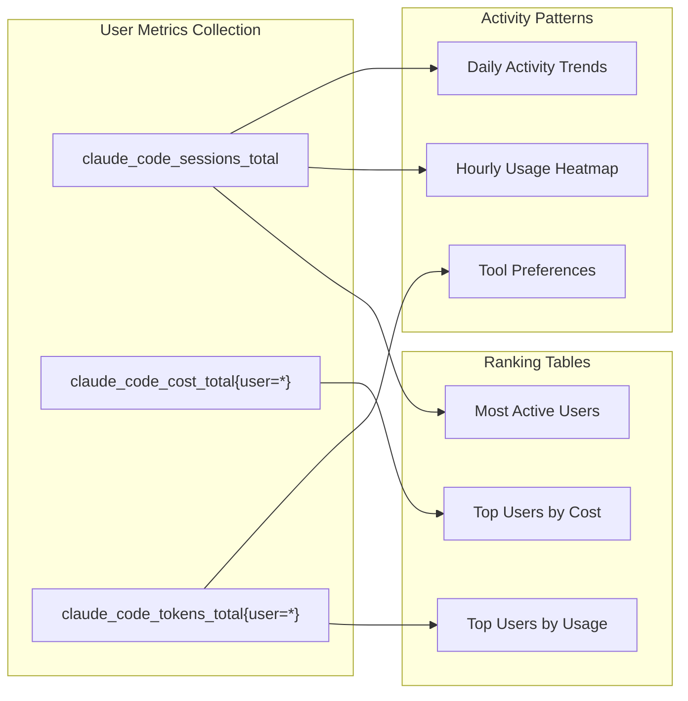
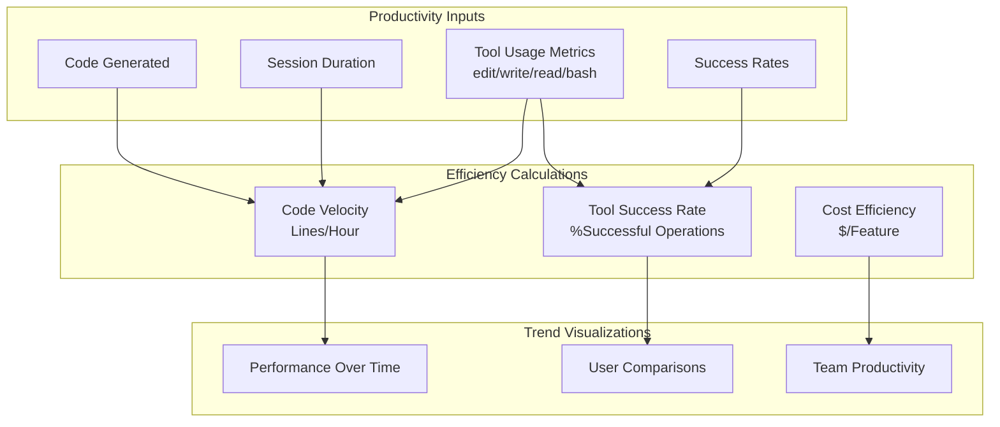

<!-- source: DeepWiki mcp.deepwiki.com · repo anthropics/claude-code-monitoring-guide · page 4.2 Cost and Usage Visualizations · fetched 2026-10-26 -->

# Cost and Usage Visualizations

Relevant source files

The following files were used as context for generating this wiki page:

- [screenshots/grafana_cost_per_model.png](screenshots/grafana_cost_per_model.png)
- [screenshots/graphan_dashboard_cost_tokens_cost_per_user.png](screenshots/graphan_dashboard_cost_tokens_cost_per_user.png)
- [screenshots/prometheus_cost_time_series.png](screenshots/prometheus_cost_time_series.png)

This document covers the cost and usage visualization capabilities in the Claude Code ROI measurement system. It explains how to understand and interpret the various dashboards, charts, and metrics displayed in Grafana for analyzing Claude Code usage patterns, costs, and productivity metrics.

For information about setting up Grafana dashboards, see [Grafana Dashboard Setup](#4.1). For dashboard provisioning and automated management, see [Dashboard Provisioning and Management](#4.3). For details on the underlying metrics data model, see [Available Metrics and Data Model](#3.3).

## Overview of Visualization Components

The visualization layer consists of Grafana dashboards that query Prometheus time-series data to display real-time and historical views of Claude Code usage patterns.

### Visualization Architecture

Sources: `screenshots/grafana_cost_per_model.png`

## Cost Analysis Visualizations

### Cost Per Model Charts

The primary cost visualization shows spending breakdown across different Claude models (`claude-3-sonnet`, `claude-3-haiku`, etc.) used in code generation sessions.

#### Key Cost Metrics

| Metric | Description | Query Pattern |
|--------|-------------|---------------|
| `claude_code_cost_total` | Total cost attributed per session | `sum by (model) (claude_code_cost_total)` |
| `claude_code_tokens_total` | Token consumption for cost calculation | `sum by (model, user) (claude_code_tokens_total)` |
| Cost per user | User-specific spending analysis | `sum by (user) (claude_code_cost_total)` |

### Cost Trend Analysis

Time-series visualizations track cost patterns over configurable time windows, helping identify usage spikes and optimization opportunities.

Sources: `screenshots/grafana_cost_per_model.png`

## Token Usage Visualizations

### Token Distribution Charts

Token usage visualizations break down consumption across input tokens, output tokens, and cached tokens for each Claude model.

#### Token Efficiency Metrics

| Visualization | Purpose | PromQL Query Example |
|---------------|---------|---------------------|
| Input vs Output Ratio | Efficiency analysis | `claude_code_output_tokens / claude_code_input_tokens` |
| Cache Hit Rate | Caching effectiveness | `claude_code_cached_tokens / (claude_code_input_tokens + claude_code_cached_tokens)` |
| Token Velocity | Tokens per time unit | `rate(claude_code_tokens_total[5m])` |

Sources: `screenshots/grafana_cost_per_model.png`

## User Activity Visualizations

### User Rankings and Activity Tables

User activity dashboards rank users by various metrics including total cost, token consumption, and session frequency.

### Activity Pattern Analysis

- **Peak Usage Hours**: Heatmap showing when Claude Code is most actively used
- **Tool Preferences**: Distribution of `edit`, `write`, `read`, and `bash` tool usage by user
- **Session Duration**: Average session length and productivity correlation

Sources: Based on system architecture diagrams

## Productivity Metrics Visualizations  

### Code Generation Efficiency

Productivity visualizations combine Claude Code metrics with development workflow data to measure AI coding tool effectiveness.

#### Key Productivity Indicators

| KPI | Calculation | Interpretation |
|-----|-------------|----------------|
| Tool Efficiency | `successful_operations / total_operations` | Higher values indicate better prompt engineering |
| Cost per Feature | `total_cost / features_delivered` | Lower values show cost-effective usage |
| Token Efficiency | `output_tokens / input_tokens` | Measures prompt effectiveness |

Sources: Based on system overview and telemetry pipeline documentation

## Dashboard Navigation and Interpretation

### Reading Cost Visualizations

1. **Pie Charts**: Show distribution percentages across models or users
2. **Time Series**: Identify trends, spikes, and usage patterns over time  
3. **Tables**: Provide detailed breakdowns with sortable columns
4. **Gauges**: Display current usage against defined thresholds

### Filtering and Drilling Down

Grafana dashboards support filtering by:
- Time range (15m, 1h, 6h, 12h, 1d, 7d, 30d)
- User groups or individual users  
- Model types (`claude-3-sonnet`, `claude-3-haiku`, etc.)
- Tool types (`edit`, `write`, `read`, `bash`)

### Alert Thresholds

Key metrics have configurable alert thresholds:
- Cost per user per day
- Token consumption rate
- Failed operation percentages
- Unusual usage pattern detection

Sources: `screenshots/grafana_cost_per_model.png`, system architecture documentation

---

