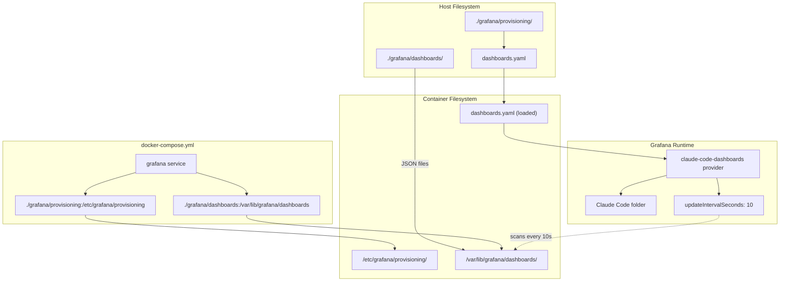
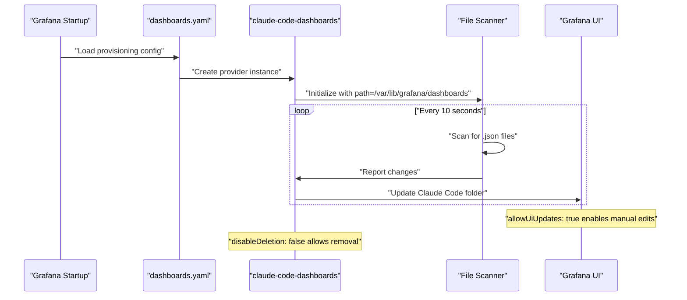
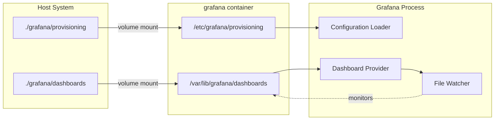
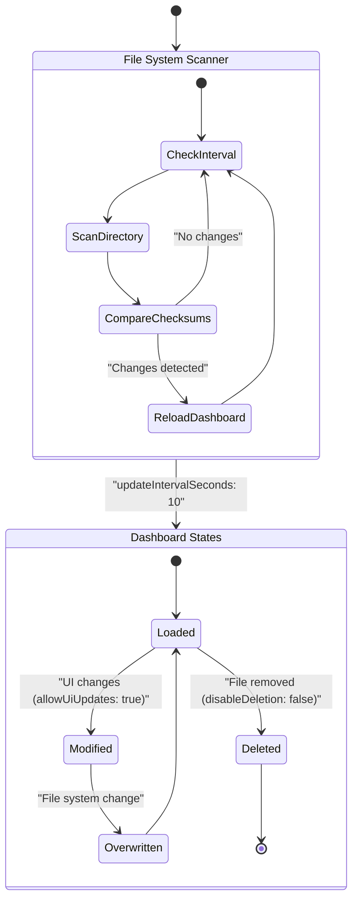
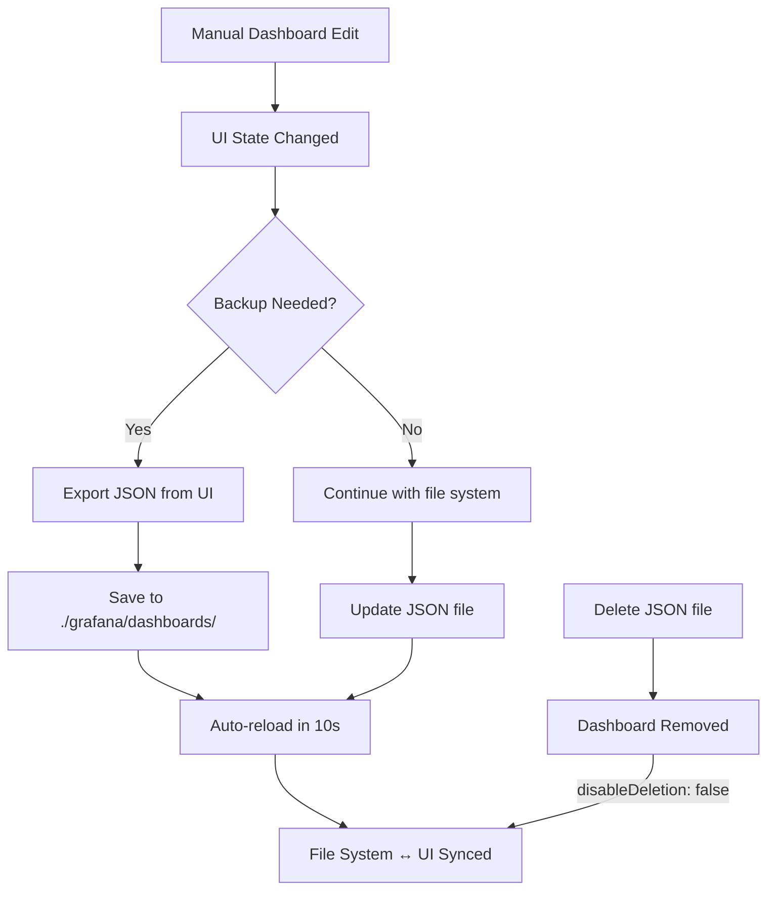

<!-- source: DeepWiki mcp.deepwiki.com · repo anthropics/claude-code-monitoring-guide · page 4.3 Dashboard Provisioning and Management · fetched 2026-10-26 -->

# Dashboard Provisioning and Management

<details>
<summary>Relevant source files</summary>

The following files were used as context for generating this wiki page:

- [docker-compose.yml](docker-compose.yml)
- [grafana/provisioning/dashboards/dashboards.yaml](grafana/provisioning/dashboards/dashboards.yaml)

</details>


This document covers the automated provisioning, configuration management, and updating procedures for Grafana dashboards in the Claude Code ROI measurement system. It focuses on the infrastructure-as-code approach used to manage dashboard definitions and their deployment lifecycle.

For information about dashboard content and visualization setup, see [Grafana Dashboard Setup](#4.1). For details about the specific metrics and charts displayed, see [Cost and Usage Visualizations](#4.2).

## Provisioning Architecture Overview

The system uses Grafana's built-in provisioning capabilities to automatically deploy and manage dashboards without manual intervention. This approach ensures consistent dashboard deployment across environments and enables version control of dashboard definitions.

### Grafana Provisioning Structure



**Sources:** [docker-compose.yml:32-46](), [grafana/provisioning/dashboards/dashboards.yaml:1-12]()

## Dashboard Provider Configuration

The dashboard provisioning is configured through the `dashboards.yaml` file which defines how Grafana discovers and loads dashboard definitions.

### Provider Configuration Structure

| Configuration Key | Value | Purpose |
|------------------|-------|---------|
| `apiVersion` | `1` | Grafana provisioning API version |
| `name` | `claude-code-dashboards` | Unique provider identifier |
| `orgId` | `1` | Target Grafana organization |
| `folder` | `Claude Code` | Dashboard folder in Grafana UI |
| `type` | `file` | Filesystem-based provider |
| `disableDeletion` | `false` | Allow dashboard deletion |
| `updateIntervalSeconds` | `10` | Scan frequency for changes |
| `allowUiUpdates` | `true` | Permit manual dashboard edits |
| `options.path` | `/var/lib/grafana/dashboards` | Source directory path |

### Configuration Flow



**Sources:** [grafana/provisioning/dashboards/dashboards.yaml:1-12]()

## Volume Mounting and File Organization

The Docker Compose configuration establishes the file system mapping that enables dashboard provisioning to function.

### Volume Mount Configuration

The Grafana service mounts two critical directories:



**Sources:** [docker-compose.yml:40-43]()

### Directory Structure

The expected file system layout for dashboard management:

```
grafana/
├── provisioning/
│   └── dashboards/
│       └── dashboards.yaml       # Provider configuration
└── dashboards/                   # Dashboard JSON files
    ├── claude-cost-analysis.json # (example dashboard file)
    ├── token-usage-metrics.json  # (example dashboard file)
    └── productivity-overview.json # (example dashboard file)
```

## Update Management and Lifecycle

The provisioning system provides automated dashboard lifecycle management with configurable update behavior.

### Update Detection Mechanism



### Configuration Parameters Impact

| Parameter | Value | Behavior |
|-----------|-------|----------|
| `updateIntervalSeconds: 10` | 10 seconds | Dashboard changes detected within 10 seconds |
| `allowUiUpdates: true` | Enabled | Manual dashboard edits permitted but may be overwritten |
| `disableDeletion: false` | Disabled | Dashboards can be removed by deleting JSON files |

**Sources:** [grafana/provisioning/dashboards/dashboards.yaml:8-11]()

## Operational Procedures

### Adding New Dashboards

1. Create dashboard JSON file in `./grafana/dashboards/` directory
2. File will be automatically detected within 10 seconds
3. Dashboard appears in "Claude Code" folder in Grafana UI

### Updating Existing Dashboards

1. Modify JSON file in `./grafana/dashboards/` directory
2. Changes automatically applied within `updateIntervalSeconds` interval
3. Any manual UI changes are overwritten by file system version

### Dashboard Backup and Recovery



**Sources:** [grafana/provisioning/dashboards/dashboards.yaml:8-11](), [docker-compose.yml:40-43]()

---

