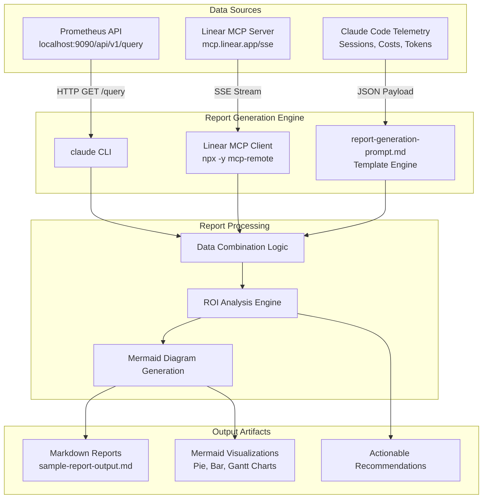
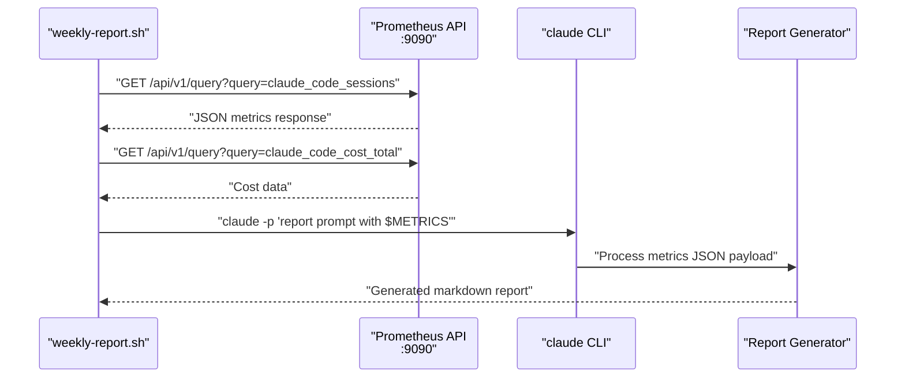
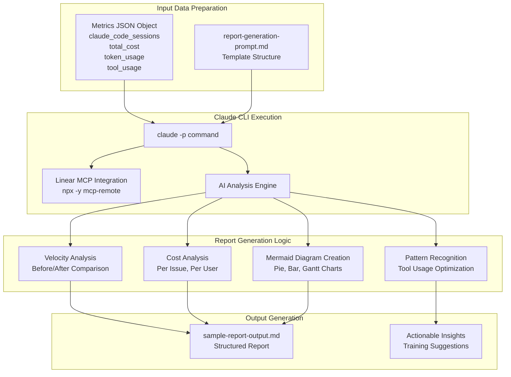
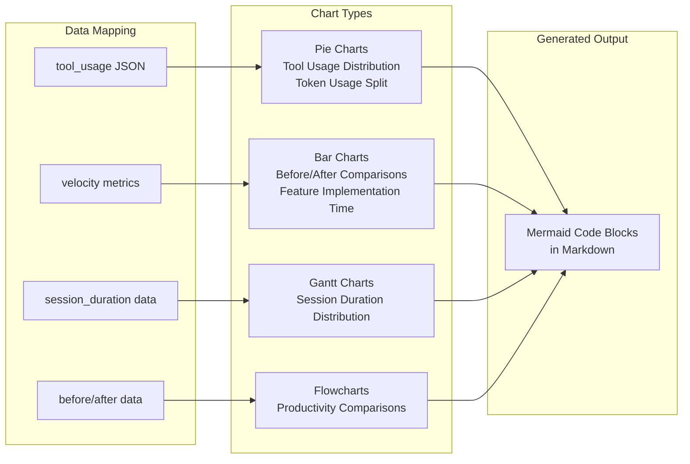
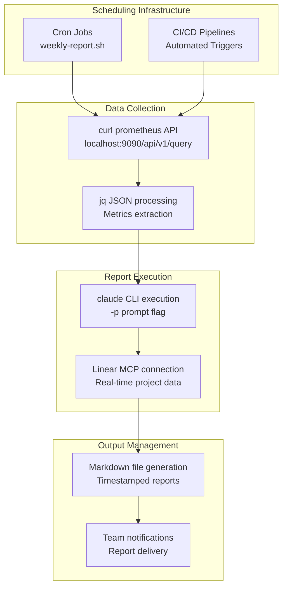

<!-- source: DeepWiki mcp.deepwiki.com · repo anthropics/claude-code-monitoring-guide · page 5 Automated Reporting System · fetched 2026-10-26 -->

# Automated Reporting System

<details>
<summary>Relevant source files</summary>

The following files were used as context for generating this wiki page:

- [report-generation-prompt.md](report-generation-prompt.md)
- [sample-report-output.md](sample-report-output.md)

</details>


## Purpose and Scope

The Automated Reporting System combines Claude Code usage metrics from Prometheus with project management data from Linear to generate comprehensive ROI and productivity reports. This system uses the Claude CLI with MCP (Model Context Protocol) integration to create automated, data-driven reports that analyze AI coding tool effectiveness and team productivity.

For real-time monitoring and visualization, see [Monitoring and Visualization](#4). For details on telemetry data collection, see [Telemetry Collection Pipeline](#3).

## System Architecture

The Automated Reporting System operates as the analysis and reporting layer of the Claude Code ROI measurement pipeline, consuming data from multiple sources to generate actionable insights.



Sources: [report-generation-prompt.md:1-81](), [sample-report-output.md:1-158]()

## Data Sources and Integration Points

The reporting system integrates three primary data sources to provide comprehensive analysis capabilities.

### Prometheus Metrics API Integration

The system queries Prometheus for Claude Code telemetry data using HTTP API calls to extract usage patterns and cost metrics.



Sources: [report-generation-prompt.md:76-81]()

### Linear MCP Integration

The system uses Linear's MCP server to fetch real-time project management data including issue velocity, sprint metrics, and team productivity indicators.

| Integration Component | Configuration | Purpose |
|----------------------|---------------|---------|
| MCP Server | `mcp.linear.app/sse` | Linear API access via SSE |
| Client Command | `claude mcp add linear -s user -- npx -y mcp-remote` | MCP registration |
| Data Stream | Server-Sent Events | Real-time project updates |

Sources: [report-generation-prompt.md:7-10]()

## Report Generation Process

The report generation process combines the Claude CLI with structured prompts to create comprehensive productivity analyses.

### Command Structure and Data Flow



Sources: [report-generation-prompt.md:14-54](), [sample-report-output.md:1-158]()

### Metrics Data Structure

The system processes structured JSON metrics that include session data, cost attribution, and tool usage patterns:

```json
{
  "claude_code_sessions": 42,
  "total_cost": 103.45,
  "pull_requests": 23,
  "avg_session_duration": "28.5 minutes",
  "tool_usage": {
    "Edit": 356,
    "MultiEdit": 128,
    "Write": 73,
    "Read": 892,
    "Bash": 204
  },
  "tool_acceptance_rates": {
    "Edit": 0.81,
    "MultiEdit": 0.92,
    "Write": 0.65
  }
}
```

Sources: [report-generation-prompt.md:17-42]()

## Report Structure and Content

Generated reports follow a standardized structure that combines quantitative metrics with qualitative analysis and actionable recommendations.

### Report Sections and Components

| Section | Content Type | Data Sources |
|---------|-------------|--------------|
| Executive Summary | Velocity improvements, cost overview | Linear + Prometheus |
| Usage Metrics | Tool distribution, acceptance rates | Claude Code telemetry |
| Linear Integration Metrics | Issue completion, team velocity | Linear MCP |
| Cost Analysis | Token usage, cost per issue | Prometheus cost metrics |
| Actionable Insights | Usage patterns, optimization opportunities | Combined analysis |
| Recommendations | Training suggestions, process improvements | AI-generated insights |

Sources: [sample-report-output.md:7-131]()

### Visualization Generation

The system automatically generates Mermaid diagrams for data visualization:



Sources: [sample-report-output.md:15-154]()

## Automation and Scheduling

The system supports automated report generation through shell scripts and cron jobs for regular ROI analysis.

### Automated Script Structure

The `weekly-report.sh` script demonstrates the automation pattern for regular report generation:

```bash
#!/bin/bash
# Gather metrics from Prometheus
METRICS=$(curl -s "http://localhost:9090/api/v1/query?query=..." | jq '...')

# Generate report
claude -p "Using the Linear MCP, analyze our team's velocity... $METRICS ..."
```

Sources: [report-generation-prompt.md:72-81]()

### Integration Points for Automation



Sources: [report-generation-prompt.md:70-81]()

---

