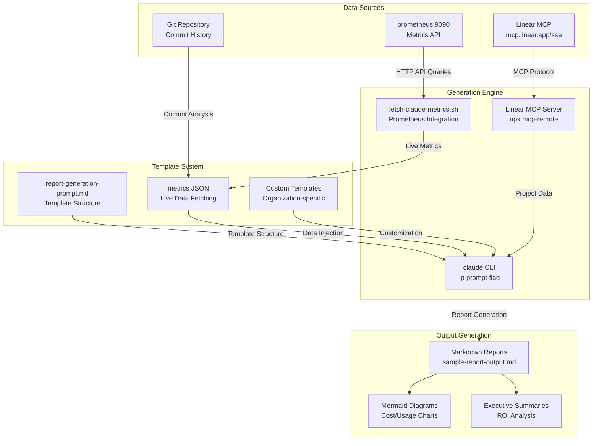
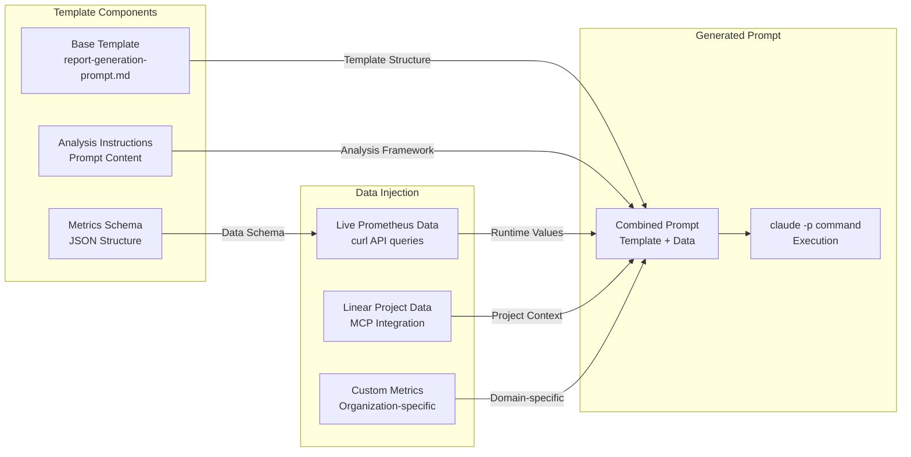
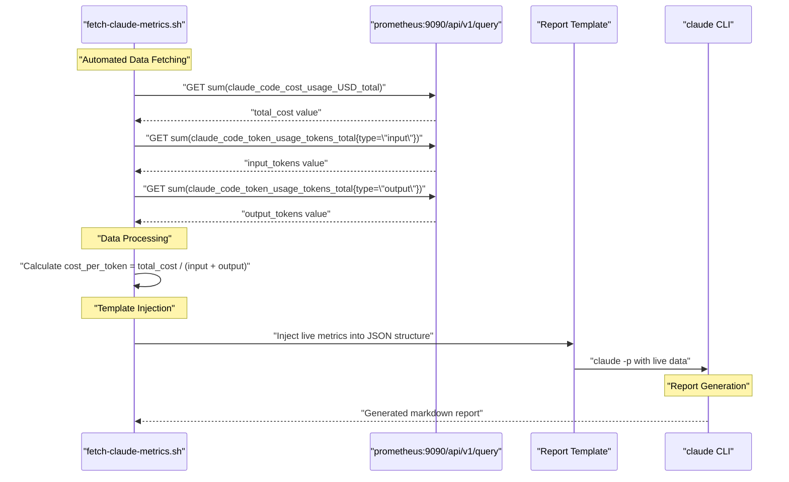
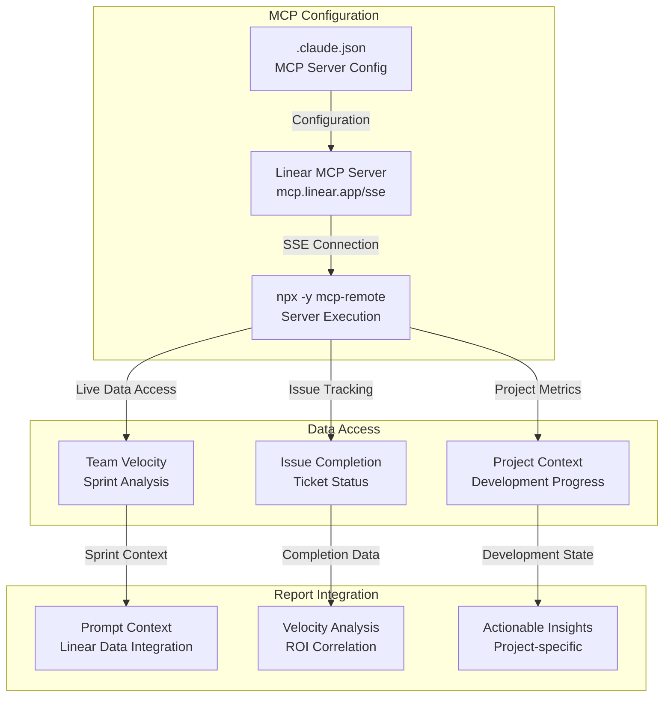
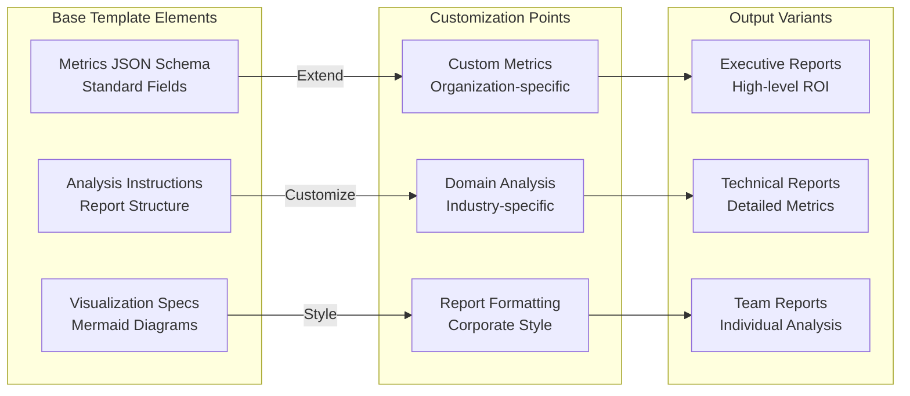
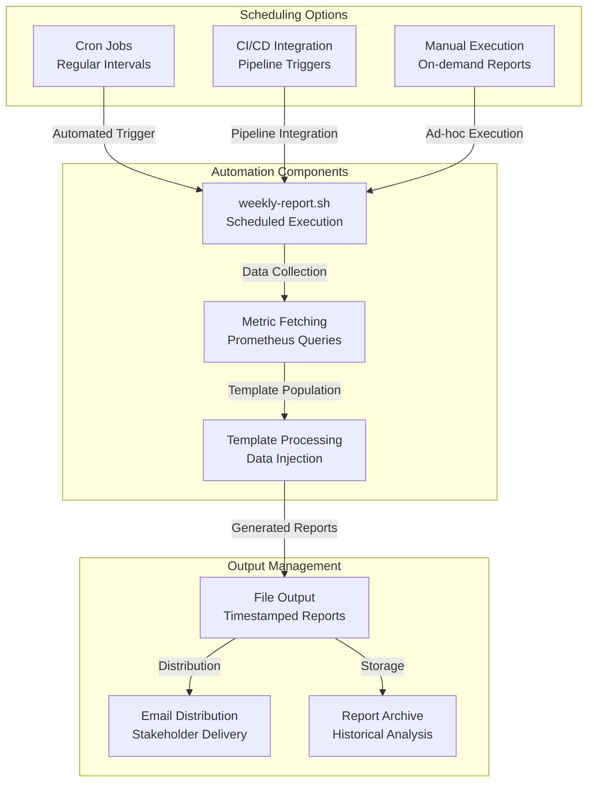

<!-- source: DeepWiki mcp.deepwiki.com · repo anthropics/claude-code-monitoring-guide · page 5.1 Report Generation and Templates · fetched 2026-10-26 -->

# Report Generation and Templates

<details>
<summary>Relevant source files</summary>

The following files were used as context for generating this wiki page:

- [claude_code_roi_full.md](claude_code_roi_full.md)
- [report-generation-prompt.md](report-generation-prompt.md)

</details>


This page covers the automated report generation system that combines Claude Code telemetry metrics with Linear project management data to produce comprehensive ROI analysis reports. The system uses the Claude CLI with structured prompts to generate markdown reports with embedded visualizations.

For information about Linear MCP configuration details, see [Linear MCP Integration](#5.2). For sample reports and interpretation guidance, see [Report Examples and Interpretation](#5.3). For setting up automated scheduling, see [Automation and Scheduling](#5.4).

## Report Generation Architecture

The report generation system leverages multiple data sources and the Claude CLI to produce automated ROI reports. The architecture centers around template-based prompts that fetch live data from Prometheus and Linear.



Sources: [claude_code_roi_full.md:406-500](), [report-generation-prompt.md:1-80]()

## Template System Overview

The report generation system uses structured prompt templates that combine static analysis instructions with dynamic metric data. Templates are defined as markdown files containing Claude CLI prompts with JSON metric placeholders.



The core template structure includes standardized metric categories and analysis instructions:

| Template Section | Purpose | Data Source |
|------------------|---------|-------------|
| Executive Summary | High-level ROI overview | Aggregated metrics |
| Usage Patterns | Developer engagement analysis | `claude_code_sessions`, `tool_acceptance_rates` |
| Cost Analysis | Financial impact breakdown | `total_cost`, `cost_per_pr` |
| Linear Integration | Project velocity metrics | Linear MCP data |
| Recommendations | Actionable optimization insights | Combined analysis |

Sources: [report-generation-prompt.md:12-54](), [claude_code_roi_full.md:440-453]()

## Prometheus Data Integration

The system fetches live metrics from Prometheus using HTTP API queries and injects them into report templates. This enables reports to reflect current usage patterns and costs.



The fetch script uses `curl` and `jq` for metric extraction and calculation:

```bash
# Core metric fetching pattern from fetch-claude-metrics.sh
TOTAL_COST=$(curl -s "http://localhost:9090/api/v1/query?query=sum(claude_code_cost_usage_USD_total)" | jq -r '.data.result[0].value[1] // "0"')
INPUT_TOKENS=$(curl -s "http://localhost:9090/api/v1/query?query=sum(claude_code_token_usage_tokens_total{type=\"input\"})" | jq -r '.data.result[0].value[1] // "0"')
```

Sources: [claude_code_roi_full.md:456-477]()

## Linear MCP Integration

The Linear MCP server enables real-time access to project management data within report generation. This integration provides context about team velocity, issue completion, and development progress.



The Linear MCP integration is configured through the Claude CLI or direct JSON configuration:

| Configuration Method | Command/File | Purpose |
|---------------------|--------------|---------|
| CLI Setup | `claude mcp add linear -s user -- npx -y mcp-remote https://mcp.linear.app/sse` | Interactive setup |
| JSON Config | `.claude.json` mcpServers section | Persistent configuration |
| Verification | `claude mcp list` | Validate integration |

Sources: [claude_code_roi_full.md:410-436]()

## Template Customization

Organizations can customize report templates by modifying the JSON metrics structure and analysis instructions. The template system supports organization-specific metrics and custom analysis frameworks.



Template customization involves modifying the metrics JSON structure and prompt instructions:

```json
{
  "claude_code_sessions": 42,
  "total_cost": 103.45,
  "pull_requests": 23,
  "avg_session_duration": "28.5 minutes",
  "tool_acceptance_rates": {
    "Edit": 0.81,
    "MultiEdit": 0.92,
    "Write": 0.65
  }
}
```

Sources: [report-generation-prompt.md:17-42](), [claude_code_roi_full.md:488-499]()

## Automation and Scheduling

The report generation system supports automated execution through shell scripts that combine metric fetching with template processing. These scripts can be scheduled for regular reporting intervals.



The automation pattern follows a standard shell script structure that fetches metrics and generates reports:

```bash
#!/bin/bash
# weekly-report.sh pattern
# 1. Gather metrics from Prometheus
# 2. Process data through template
# 3. Execute Claude CLI for report generation
```

Sources: [report-generation-prompt.md:68-81](), [claude_code_roi_full.md:456-477]()

---

