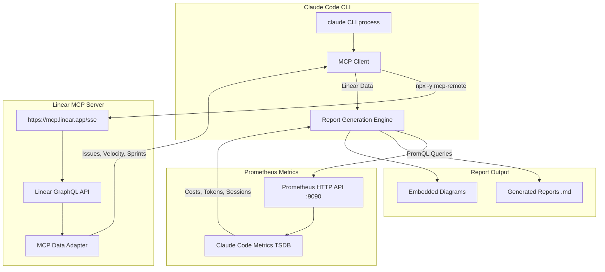
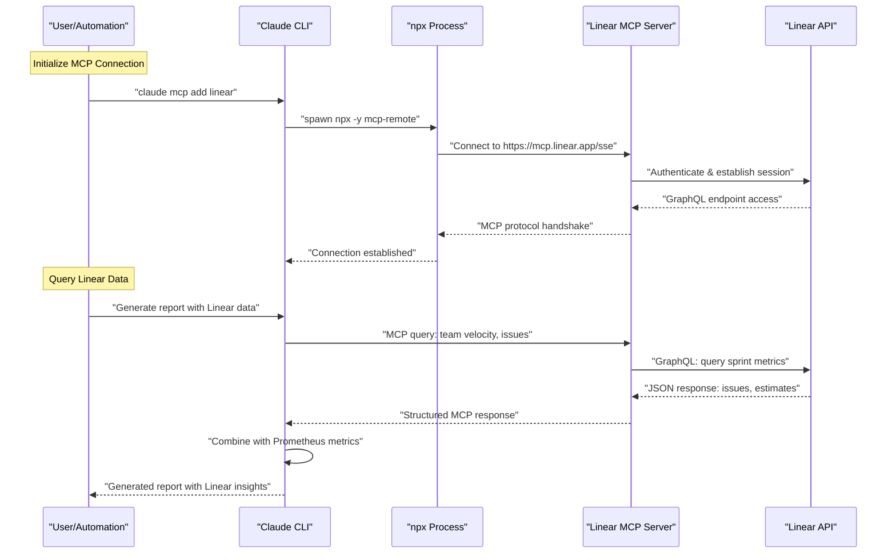
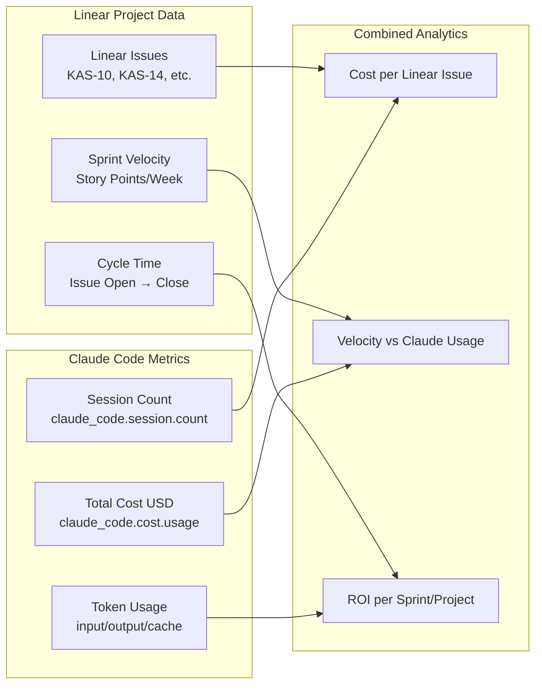
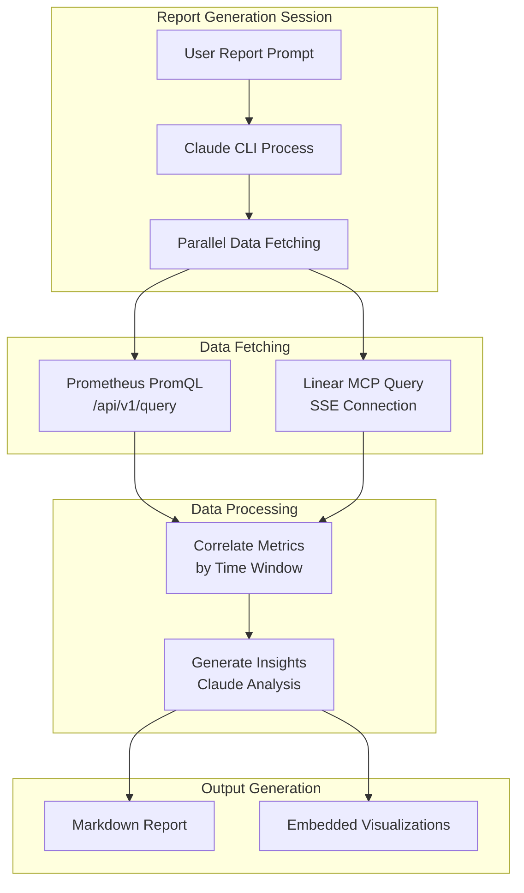

<!-- source: DeepWiki mcp.deepwiki.com · repo anthropics/claude-code-monitoring-guide · page 5.2 Linear MCP Integration · fetched 2026-10-26 -->

# Linear MCP Integration

<details>
<summary>Relevant source files</summary>

The following files were used as context for generating this wiki page:

- [claude_code_roi_full.md](claude_code_roi_full.md)
- [report-generation-prompt.md](report-generation-prompt.md)

</details>


This document covers the configuration and usage of Linear's Model Context Protocol (MCP) integration within the Claude Code ROI measurement system. The Linear MCP integration enables automated report generation by combining Claude Code telemetry metrics with real-time project management data from Linear, including team velocity, issue completion rates, and sprint analytics.

For general report generation templates and automation, see [Report Generation and Templates](#5.1). For interpreting the combined reports, see [Report Examples and Interpretation](#5.3).

## MCP Protocol Overview

The Model Context Protocol (MCP) provides a standardized way for Claude Code to access external data sources in real-time during conversation sessions. The Linear MCP server exposes Linear's project management data through a Server-Sent Events (SSE) interface that Claude Code can query directly.

### MCP Integration Architecture



Sources: [claude_code_roi_full.md:410-436](), [report-generation-prompt.md:7-10]()

## Linear MCP Server Configuration

### CLI-Based Setup

The recommended approach uses Claude Code's built-in MCP management commands to configure the Linear integration:

```bash
# Add Linear MCP server
claude mcp add linear -s user -- npx -y mcp-remote https://mcp.linear.app/sse

# Verify installation
claude mcp list

# Restart Claude Code to activate
```

### Manual Configuration

For advanced deployments or automation, configure the Linear MCP server directly in the Claude Code configuration file:

```json
{
  "mcpServers": {
    "linear": {
      "type": "stdio", 
      "command": "npx",
      "args": ["-y", "mcp-remote", "https://mcp.linear.app/sse"]
    }
  }
}
```

The configuration file location is `~/.claude.json` on Unix systems and `%APPDATA%\Claude\claude.json` on Windows.

### MCP Connection Flow



Sources: [claude_code_roi_full.md:414-422](), [claude_code_roi_full.md:424-436]()

## Data Access and Integration

### Available Linear Data

The Linear MCP integration provides access to the following project management data:

| Data Type | MCP Query | Use Case |
|-----------|-----------|----------|
| **Team Velocity** | Sprint completion metrics | Correlate with Claude Code session frequency |
| **Issue Tracking** | Open/closed issues, estimates | Calculate cost per feature/bug fix |
| **Sprint Analytics** | Burndown, cycle time | Measure productivity improvements |
| **Project Status** | Milestone progress | ROI attribution by project phase |

### Data Combination Strategy

The integration combines Linear project data with Claude Code telemetry through shared time windows and user attribution:



Sources: [claude_code_roi_full.md:442-454](), [report-generation-prompt.md:14-54]()

## Report Generation Integration

### Automated Metric Fetching

The integration supports automated report generation by combining live Prometheus metrics with Linear data:

```bash
#!/bin/bash
# Fetch live Claude Code metrics
TOTAL_COST=$(curl -s "http://localhost:9090/api/v1/query?query=sum(claude_code_cost_usage_USD_total)" | jq -r '.data.result[0].value[1] // "0"')
INPUT_TOKENS=$(curl -s "http://localhost:9090/api/v1/query?query=sum(claude_code_token_usage_tokens_total{type=\"input\"})" | jq -r '.data.result[0].value[1] // "0"')

# Generate report with Linear MCP integration
claude -p "Using the Linear MCP, analyze team velocity and combine with metrics..."
```

### Report Template Structure

The Linear MCP integration supports structured report generation with these components:

| Report Section | Data Source | Implementation |
|----------------|-------------|----------------|
| **Executive Summary** | Linear velocity + Claude costs | Sprint completion rate analysis |
| **Linear Issue Analysis** | MCP query: specific ticket IDs | Individual issue cost attribution |
| **Productivity Correlation** | Both Linear and Claude metrics | Statistical correlation analysis |
| **Actionable Insights** | Combined pattern analysis | Claude-generated recommendations |

### Real-Time Data Access Pattern



Sources: [claude_code_roi_full.md:456-479](), [report-generation-prompt.md:70-81]()

## Authentication and Security

### Linear API Access

The Linear MCP server handles authentication transparently through Linear's OAuth flow. No additional API keys or tokens are required in the Claude Code configuration.

### MCP Security Model

The MCP integration operates with the following security constraints:

- **Read-only access**: Cannot modify Linear data, only query
- **User-scoped**: Accesses only projects/teams visible to authenticated user
- **Session-based**: Authentication tied to Claude Code session lifecycle
- **No persistent storage**: Data queried fresh for each report generation

## Troubleshooting

### Common Integration Issues

| Issue | Symptom | Resolution |
|-------|---------|------------|
| **MCP Server Not Found** | `Error: Cannot connect to linear` | Verify `npx` is installed and accessible |
| **Authentication Failed** | Empty Linear data in reports | Check Linear account access and permissions |
| **SSE Connection Timeout** | Intermittent Linear data retrieval | Network connectivity or Linear service issues |
| **Stale Configuration** | Changes not reflected | Restart Claude Code after configuration changes |

### Diagnostic Commands

```bash
# Verify MCP server status
claude mcp list

# Test Linear connection
claude -p "Using Linear MCP, list my recent issues"

# Check npx process
ps aux | grep "mcp-remote"
```

### Integration Verification

Successful Linear MCP integration should enable queries like:

```bash
claude -p "Using Linear MCP, show me the velocity trend for our current sprint and correlate it with Claude Code usage patterns"
```

The response should include actual Linear issue IDs, sprint data, and project metrics combined with Claude Code telemetry data.

Sources: [claude_code_roi_full.md:414-422](), [report-generation-prompt.md:7-10]()

---

