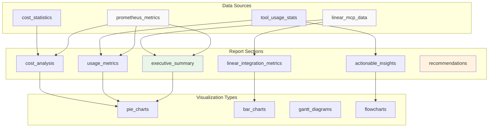
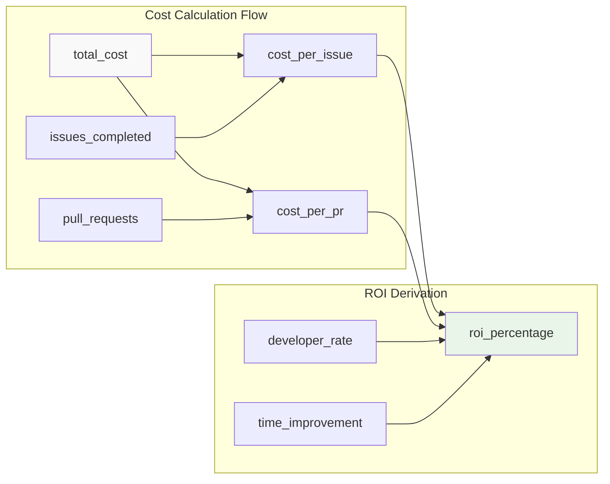
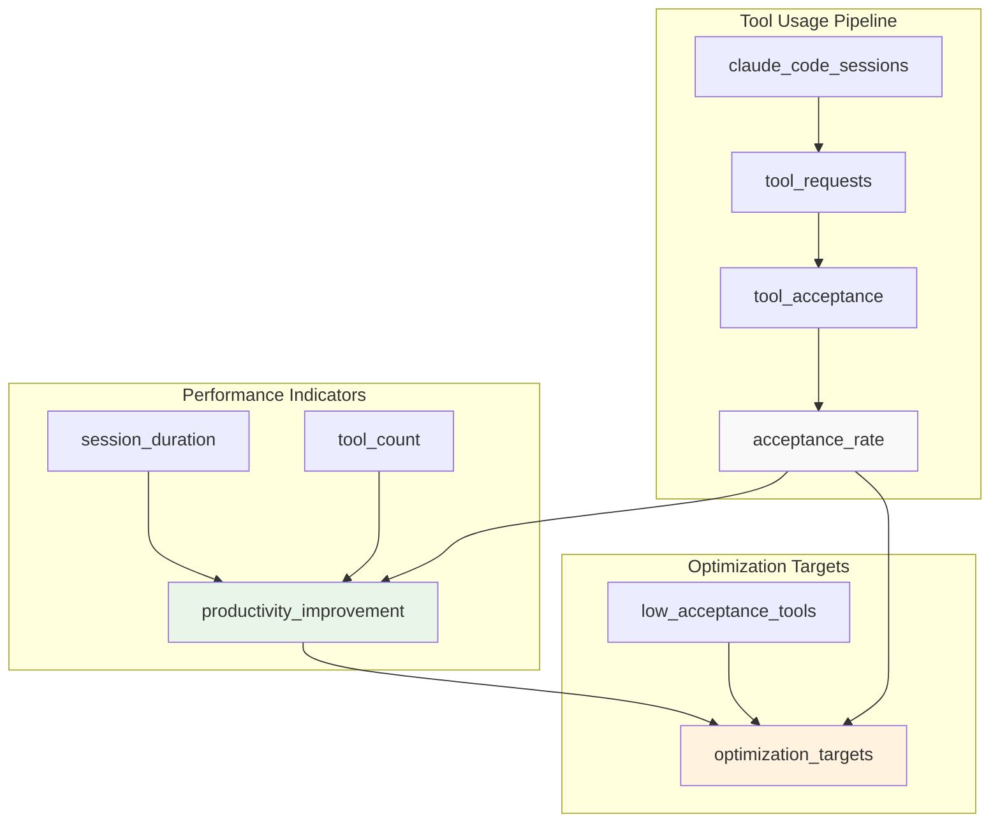
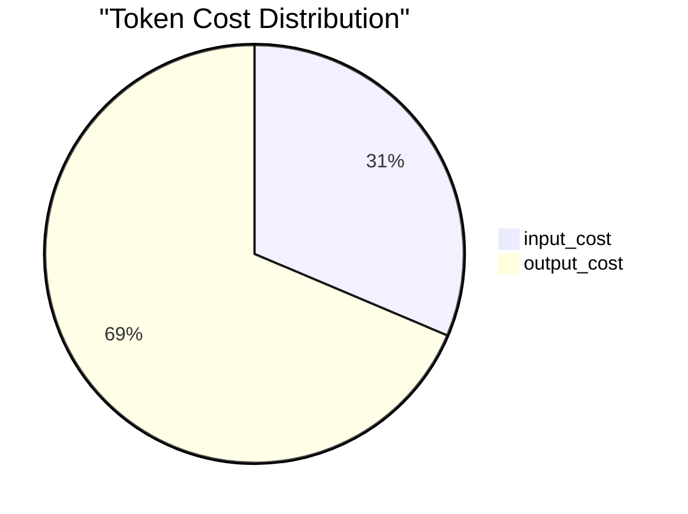
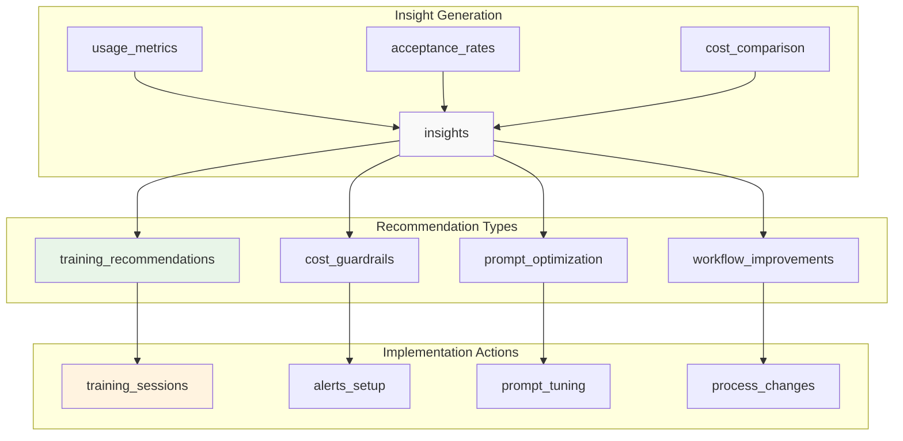

<!-- source: DeepWiki mcp.deepwiki.com · repo anthropics/claude-code-monitoring-guide · page 5.3 Report Examples and Interpretation · fetched 2026-10-26 -->

# Report Examples and Interpretation

Relevant source files

The following files were used as context for generating this wiki page:

- [report-generation-prompt.md](report-generation-prompt.md)
- [sample-report-output.md](sample-report-output.md)

This document provides detailed guidance on interpreting Claude Code ROI reports generated by the automated reporting system. It covers the structure of generated reports, meaning of metrics, and how to extract actionable insights from productivity analysis.

For information about configuring report generation, see [Report Generation and Templates](#5.1). For setting up the Linear MCP integration that provides project data, see [Linear MCP Integration](#5.2).

## Report Structure and Data Sources

The automated reporting system combines multiple data sources to generate comprehensive ROI analysis. Each report follows a standardized structure with specific sections for different types of insights.

Sources: [sample-report-output.md:1-158](), [report-generation-prompt.md:44-53]()

## Executive Summary Interpretation

The executive summary provides high-level performance indicators derived from both telemetry and project management data. Key metrics to focus on include velocity improvements, cost per deliverable, and team adoption patterns.

### Velocity Metrics

The velocity improvement percentage represents the change in commit frequency and merge time after Claude Code adoption. In the sample report, the **17% improvement in commit velocity** indicates faster development cycles for teams with high tool acceptance rates (above 75%).

### Cost Efficiency Indicators

Cost per issue and cost per pull request provide direct ROI measurements. The sample shows **$2.46 per issue** and **$4.50 per pull request**, which should be compared against developer hourly rates to calculate net productivity gains.

Sources: [sample-report-output.md:8-12](), [report-generation-prompt.md:18-22]()

## Usage Metrics Analysis

Usage metrics reveal tool adoption patterns and acceptance rates, which directly correlate with productivity improvements.

### Tool Distribution Patterns

The tool usage distribution shows which Claude Code capabilities are most utilized:
- **Read operations** (892 uses) indicate code exploration and understanding tasks
- **Edit operations** (356 uses) represent direct code modifications  
- **MultiEdit operations** (128 uses) suggest complex refactoring scenarios
- **Write operations** (73 uses) indicate new code generation
- **Bash operations** (204 uses) represent command execution and automation

### Acceptance Rate Analysis

Tool acceptance rates measure how often suggestions are accepted by developers:
- **MultiEdit: 92%** - Highest acceptance indicates effective complex editing
- **Edit: 81%** - Strong acceptance for code modifications
- **Write: 65%** - Lower acceptance suggests prompt optimization opportunities

Sources: [sample-report-output.md:26-33](), [sample-report-output.md:15-23](), [report-generation-prompt.md:37-42]()

## Linear Integration Metrics

The Linear MCP integration provides project management context for Claude Code usage, enabling correlation between tool usage and delivery metrics.

### Issue Completion Analysis

Issue completion metrics show sprint progress and development velocity:
- **Completion Ratio: 60%** indicates healthy sprint progress
- **Average Issue Age: 1 day** suggests rapid issue creation and resolution
- **Active Development Tickets: 6** represents manageable work-in-progress

### Priority Distribution

Issue priority analysis reveals focus areas:
- **Urgent issues** (KAS-10, KAS-14) require immediate attention
- **High priority issues** (KAS-11, KAS-12, KAS-15) represent core feature work
- **Low priority issues** (KAS-13) indicate maintenance or enhancement tasks

Sources: [sample-report-output.md:34-57](), [report-generation-prompt.md:46-47]()

## Cost Analysis Interpretation

Cost analysis breaks down token usage and associated expenses to calculate true ROI of Claude Code adoption.

### Token Distribution

The token usage ratio provides insight into interaction patterns:
- **Input tokens: 3,245,670** ($32.46) represent prompts and context
- **Output tokens: 2,156,780** ($70.99) represent AI-generated code
- **Input/Output ratio: 1.5** indicates efficient prompt usage

### Cost Per Metric Calculations

Per-unit costs enable direct ROI comparison:
- **Cost per session**: $2.46 ($103.45 / 42 sessions)
- **Cost per tool use**: $0.06 ($103.45 / 1,653 total tool uses)
- **Cost per pull request**: $4.50 (total cost / 23 PRs)

Sources: [sample-report-output.md:102-115](), [report-generation-prompt.md:24-29]()

## Productivity Comparison Metrics

Before/after comparisons quantify the impact of Claude Code adoption on development workflow efficiency.

### Key Performance Indicators

The productivity comparison reveals measurable improvements:
- **Commits per week**: +17.1% improvement (8.2 → 9.6)
- **Review cycles**: -12.5% reduction (2.4 → 2.1)  
- **Merge time**: -16.0% faster (7.5 → 6.3 hours)
- **Pull request size**: -12.1% smaller (165 → 145 LOC)

### Interpretation Guidelines

- **Increased commit frequency** indicates faster development iterations
- **Reduced review cycles** suggests higher code quality on first submission
- **Faster merge times** shows improved collaboration and less rework
- **Smaller PR size** indicates more focused, reviewable changes

Sources: [sample-report-output.md:67-100](), [sample-report-output.md:58-66]()

## Actionable Insights and Recommendations

The insights section translates metrics into specific actions for improving Claude Code adoption and ROI.

### Usage Pattern Insights

Key insights from the sample report include:
1. **MultiEdit underutilization** - High acceptance rate (92%) but low usage suggests training opportunities
2. **Edit rate optimization** - Teams above 80% acceptance show 16% faster PR merges
3. **Session duration sweet spot** - 25-35 minute sessions show optimal productivity

### Implementation Recommendations

Recommendations provide concrete next steps:
1. **Training programs** - Schedule MultiEdit workshops for complex editing scenarios
2. **Cost guardrails** - Set up alerts for sessions exceeding 5,000 tokens
3. **Prompt optimization** - Improve Write tool prompts to increase 65% acceptance rate

Sources: [sample-report-output.md:116-131](), [sample-report-output.md:132-154]()

## Visualization Guide

Reports include multiple Mermaid diagram types for different data representations:

### Pie Charts
Used for distribution analysis (tool usage, token costs, time allocation)

### Bar Charts  
Used for comparative metrics (before/after performance, team comparisons)

### Gantt Charts
Used for duration and frequency distributions (session lengths, sprint timelines)

### Flowcharts
Used for process improvements and recommendation workflows

Each visualization type serves specific analytical purposes and should be interpreted in context of the surrounding metrics and narrative.

Sources: [sample-report-output.md:15-23](), [sample-report-output.md:104-109](), [sample-report-output.md:134-154]()

---

