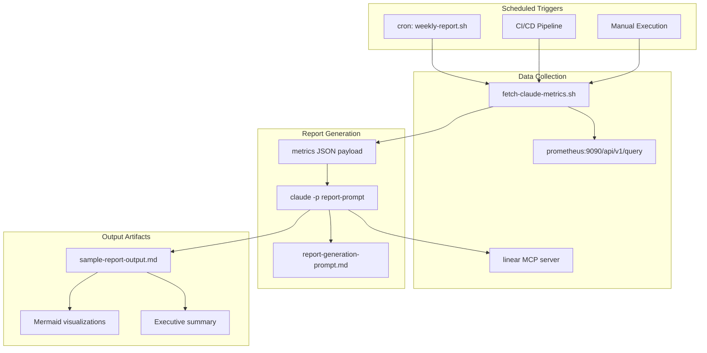
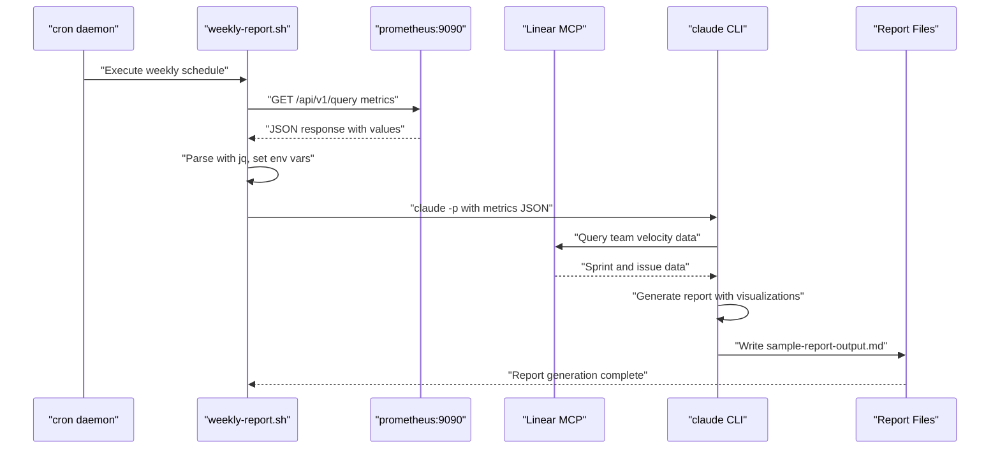
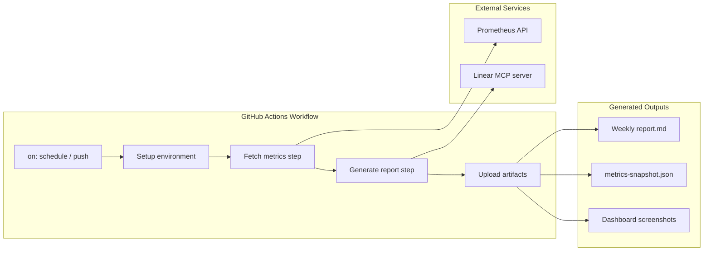
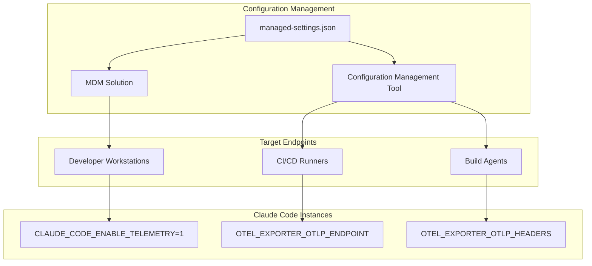
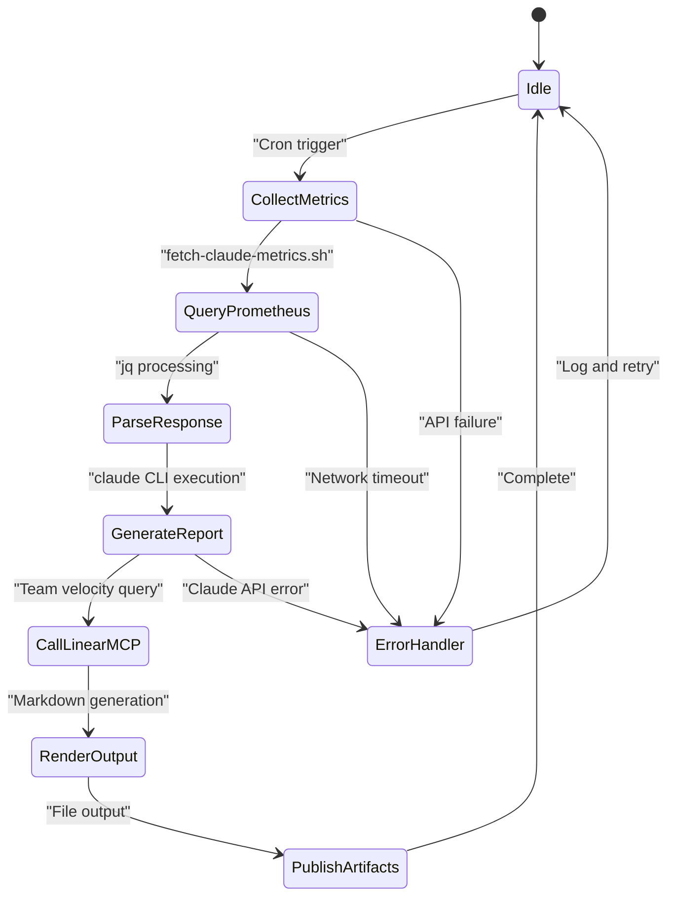
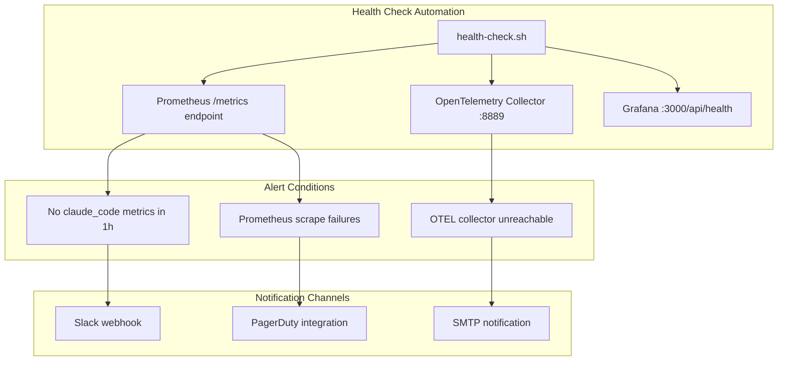

<!-- source: DeepWiki mcp.deepwiki.com · repo anthropics/claude-code-monitoring-guide · page 5.4 Automation and Scheduling · fetched 2026-10-26 -->

# Automation and Scheduling

<details>
<summary>Relevant source files</summary>

The following files were used as context for generating this wiki page:

- [claude_code_roi_full.md](claude_code_roi_full.md)
- [report-generation-prompt.md](report-generation-prompt.md)

</details>


This page covers the automation and scheduling capabilities of the Claude Code ROI measurement system. It documents how to set up automated report generation, scheduled metric collection, and integration with CI/CD pipelines for regular ROI analysis.

For manual report generation and template customization, see [Report Generation and Templates](#5.1). For Linear MCP configuration details, see [Linear MCP Integration](#5.2).

## Automated Report Generation

The system provides automated report generation capabilities using the Claude CLI with Linear MCP integration and Prometheus metric queries.

### Report Generation Workflow



Sources: [claude_code_roi_full.md:458-477](), [report-generation-prompt.md:70-81]()

### Script-Based Metric Collection

The system includes automated metric fetching from Prometheus endpoints using shell scripts:

```mermaid
graph TD
    subgraph "Prometheus Queries"
        Q1["sum(claude_code_cost_usage_USD_total)"]
        Q2["sum(claude_code_token_usage_tokens_total{type=\"input\"})"]
        Q3["sum(claude_code_token_usage_tokens_total{type=\"output\"})"]
    end
    
    subgraph "fetch-claude-metrics.sh"
        CURL1["curl prometheus:9090/api/v1/query"]
        JQ_PARSE["jq -r '.data.result[0].value[1]'"]
        ENV_VARS["TOTAL_COST, INPUT_TOKENS, OUTPUT_TOKENS"]
    end
    
    subgraph "Report Template"
        JSON_PAYLOAD["Metrics JSON structure"]
        CLAUDE_PROMPT["claude -p with live data"]
    end
    
    Q1 --> CURL1
    Q2 --> CURL1  
    Q3 --> CURL1
    CURL1 --> JQ_PARSE
    JQ_PARSE --> ENV_VARS
    ENV_VARS --> JSON_PAYLOAD
    JSON_PAYLOAD --> CLAUDE_PROMPT
```

Sources: [claude_code_roi_full.md:458-477]()

## Scheduled Report Generation

### Cron-Based Automation

The system supports cron-based scheduling for regular report generation:

| Schedule Type | Cron Expression | Use Case |
|---------------|----------------|----------|
| Weekly Reports | `0 9 * * 1` | Monday 9 AM executive summaries |
| Daily Metrics | `0 8 * * *` | Daily cost tracking |
| Monthly Analysis | `0 10 1 * *` | Monthly ROI analysis |
| Sprint Reviews | Custom | Aligned with sprint cycles |

### Weekly Report Script Structure



Sources: [claude_code_roi_full.md:458-477](), [report-generation-prompt.md:70-81]()

## CI/CD Pipeline Integration

### GitHub Actions Integration

The system can be integrated into GitHub Actions workflows for automated reporting:



Sources: [claude_code_roi_full.md:458-477]()

### Jenkins Pipeline Integration

For Jenkins-based CI/CD, the system provides pipeline-compatible scripts:

| Pipeline Stage | Script/Command | Purpose |
|----------------|----------------|---------|
| `collectMetrics` | `fetch-claude-metrics.sh` | Gather Prometheus data |
| `generateReport` | `claude -p report-prompt` | Create ROI analysis |
| `publishResults` | `cp *.md artifacts/` | Archive reports |
| `notifyTeam` | `slack-notify.sh` | Send executive summary |

## Deployment Automation

### Managed Settings Distribution

The system supports automated deployment of telemetry configuration across organizations:



Sources: [claude_code_roi_full.md:506-528]()

### Infrastructure as Code Integration

The Docker Compose infrastructure supports automated deployment through infrastructure as code:

| Component | Configuration File | Automation Target |
|-----------|-------------------|------------------|
| OpenTelemetry Collector | `otel-collector-config.yaml` | Kubernetes ConfigMaps |
| Prometheus | `prometheus.yml` | Helm chart values |
| Grafana | `grafana/provisioning/` | Terraform modules |
| Docker Services | `docker-compose.yml` | Docker Swarm/K8s |

### Metric Collection Scheduling



Sources: [claude_code_roi_full.md:458-477](), [report-generation-prompt.md:70-81]()

## Configuration Management

### Environment Variable Automation

Automated deployment relies on consistent environment variable configuration across all Claude Code instances:

| Variable | Purpose | Automation Method |
|----------|---------|------------------|
| `CLAUDE_CODE_ENABLE_TELEMETRY=1` | Enable metrics collection | MDM/ConfigMgmt |
| `OTEL_METRICS_EXPORTER=otlp` | Set exporter type | Managed settings |
| `OTEL_EXPORTER_OTLP_ENDPOINT` | Collector endpoint | Environment-specific |
| `OTEL_EXPORTER_OTLP_HEADERS` | Authentication tokens | Secret management |

### Automated Health Checks

The system includes automated health monitoring for the telemetry pipeline:



Sources: [claude_code_roi_full.md:506-528]()

---

