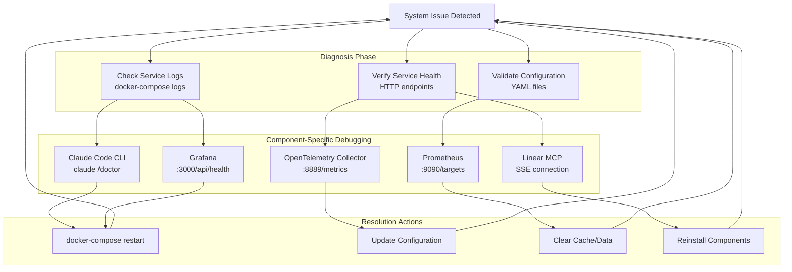
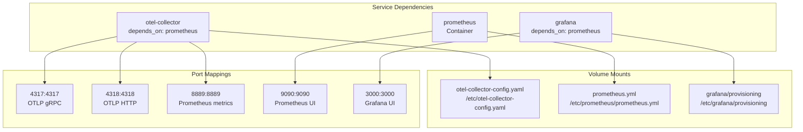
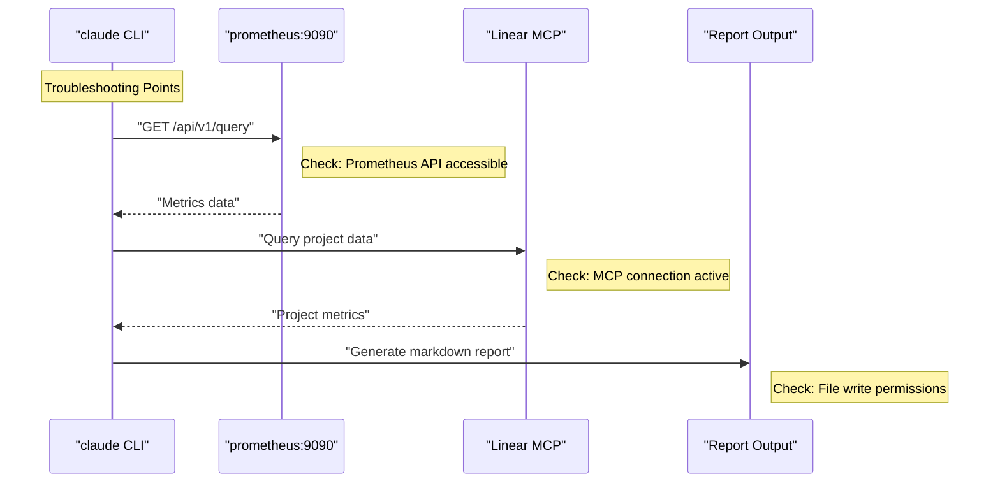

<!-- source: DeepWiki mcp.deepwiki.com · repo anthropics/claude-code-monitoring-guide · page 6.1 Troubleshooting Guide · fetched 2026-10-26 -->

# Troubleshooting Guide

<details>
<summary>Relevant source files</summary>

The following files were used as context for generating this wiki page:

- [docker-compose.yml](docker-compose.yml)
- [troubleshooting.md](troubleshooting.md)

</details>


This document provides comprehensive troubleshooting guidance for the Claude Code ROI Measurement System, covering issues with telemetry collection, monitoring infrastructure, and automated reporting. It addresses problems that may occur across the entire observability pipeline from Claude Code CLI telemetry emission to final report generation.

For information about optimizing system performance, see [Performance Optimization](#6.2). For production security considerations, see [Security and Best Practices](#6.3).

## Troubleshooting Workflow



Sources: [troubleshooting.md:1-187](), [docker-compose.yml:1-49]()

## Claude Code Telemetry Issues

### Telemetry Not Emitting

| Problem | Diagnostic Command | Solution |
|---------|-------------------|----------|
| No metrics in Prometheus | `echo $CLAUDE_CODE_ENABLE_TELEMETRY` | Set `CLAUDE_CODE_ENABLE_TELEMETRY=1` |
| OTLP endpoint unreachable | `curl -v http://localhost:4317` | Verify `otel-collector` container running |
| Console export not working | `export OTEL_METRICS_EXPORTER=console` | Check for console metric output |

**Environment Variable Verification:**
```bash
# Required telemetry configuration
export CLAUDE_CODE_ENABLE_TELEMETRY=1
export OTEL_METRICS_EXPORTER=otlp
export OTEL_EXPORTER_OTLP_ENDPOINT=http://localhost:4318
export OTEL_METRIC_EXPORT_INTERVAL=1000
```

### Claude Code Hanging After Telemetry Enable

**Clean Installation Process:**
1. Uninstall and reinstall Claude Code CLI
2. Clear configuration directory: `rm -rf ~/.config/claude-code/`
3. Restart with fresh telemetry configuration

### Authentication and Permission Issues

**Linux NPM Permission Fix:**
```bash
# Create user-writable npm prefix
mkdir -p ~/.npm-global
npm config set prefix ~/.npm-global
echo 'export PATH=~/.npm-global/bin:$PATH' >> ~/.bashrc
source ~/.bashrc
npm install -g @anthropic-ai/claude-code
```

**Authentication Reset:**
```bash
claude /logout
rm -rf ~/.config/claude-code/auth.json
claude  # Will prompt for fresh authentication
```

Sources: [troubleshooting.md:7-107]()

## Infrastructure Component Troubleshooting

### Docker Compose Service Issues



**Service Health Verification:**
```bash
# Check all services are running
docker-compose ps

# View service logs
docker-compose logs otel-collector
docker-compose logs prometheus
docker-compose logs grafana

# Restart specific service
docker-compose restart otel-collector
```

### OpenTelemetry Collector Issues

**Common OTEL Collector Problems:**

| Issue | Check | Resolution |
|-------|-------|------------|
| Memory limiter triggered | `docker-compose logs otel-collector` | Increase memory limit in config |
| Batch processor timeout | OTLP metrics not arriving | Reduce `timeout` in processor config |
| Prometheus exporter unreachable | `curl http://localhost:8889/metrics` | Verify exporter endpoint configuration |

**OTEL Collector Endpoints:**
- OTLP gRPC: `localhost:4317`
- OTLP HTTP: `localhost:4318`
- Prometheus metrics: `localhost:8889/metrics`

### Prometheus Configuration Issues

**Target Health Check:**
1. Navigate to `http://localhost:9090/targets`
2. Verify `otel-collector:8889` target is UP
3. Check scrape interval and last scrape time

**Common Prometheus Issues:**

| Problem | Symptom | Solution |
|---------|---------|----------|
| No OTEL metrics | Empty Prometheus UI | Verify `prometheus.yml` scrape config |
| Storage issues | Data not persisting | Check `prometheus_data` volume mount |
| Query performance | Slow PromQL queries | Reduce retention time or optimize queries |

### Grafana Dashboard Problems

**Dashboard Loading Issues:**
1. Check provisioning directory: `./grafana/provisioning`
2. Verify dashboard JSON files in `./grafana/dashboards`
3. Restart Grafana: `docker-compose restart grafana`

**Data Source Configuration:**
- Prometheus URL: `http://prometheus:9090`
- Default credentials: `admin/admin`

Sources: [docker-compose.yml:3-45]()

## Report Generation Troubleshooting

### Linear MCP Integration Issues

**MCP Connection Problems:**
```bash
# Test Linear MCP connection
claude mcp add linear
# Should establish SSE connection without errors
```

**Common Linear Integration Issues:**

| Problem | Diagnostic | Solution |
|---------|------------|----------|
| SSE connection failed | Check Linear API token | Refresh authentication |
| No project data | Verify team access | Check Linear permissions |
| Rate limiting | API calls blocked | Reduce query frequency |

### Automated Report Generation Failures

**Report Generation Workflow Issues:**



**Common Report Issues:**

| Issue | Check Command | Resolution |
|-------|---------------|------------|
| Empty metrics | `curl http://localhost:9090/api/v1/query?query=claude_code_total_cost` | Verify telemetry data exists |
| Linear data missing | `claude mcp status` | Reconnect Linear MCP |
| File write errors | Check directory permissions | Set appropriate file permissions |

Sources: [troubleshooting.md:140-187]()

## Diagnostic Commands and Health Checks

### System Health Verification

```bash
# Docker infrastructure
docker-compose ps
docker-compose logs --tail=50

# Service endpoints
curl http://localhost:4318/v1/metrics  # OTLP HTTP
curl http://localhost:8889/metrics     # OTEL metrics
curl http://localhost:9090/-/healthy   # Prometheus health
curl http://localhost:3000/api/health  # Grafana health

# Claude Code diagnostics
claude /doctor
claude /bug
```

### Metrics Verification

**Prometheus Query Testing:**
```bash
# Total cost metrics
curl "http://localhost:9090/api/v1/query?query=claude_code_total_cost"

# Token usage by model
curl "http://localhost:9090/api/v1/query?query=claude_code_token_usage"

# User activity metrics
curl "http://localhost:9090/api/v1/query?query=claude_code_user_sessions"
```

### Log Analysis Patterns

**Critical Log Patterns to Monitor:**

| Component | Log Pattern | Indicates |
|-----------|-------------|-----------|
| OTEL Collector | `memory limiter` | Memory pressure |
| Prometheus | `scrape failed` | Target unreachable |
| Grafana | `database locked` | SQLite contention |
| Claude Code | `telemetry disabled` | Configuration issue |

### Configuration Validation

**Configuration File Checks:**
1. YAML syntax validation: `yamllint otel-collector-config.yaml`
2. Prometheus config test: `promtool check config prometheus.yml`
3. Docker Compose validation: `docker-compose config`

Sources: [troubleshooting.md:170-187](), [docker-compose.yml:8-11]()

## Advanced Troubleshooting

### Performance Issues

**Memory and Resource Problems:**

| Symptom | Component | Action |
|---------|-----------|--------|
| High memory usage | Claude Code | Use `/compact` command regularly |
| Container OOM kills | OTEL Collector | Increase memory limits |
| Slow queries | Prometheus | Optimize PromQL queries |
| Dashboard timeouts | Grafana | Reduce time range |

### Network and Connectivity

**Port Conflict Resolution:**
```bash
# Check port usage
netstat -tlnp | grep -E "(3000|4317|4318|8889|9090)"

# Kill conflicting processes
lsof -ti:4317 | xargs kill -9
```

**Firewall Configuration:**
- Ensure ports 3000, 4317, 4318, 8889, 9090 are accessible
- Check corporate firewall rules for OTLP traffic
- Verify Docker network connectivity

### Data Integrity Issues

**Metrics Validation:**
1. Compare Claude Code session data with Prometheus metrics
2. Verify cost calculations against billing APIs
3. Cross-reference Linear project data with generated reports

**Data Recovery:**
```bash
# Clear corrupted Prometheus data
docker-compose down
docker volume rm $(docker volume ls -q | grep prometheus)
docker-compose up -d

# Reset Grafana dashboards
docker volume rm $(docker volume ls -q | grep grafana)
# Dashboards will be reprovisioned on restart
```

Sources: [troubleshooting.md:108-138]()

---

