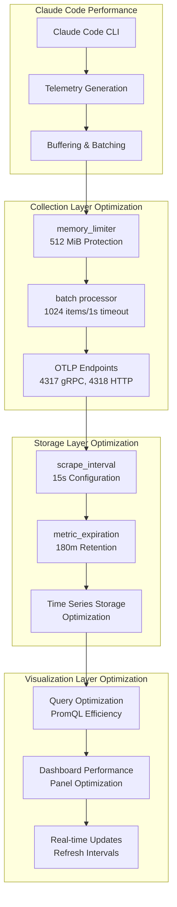
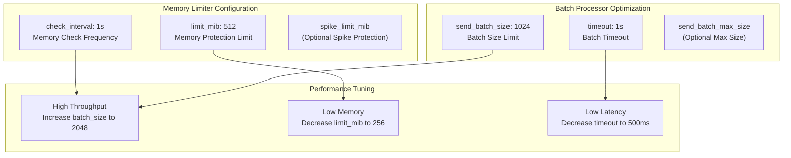
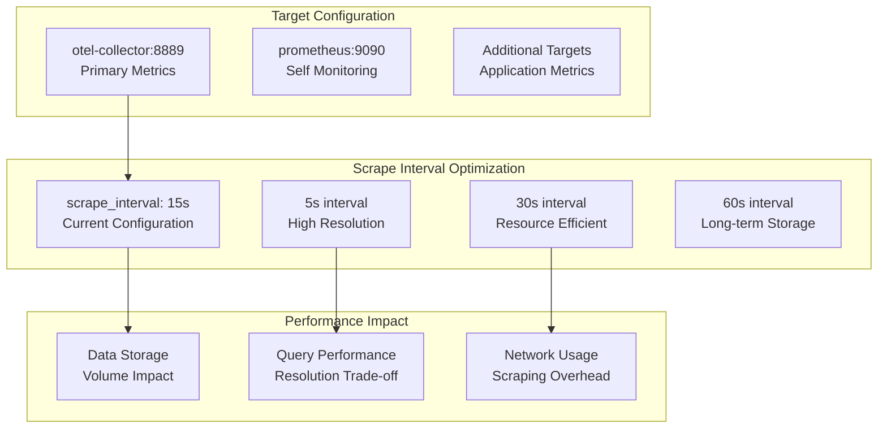
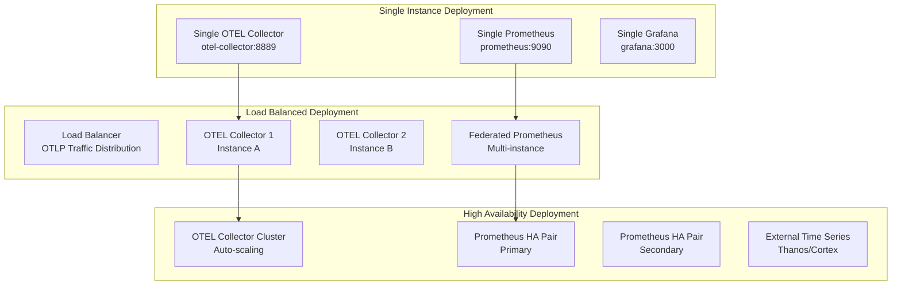
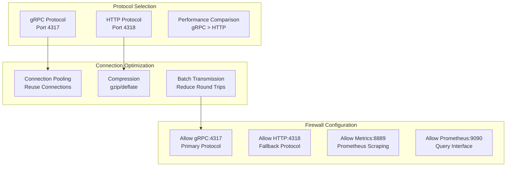

<!-- source: DeepWiki mcp.deepwiki.com · repo anthropics/claude-code-monitoring-guide · page 6.2 Performance Optimization · fetched 2026-10-26 -->

# Performance Optimization

Relevant source files

The following files were used as context for generating this wiki page:

- [otel-collector-config.yaml](otel-collector-config.yaml)
- [prometheus.yml](prometheus.yml)
- [troubleshooting.md](troubleshooting.md)

This document covers performance optimization strategies for the Claude Code ROI Measurement System. It focuses on optimizing the telemetry collection pipeline, storage systems, and monitoring infrastructure to handle high-volume Claude Code usage efficiently.

For troubleshooting performance issues, see [Troubleshooting Guide](#6.1). For production deployment considerations, see [Security and Best Practices](#6.3).

## System Performance Overview

The Claude Code ROI measurement system consists of multiple performance-critical components that must be optimized for efficient telemetry collection and analysis.

### Performance Optimization Pipeline

Sources: [otel-collector-config.yaml:9-15](), [prometheus.yml:1-3]()

## OpenTelemetry Collector Optimization

The OpenTelemetry Collector is the primary bottleneck in the telemetry pipeline and requires careful optimization for high-throughput scenarios.

### Memory Management

The `memory_limiter` processor prevents memory exhaustion during high-volume telemetry collection:

| Parameter | Current Value | Optimization Range | Impact |
|-----------|---------------|-------------------|---------|
| `limit_mib` | 512 | 256-2048 | Memory protection threshold |
| `check_interval` | 1s | 0.5s-5s | Memory check frequency |

Sources: [otel-collector-config.yaml:10-15]()

### Batch Processing Optimization

The `batch` processor configuration directly impacts throughput and latency:

**High Throughput Configuration:**
- `send_batch_size`: 2048-4096
- `timeout`: 2s-5s
- `send_batch_max_size`: 8192

**Low Latency Configuration:**
- `send_batch_size`: 512-1024
- `timeout`: 500ms-1s
- `send_batch_max_size`: 2048

**Memory Constrained Configuration:**
- `send_batch_size`: 256-512
- `timeout`: 1s-2s
- Memory limiter: 256-512 MiB

Sources: [otel-collector-config.yaml:10-12]()

### Endpoint Performance

The OTLP receivers support both gRPC and HTTP protocols with different performance characteristics:

| Protocol | Endpoint | Performance | Use Case |
|----------|----------|-------------|----------|
| gRPC | `0.0.0.0:4317` | Higher throughput, lower latency | Production environments |
| HTTP | `0.0.0.0:4318` | Better firewall compatibility | Development, restricted networks |

Sources: [otel-collector-config.yaml:2-7]()

## Prometheus Storage Optimization

Prometheus performance depends on efficient metric scraping, storage, and query execution.

### Scrape Configuration Optimization

Sources: [prometheus.yml:2-3](), [prometheus.yml:11-13]()

### Storage Retention and Capacity

Prometheus storage optimization involves balancing retention time with storage capacity:

**Retention Strategies:**
- Default: 15 days local storage
- Long-term: Configure external storage (Thanos, Cortex)
- Short-term: 7 days for development environments

**Storage Sizing:**
- Base requirement: ~1KB per metric per scrape interval
- Claude Code metrics: ~50-100 series per active user
- Estimated storage: 1GB per 1000 active user-hours

Sources: [otel-collector-config.yaml:21]()

## Resource Scaling and Capacity Planning

### Container Resource Allocation

Recommended resource allocation for different deployment scales:

| Component | Small (1-10 users) | Medium (10-100 users) | Large (100+ users) |
|-----------|-------------------|----------------------|-------------------|
| **OpenTelemetry Collector** |  |  |  |
| CPU | 0.1-0.5 cores | 0.5-1.0 cores | 1.0-2.0 cores |
| Memory | 256-512 MB | 512-1024 MB | 1-2 GB |
| **Prometheus** |  |  |  |
| CPU | 0.2-0.5 cores | 0.5-1.0 cores | 1.0-4.0 cores |
| Memory | 512 MB-1 GB | 1-2 GB | 2-8 GB |
| Storage | 5-10 GB | 10-50 GB | 50-200 GB |
| **Grafana** |  |  |  |
| CPU | 0.1-0.2 cores | 0.2-0.5 cores | 0.5-1.0 cores |
| Memory | 128-256 MB | 256-512 MB | 512 MB-1 GB |

### Horizontal Scaling Strategies

Sources: [prometheus.yml:11-18]()

## Query Performance Optimization

### PromQL Query Optimization

Efficient PromQL queries are essential for responsive Grafana dashboards:

**High-Performance Query Patterns:**
- Use recording rules for complex calculations
- Leverage metric relabeling for dimension reduction
- Implement query result caching
- Optimize time range selections

**Query Optimization Examples:**
- Avoid high-cardinality grouping operations
- Use `rate()` instead of `increase()` for better performance
- Implement efficient aggregation strategies
- Cache frequently accessed dashboard queries

### Dashboard Performance

Grafana dashboard performance optimization focuses on query efficiency and update frequencies:

**Panel Optimization:**
- Limit time series per panel (< 100 series)
- Use appropriate visualization types
- Optimize refresh intervals (30s-5m)
- Implement query result caching

**Dashboard-Level Optimization:**
- Minimize concurrent panel queries
- Use template variables efficiently
- Implement progressive data loading
- Cache dashboard JSON definitions

Sources: [otel-collector-config.yaml:21]()

## Network and Connectivity Optimization

### OTLP Endpoint Configuration

Network optimization for telemetry collection involves protocol selection and connection pooling:

Sources: [otel-collector-config.yaml:4-7](), [otel-collector-config.yaml:19]()

### Bandwidth and Compression

Optimize network usage through compression and efficient data serialization:

**Compression Settings:**
- OTLP gRPC: Built-in compression enabled
- Prometheus metrics: gzip compression for HTTP endpoints
- Dashboard assets: Enable browser caching

**Data Reduction Strategies:**
- Metric sampling for high-frequency data
- Selective metric collection
- Efficient label usage
- Delta encoding for counter metrics

Sources: [otel-collector-config.yaml:18-22]()

## Monitoring Performance Metrics

### System Health Monitoring

Monitor the monitoring system itself to ensure optimal performance:

**Key Performance Indicators:**
- OTLP ingestion rate (metrics/second)
- Memory usage percentage
- Query response times
- Storage growth rate
- Dashboard rendering times

**Alert Thresholds:**
- Memory usage > 80% of limit
- Query response time > 5 seconds
- Storage usage > 85% capacity
- OTLP ingestion errors > 1%

### Performance Debugging

Use built-in debugging capabilities for performance analysis:

**OTEL Collector Debug Output:**
- `debug` exporter with `verbosity: detailed`
- `sampling_initial: 5` for startup debugging
- `sampling_thereafter: 200` for ongoing monitoring

**Prometheus Query Analysis:**
- Query execution time monitoring
- Index usage analysis
- Memory consumption tracking
- Query result caching effectiveness

Sources: [otel-collector-config.yaml:24-27](), [otel-collector-config.yaml:38-40]()

---

