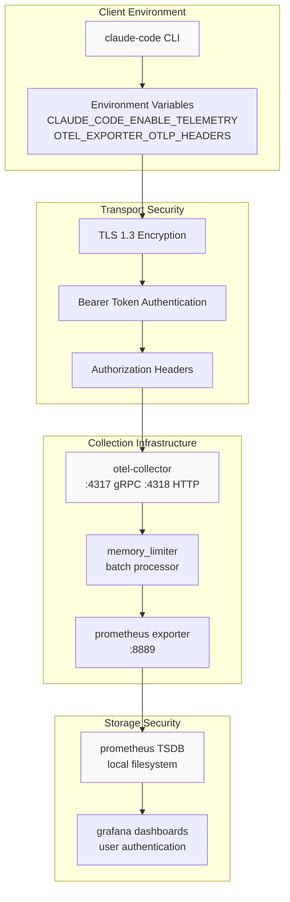
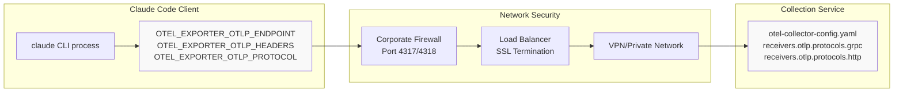
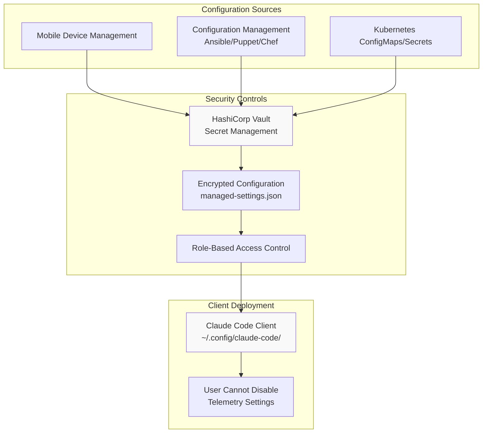
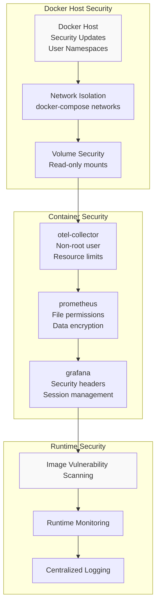
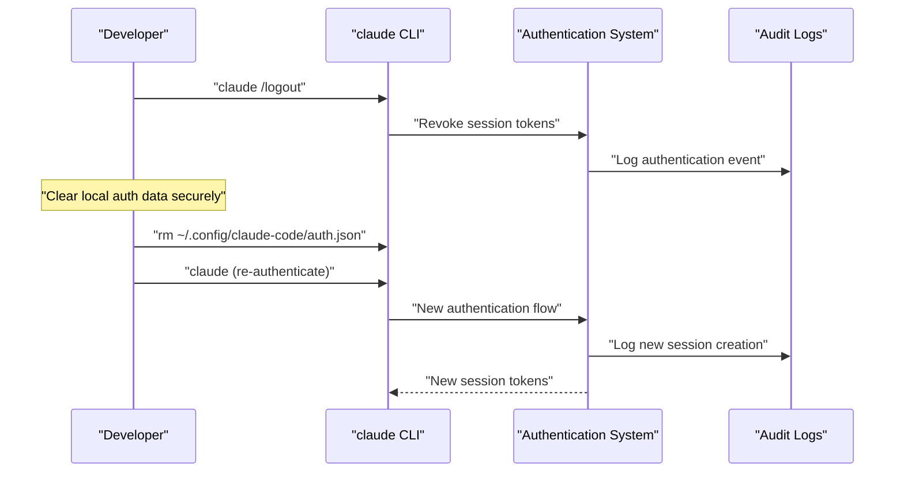

<!-- source: DeepWiki mcp.deepwiki.com · repo anthropics/claude-code-monitoring-guide · page 6.3 Security and Best Practices · fetched 2026-10-26 -->

# Security and Best Practices

<details>
<summary>Relevant source files</summary>

The following files were used as context for generating this wiki page:

- [claude_code_roi_full.md](claude_code_roi_full.md)
- [troubleshooting.md](troubleshooting.md)

</details>


This document covers security considerations, authentication mechanisms, and operational best practices for deploying the Claude Code ROI measurement system in production environments. It addresses data privacy, network security, access controls, and compliance requirements specific to telemetry collection and analysis.

For general troubleshooting of authentication issues, see [Troubleshooting Guide](#6.1). For performance optimization and resource management, see [Performance Optimization](#6.2).

## Telemetry Data Security

### Sensitive Data in Metrics

The Claude Code telemetry system collects several types of data that require security consideration:

| Data Type | Sensitivity Level | Security Implications |
|-----------|------------------|----------------------|
| `user.account_uuid` | High | Unique user identifier that can link activities |
| `session.id` | Medium | Session tracking across requests |
| `model` | Low | Model usage patterns |
| `cost.usage` | Medium | Financial data requiring confidentiality |
| `user_prompt` content | High | May contain proprietary code, business logic |

**Security Architecture for Data Collection**



Sources: [claude_code_roi_full.md:67-89](), [claude_code_roi_full.md:514-527]()

### User Prompt Data Protection

The system can optionally collect user prompt content via `OTEL_LOG_USER_PROMPTS=1`. This represents the highest security risk as prompts may contain:

- Proprietary source code
- Business logic and algorithms  
- Customer data references
- Infrastructure details
- Security credentials

**Recommendation**: Disable prompt logging in production unless explicitly required for analysis and approved by security teams.

```bash
# Secure configuration - disable prompt collection
export OTEL_LOG_USER_PROMPTS=0
export CLAUDE_CODE_ENABLE_TELEMETRY=1
```

Sources: [claude_code_roi_full.md:340-389]()

## Network Security and Transport

### OTLP Endpoint Security

The OpenTelemetry Protocol (OTLP) endpoints require proper security configuration:

**Secure Transport Configuration**



**Production Endpoint Examples:**
- **Local development**: `http://localhost:4317` (development only)
- **Kubernetes**: `https://otel-collector.monitoring.svc.cluster.local:4317` 
- **AWS ALB**: `https://telemetry.company.com:4317`
- **Managed services**: `https://otlp.datadoghq.com` with API keys

Sources: [claude_code_roi_full.md:84-89](), [claude_code_roi_full.md:72-78]()

### Authentication Token Management

OTLP authentication uses bearer tokens in headers:

```bash
# Secure token configuration
export OTEL_EXPORTER_OTLP_HEADERS="Authorization=Bearer ${OTEL_TOKEN}"
```

**Token Security Requirements:**
- Rotate tokens every 90 days minimum
- Store tokens in secure credential management systems
- Use environment variables, never hardcode in configuration files
- Implement token validation and expiration checking

Sources: [claude_code_roi_full.md:77-78](), [claude_code_roi_full.md:516-517]()

## Authentication and Authorization

### Grafana Access Control

Grafana dashboards contain sensitive cost and usage data requiring proper access controls:

**Role-Based Access Model**

| Role | Permissions | Justification |
|------|-------------|---------------|
| **Viewer** | Read dashboards only | Developers, managers viewing team metrics |
| **Editor** | Modify dashboards | DevOps, analytics teams |
| **Admin** | Full system access | Security, infrastructure teams |

**Grafana Authentication Configuration:**
- Enable OIDC/SAML integration with corporate identity provider
- Disable anonymous access in production
- Implement session timeout policies
- Enable audit logging for dashboard access

### Prometheus Query Security

Prometheus exposes sensitive metrics via HTTP API at `:9090`. Secure this endpoint:

```bash
# Example queries that expose sensitive data
curl "http://localhost:9090/api/v1/query?query=sum(claude_code_cost_usage_USD_total)by(user_email)"
curl "http://localhost:9090/api/v1/query?query=claude_code_token_usage_tokens_total"
```

**Security Controls:**
- Place Prometheus behind authentication proxy
- Implement query rate limiting
- Restrict network access to monitoring subnet
- Enable TLS for all connections

Sources: [claude_code_roi_full.md:96-121](), [claude_code_roi_full.md:462-464]()

## Configuration Security

### Managed Settings Deployment

Enterprise deployments use `managed-settings.json` for centralized configuration:

**Secure Configuration Management**



**Configuration Security Best Practices:**
- Encrypt configuration files at rest
- Use secret management systems for tokens
- Implement configuration drift detection
- Audit configuration changes
- Validate configuration syntax before deployment

Sources: [claude_code_roi_full.md:508-528]()

### Environment Variable Security

Claude Code telemetry relies on environment variables that may contain sensitive data:

```bash
# Sensitive environment variables
CLAUDE_CODE_ENABLE_TELEMETRY=1
OTEL_EXPORTER_OTLP_ENDPOINT=https://collector.company.com:4317
OTEL_EXPORTER_OTLP_HEADERS="Authorization=Bearer secret-token"
```

**Security Requirements:**
- Never log environment variables in debugging output
- Use `.env` files with restricted permissions (600)
- Implement environment variable scanning in CI/CD
- Rotate authentication tokens regularly

Sources: [claude_code_roi_full.md:68-78](), [troubleshooting.md:31-35]()

## Container and Infrastructure Security

### Docker Compose Security Hardening

The system uses Docker Compose for orchestration. Security considerations:

**Container Security Architecture**



**Security Hardening Checklist:**
- Run containers as non-root users
- Implement resource limits in `docker-compose.yml`
- Use read-only root filesystems where possible
- Scan container images for vulnerabilities
- Enable Docker security options (`--security-opt`)
- Implement network segmentation

Sources: Inferred from system architecture diagrams

### Prometheus Data Security

Prometheus stores time-series data containing sensitive usage and cost information:

**Data Protection Requirements:**
- Encrypt Prometheus data directory at rest
- Implement retention policies to limit data exposure
- Secure backup and restore procedures
- Monitor for unauthorized data access
- Implement data anonymization for non-production environments

Configuration: [prometheus.yml:retention policies]()

## Data Privacy and Retention

### PII and Sensitive Data Handling

The telemetry system collects potentially sensitive information:

**Data Classification and Handling**

| Data Element | Classification | Retention | Access Control |
|--------------|----------------|-----------|----------------|
| `user.account_uuid` | PII | 90 days | Need-to-know |
| `user_email` | PII | 90 days | Manager+ only |
| `session.id` | Sensitive | 30 days | Automated systems |
| `cost.usage` | Confidential | 1 year | Finance+ only |
| `user_prompt` | Highly Sensitive | Disabled | Security approval |

**Privacy Protection Measures:**
- Implement data anonymization pipelines
- Hash user identifiers where possible
- Regular data purging based on retention policies
- Audit data access and exports
- Provide data deletion mechanisms for user requests

### Compliance Considerations

**GDPR Compliance:**
- Implement right to be forgotten (data deletion)
- Provide data export capabilities
- Maintain data processing records
- Implement consent management for optional telemetry

**SOX/Financial Compliance:**
- Secure cost and financial metrics
- Implement audit trails for all data access
- Separate financial data access controls
- Regular compliance audits

Sources: [claude_code_roi_full.md:247-295]()

## Operational Security Practices

### Authentication Troubleshooting Security

Common authentication issues can create security vulnerabilities:

**Secure Troubleshooting Procedures:**



**Security Requirements:**
- Always use `/logout` before clearing auth files
- Monitor authentication failures for brute force attempts  
- Implement account lockout policies
- Log all authentication events for audit

Sources: [troubleshooting.md:93-106]()

### Monitoring Security Events

Implement security monitoring for the telemetry infrastructure:

**Security Event Monitoring:**
- Failed authentication attempts to Grafana/Prometheus
- Unusual data access patterns
- Configuration changes
- Container runtime security events
- Network connection anomalies

**Alerting Configuration:**
- Set up alerts for authentication failures
- Monitor for data exfiltration patterns
- Track configuration drift
- Alert on container security violations

### Incident Response Procedures

**Security Incident Response:**
1. **Detection**: Automated monitoring and alerting
2. **Containment**: Isolate affected components
3. **Investigation**: Analyze logs and access patterns
4. **Recovery**: Restore from secure backups
5. **Lessons Learned**: Update security controls

**Data Breach Response:**
- Immediately disable telemetry collection
- Assess scope of data exposure
- Notify stakeholders per company policy
- Implement additional security controls
- Document incident for compliance reporting

This comprehensive security framework ensures the Claude Code ROI measurement system meets enterprise security requirements while maintaining operational effectiveness.