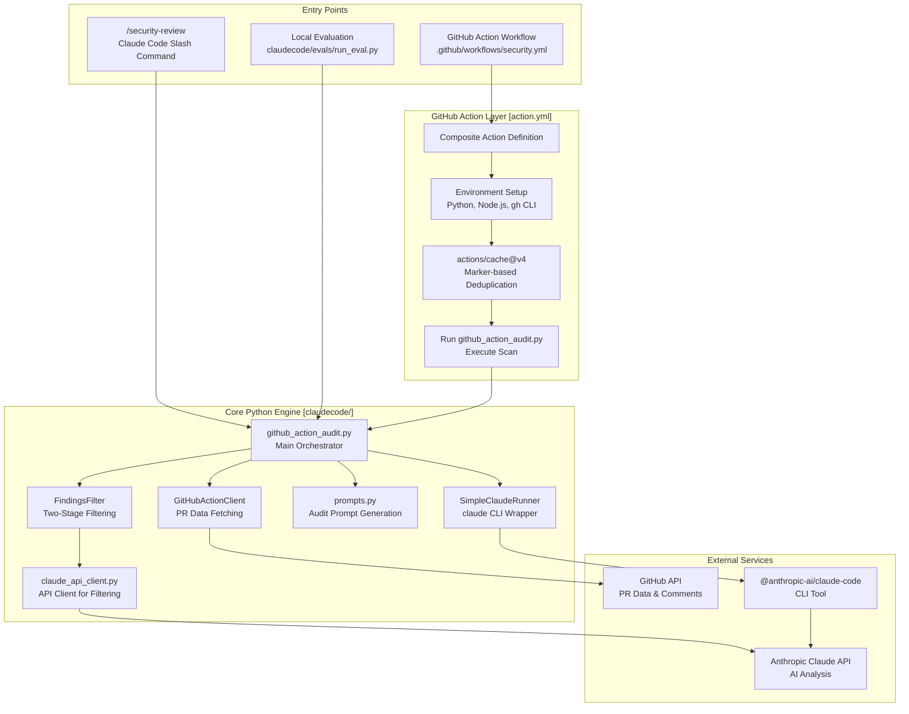
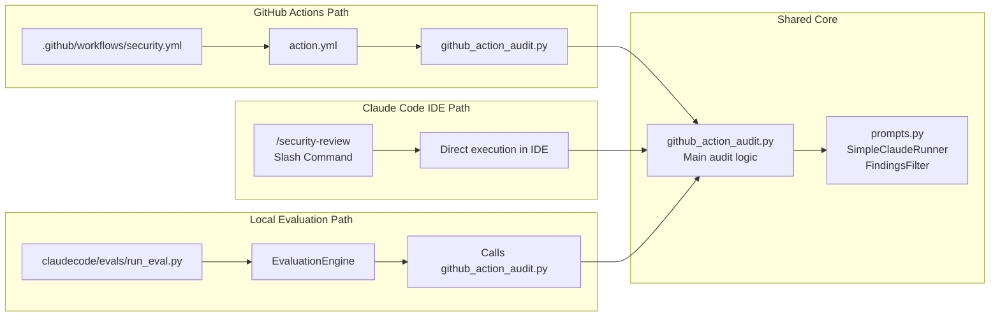
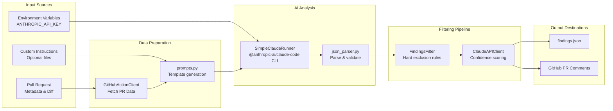

<!-- source: DeepWiki mcp.deepwiki.com · repo anthropics/claude-code-security-review · page 1 Overview · fetched 2026-10-26 -->

# Overview

Relevant source files

The following files were used as context for generating this wiki page:

- [LICENSE](LICENSE)
- [README.md](README.md)
- [action.yml](action.yml)

The Claude Code Security Review system is an AI-powered GitHub Action that performs automated security analysis on pull requests. This page introduces the system's purpose, architecture, and core workflow at a high level.

For detailed information about specific subsystems, see GitHub Action Integration (page 2), Core Python Engine (page 3), Security Analysis Pipeline (page 4), Evaluation and Testing System (page 5), Utilities and Infrastructure (page 6), and Configuration and Deployment (page 7).

## System Purpose

The Claude Code Security Review system is a static application security testing (SAST) tool that identifies security vulnerabilities in code changes. It integrates with GitHub as a composite action ([action.yml:1-3]()) and uses Anthropic's Claude AI to perform semantic code analysis.

**Key Capabilities:**
- **AI-Powered Analysis**: Uses Claude's advanced reasoning to detect security vulnerabilities with deep semantic understanding [README.md:7-7]().
- **Diff-Aware Scanning**: For PRs, only analyzes changed files [README.md:8-8]().
- **PR Comments**: Automatically comments on PRs with security findings [README.md:9-9]().
- **Language Agnostic**: Works with any programming language [README.md:11-11]().
- **False Positive Filtering**: Advanced filtering to reduce noise and focus on real vulnerabilities [README.md:12-12]().

Sources: [README.md:1-13](), [action.yml:1-3]()

## System Architecture

The system consists of three primary layers: the GitHub Action Integration layer, the Core Python Engine, and External Services.

### Overall System Architecture

The `action.yml` composite action serves as the primary integration point, coordinating environment setup, dependency installation, and execution of `github_action_audit.py` [action.yml:60-185](). The Python core engine handles data collection, AI analysis, and filtering [README.md:75-84]().

Sources: [action.yml:60-185](), [README.md:72-84]()

### Alternative Execution Paths

The system can be invoked through three different entry points, all converging on the same core analysis logic:

The GitHub Actions path provides automated CI/CD integration via `action.yml` [action.yml:1-3](). The Claude Code slash command enables on-demand analysis within the developer's environment [README.md:139-141](). The local evaluation path (`claudecode/evals/run_eval.py`) supports testing against arbitrary PRs [README.md:133-135]().

Sources: [action.yml:1-185](), [README.md:133-141]()

## Core Workflow

The system transforms pull request data through a multi-stage pipeline from raw input to filtered security findings.

### Data Flow and Transformation Pipeline

The workflow consists of five stages:
1. **PR Analysis**: Claude analyzes the diff to understand what changed [README.md:88-88]().
2. **Contextual Review**: Claude examines the code changes in context [README.md:89-89]().
3. **Finding Generation**: Security issues are identified with explanations and severity [README.md:90-90]().
4. **False Positive Filtering**: Advanced filtering removes low-impact findings [README.md:91-91]().
5. **PR Comments**: Findings are posted as review comments on specific lines [README.md:92-92]().

Sources: [README.md:86-92]()

## Key Components

The system is organized into several subsystems:

| Component | Primary Files | Purpose |
|-----------|--------------|---------|
| **GitHub Action** | `action.yml` | Orchestrates the CI/CD pipeline and environment setup [action.yml:1-61](). |
| **Audit Orchestrator** | `github_action_audit.py` | Main script coordinating the audit for GitHub Actions [README.md:76-76](). |
| **Prompt Engine** | `prompts.py` | Security audit prompt templates and logic [README.md:77-77](). |
| **Filtering System** | `findings_filter.py` | False positive filtering logic [README.md:78-78](). |
| **Claude API Client** | `claude_api_client.py` | Client for false positive filtering via API [README.md:79-79](). |
| **CLI Runner** | `claude_runner.py` | Wrapper for executing the Claude Code CLI tool. |
| **JSON Parser** | `json_parser.py` | Robust JSON parsing utilities for AI output [README.md:80-80](). |
| **Eval Tooling** | `evals/` | Tooling to test Claude Code on arbitrary PRs [README.md:83-83](). |

Sources: [README.md:72-84](), [action.yml:1-61]()

## Security Analysis Capabilities

The tool detects a wide range of vulnerabilities, including:
- **Injection Attacks**: SQL, command, LDAP, XXE, etc. [README.md:98-98]().
- **Auth & Authz**: Broken authentication, privilege escalation, IDOR [README.md:99-99]().
- **Data Exposure**: Hardcoded secrets, PII handling violations [README.md:100-100]().
- **Cryptographic Issues**: Weak algorithms, improper key management [README.md:101-101]().
- **Code Execution**: RCE via deserialization, eval injection [README.md:106-106]().

### False Positive Filtering
To reduce noise, the tool automatically excludes low-impact findings such as:
- Denial of Service (DoS) [README.md:112-112]().
- Rate limiting concerns [README.md:113-113]().
- Memory/CPU exhaustion [README.md:114-114]().
- Open redirect vulnerabilities [README.md:116-116]().

Sources: [README.md:96-118]()

---

