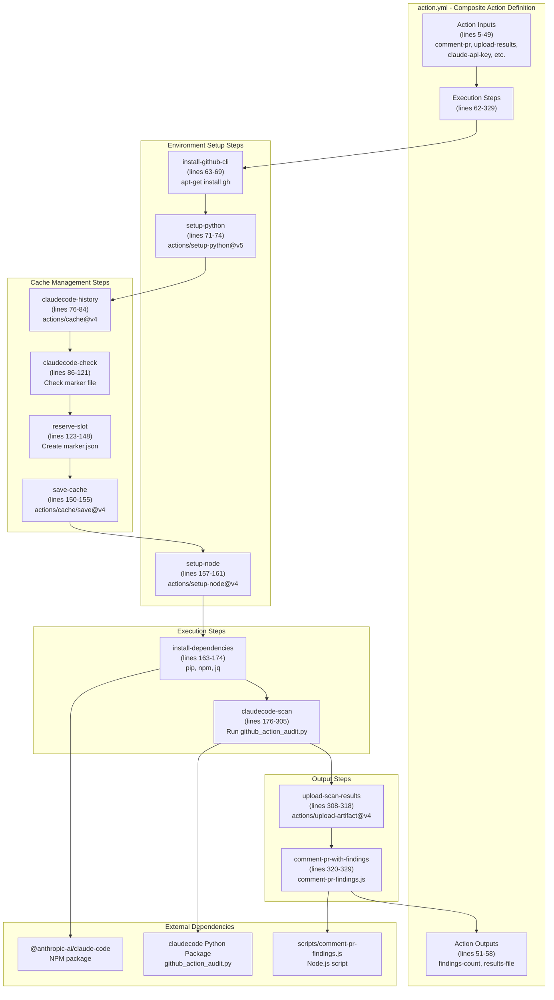
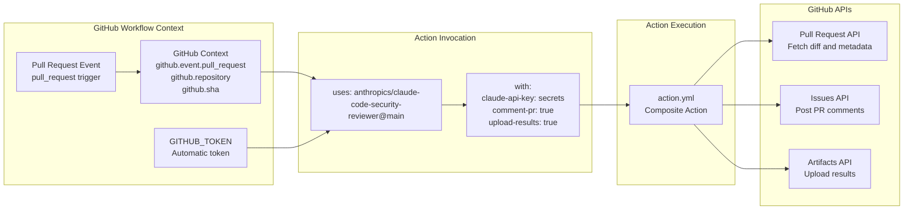
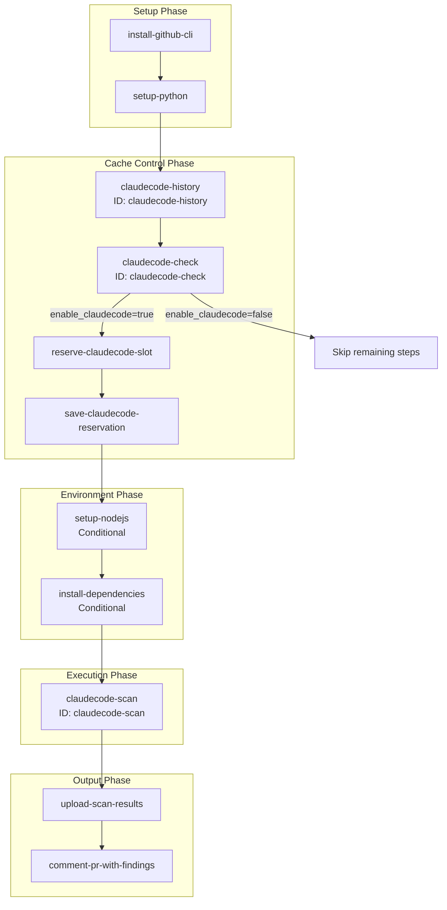
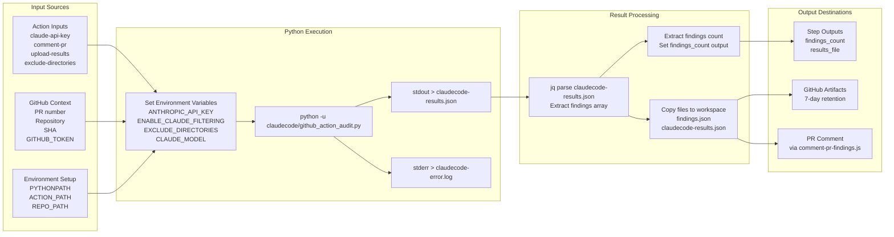
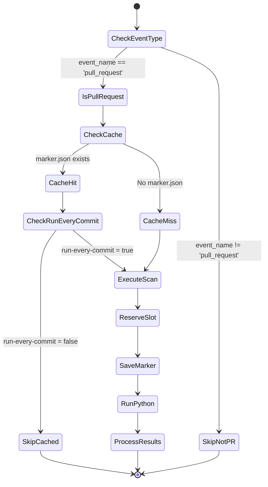
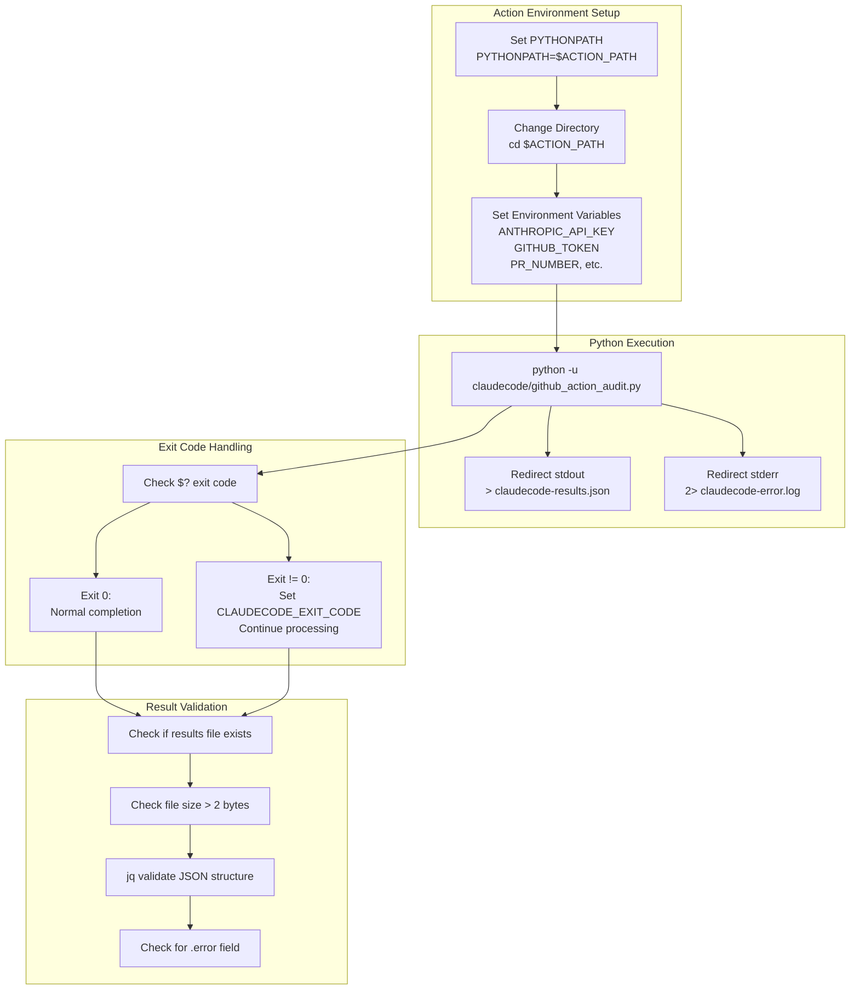
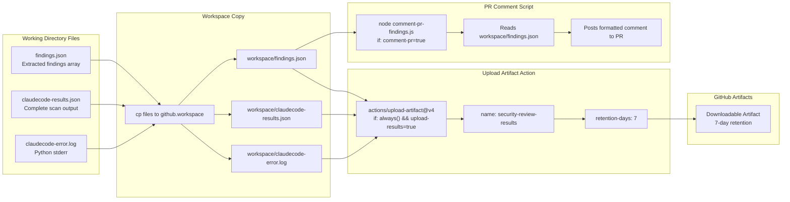
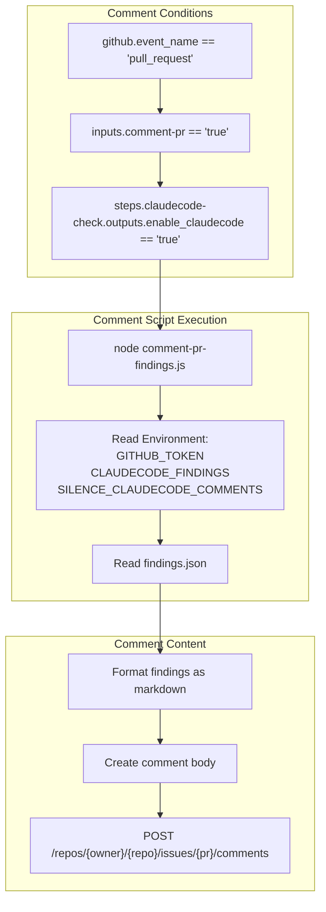

<!-- source: DeepWiki mcp.deepwiki.com · repo anthropics/claude-code-security-review · page 2 GitHub Action Integration · fetched 2026-10-26 -->

# GitHub Action Integration

<details>
<summary>Relevant source files</summary>

The following files were used as context for generating this wiki page:

- [.github/workflows/sast.yml](.github/workflows/sast.yml)
- [action.yml](action.yml)

</details>


## Purpose and Scope

This document describes the GitHub Action that serves as the primary interface to the Claude Code Security Review system. The action orchestrates security analysis by coordinating dependency installation, cache management, scan execution, and result reporting within GitHub's CI/CD environment.

For detailed information about:
- Configuration inputs and outputs, see [Action Configuration and Inputs](#2.1)
- The sequential execution flow, see [Execution Pipeline and Steps](#2.2)
- The caching mechanism, see [Caching and Run Deduplication](#2.3)
- Example workflows, see [CI/CD Workflow Integration](#2.4)
- The underlying Python security analysis engine, see [Core Python Engine](#3)

## Action Overview

The security reviewer is implemented as a GitHub composite action defined in `action.yml`. It wraps the Python-based security analysis engine (`claudecode` package) and provides a declarative interface for integrating AI-powered security reviews into GitHub workflows.

The action operates exclusively on pull request events, analyzing code changes using Claude AI to identify potential security vulnerabilities. It manages its own execution state through a marker-based caching system to prevent redundant scans and reduce false positives from repeated analysis.

**Action Type:** Composite Action  
**Primary Entry Point:** [action.yml:1-334]()  
**Core Execution Module:** [claudecode/github_action_audit.py]()

Sources: [action.yml:1-10]()

## Action Architecture

The composite action is structured around several key phases that execute sequentially:



**Key Architectural Characteristics:**

| Aspect | Implementation |
|--------|---------------|
| Action Type | Composite (`runs.using: 'composite'`) |
| Step Execution | Sequential shell scripts (`shell: bash`) |
| Conditional Logic | Step-level `if` conditions based on previous step outputs |
| State Management | GitHub Actions cache with marker files |
| Language Integration | Multi-language (Bash, Python, Node.js) |
| External Dependencies | GitHub CLI, Python packages, NPM packages |

The architecture uses step outputs (e.g., `steps.claudecode-check.outputs.enable_claudecode`) to control conditional execution throughout the pipeline. This allows downstream steps to skip execution when the scan is disabled by cache checks or configuration.

Sources: [action.yml:60-334]()

## Integration with GitHub Workflows

The action integrates into GitHub workflows as a standard action step. It requires specific GitHub context and triggers to function correctly:



**Required GitHub Context:**

- **Event Type:** Must be `pull_request` event ([action.yml:78](), [action.yml:201-204]())
- **GitHub Token:** Automatically provided via `github.token` ([action.yml:181](), [action.yml:324]())
- **PR Context:** Requires `github.event.pull_request.number` ([action.yml:90](), [action.yml:183]())
- **Repository Context:** Uses `github.repository` and `github.repository_id` ([action.yml:82](), [action.yml:182]())

**GitHub API Interactions:**

The action interacts with GitHub through multiple mechanisms:

| Mechanism | Purpose | Implementation |
|-----------|---------|---------------|
| GitHub CLI (`gh`) | PR operations and API calls | Installed via apt-get ([action.yml:68]()) |
| GitHub Token | Authentication for API requests | Passed as `GITHUB_TOKEN` env var ([action.yml:181]()) |
| Actions Cache API | Store and retrieve scan markers | `actions/cache@v4` ([action.yml:79]()) |
| Artifacts API | Upload scan results | `actions/upload-artifact@v4` ([action.yml:310]()) |

Sources: [action.yml:78-84](), [action.yml:181-184](), [action.yml:201-204](), [action.yml:324]()

## Core Step Identifiers and Responsibilities

The action defines specific step IDs that control execution flow and produce outputs:



**Critical Step Outputs:**

| Step ID | Output Variables | Purpose |
|---------|-----------------|---------|
| `claudecode-history` | `cache-hit` | Indicates if cache was restored ([action.yml:77]()) |
| `claudecode-check` | `enable_claudecode` | Controls whether scan executes ([action.yml:114]()) |
| `claudecode-check` | `silence_claudecode_comments` | Controls comment behavior ([action.yml:115]()) |
| `claudecode-scan` | `findings_count` | Number of security findings ([action.yml:54](), [action.yml:277]()) |
| `claudecode-scan` | `results_file` | Path to results JSON ([action.yml:57](), [action.yml:198]()) |

These outputs are referenced throughout the action using the syntax `${{ steps.<step-id>.outputs.<output-name> }}`.

Sources: [action.yml:76-121](), [action.yml:176-305]()

## Data Flow Through the Action

The action processes data through a well-defined pipeline from inputs to outputs:



**Environment Variable Mapping:**

The action transforms user inputs into environment variables consumed by the Python module:

| Action Input | Environment Variable | Consumed By |
|--------------|---------------------|-------------|
| `claude-api-key` | `ANTHROPIC_API_KEY` | `github_action_audit.py` ([action.yml:184]()) |
| `exclude-directories` | `EXCLUDE_DIRECTORIES` | `github_action_audit.py` ([action.yml:186]()) |
| `claude-model` | `CLAUDE_MODEL` | `github_action_audit.py` ([action.yml:189]()) |
| `claudecode-timeout` | `CLAUDECODE_TIMEOUT` → `CLAUDE_TIMEOUT` | `github_action_audit.py` ([action.yml:190](), [action.yml:217]()) |
| `false-positive-filtering-instructions` | `FALSE_POSITIVE_FILTERING_INSTRUCTIONS` | `github_action_audit.py` ([action.yml:187]()) |
| `custom-security-scan-instructions` | `CUSTOM_SECURITY_SCAN_INSTRUCTIONS` | `github_action_audit.py` ([action.yml:188]()) |
| (hardcoded) | `ENABLE_CLAUDE_FILTERING=true` | `github_action_audit.py` ([action.yml:185]()) |

**Result File Processing:**

The action produces multiple result files with distinct purposes:

| File | Format | Purpose | Created At |
|------|--------|---------|-----------|
| `claudecode-results.json` | JSON | Complete scan output with metadata | Line 242 (Python stdout) |
| `findings.json` | JSON Array | Extracted findings for PR comment | Line 281 (jq extraction) |
| `claudecode-error.log` | Text | Error messages from Python execution | Line 242 (Python stderr) |

Sources: [action.yml:176-305]()

## Execution Control Mechanisms

The action implements several mechanisms to control when and how scans execute:



**Cache Key Structure:**

The cache key follows a hierarchical pattern to enable precise cache management:

```
claudecode-{repository_id}-pr-{pr_number}-{sha}
```

Components:
- `repository_id`: GitHub repository ID for uniqueness across forks ([action.yml:82]())
- `pr_number`: Pull request number for per-PR tracking ([action.yml:82]())
- `sha`: Commit SHA for per-commit granularity ([action.yml:82]())

**Restore Keys:**

The action uses a restore key prefix to find markers from earlier commits in the same PR:

```
claudecode-{repository_id}-pr-{pr_number}-
```

This allows the cache system to restore the most recent marker from any commit in the PR ([action.yml:83-84]()).

**Marker File Format:**

When execution proceeds, the action creates a marker file at `.claudecode-marker/marker.json`:

```json
{
  "timestamp": "ISO-8601 timestamp",
  "repository_id": "GitHub repository ID",
  "repository": "owner/repo",
  "pr_number": 123,
  "sha": "commit SHA",
  "status": "reserved",
  "run_id": "GitHub Actions run ID",
  "run_number": "GitHub Actions run number"
}
```

This marker serves multiple purposes:
- **Race condition prevention:** Multiple concurrent runs on the same PR check for existing markers ([action.yml:104]())
- **Audit trail:** Records which run created the marker ([action.yml:136-147]())
- **Cache invalidation:** SHA-specific keys prevent stale cache hits

Sources: [action.yml:76-156]()

## Python Module Invocation

The core security analysis is performed by executing the Python module:



**Invocation Details:**

| Aspect | Implementation |
|--------|---------------|
| Working Directory | Changes to `$ACTION_PATH` before execution ([action.yml:221]()) |
| Python Path | Sets `PYTHONPATH` to include action root ([action.yml:238-239]()) |
| Python Flags | Uses `-u` for unbuffered output ([action.yml:242]()) |
| Output Redirection | stdout → `claudecode-results.json`, stderr → `claudecode-error.log` ([action.yml:242]()) |
| Exit Code Handling | Captures exit code but continues processing ([action.yml:242-248]()) |

**Error Handling Strategy:**

The action implements graceful degradation when Python execution encounters errors:

1. **Non-zero exit code:** Captured as warning but doesn't fail the action ([action.yml:244-246]())
2. **Empty results file:** Warns and sets findings count to 0 ([action.yml:256-263]())
3. **JSON error field:** Extracts error message and sets findings count to 0 ([action.yml:269-272]())
4. **Missing results file:** Warns, displays error log, sets findings count to 0 ([action.yml:284-290]())

This approach ensures the GitHub Actions workflow continues even if the scan encounters issues, preventing blocking of PR merges due to transient failures.

Sources: [action.yml:192-305]()

## Output Artifact Management

The action produces artifacts that are uploaded to GitHub and made available for inspection:



**Upload Configuration:**

| Setting | Value | Location |
|---------|-------|----------|
| Upload Step | `upload-scan-results` | [action.yml:308]() |
| Condition | `always() && inputs.upload-results == 'true'` | [action.yml:309]() |
| Artifact Name | `security-review-results` | [action.yml:312]() |
| Retention | 7 days | [action.yml:317]() |
| Missing Files | Ignored (`if-no-files-found: ignore`) | [action.yml:318]() |

The `always()` condition ensures artifacts are uploaded even if previous steps failed, enabling debugging of scan failures.

**File Path Management:**

Files are copied from the action's working directory to the workspace root to ensure downstream steps can locate them:

```bash
# Copy occurs after Python execution completes
cp findings.json ${{ github.workspace }}/findings.json
cp claudecode/claudecode-results.json ${{ github.workspace }}/claudecode-results.json
cp claudecode/claudecode-error.log ${{ github.workspace }}/claudecode-error.log
```

This copying happens at [action.yml:295-303]() with error suppression (`|| true`) to prevent failures if files don't exist.

Sources: [action.yml:295-318]()

## PR Comment Generation

The final step posts scan results as a PR comment using a Node.js script:



**Comment Step Configuration:**

| Aspect | Value |
|--------|-------|
| Step Name | `comment-pr-with-findings` ([action.yml:320]()) |
| Condition | Must be PR event, comment-pr enabled, and scan enabled ([action.yml:321]()) |
| Script Path | `$ACTION_PATH/scripts/comment-pr-findings.js` ([action.yml:329]()) |
| Environment | `GITHUB_TOKEN`, `CLAUDECODE_FINDINGS`, `SILENCE_CLAUDECODE_COMMENTS` ([action.yml:324-326]()) |

The script reads `findings.json` from the workspace and formats it as a markdown comment posted to the PR using GitHub's API.

Sources: [action.yml:320-329]()

## Configuration Interface Summary

The action exposes a comprehensive configuration interface through its inputs:

| Input Category | Inputs | Purpose |
|----------------|--------|---------|
| **Outputs** | `comment-pr`, `upload-results` | Control what artifacts are produced |
| **API Credentials** | `claude-api-key` | Required for Claude API access |
| **Scan Configuration** | `exclude-directories`, `custom-security-scan-instructions` | Customize what and how to scan |
| **Execution Control** | `claudecode-timeout`, `run-every-commit` | Control scan behavior |
| **Filtering** | `false-positive-filtering-instructions` | Customize false positive filtering |
| **Model Selection** | `claude-model` | Choose specific Claude model version |

For detailed documentation of each input parameter and output value, see [Action Configuration and Inputs](#2.1).

For information about the step-by-step execution sequence, see [Execution Pipeline and Steps](#2.2).

For details on the caching mechanism, see [Caching and Run Deduplication](#2.3).

For example workflow configurations, see [CI/CD Workflow Integration](#2.4).

Sources: [action.yml:5-58]()

---

