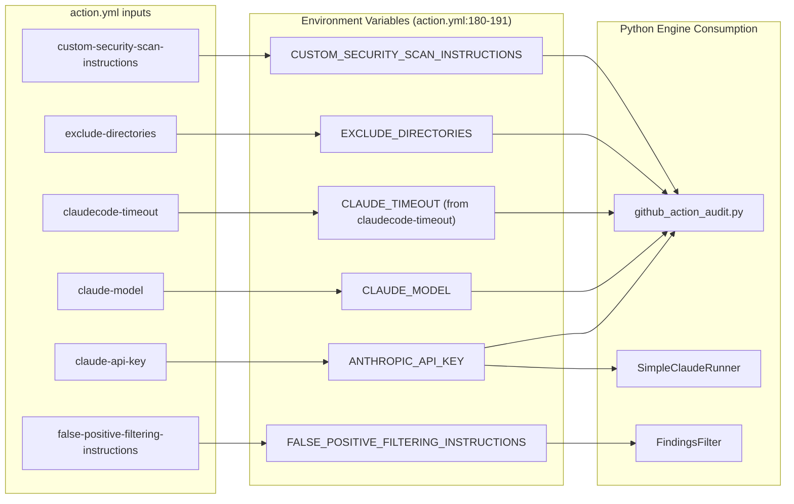
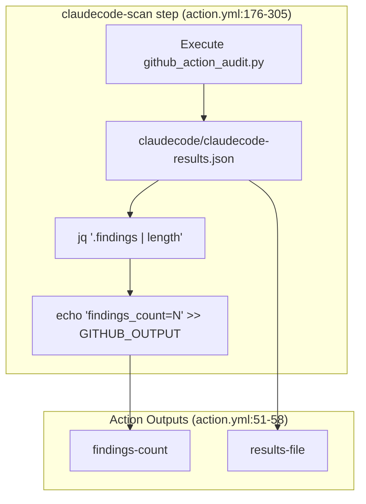
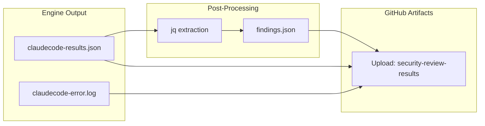

<!-- source: DeepWiki mcp.deepwiki.com · repo anthropics/claude-code-security-review · page 2.1 Action Configuration and Inputs · fetched 2026-10-26 -->

# Action Configuration and Inputs

<details>
<summary>Relevant source files</summary>

The following files were used as context for generating this wiki page:

- [README.md](README.md)
- [action.yml](action.yml)

</details>


This page documents the `action.yml` configuration interface for the Claude Code Security Review GitHub Action. It details all available inputs, outputs, and how user-provided configuration flows through the system to control security analysis behavior.

For information about the execution pipeline and step sequencing, see page 2.2. For caching mechanisms, see page 2.3. For the core security analysis logic, see page 3.

## Action Metadata

The GitHub Action is defined in `action.yml` with the following metadata:

| Property | Value |
|----------|-------|
| `name` | Claude Code Security Reviewer |
| `description` | AI-powered security review GitHub Action using Claude to analyze code changes for security vulnerabilities |
| `author` | Anthropic |

Sources: [action.yml:1-3]()

## Input Configuration Options

The action defines several inputs in `action.yml` that control security analysis behavior. These inputs are categorized into three groups: behavior controls, analysis configuration, and customization options.

### Behavior Control Inputs

These inputs control how the action operates and reports results:

| Input | Type | Required | Default | Description |
|-------|------|----------|---------|-------------|
| `comment-pr` | boolean | No | `'true'` | Whether to post PR comments with security findings |
| `upload-results` | boolean | No | `'true'` | Whether to upload results as GitHub artifacts |
| `run-every-commit` | boolean | No | `'false'` | Run on every commit, skipping cache check. Warning: may increase false positives on multi-commit PRs |

Sources: [action.yml:6-9](), [action.yml:11-14](), [action.yml:36-39]()

### Analysis Configuration Inputs

These inputs configure the Claude API and analysis parameters:

| Input | Type | Required | Default | Description |
|-------|------|----------|---------|-------------|
| `claude-api-key` | string | Yes | `''` | Anthropic Claude API key for security analysis (used for both Claude CLI and API) |
| `claude-model` | string | No | `''` | Claude model name (e.g., `claude-sonnet-4-20250514`). Empty string uses system default |
| `claudecode-timeout` | string | No | `'20'` | Timeout for ClaudeCode analysis in minutes |
| `exclude-directories` | string | No | `''` | Comma-separated list of directories to exclude from scanning |

Sources: [action.yml:26-29](), [action.yml:31-34](), [action.yml:21-24](), [action.yml:16-19]()

### Customization Inputs

These inputs allow users to provide custom instructions for security scanning and filtering:

| Input | Type | Required | Default | Description |
|-------|------|----------|---------|-------------|
| `custom-security-scan-instructions` | string | No | `''` | Path to text file with custom security scan instructions appended to the audit prompt |
| `false-positive-filtering-instructions` | string | No | `''` | Path to text file with custom false positive filtering instructions |

Sources: [action.yml:46-49](), [action.yml:41-44]()

### Input to Environment Variable Mapping

The following diagram shows how action inputs are mapped to environment variables consumed by the core engine:

**Input Data Flow Diagram**



Sources: [action.yml:180-191]()

## Output Specifications

The action exposes two outputs that downstream workflow steps can consume:

| Output | Type | Description | Value Mapping |
|--------|------|-------------|---------------|
| `findings-count` | number | Total number of security findings identified | `${{ steps.claudecode-scan.outputs.findings_count }}` |
| `results-file` | string | Path to the generated results JSON file | `${{ steps.claudecode-scan.outputs.results_file }}` |

Sources: [action.yml:51-58]()

### Output Generation Flow

The `claudecode-scan` step executes the Python orchestrator and then processes the resulting JSON to set step outputs.

**Output Processing Diagram**



Sources: [action.yml:51-58](), [action.yml:275-278]()

## Configuration Usage Patterns

### Basic Usage Example

The minimal configuration requires only the `claude-api-key`:

```yaml
- uses: anthropics/claude-code-security-review@main
  with:
    claude-api-key: ${{ secrets.CLAUDE_API_KEY }}
```

Sources: [README.md:37-40]()

### Advanced Configuration Example

A fully customized configuration with all inputs:

```yaml
- uses: anthropics/claude-code-security-review@main
  with:
    claude-api-key: ${{ secrets.CLAUDE_API_KEY }}
    claude-model: 'claude-3-5-sonnet-20241022'
    claudecode-timeout: '30'
    comment-pr: true
    upload-results: true
    run-every-commit: false
    exclude-directories: 'vendor,node_modules,dist'
    custom-security-scan-instructions: '.github/security-scan-instructions.txt'
    false-positive-filtering-instructions: '.github/fp-filter-instructions.txt'
```

Sources: [action.yml:5-49]()

## Environment Variables Set by Action

The action sets multiple environment variables for the `github_action_audit.py` execution and downstream scripts:

### GitHub Context Variables

| Variable | Source | Purpose |
|----------|--------|---------|
| `GITHUB_TOKEN` | `${{ github.token }}` | Authentication for GitHub API operations |
| `GITHUB_REPOSITORY` | `${{ github.repository }}` | Target repository for analysis |
| `PR_NUMBER` | `${{ github.event.pull_request.number }}` | Current Pull Request identifier |

Sources: [action.yml:181-183]()

### Analysis Customization Variables

| Variable | Source | Purpose |
|----------|--------|---------|
| `EXCLUDE_DIRECTORIES` | `inputs.exclude-directories` | Filters files before analysis |
| `CUSTOM_SECURITY_SCAN_INSTRUCTIONS` | `inputs.custom-security-scan-instructions` | Appends custom rules to the Claude prompt |
| `FALSE_POSITIVE_FILTERING_INSTRUCTIONS` | `inputs.false-positive-filtering-instructions` | Guides the AI during the filtering phase |

Sources: [action.yml:186-188]()

## File Outputs and Artifacts

The action produces several output files during execution that are uploaded as artifacts or used by downstream steps.

### Generated Files

| File | Location | Purpose |
|------|----------|---------|
| `claudecode-results.json` | `claudecode/` | Complete analysis results including metadata |
| `findings.json` | Workspace root | Extracted findings array for PR commenting |
| `claudecode-error.log` | `claudecode/` | Error and debug logs from the Python engine |
| `marker.json` | `.claudecode-marker/` | Cache marker for run deduplication |

Sources: [action.yml:136-147](), [action.yml:275-282](), [action.yml:295-303]()

### Artifact Upload Configuration

When `upload-results` is `true`, the action uploads artifacts with a 7-day retention period.

**Artifact Flow Diagram**



Sources: [action.yml:11-14](), [action.yml:275-282](), [action.yml:308-318]()

---

