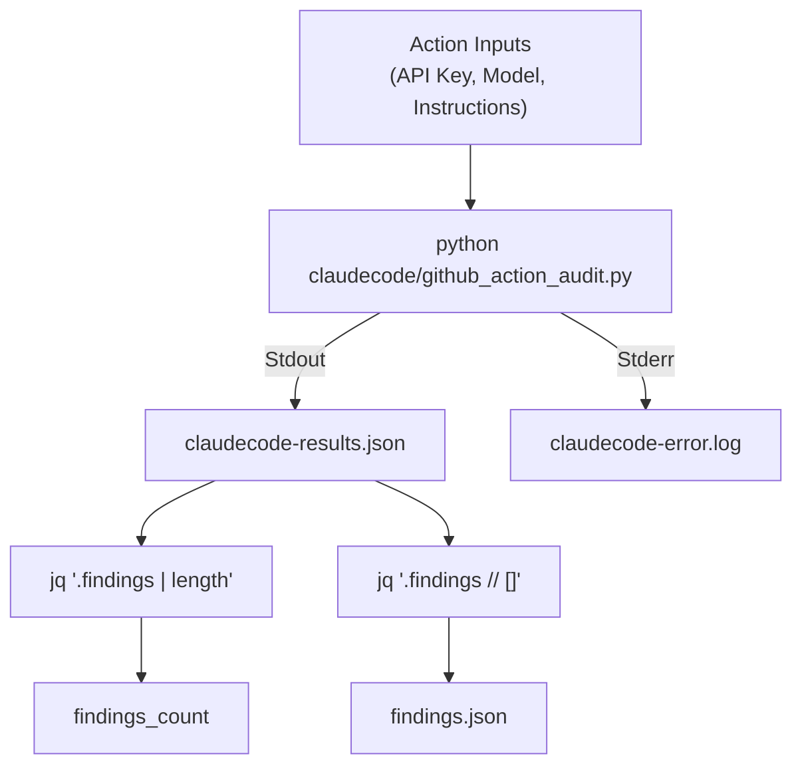

<!-- source: DeepWiki mcp.deepwiki.com · repo anthropics/claude-code-security-review · page 2.2 Execution Pipeline and Steps · fetched 2026-10-26 -->

# Execution Pipeline and Steps

Relevant source files

The following files were used as context for generating this wiki page:

- [action.yml](action.yml)
- [scripts/comment-pr-findings.bun.test.js](scripts/comment-pr-findings.bun.test.js)
- [scripts/comment-pr-findings.js](scripts/comment-pr-findings.js)
- [scripts/package.json](scripts/package.json)

## Purpose and Scope

This document details the sequential execution flow of the GitHub Action from trigger to completion. It explains each step in the action's composite run configuration, the decision points that control execution, and how data flows through the pipeline.

## Execution Overview

The GitHub Action executes as a composite action with 11 distinct steps, orchestrated by `action.yml`. The pipeline follows a linear flow with conditional branching based on cache status and configuration. The action can exit early if a scan has already been performed for the current PR and commit, preventing redundant analysis.

### System Flow Diagram
The following diagram maps the execution stages to the specific code entities responsible for each phase.

```mermaid
flowchart TD
    Start(["Workflow Trigger"]) --> InstallGH["Step 1: Install GitHub CLI<br/>action.yml:63-69"]
    InstallGH --> SetupPy["Step 2: Set up Python<br/>action.yml:71-74"]
    SetupPy --> CheckCache["Step 3: Check History<br/>actions/cache@v4<br/>action.yml:76-84"]
    
    CheckCache --> DetermineEnable["Step 4: Determine Enablement<br/>action.yml:86-121"]
    
    DetermineEnable --> EnableCheck{"`enable_claudecode == 'true'?`"}
    
    EnableCheck -->|No| SkipToUpload["Skip to Upload Results"]
    EnableCheck -->|Yes| ReserveSlot["Step 5: Reserve Slot<br/>.claudecode-marker/marker.json<br/>action.yml:123-148"]
    
    ReserveSlot --> SaveCache["Step 6: Save reservation<br/>actions/cache/save@v4<br/>action.yml:150-155"]
    SaveCache --> SetupNode["Step 7: Set up Node.js<br/>action.yml:157-161"]
    SetupNode --> InstallDeps["Step 8: Install dependencies<br/>pip & npm install<br/>action.yml:163-174"]
    
    InstallDeps --> RunScan["Step 9: Run ClaudeCode scan<br/>github_action_audit.py<br/>action.yml:176-305"]
    
    RunScan --> SkipToUpload
    SkipToUpload --> UploadResults["Step 10: Upload results<br/>actions/upload-artifact@v4<br/>action.yml:308-318"]
    
    UploadResults --> CommentCheck{"`comment-pr == 'true'?`"}
    CommentCheck -->|Yes| CommentPR["Step 11: Comment PR<br/>comment-pr-findings.js<br/>action.yml:320-329"]
    CommentCheck -->|No| End
    CommentPR --> End(["Workflow Complete"])
```

**Sources:** [action.yml:60-329]()

---

## Step-by-Step Execution

### Step 1-2: Environment Preparation
The action begins by ensuring the runner has the necessary binaries:
- **GitHub CLI (`gh`)**: Required for interacting with PR metadata and posting comments [action.yml:63-69]().
- **Python 3.x**: Required to run the core audit engine [action.yml:71-74]().

### Step 3-4: Cache Check and Enablement Logic
The system uses a marker-based caching system to prevent duplicate scans on the same commit SHA.

1. **Check History**: Attempts to restore a cache keyed by `claudecode-${{ github.repository_id }}-pr-${{ github.event.pull_request.number }}-${{ github.sha }}` [action.yml:76-82]().
2. **Determine Enablement**: A bash script checks if `.claudecode-marker/marker.json` exists. If it exists and `run-every-commit` is false, the scan is disabled [action.yml:104-106]().

### Step 5-6: Concurrency Reservation
To prevent race conditions where multiple workflow runs might target the same PR simultaneously, the action "reserves" a slot.
- It creates a `marker.json` containing the `run_id` and `timestamp` [action.yml:136-147]().
- It immediately saves this marker to the GitHub cache [action.yml:152-156]().

### Step 7-8: Dependency Installation
If enabled, the action installs:
- **Python Dependencies**: `pip install -r claudecode/requirements.txt` [action.yml:170]().
- **Claude CLI**: `npm install -g @anthropic-ai/claude-code` [action.yml:171]().
- **Utility**: `jq` for JSON processing [action.yml:173]().

### Step 9: Core Scan Execution
This step invokes the Python orchestrator.

**Data Flow in Scan Step:**

**Key Implementation Details:**
- The script is executed with the `-u` flag for unbuffered output [action.yml:236]().
- Results are piped to `claudecode-results.json` [action.yml:237]().
- The step uses `jq` to extract the `findings_count` for the Action's output variables [action.yml:263-271]().

**Sources:** [action.yml:176-305]()

### Step 10: Artifact Upload
The action uploads three key files as artifacts named `security-review-results` [action.yml:308-318]():
1. `findings.json`: The filtered list of vulnerabilities.
2. `claudecode-results.json`: The raw output from the Python engine.
3. `claudecode-error.log`: Any stderr output captured during the scan.

### Step 11: PR Reporting
If `comment-pr` is enabled, the action executes `scripts/comment-pr-findings.js` using Node.js [action.yml:320-329]().

**Reporting Logic (`comment-pr-findings.js`):**
- **Context Parsing**: Reads `GITHUB_EVENT_PATH` to identify the PR number and head SHA [scripts/comment-pr-findings.js:11-22]().
- **Finding Processing**: Iterates through `findings.json`. It maps file paths to the PR diff using the `gh api .../pulls/{id}/files` endpoint [scripts/comment-pr-findings.js:108-114]().
- **Comment Creation**: Generates a formatted markdown body for each finding, including Severity, Category, Exploit Scenario, and Recommendation [scripts/comment-pr-findings.js:143-158]().
- **Review Submission**: Bundles all comments into a single PR Review with the event type `COMMENT` [scripts/comment-pr-findings.js:192-198]().

**Sources:** [scripts/comment-pr-findings.js:91-205]()

---

## Error Handling and Exit States

The pipeline is designed to be resilient to partial failures:

| Failure Scenario | System Behavior |
|:---|:---|
| **Missing API Key** | Script logs an error and exits with code 1 [action.yml:206-214](). |
| **Python Crash** | The `CLAUDECODE_EXIT_CODE` is captured, but the workflow continues to allow artifact upload for debugging [action.yml:242-248](). |
| **Malformed JSON** | `jq` processing includes fallbacks (e.g., `|| echo "0"`) to ensure the action doesn't crash during output variable assignment [action.yml:265](). |
| **Empty Findings** | If `findings.json` is empty or missing, the reporting script exits silently without posting a comment [scripts/comment-pr-findings.js:103-105](). |

**Sources:** [action.yml:251-291](), [scripts/comment-pr-findings.js:98-101]()

---

