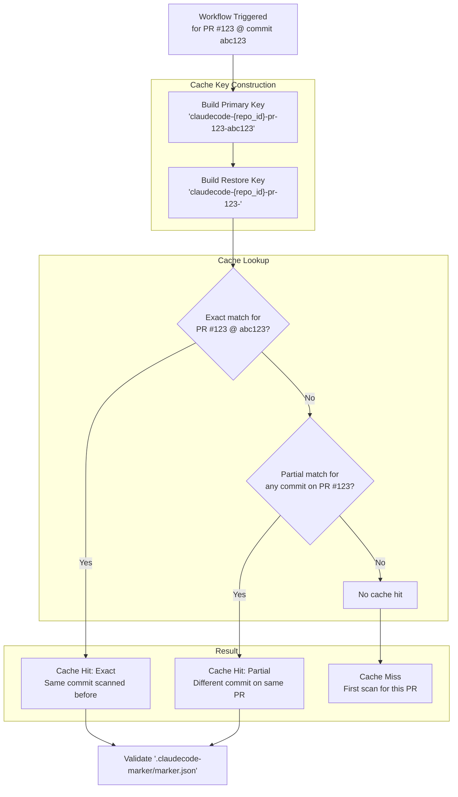
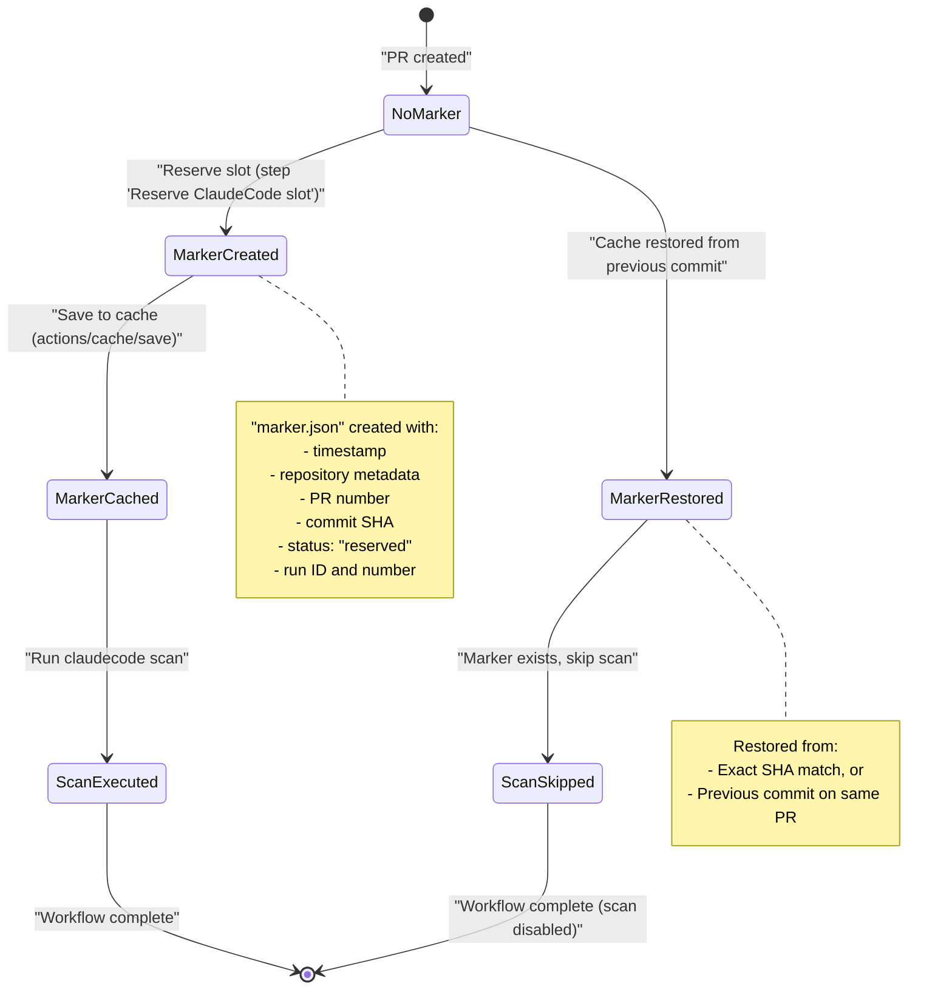
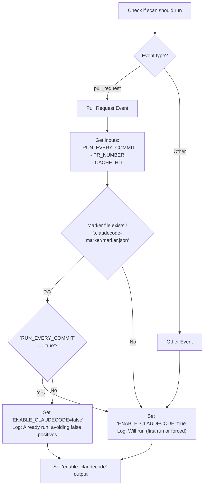
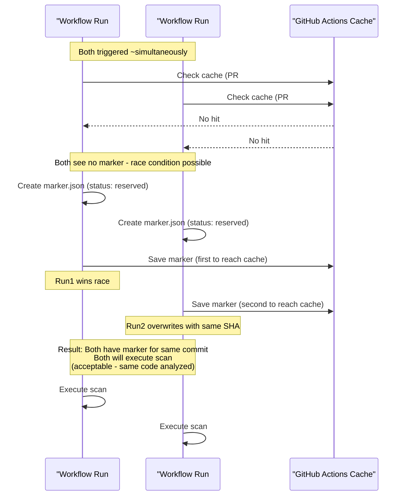
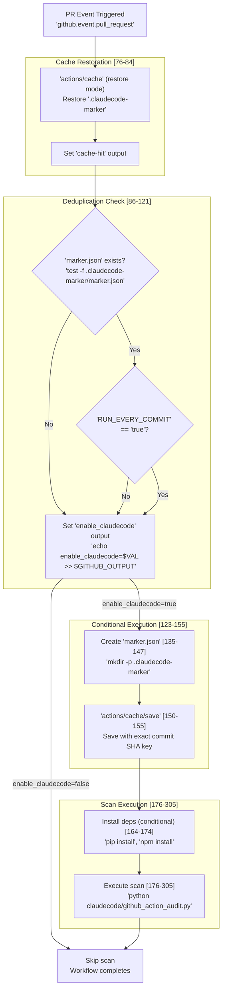

<!-- source: DeepWiki mcp.deepwiki.com · repo anthropics/claude-code-security-review · page 2.3 Caching and Run Deduplication · fetched 2026-10-26 -->

# Caching and Run Deduplication

<details>
<summary>Relevant source files</summary>

The following files were used as context for generating this wiki page:

- [action.yml](action.yml)

</details>


## Purpose and Scope

This document describes the marker-based caching system that prevents redundant security scans on the same code. The system addresses a critical problem: when a PR receives multiple commits, running the security analysis on every commit can lead to false positives because the AI analyzes the same code multiple times and may produce different findings each time.

The caching mechanism uses GitHub Actions cache to store a marker file that indicates whether a security scan has already been performed for a specific PR and commit combination. For information about the overall GitHub Action execution flow, see [Execution Pipeline and Steps](). For details on action configuration options, see [Action Configuration and Inputs]().

**Sources:** [action.yml:36-39](), [action.yml:76-155]()

## Overview of the Caching Strategy

The caching system operates on a **per-PR, per-commit basis** with an optional override mechanism. The core principle is: once a scan has been performed for a specific commit on a PR, subsequent workflow runs for that same commit should skip the scan unless explicitly configured otherwise.

The system uses two complementary mechanisms:
1. **GitHub Actions cache** - Provides distributed storage and retrieval of marker files across workflow runs [action.yml:76-84]().
2. **Marker file validation** - Ensures cache hits are legitimate by verifying the existence of the marker file content [action.yml:104-111]().

This dual approach prevents race conditions and ensures that only one scan executes for each commit, even when multiple workflow runs occur simultaneously.

**Sources:** [action.yml:76-121]()

## Cache Key Structure

### Cache Key Hierarchy

The cache system uses a hierarchical key structure that enables both exact matches and partial restoration:

```
Primary Key:
claudecode-${{ github.repository_id }}-pr-${{ github.event.pull_request.number }}-${{ github.sha }}

Restore Keys:
claudecode-${{ github.repository_id }}-pr-${{ github.event.pull_request.number }}-
```

The primary key uniquely identifies a specific commit on a specific PR in a specific repository. The restore key allows the action to find markers from previous commits on the same PR.

**Sources:** [action.yml:82-84]()

### Cache Key Components

| Component | Source | Purpose |
|-----------|--------|---------|
| `repository_id` | `github.repository_id` context | Ensures isolation between repositories [action.yml:82]() |
| `pr_number` | `github.event.pull_request.number` | Groups caches by pull request [action.yml:82]() |
| `commit_sha` | `github.sha` context | Identifies specific commits [action.yml:82]() |

The repository ID (rather than repository name) is used to avoid cache collisions if a repository is renamed. The PR number provides a logical grouping, while the commit SHA ensures precision.

**Sources:** [action.yml:82-84]()

### Cache Key Resolution Diagram



**Sources:** [action.yml:76-84]()

## Marker File System

### Marker File Structure

The marker file is a JSON document stored at `.claudecode-marker/marker.json` that records metadata about the scan reservation:

```json
{
  "timestamp": "2024-01-15T10:30:45Z",
  "repository_id": "123456789",
  "repository": "owner/repo",
  "pr_number": 123,
  "sha": "abc123def456",
  "status": "reserved",
  "run_id": "1234567890",
  "run_number": 42
}
```

The `status` field is set to `"reserved"` when the scan slot is claimed, indicating that this workflow run has reserved the right to perform the scan.

**Sources:** [action.yml:135-147]()

### Marker File Lifecycle



**Sources:** [action.yml:123-155]()

### Marker Creation Process

The marker file is created in the "Reserve ClaudeCode slot to prevent race conditions" step. This step only executes when:
1. `enable_claudecode == 'true'` (scan is enabled) [action.yml:124]()
2. `github.event_name == 'pull_request'` (event is a PR) [action.yml:124]()

The creation process:
1. Creates the `.claudecode-marker` directory [action.yml:135]()
2. Writes `marker.json` with metadata from GitHub context variables [action.yml:136-147]()
3. Saves the marker directory to GitHub Actions cache [action.yml:150-155]()

**Sources:** [action.yml:123-155]()

## Run Deduplication Logic

### Decision Flow

The deduplication logic is implemented in the "Determine ClaudeCode enablement" step, which sets the `enable_claudecode` output variable that controls whether subsequent steps execute.



**Sources:** [action.yml:86-121]()

### Code Implementation

The deduplication check is implemented in bash at [action.yml:92-121]():

| Line Range | Logic | Purpose |
|------------|-------|---------|
| [94]() | Initialize `ENABLE_CLAUDECODE="true"` | Default to enabled |
| [98-112]() | PR-specific deduplication logic | Apply caching rules |
| [104-106]() | Check `RUN_EVERY_COMMIT != "true" && marker exists` | Skip if already run |
| [107-108]() | Check `RUN_EVERY_COMMIT == "true" && marker exists` | Allow re-run if forced |
| [109-111]() | Check `marker does not exist` | Run first scan |
| [114]() | Set output variables | Control downstream steps |

**Sources:** [action.yml:86-121]()

### Skip Condition Output

When a scan is skipped, the following log message is produced:

```
ClaudeCode has already run on PR #123 (found marker file), forcing disable to avoid false positives
```

This message clarifies that the skip is intentional and motivated by false positive reduction.

**Sources:** [action.yml:105-106]()

## Override Mechanism: run-every-commit

### Configuration

The `run-every-commit` input parameter provides an escape hatch from the deduplication system:

```yaml
inputs:
  run-every-commit:
    description: 'Run ClaudeCode on every commit (skips cache check). Warning: This may lead to more false positives on PRs with many commits as the AI analyzes the same code multiple times.'
    required: false
    default: 'false'
```

**Warning:** The input description explicitly warns users that enabling this option may increase false positives [action.yml:37]().

**Sources:** [action.yml:36-39]()

### When to Use run-every-commit

| Scenario | Recommended Setting | Rationale |
|----------|---------------------|-----------|
| Standard PR workflow | `false` (default) | Prevents duplicate scans and false positives |
| Single-commit PRs | `false` (default) | No benefit from override |
| Multi-commit PRs | `false` (default) | Deduplication prevents AI inconsistency |
| Debugging scan behavior | `true` | Forces scan on every commit for testing |
| Force rescan after config change | `true` | Ensures new config is applied |

**Sources:** [action.yml:36-39]()

### Override Behavior

When `run-every-commit: 'true'`:
1. The marker file check is still performed [action.yml:107]().
2. If marker exists, log message: `"ClaudeCode has already run on PR #$PR_NUMBER but run-every-commit is enabled, running again"` [action.yml:108]().
3. `ENABLE_CLAUDECODE` remains `"true"` [action.yml:94]().
4. Scan executes normally.
5. New marker created with current commit SHA [action.yml:136-147]().
6. New cache entry saved (potentially overwriting previous) [action.yml:150-155]().

**Sources:** [action.yml:107-108](), [action.yml:136-155]()

## Race Condition Prevention

### Problem Statement

When multiple workflow runs are triggered simultaneously (e.g., rapid commits or workflow reruns), there's a risk of race conditions where:
1. Multiple runs check the cache simultaneously (all see no marker).
2. Multiple runs decide to execute the scan.
3. Multiple scans run in parallel, wasting resources and potentially causing conflicts.

### Solution: Immediate Marker Reservation

The system prevents races by creating and caching the marker **before** executing the scan:



### Race Condition Analysis

The current implementation has an acceptable race condition window:

1. **Before marker creation** ([action.yml:76-121]()): Multiple runs may all decide to execute.
2. **After marker creation** ([action.yml:123-155]()): Subsequent runs will see the marker and skip.

The race condition is acceptable because:
- It only affects simultaneous runs for the **same commit SHA**.
- Multiple scans of the same code produce consistent results.
- The alternative (distributed locking) adds complexity without significant benefit.
- The common case (sequential commits) is fully protected.

**Sources:** [action.yml:76-155]()

## Integration with Action Steps

### Conditional Step Execution

The `enable_claudecode` output controls execution of downstream steps using GitHub Actions `if` conditionals:

```yaml
if: steps.claudecode-check.outputs.enable_claudecode == 'true'
```

The following steps are conditionally executed:

| Step Name | Condition | Purpose |
|-----------|-----------|---------|
| "Reserve ClaudeCode slot" | `enable_claudecode == 'true' && event == 'pull_request'` | Create marker [action.yml:124]() |
| "Save ClaudeCode reservation" | `enable_claudecode == 'true' && event == 'pull_request'` | Cache marker [action.yml:151]() |
| "Set up Node.js" | `enable_claudecode == 'true'` | Install runtime [action.yml:158]() |
| "Install dependencies" | Checks flag inline | Install packages [action.yml:169]() |
| "Run ClaudeCode scan" | `enable_claudecode == 'true'` | Execute scan [action.yml:178]() |

When `enable_claudecode == 'false'`, these steps are skipped, and the workflow completes quickly without performing a scan.

**Sources:** [action.yml:124](), [action.yml:151](), [action.yml:158](), [action.yml:169](), [action.yml:178]()

### Dependency Installation Optimization

The dependency installation step also checks the flag to avoid unnecessary installations:

```bash
if [ "${{ steps.claudecode-check.outputs.enable_claudecode }}" == "true" ]; then
  pip install -r "$ACTION_PATH/claudecode/requirements.txt"
  npm install -g @anthropic-ai/claude-code
fi
```

This optimization saves time when scans are skipped.

**Sources:** [action.yml:169-172]()

## Cache Storage Location

### GitHub Actions Cache Path

The cache stores the `.claudecode-marker` directory:

```yaml
with:
  path: .claudecode-marker
```

This directory contains a single file: `marker.json`. The directory-based approach (rather than caching a single file) allows for potential future expansion to include additional metadata files.

**Sources:** [action.yml:81](), [action.yml:154]()

### Cache Restoration

Cache restoration happens automatically via the `actions/cache` action in "restore" mode:

```yaml
- name: Check ClaudeCode run history
  id: claudecode-history
  if: github.event_name == 'pull_request'
  uses: actions/cache@0057852bfaa89a56745cba8c7296529d2fc39830
  with:
    path: .claudecode-marker
    key: claudecode-${{ github.repository_id }}-pr-${{ github.event.pull_request.number }}-${{ github.sha }}
    restore-keys: |
      claudecode-${{ github.repository_id }}-pr-${{ github.event.pull_request.number }}-
```

The `restore-keys` allows the action to find markers from previous commits on the same PR, which is why the subsequent marker existence check is necessary.

**Sources:** [action.yml:76-84]()

### Cache Persistence

Cache saving happens explicitly via `actions/cache/save`:

```yaml
- name: Save ClaudeCode reservation to cache
  if: steps.claudecode-check.outputs.enable_claudecode == 'true' && github.event_name == 'pull_request'
  uses: actions/cache/save@0057852bfaa89a56745cba8c7296529d2fc39830
  with:
    path: .claudecode-marker
    key: claudecode-${{ github.repository_id }}-pr-${{ github.event.pull_request.number }}-${{ github.sha }}
```

This explicit save ensures the marker is persisted immediately after reservation, before the scan executes.

**Sources:** [action.yml:150-155]()

## Cache Behavior Summary

### Complete Flow with Code References



**Sources:** [action.yml:76-305]()

---

