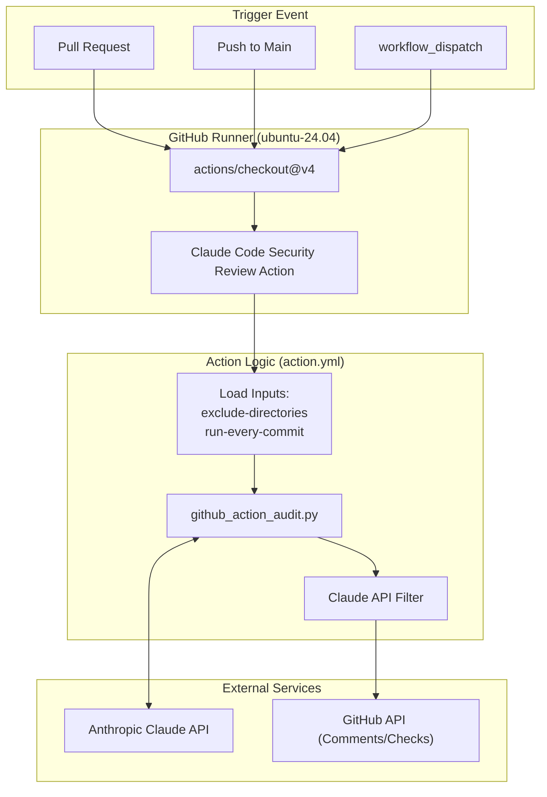

<!-- source: DeepWiki mcp.deepwiki.com · repo anthropics/claude-code-security-review · page 2.4 CI/CD Workflow Integration · fetched 2026-10-26 -->

# CI/CD Workflow Integration

<details>
<summary>Relevant source files</summary>

The following files were used as context for generating this wiki page:

- [.github/workflows/sast.yml](.github/workflows/sast.yml)
- [.github/workflows/test-claudecode.yml](.github/workflows/test-claudecode.yml)

</details>


This page documents how the Claude Code Security Review system is integrated into CI/CD pipelines. It covers two primary aspects: the self-testing pipeline that validates the codebase itself, and the Static Application Security Testing (SAST) workflow used to perform security audits on pull requests.

## SAST Workflow Integration

The primary integration pattern for using this system as a security scanner is the SAST workflow. This workflow demonstrates how to invoke the GitHub Action to perform automated security reviews.

### Implementation and Data Flow

The SAST workflow is defined in [.github/workflows/sast.yml:1-26](). It orchestrates the security review process by triggering the local action on pull requests and pushes to the main branch.



### Configuration Parameters
The workflow utilizes several key inputs to control the audit behavior:
*   `comment-pr: true`: Enables posting findings directly as PR comments [.github/workflows/sast.yml:21]().
*   `upload-results: true`: Archives the scan results as workflow artifacts [.github/workflows/sast.yml:22]().
*   `exclude-directories`: Specifies paths to ignore, such as known vulnerable test suites [.github/workflows/sast.yml:23]().
*   `run-every-commit: true`: Ensures every push to a PR is analyzed, rather than just the final state [.github/workflows/sast.yml:25]().

Sources: [.github/workflows/sast.yml:1-26]()

## Internal CI/CD Pipeline

The system maintains its own quality through the `test-claudecode` workflow. This pipeline ensures the reliability of the core Python engine and supporting scripts.

### Multi-Runtime Environment
The testing pipeline establishes three distinct runtime environments to validate all components of the system:

```mermaid
graph TB
    subgraph "CI Environment: ubuntu-latest"
        "actions/checkout"["actions/checkout@v4"]
        
        subgraph "Python Runtime (3.10)"
            "setup-python"["actions/setup-python@v4"]
            "pip_install"["pip install pytest pytest-cov -r claudecode/requirements.txt"]
        end
        
        subgraph "Node.js Runtime (20)"
            "setup-node"["actions/setup-node@v4"]
            "npm_install"["npm install -g @anthropic-ai/claude-code"]
        end
        
        subgraph "Bun Runtime"
            "setup-bun"["oven-sh/setup-bun@v2"]
            "bun_install"["bun install in scripts/"]
        end
    end
    
    "actions/checkout" --> "setup-python"
    "actions/checkout" --> "setup-node"  
    "actions/checkout" --> "setup-bun"
    
    "setup-python" --> "pip_install"
    "setup-node" --> "npm_install"
    "setup-bun" --> "bun_install"
```

**Environment Roles:**
*   **Python 3.10**: Used for executing the `claudecode` package unit tests and the `github_action_audit.py` logic [.github/workflows/test-claudecode.yml:23-26]().
*   **Node.js 20**: Required to install and provide the `@anthropic-ai/claude-code` CLI, which the Python engine wraps [.github/workflows/test-claudecode.yml:28-35]().
*   **Bun**: Used for executing high-performance TypeScript/JavaScript tests for the PR commenting scripts [.github/workflows/test-claudecode.yml:47-55]().

Sources: [.github/workflows/test-claudecode.yml:17-55]()

### Testing Stages and Execution

The pipeline executes two primary testing stages that validate different layers of the system architecture:

| Stage | Command | Purpose |
| :--- | :--- | :--- |
| **Python Unit Tests** | `pytest claudecode -v --cov=claudecode` | Validates the core logic in `github_action_audit.py`, `SimpleClaudeRunner`, and `GitHubActionClient` [.github/workflows/test-claudecode.yml:45](). |
| **Script Tests** | `bun test` (in `scripts/`) | Validates the JavaScript-based utilities used for GitHub PR interactions [.github/workflows/test-claudecode.yml:59-60](). |

```mermaid
graph LR
    subgraph "Testing Flow"
        "Start"["Trigger: push/PR"] --> "PyTest"["Run pytest (Python)"]
        "PyTest" --> "Coverage"["Generate Coverage Report"]
        "Coverage" --> "BunTest"["Run bun test (TS/JS)"]
        "BunTest" --> "End"["Complete"]
    end
```

The Python testing stage explicitly sets the `PYTHONPATH` to the current working directory to ensure that the `claudecode` module is correctly discoverable by `pytest` [.github/workflows/test-claudecode.yml:44]().

Sources: [.github/workflows/test-claudecode.yml:1-61]()

---

