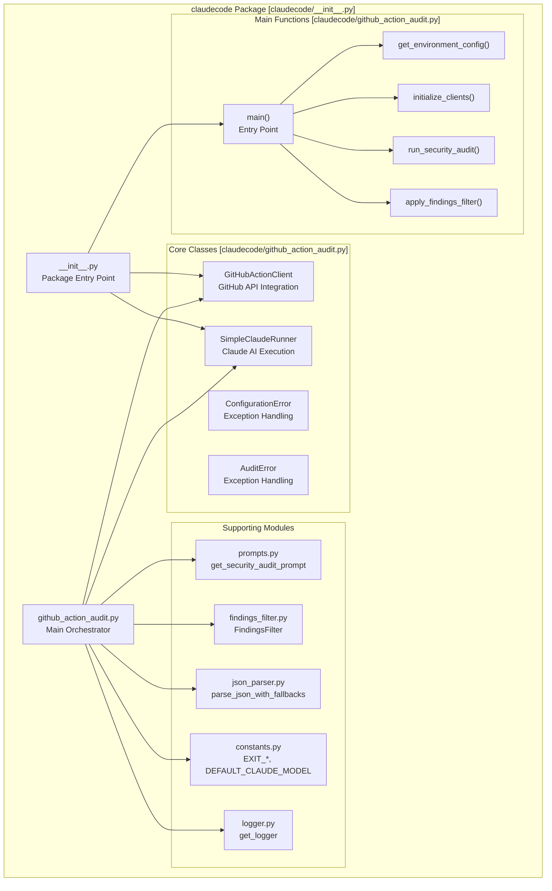
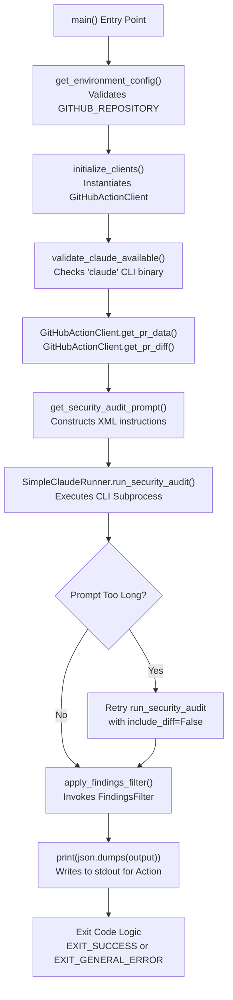

<!-- source: DeepWiki mcp.deepwiki.com · repo anthropics/claude-code-security-review · page 3 Core Python Engine · fetched 2026-10-26 -->

# Core Python Engine

Relevant source files

The following files were used as context for generating this wiki page:

- [claudecode/__init__.py](claudecode/__init__.py)
- [claudecode/audit.py](claudecode/audit.py)
- [claudecode/github_action_audit.py](claudecode/github_action_audit.py)
- [claudecode/requirements.txt](claudecode/requirements.txt)

## Purpose and Scope

The Core Python Engine constitutes the main Python package (`claudecode`) that orchestrates AI-powered security analysis of GitHub pull requests. This system serves as the central coordination layer between GitHub API integration, Claude AI execution via the CLI, and the security analysis pipeline.

This page covers the core Python package architecture, main execution orchestration, and the primary classes that drive the security audit process.

- For details on package organization, see [Package Structure and Entry Points](#3.1).
- For details on the main orchestration logic, see [Main Audit Orchestrator](#3.2).
- For details on GitHub communication, see [GitHub API Client](#3.3).
- For details on Claude CLI execution, see [Claude CLI Runner](#3.4).

## Package Architecture Overview

The `claudecode` package follows a modular architecture with clear separation of concerns between GitHub integration, AI processing, and audit orchestration. It leverages several internal utility modules for prompting, filtering, and parsing.

### Code Entity Relationship Diagram
This diagram bridges the system concepts to the specific Python classes and functions defined in the codebase.

**Sources:** [claudecode/__init__.py:1-22](), [claudecode/github_action_audit.py:1-50]()

## Core Component Classes

### GitHubActionClient
The `GitHubActionClient` class provides GitHub API integration optimized for the GitHub Actions environment. It handles PR metadata retrieval, automated file filtering (excluding generated code), and diff processing.

**Key responsibilities include:**
- **Authentication**: Uses `GITHUB_TOKEN` from the environment [claudecode/github_action_audit.py:45-53]().
- **Data Retrieval**: Fetches PR details and file lists with pagination support [claudecode/github_action_audit.py:61-117]().
- **Noise Reduction**: Filters out files based on `EXCLUDE_DIRECTORIES` and detects `@generated` code markers [claudecode/github_action_audit.py:138-186]().

For details, see [GitHub API Client](#3.3).

### SimpleClaudeRunner
The `SimpleClaudeRunner` class manages the execution of the `@anthropic-ai/claude-code` CLI tool. It encapsulates the complexities of subprocess management, input/output piping, and error recovery.

**Key features include:**
- **Subprocess Management**: Executes the `claude` command with configurable timeouts [claudecode/github_action_audit.py:192-201]().
- **Resilience**: Implements a retry loop (up to 3 attempts) for transient execution failures [claudecode/github_action_audit.py:231-251]().
- **Prompt Optimization**: Detects "Prompt is too long" errors and allows the orchestrator to fallback to metadata-only scans [claudecode/github_action_audit.py:257-270]().

For details, see [Claude CLI Runner](#3.4).

## Main Execution Flow

The `main()` function in `github_action_audit.py` serves as the primary entry point, orchestrating the sequence from environment validation to the final security report.

### Logic Flow: Natural Language to Code Space
This diagram maps the logical steps of an audit to the specific function calls in the Python engine.

**Sources:** [claudecode/github_action_audit.py:520-644]()

## Configuration and Error Handling

The system implements strict configuration validation to ensure the GitHub Action environment is correctly set up before attempting expensive AI operations.

| Component | Purpose | Related Symbols |
|----------|---------|----------------|
| **Environment Validation** | Ensures required secrets and context are present | `get_environment_config()` [claudecode/github_action_audit.py:348-386]() |
| **Exception Hierarchy** | Distinguishes between setup issues and runtime failures | `ConfigurationError`, `AuditError` [claudecode/github_action_audit.py:32-38]() |
| **Exit Strategy** | Signals the GitHub Action runner whether to fail the build | `EXIT_CONFIGURATION_ERROR`, `EXIT_GENERAL_ERROR` [claudecode/github_action_audit.py:21-27]() |

**Sources:** [claudecode/github_action_audit.py:32-38](), [claudecode/github_action_audit.py:348-429]()

## Integration Points

The core system provides clean integration points with other ClaudeCode subsystems:

- **Prompts**: Uses `claudecode.prompts` to generate the security context [claudecode/github_action_audit.py:18]().
- **Filtering**: Uses `claudecode.findings_filter` to post-process AI output [claudecode/github_action_audit.py:19]().
- **Parsing**: Uses `claudecode.json_parser` to handle the semi-structured output from the Claude CLI [claudecode/github_action_audit.py:20]().

The package exposes its main components through the `__init__.py` module for external access, including the `main` entry point and the primary client classes.

**Sources:** [claudecode/__init__.py:11-21](), [claudecode/github_action_audit.py:17-28]()

---

