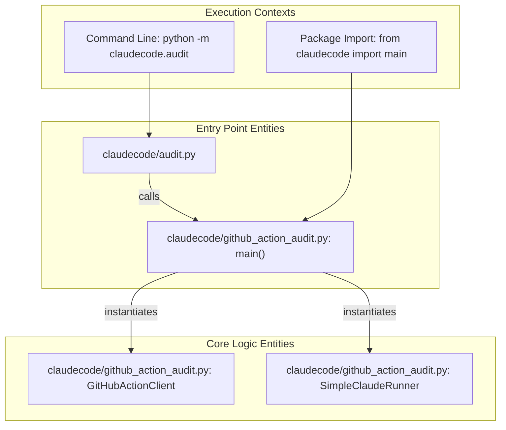
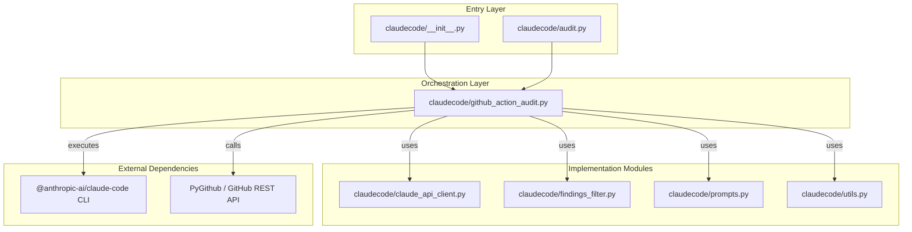

<!-- source: DeepWiki mcp.deepwiki.com · repo anthropics/claude-code-security-review · page 3.1 Package Structure and Entry Points · fetched 2026-10-26 -->

# Package Structure and Entry Points

Relevant source files

The following files were used as context for generating this wiki page:

- [__init__.py](__init__.py)
- [claudecode/__init__.py](claudecode/__init__.py)
- [claudecode/audit.py](claudecode/audit.py)
- [claudecode/requirements.txt](claudecode/requirements.txt)

This document explains the structure of the `claudecode` Python package, its main entry points, and the module relationships. This covers how the package is organized and how the core components interact to perform security audits.

## Package Overview

The `claudecode` package is the core Python engine for the security review system. It is structured to provide a clear public API while encapsulating complex orchestration logic for GitHub and Claude interactions.

The package is identified as version `1.0.0` and is authored by the `Anthropic Security Team` [claudecode/__init__.py:8-9](). It is described as a standalone security audit tool that uses Claude Code for comprehensive security analysis of GitHub pull requests [claudecode/__init__.py:4-5]().

Sources: [claudecode/__init__.py:1-9]()

## Public API and Main Components

The package exposes its primary functionality through `claudecode/__init__.py`. The public API surface is defined by the `__all__` list, ensuring a clean interface for consumers [claudecode/__init__.py:18-22]().

| Component | Code Entity | Purpose |
|-----------|-------------|---------|
| **GitHub Client** | `GitHubActionClient` | Manages interactions with the GitHub API, including fetching PR metadata and posting comments [claudecode/__init__.py:13](). |
| **Claude Runner** | `SimpleClaudeRunner` | Executes the `@anthropic-ai/claude-code` CLI tool to perform the actual security analysis [claudecode/__init__.py:14](). |
| **Main Orchestrator** | `main` | The top-level function that coordinates the entire audit lifecycle [claudecode/__init__.py:15](). |

Sources: [claudecode/__init__.py:11-22]()

## Entry Points Architecture

The system provides two primary ways to invoke the audit engine: through the `claudecode.audit` module or via direct function calls.

### 1. Command Line Interface (CLI)
The `claudecode/audit.py` file serves as a clean entry point for running the tool as a script [claudecode/audit.py:1-5](). It simply imports and executes the `main` function when run directly [claudecode/audit.py:7-10]().

### 2. Programmatic Entry
The `main()` function in `claudecode/github_action_audit.py` is the central hub. It handles environment variable parsing, initializes the GitHub client, and triggers the audit process.

### Data Flow and Entry Point Mapping
The following diagram bridges the "Natural Language" intent of running an audit to the specific "Code Entities" that handle the request.

**Diagram: Entry Point Execution Flow**

Sources: [claudecode/audit.py:7-10](), [claudecode/github_action_audit.py:12-16](), [claudecode/__init__.py:12-16]()

## Package Structure and Module Relationships

The package follows a modular design where the orchestration logic is separated from specific service implementations (GitHub, Claude API, Filtering).

**Diagram: Module Relationship and Dependency Graph**

### Dependency Details
The package relies on several external libraries to function, as defined in the requirements:
*   **`PyGithub` & `requests`**: Used by `GitHubActionClient` for API communication [claudecode/requirements.txt:5-8]().
*   **`anthropic`**: Used for the secondary Claude API-based false positive filtering [claudecode/requirements.txt:15]().
*   **Claude CLI**: The `SimpleClaudeRunner` requires the `@anthropic-ai/claude-code` tool to be pre-installed in the environment [claudecode/requirements.txt:17-18]().

Sources: [claudecode/requirements.txt:1-18](), [claudecode/__init__.py:12-16](), [claudecode/audit.py:7-10]()

---

