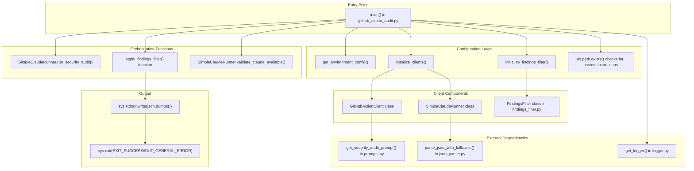
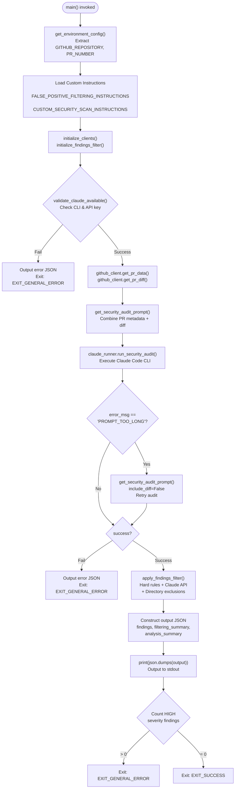
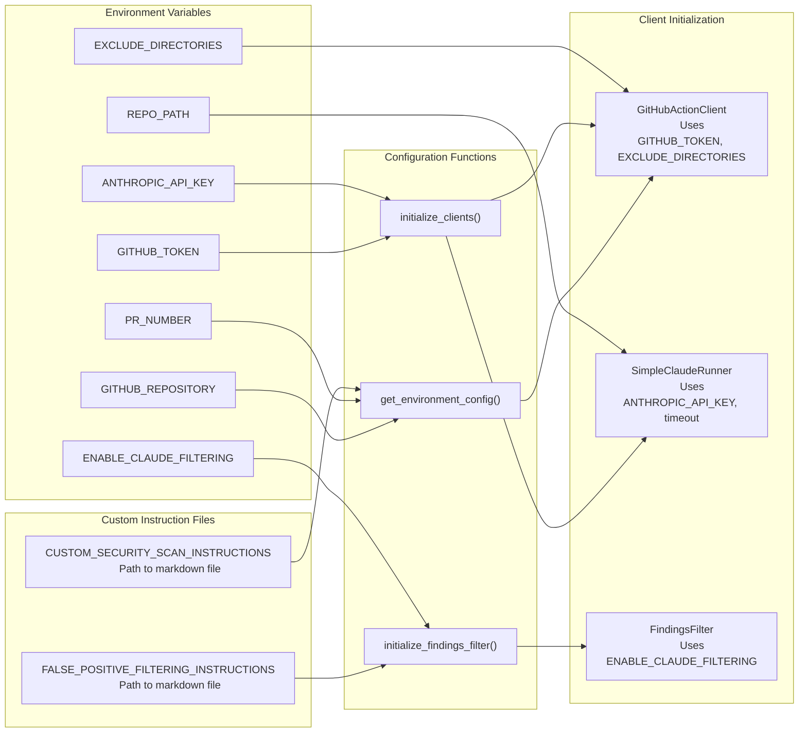
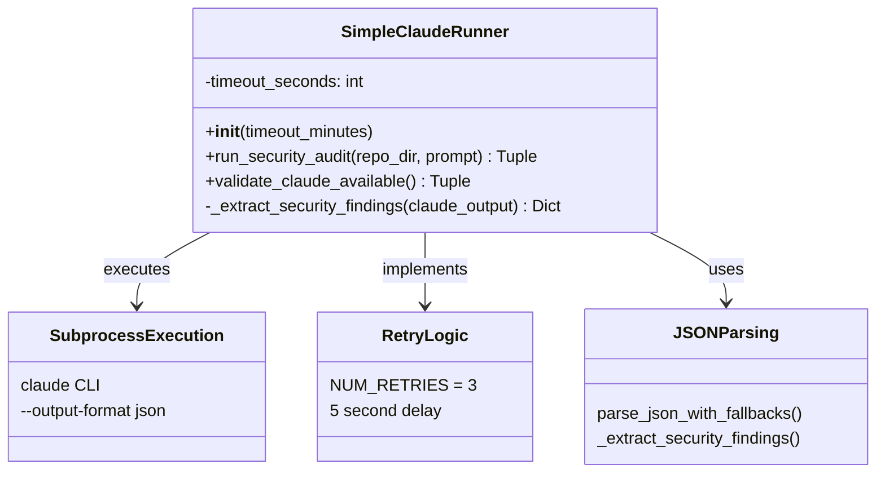
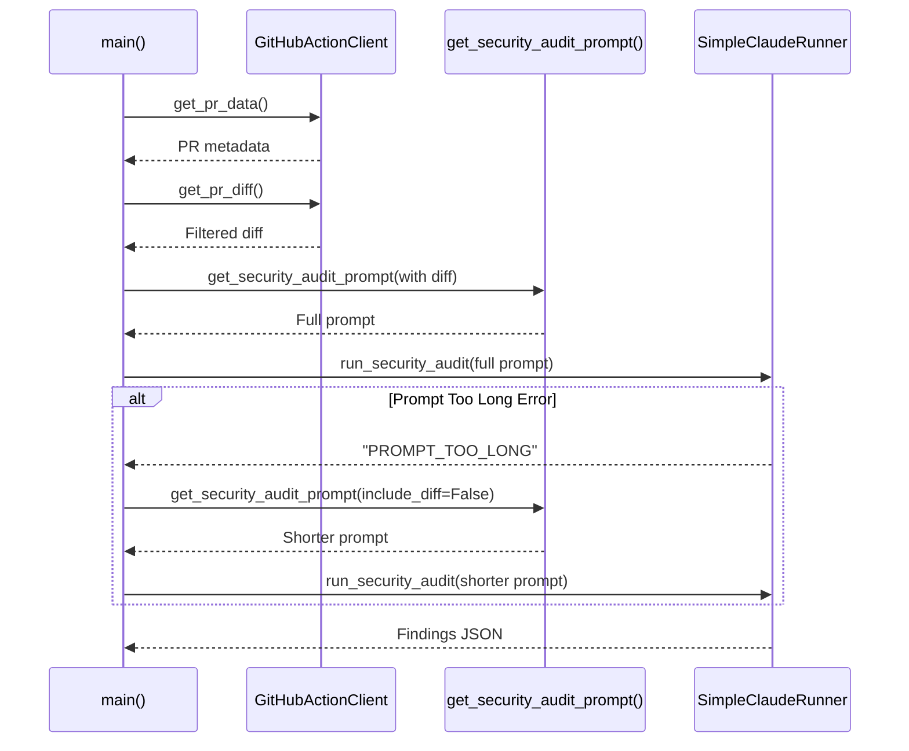

<!-- source: DeepWiki mcp.deepwiki.com · repo anthropics/claude-code-security-review · page 3.2 Main Audit Orchestrator · fetched 2026-10-26 -->

# Main Audit Orchestrator

<details>
<summary>Relevant source files</summary>

The following files were used as context for generating this wiki page:

- [claudecode/github_action_audit.py](claudecode/github_action_audit.py)
- [claudecode/test_github_action_audit.py](claudecode/test_github_action_audit.py)
- [claudecode/test_main_function.py](claudecode/test_main_function.py)

</details>


## Purpose and Scope

The Main Audit Orchestrator is implemented in [claudecode/github_action_audit.py](). This module serves as the central coordinator for the entire security audit workflow, orchestrating all major operations from environment configuration through final output generation. It bridges the GitHub Action wrapper with the core Python components.

The orchestrator is responsible for:
- Validating and loading environment configuration [claudecode/github_action_audit.py:348-371]()
- Initializing GitHub and Claude clients [claudecode/github_action_audit.py:374-393]()
- Fetching PR data and diffs from GitHub API [claudecode/github_action_audit.py:61-136]()
- Generating and executing security audit prompts [claudecode/github_action_audit.py:581-598]()
- Filtering findings to reduce false positives [claudecode/github_action_audit.py:456-501]()
- Outputting structured JSON results [claudecode/github_action_audit.py:617-636]()

**Sources:** [claudecode/github_action_audit.py:1-10](), [claudecode/github_action_audit.py:348-636]()

## Architecture Overview

The orchestrator follows a modular design with clear separation of concerns:

### System Architecture and Code Entities
The following diagram maps high-level system components to their corresponding code entities within the `claudecode` package.



**Key Classes and Functions:**

| Component | Type | Purpose | Lines |
|-----------|------|---------|-------|
| `main()` | Function | Primary entry point, orchestrates entire workflow | [claudecode/github_action_audit.py:520-641]() |
| `GitHubActionClient` | Class | Fetches PR data and diffs from GitHub API | [claudecode/github_action_audit.py:40-187]() |
| `SimpleClaudeRunner` | Class | Executes Claude Code CLI and parses output | [claudecode/github_action_audit.py:189-344]() |
| `get_environment_config()` | Function | Validates required environment variables | [claudecode/github_action_audit.py:348-371]() |
| `initialize_clients()` | Function | Creates GitHub and Claude client instances | [claudecode/github_action_audit.py:374-393]() |
| `initialize_findings_filter()` | Function | Sets up findings filter based on configuration | [claudecode/github_action_audit.py:396-428]() |
| `run_security_audit()` | Method | Executes security audit with retry logic (in `SimpleClaudeRunner`) | [claudecode/github_action_audit.py:203-286]() |
| `apply_findings_filter()` | Function | Applies multi-stage filtering to findings | [claudecode/github_action_audit.py:456-501]() |

**Sources:** [claudecode/github_action_audit.py:1-645]()

## Main Execution Flow

The `main()` function implements a sequential workflow with comprehensive error handling:



**Execution Phases:**

1. **Configuration Phase** ([claudecode/github_action_audit.py:520-565]()): Load environment variables, read custom instruction files, initialize clients.
2. **Validation Phase** ([claudecode/github_action_audit.py:567-570]()): Verify Claude Code CLI is available and API key is configured.
3. **Data Acquisition Phase** ([claudecode/github_action_audit.py:573-578]()): Fetch PR metadata and diff from GitHub API.
4. **Prompt Generation Phase** ([claudecode/github_action_audit.py:581]()): Create security audit prompt with PR context.
5. **Audit Execution Phase** ([claudecode/github_action_audit.py:584-598]()): Run Claude Code CLI, with automatic retry if prompt is too long.
6. **Filtering Phase** ([claudecode/github_action_audit.py:600-614]()): Apply multi-stage filtering to reduce false positives.
7. **Output Phase** ([claudecode/github_action_audit.py:617-636]()): Generate structured JSON output and exit with appropriate code.

**Error Handling Strategy:**

The orchestrator uses specific exception types and exit codes:
- `ConfigurationError`: Raised for missing/invalid configuration [claudecode/github_action_audit.py:32-34]() → `EXIT_CONFIGURATION_ERROR` (2).
- `AuditError`: Defined for security audit failures [claudecode/github_action_audit.py:36-38]() → `EXIT_GENERAL_ERROR` (1).
- High severity findings found → `EXIT_GENERAL_ERROR` (non-zero exit) [claudecode/github_action_audit.py:635-636]().
- Successful scan with no high severity findings → `EXIT_SUCCESS` (0) [claudecode/github_action_audit.py:636]().

**Sources:** [claudecode/github_action_audit.py:520-641](), [claudecode/constants.py]()

## Configuration Management

The orchestrator loads configuration from multiple sources in a specific precedence order:



### get_environment_config()

This function validates required environment variables and returns core configuration:

```python
# Returns: (repo_name, pr_number)
# Raises: ConfigurationError if GITHUB_REPOSITORY or PR_NUMBER missing/invalid
```

**Validation Rules:**
- `GITHUB_REPOSITORY` must be present (format: "owner/repo") [claudecode/github_action_audit.py:354-357]().
- `PR_NUMBER` must be present and convertible to integer [claudecode/github_action_audit.py:359-369]().
- Raises `ConfigurationError` with descriptive message on failure [claudecode/github_action_audit.py:357, 363, 369]().

**Sources:** [claudecode/github_action_audit.py:348-371]()

### initialize_clients()

This function creates and validates GitHub and Claude clients:

```python
# Returns: (GitHubActionClient, SimpleClaudeRunner)
# Raises: ConfigurationError if client initialization fails
```

**GitHubActionClient Requirements:**
- `GITHUB_TOKEN` environment variable for API authentication [claudecode/github_action_audit.py:45-47]().
- Optional `EXCLUDE_DIRECTORIES` for filtering file paths [claudecode/github_action_audit.py:56-59]().

**SimpleClaudeRunner Requirements:**
- `ANTHROPIC_API_KEY` for Claude API access [claudecode/github_action_audit.py:196-197]().
- Optional timeout configuration from `SUBPROCESS_TIMEOUT` constant [claudecode/github_action_audit.py:200-201]().

**Sources:** [claudecode/github_action_audit.py:374-393](), [claudecode/github_action_audit.py:40-60](), [claudecode/github_action_audit.py:189-201]()

### initialize_findings_filter()

This function configures the findings filter based on environment and custom instructions:

```python
# Args: custom_filtering_instructions (Optional[str])
# Returns: FindingsFilter
# Raises: ConfigurationError if filter initialization fails
```

**Filtering Configuration Logic:**

| Condition | Result |
|-----------|--------|
| `ENABLE_CLAUDE_FILTERING=true` AND `ANTHROPIC_API_KEY` set | Full filtering: hard rules + Claude API [claudecode/github_action_audit.py:408-417]() |
| Otherwise | Hard rules only [claudecode/github_action_audit.py:419-424]() |

If `FALSE_POSITIVE_FILTERING_INSTRUCTIONS` points to a readable file, its contents are passed to the filter for custom filtering logic [claudecode/github_action_audit.py:531-540]().

**Sources:** [claudecode/github_action_audit.py:396-428](), [claudecode/github_action_audit.py:531-540]()

## Client Components

### GitHubActionClient

The `GitHubActionClient` class encapsulates all GitHub API interactions:

```mermaid
classDiagram
    class GitHubActionClient {
        -github_token: str
        -headers: Dict
        -excluded_dirs: List[str]
        +__init__()
        +get_pr_data(repo_name, pr_number) Dict
        +get_pr_diff(repo_name, pr_number) str
        -_is_excluded(filepath) bool
        -_filter_generated_files(diff_text) str
    }
    
    class Configuration {
        GITHUB_TOKEN
        EXCLUDE_DIRECTORIES
    }
    
    class GitHubAPI {
        /repos/{owner}/{repo}/pulls/{number}
        Accept: application/vnd.github.diff
    }
    
    Configuration --> GitHubActionClient : configures
    GitHubActionClient --> GitHubAPI : calls
```

**Key Methods:**

| Method | Purpose | Returns |
|--------|---------|---------|
| `__init__()` | Initialize with token and exclusion patterns | None [claudecode/github_action_audit.py:43-60]() |
| `get_pr_data(repo_name, pr_number)` | Fetch PR metadata and file list | Dict with PR details [claudecode/github_action_audit.py:61-117]() |
| `get_pr_diff(repo_name, pr_number)` | Fetch unified diff, filtered | Diff string [claudecode/github_action_audit.py:119-136]() |
| `_is_excluded(filepath)` | Check if file matches exclusion patterns | Boolean [claudecode/github_action_audit.py:138-157]() |
| `_filter_generated_files(diff_text)` | Remove generated files from diff | Filtered diff string [claudecode/github_action_audit.py:159-186]() |

**File Exclusion Logic:**

The client implements sophisticated exclusion logic in `_is_excluded()` ([claudecode/github_action_audit.py:138-157]()):
1. Normalizes excluded directory patterns (removes leading `./`).
2. Checks if file path starts with excluded directory.
3. Checks if excluded directory appears anywhere in path.
4. Applied to both file lists [claudecode/github_action_audit.py:112]() and diff content [claudecode/github_action_audit.py:180]().

**Generated File Detection:**

The `_filter_generated_files()` method ([claudecode/github_action_audit.py:159-186]()) removes:
- Files with `@generated by` or `@generated` markers [claudecode/github_action_audit.py:170-171]().
- OpenAPI Generator output [claudecode/github_action_audit.py:172]().
- Protocol Buffer generated code [claudecode/github_action_audit.py:173]().

**Sources:** [claudecode/github_action_audit.py:40-187]()

### SimpleClaudeRunner

The `SimpleClaudeRunner` class manages Claude Code CLI execution:



**Execution Flow:**

The `run_security_audit()` method ([claudecode/github_action_audit.py:203-286]()) implements a robust execution pattern:

1. **Validation**: Check repo directory exists [claudecode/github_action_audit.py:214-216]().
2. **Size Warning**: Log warning if prompt > 1MB [claudecode/github_action_audit.py:219-220]().
3. **Command Construction**: Build `claude` CLI command with JSON output format and model [claudecode/github_action_audit.py:223-228]().
4. **Retry Loop** (up to 3 attempts):
   - Execute subprocess with prompt via stdin [claudecode/github_action_audit.py:236-241]().
   - Parse JSON output using fallback parser [claudecode/github_action_audit.py:245]().
   - Handle special error conditions: `PROMPT_TOO_LONG` [claudecode/github_action_audit.py:258-263]().
   - Apply delay between retries [claudecode/github_action_audit.py:249-251]().
5. **Timeout Handling**: Catch `subprocess.TimeoutExpired` and return descriptive error [claudecode/github_action_audit.py:283-284]().

**Output Parsing:**

The `_extract_security_findings()` method ([claudecode/github_action_audit.py:288-311]()) expects Claude Code's wrapped output format where the inner result is a JSON string.

**Sources:** [claudecode/github_action_audit.py:189-344]()

## Audit Execution Workflow

The orchestrator implements a two-stage audit execution pattern with automatic prompt size handling:



**Prompt Size Fallback:**

The orchestrator implements automatic prompt size handling ([claudecode/github_action_audit.py:589-594]()):
1. First attempt includes full diff in prompt.
2. If Claude returns `"Prompt is too long"` error:
   - Regenerate prompt with `include_diff=False` [claudecode/github_action_audit.py:591]().
   - Retry audit with shorter prompt [claudecode/github_action_audit.py:592]().

**Sources:** [claudecode/github_action_audit.py:584-598](), [claudecode/github_action_audit.py:203-286]()

## Findings Filtering Pipeline

After audit completion, the orchestrator applies a multi-stage filtering process:

### apply_findings_filter()

This function ([claudecode/github_action_audit.py:456-501]()) orchestrates the complete filtering pipeline:

**Stage 1: FindingsFilter Processing**
- Applies hard exclusion rules (pattern-based).
- Optionally applies Claude API filtering (confidence scoring).
- Returns kept findings, excluded findings, and analysis summary [claudecode/github_action_audit.py:470-474]().

**Stage 2: Directory Exclusion**
- For each kept finding, check if file path matches `EXCLUDE_DIRECTORIES` [claudecode/github_action_audit.py:480-488]().
- Uses `_is_finding_in_excluded_directory()` helper ([claudecode/github_action_audit.py:503-517]()).

**Stage 3: Summary Generation**
- Combines all excluded findings into a single list [claudecode/github_action_audit.py:491-494]().
- Updates analysis summary with directory exclusion count [claudecode/github_action_audit.py:497]().

**Sources:** [claudecode/github_action_audit.py:456-517](), [claudecode/github_action_audit.py:617-629]()

## Error Handling and Exit Codes

The orchestrator implements comprehensive error handling with specific exit codes defined in [claudecode/constants.py]().

| Exit Code | Constant | Conditions | Lines |
|-----------|----------|------------|-------|
| 0 | `EXIT_SUCCESS` | Successful scan, no high severity findings | [claudecode/github_action_audit.py:636]() |
| 1 | `EXIT_GENERAL_ERROR` | High severity findings found OR audit failed | [claudecode/github_action_audit.py:636, 570, 598]() |
| 2 | `EXIT_CONFIGURATION_ERROR` | Missing/invalid environment variables or config | [claudecode/github_action_audit.py:528, 557, 564, 640]() |

**High Severity Detection:**

The final exit code logic ([claudecode/github_action_audit.py:635-636]()):
```python
high_severity_count = len([f for f in kept_findings if f.get('severity', '').upper() == 'HIGH'])
sys.exit(EXIT_GENERAL_ERROR if high_severity_count > 0 else EXIT_SUCCESS)
```

**Sources:** [claudecode/github_action_audit.py:520-641](), [claudecode/constants.py]()

## Integration Points

**Internal Dependencies:**

| Module | Purpose | Usage |
|--------|---------|-------|
| `claudecode.prompts` | Security audit prompt templates | `get_security_audit_prompt()` [claudecode/github_action_audit.py:18]() |
| `claudecode.findings_filter` | False positive filtering | `FindingsFilter` class [claudecode/github_action_audit.py:19]() |
| `claudecode.json_parser` | Robust JSON parsing | `parse_json_with_fallbacks()` [claudecode/github_action_audit.py:20]() |
| `claudecode.constants` | Configuration constants | Exit codes, timeouts [claudecode/github_action_audit.py:21-27]() |
| `claudecode.logger` | Contextual logging | `get_logger()` [claudecode/github_action_audit.py:28]() |

**Sources:** [claudecode/github_action_audit.py:17-30]()

---

