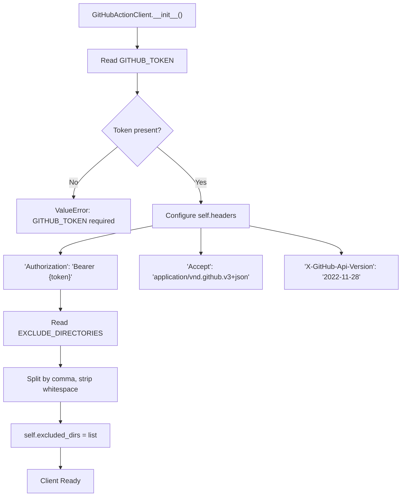
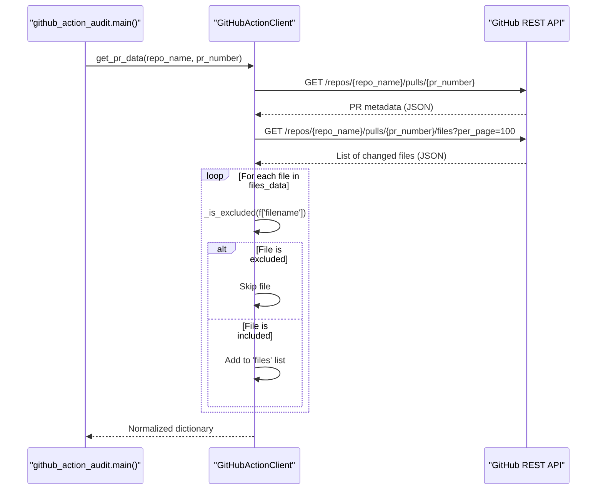
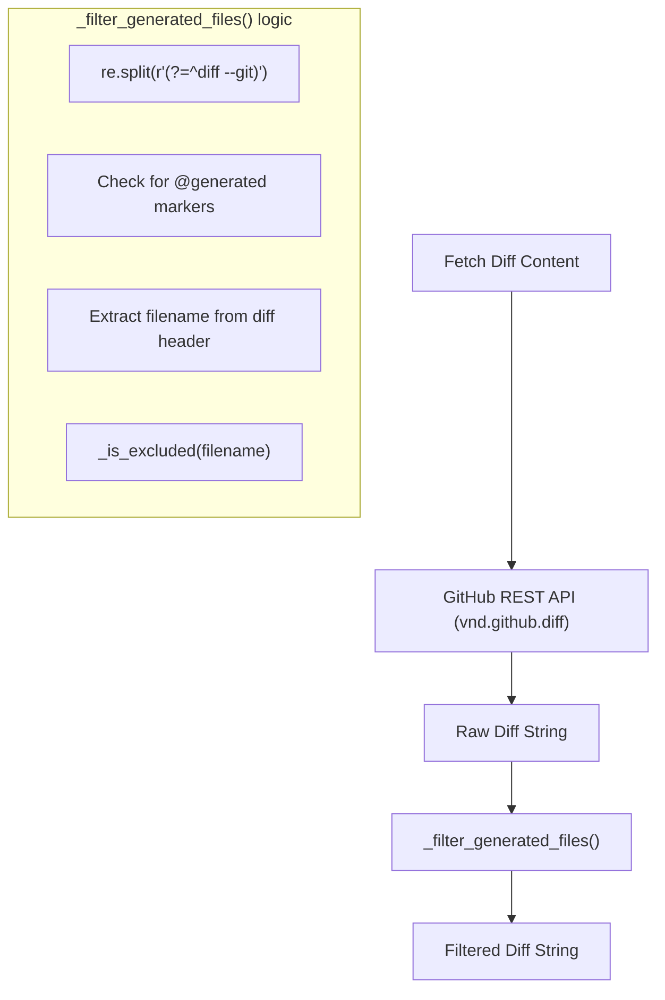

<!-- source: DeepWiki mcp.deepwiki.com · repo anthropics/claude-code-security-review · page 3.3 GitHub API Client · fetched 2026-10-26 -->

# GitHub API Client

<details>
<summary>Relevant source files</summary>

The following files were used as context for generating this wiki page:

- [claudecode/github_action_audit.py](claudecode/github_action_audit.py)
- [claudecode/test_github_client.py](claudecode/test_github_client.py)

</details>


The `GitHubActionClient` class provides the interface for fetching pull request data from the GitHub REST API. This client is responsible for retrieving PR metadata, changed files, diffs, and applying preprocessing filters to exclude generated content and specified directories.

For information about how this client is used in the audit orchestrator, see [Main Audit Orchestrator](3.2). For details about the broader GitHub Action execution environment, see [GitHub Action Integration](2).

## GitHubActionClient Overview

The `GitHubActionClient` class is defined in [claudecode/github_action_audit.py:40-186]() and serves as the primary interface between the security review system and GitHub's REST API. The client handles authentication via environment variables, fetches PR data and diffs, and applies filtering logic to exclude generated files and specific directories from analysis.

### Class Structure

The following diagram maps the code entities within `GitHubActionClient` to their functional roles in the API interaction process.

**Code Entity to System Component Mapping**
```mermaid
classDiagram
    class GitHubActionClient {
        +github_token: str [os.environ.get('GITHUB_TOKEN')]
        +headers: dict [Authorization, Accept, X-GitHub-Api-Version]
        +excluded_dirs: list [os.environ.get('EXCLUDE_DIRECTORIES')]
        +__init__()
        +get_pr_data(repo_name, pr_number) dict
        +get_pr_diff(repo_name, pr_number) str
        +_is_excluded(filepath) bool
        +_filter_generated_files(diff_text) str
    }
    
    class GitHub_REST_API {
        <<external>>
        +GET /repos/{repo}/pulls/{number}
        +GET /repos/{repo}/pulls/{number}/files
        +Accept: application/vnd.github.diff
    }
    
    class github_action_audit_py {
        +main()
    }
    
    github_action_audit_py ..> GitHubActionClient : "instantiates at line 551"
    GitHubActionClient --> GitHub_REST_API : "requests.get() calls"
```

**Key Components:**

| Component | Type | Purpose |
|-----------|------|---------|
| `github_token` | str | GitHub API authentication token from environment [claudecode/github_action_audit.py:45]() |
| `headers` | dict | HTTP headers including API version `2022-11-28` [claudecode/github_action_audit.py:49-53]() |
| `excluded_dirs` | list | Directories to exclude, parsed from `EXCLUDE_DIRECTORIES` [claudecode/github_action_audit.py:56-57]() |
| `get_pr_data()` | method | Fetches PR metadata and file list with pagination [claudecode/github_action_audit.py:61-117]() |
| `get_pr_diff()` | method | Retrieves unified diff content using specialized headers [claudecode/github_action_audit.py:119-136]() |
| `_is_excluded()` | method | Checks if file path matches exclusion patterns [claudecode/github_action_audit.py:138-157]() |
| `_filter_generated_files()` | method | Removes generated code sections from diff using regex [claudecode/github_action_audit.py:159-186]() |

Sources: [claudecode/github_action_audit.py:40-186]()

## Initialization and Configuration

The `GitHubActionClient.__init__()` method reads configuration from environment variables and sets up the API client for GitHub interactions.

### Initialization Flow



### Configuration Parameters

| Parameter | Source | Type | Purpose |
|-----------|--------|------|---------|
| `GITHUB_TOKEN` | Environment | Required | GitHub API authentication [claudecode/github_action_audit.py:45-47]() |
| `EXCLUDE_DIRECTORIES` | Environment | Optional | Comma-separated list of directories to exclude [claudecode/github_action_audit.py:56-57]() |

**Implementation Details:**

The initialization at [claudecode/github_action_audit.py:43-59]() performs these steps:

1. **Token Validation**: Reads `GITHUB_TOKEN` from `os.environ` and raises `ValueError` if not present [claudecode/github_action_audit.py:45-47]().
2. **Header Configuration**: Sets up HTTP headers with Bearer token authentication and specific GitHub API version [claudecode/github_action_audit.py:49-53]().
3. **Exclusion Setup**: Parses `EXCLUDE_DIRECTORIES` environment variable into a list of directory patterns, handling whitespace and empty strings [claudecode/github_action_audit.py:56-57]().
4. **Debug Logging**: Prints excluded directories to stderr if configured for visibility in Action logs [claudecode/github_action_audit.py:59]().

Sources: [claudecode/github_action_audit.py:43-59]()

## Pull Request Data Retrieval

The `get_pr_data()` method at [claudecode/github_action_audit.py:61-117]() fetches comprehensive pull request information through two GitHub API calls: one for PR metadata and one for the list of changed files.

### PR Data Collection Flow



### Returned Data Structure

The method returns a dictionary with the following structure, specifically handling deleted forks by falling back to the base repository name [claudecode/github_action_audit.py:95]():

```python
{
    'number': pr_data['number'],
    'title': pr_data['title'],
    'body': pr_data.get('body', ''),
    'user': pr_data['user']['login'],
    'head': {
        'ref': pr_data['head']['ref'],
        'sha': pr_data['head']['sha'],
        'repo': {
            'full_name': pr_data['head']['repo']['full_name'] # or repo_name
        }
    },
    'files': [
        {
            'filename': f['filename'],
            'status': f['status'],
            'patch': f.get('patch', '')
        }
        # ... filtered by _is_excluded
    ],
    # ... additional metadata
}
```

### File Filtering During Retrieval

The method applies directory exclusion filtering while building the files list at [claudecode/github_action_audit.py:102-113](). For each file returned by the GitHub API, it calls `self._is_excluded(f['filename'])`. This ensures that downstream security analysis never receives data from directories explicitly marked for exclusion.

**Edge Case Handling:**

| Scenario | Handling | Location |
|----------|----------|----------|
| Missing PR body | Defaults to empty string via `.get()` | [claudecode/github_action_audit.py:86]() |
| Deleted fork | `pr_data['head']['repo']` is None; uses `repo_name` | [claudecode/github_action_audit.py:95]() |
| Missing patch | Defaults to empty string via `.get()` | [claudecode/github_action_audit.py:109]() |

Sources: [claudecode/github_action_audit.py:61-117](), [claudecode/test_github_client.py:113-151]()

## Directory Exclusion System

The `GitHubActionClient` implements a directory exclusion system that filters out files from specified directories during both PR data retrieval and diff processing.

### Exclusion Pattern Matching

The `_is_excluded()` method at [claudecode/github_action_audit.py:138-157]() checks if a file path matches any configured exclusion patterns.

**Matching Rules Implementation:**

1. **Direct prefix match**: Checks if `filepath.startswith(excluded_dir + '/')` [claudecode/github_action_audit.py:148]().
2. **Normalized prefix match**: Removes leading `./` and checks `filepath.startswith(normalized_excluded + '/')` [claudecode/github_action_audit.py:150]().
3. **Substring match**: Checks if `'/' + normalized_excluded + '/'` appears anywhere in the path [claudecode/github_action_audit.py:154]().

This logic allows flexible patterns like `vendor`, `./node_modules`, or `internal/generated` to correctly match files nested within those structures.

Sources: [claudecode/github_action_audit.py:138-157]()

## Diff Retrieval and Filtering

The `get_pr_diff()` method at [claudecode/github_action_audit.py:119-136]() retrieves the complete unified diff for a pull request and applies multi-stage filtering.

### Diff Processing Pipeline

**Natural Language to Code Entity Mapping**


### Generated File Detection

The `_filter_generated_files()` method at [claudecode/github_action_audit.py:159-186]() removes diff sections containing specific markers. It uses regex splitting to isolate individual file diffs [claudecode/github_action_audit.py:162]().

| Marker Pattern | Detection Logic |
|----------------|----------|
| `@generated by` | `if '@generated by' in section` |
| `@generated` | `if '@generated' in section` |
| `OpenAPI Generator` | `if 'Code generated by OpenAPI Generator' in section` |
| `protoc-gen-go` | `if 'Code generated by protoc-gen-go' in section` |

**Implementation Details:**

- **Filename Extraction**: Uses regex `r'^diff --git a/(.*?) b/'` to find the path in the unified diff header [claudecode/github_action_audit.py:177]().
- **Integration with Exclusions**: If a filename is extracted, it is passed to `_is_excluded()` for secondary filtering [claudecode/github_action_audit.py:180]().
- **Logging**: Prints `[Debug] Filtering out excluded file: {filename}` to stderr when a file is removed [claudecode/github_action_audit.py:181]().

Sources: [claudecode/github_action_audit.py:119-136](), [claudecode/github_action_audit.py:159-186](), [claudecode/test_github_client.py:199-231]()

## Error Handling

The `GitHubActionClient` relies on the `requests` library's `raise_for_status()` to handle API errors.

| Operation | Method | Error Handling |
|-----------|--------|----------------|
| Fetch PR Metadata | `requests.get(pr_url)` | `response.raise_for_status()` [claudecode/github_action_audit.py:74]() |
| Fetch PR Files | `requests.get(files_url)` | `response.raise_for_status()` [claudecode/github_action_audit.py:80]() |
| Fetch PR Diff | `requests.get(url)` | `response.raise_for_status()` [claudecode/github_action_audit.py:134]() |

If an error occurs, the exception propagates to the orchestrator in `github_action_audit.py`, which catches it in the main try-except block and exits with `EXIT_GENERAL_ERROR` [claudecode/github_action_audit.py:573-578]().

Sources: [claudecode/github_action_audit.py:73-81](), [claudecode/github_action_audit.py:133-134](), [claudecode/github_action_audit.py:573-578]()

---

