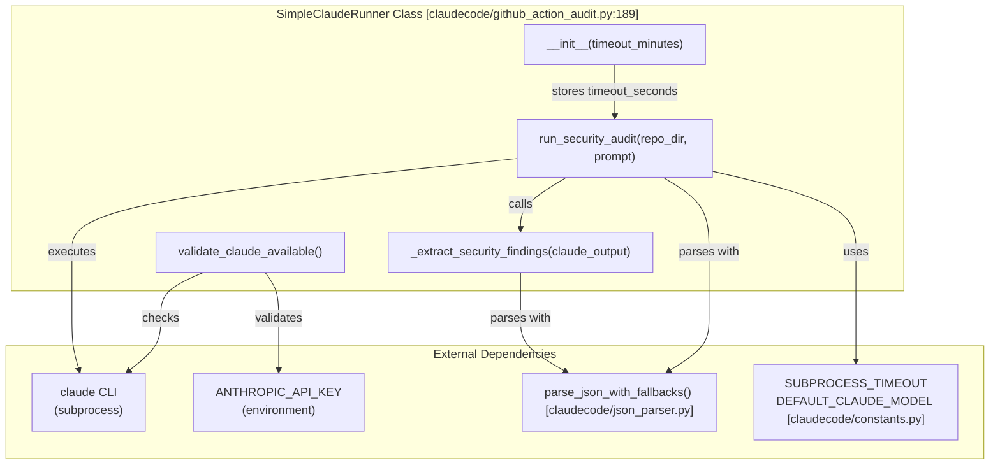
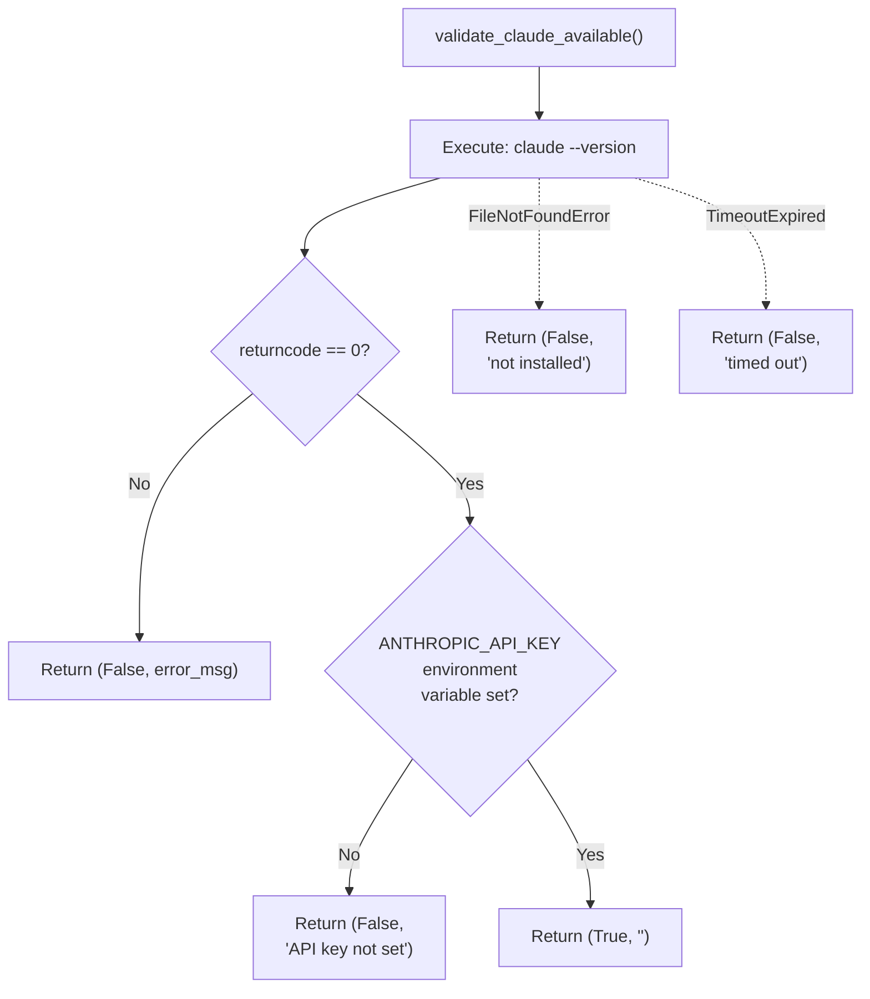
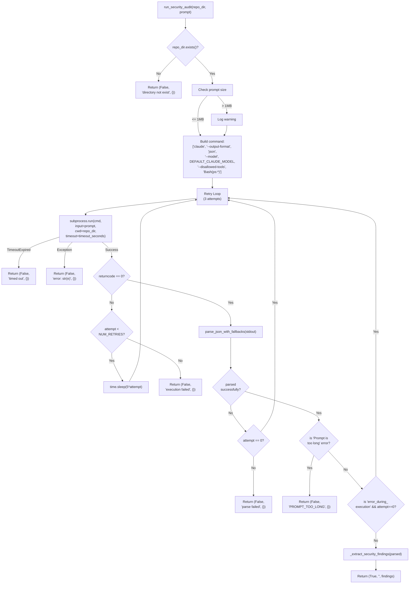
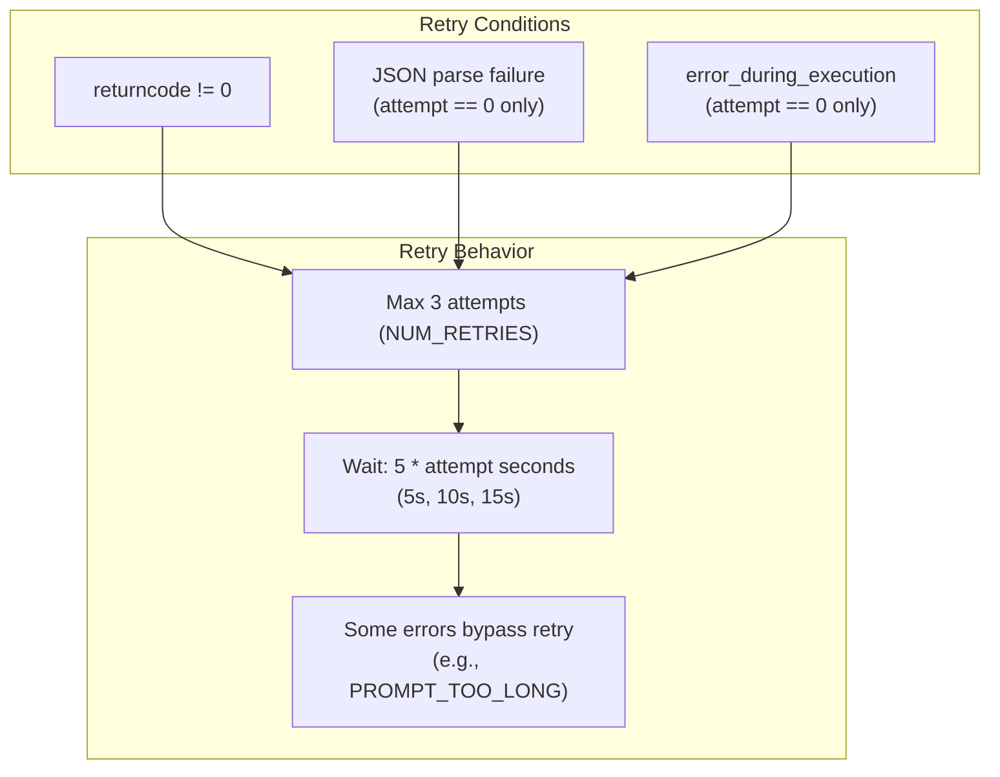
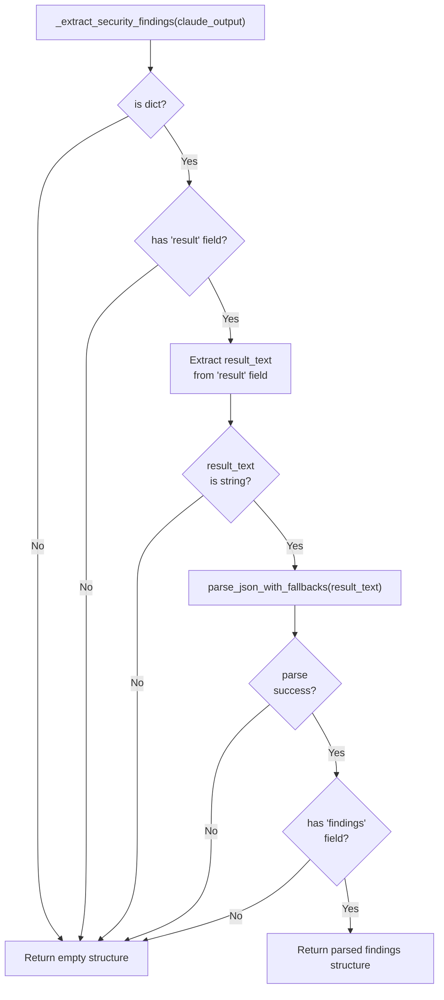
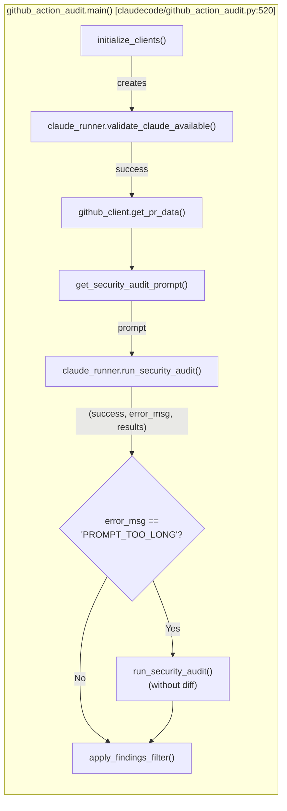

<!-- source: DeepWiki mcp.deepwiki.com · repo anthropics/claude-code-security-review · page 3.4 Claude CLI Runner · fetched 2026-10-26 -->

# Claude CLI Runner

<details>
<summary>Relevant source files</summary>

The following files were used as context for generating this wiki page:

- [claudecode/github_action_audit.py](claudecode/github_action_audit.py)
- [claudecode/test_claude_runner.py](claudecode/test_claude_runner.py)

</details>


## Purpose and Scope

This document describes the `SimpleClaudeRunner` class, which provides a Python wrapper for executing the `@anthropic-ai/claude-code` CLI tool as a subprocess. The runner manages the complete lifecycle of invoking Claude for security analysis: validation, execution, timeout management, retry logic, and response parsing.

For information about how the runner is orchestrated within the broader audit workflow, see [Main Audit Orchestrator](#3.2). For details on prompt construction passed to the runner, see [Prompt Engineering and Templates](#4.1).

---

## Class Structure and Initialization

The `SimpleClaudeRunner` class is defined in [claudecode/github_action_audit.py:189-343]() and serves as a lightweight wrapper around the Claude CLI tool.

### Initialization Parameters

The runner accepts a single optional parameter during initialization:

| Parameter | Type | Default | Description |
|-----------|------|---------|-------------|
| `timeout_minutes` | `Optional[int]` | `None` | Execution timeout in minutes, converted to seconds internally |

When `timeout_minutes` is `None`, the runner uses the system default `SUBPROCESS_TIMEOUT` constant (20 minutes) [claudecode/github_action_audit.py:198-201]().

**Sources:** [claudecode/github_action_audit.py:189-201]()

---

## Core Architecture

The following diagram shows the `SimpleClaudeRunner` class structure and its relationship to external dependencies:



**Sources:** [claudecode/github_action_audit.py:189-343](), [claudecode/json_parser.py:1-20](), [claudecode/constants.py:1-26]()

---

## CLI Validation

Before executing security audits, the runner validates that the Claude CLI is available and properly configured through the `validate_claude_available()` method [claudecode/github_action_audit.py:314-343]().

### Validation Process



### Validation Return Values

The method returns a tuple `(success: bool, error_message: str)`:

| Scenario | Success | Error Message |
|----------|---------|---------------|
| CLI works + API key present | `True` | `""` |
| CLI not installed | `False` | `"Claude Code is not installed or not in PATH"` |
| CLI execution fails | `False` | `"Claude Code returned exit code X"` |
| No API key | `False` | `"ANTHROPIC_API_KEY environment variable is not set"` |
| Timeout | `False` | `"Claude Code command timed out"` |

**Sources:** [claudecode/github_action_audit.py:314-343](), [claudecode/test_claude_runner.py:27-105]()

---

## Security Audit Execution

The `run_security_audit()` method orchestrates the complete execution of Claude CLI for security analysis [claudecode/github_action_audit.py:203-286]().

### Method Signature

```python
run_security_audit(repo_dir: Path, prompt: str) -> Tuple[bool, str, Dict[str, Any]]
```

Returns:
- `bool`: Success status
- `str`: Error message (empty if successful)
- `Dict[str, Any]`: Parsed security findings

### Execution Flow



**Sources:** [claudecode/github_action_audit.py:203-286](), [claudecode/test_claude_runner.py:119-288]()

---

## CLI Command Construction

The runner constructs the Claude CLI command with specific parameters to ensure structured output and security constraints:

```python
cmd = [
    'claude',
    '--output-format', 'json',
    '--model', DEFAULT_CLAUDE_MODEL,
    '--disallowed-tools', 'Bash(ps:*)'
]
```

### Key Design Decisions

| Aspect | Implementation | Rationale |
|--------|----------------|-----------|
| Prompt delivery | Via `stdin` (not CLI arg) | Avoid "argument list too long" error for large prompts [claudecode/github_action_audit.py:237]() |
| Output format | `--output-format json` | Enable structured parsing [claudecode/github_action_audit.py:224]() |
| Model selection | From `DEFAULT_CLAUDE_MODEL` constant | Centralized configuration [claudecode/github_action_audit.py:225]() |
| Tool Restrictions | `--disallowed-tools 'Bash(ps:*)'` | Security hardening to prevent process listing [claudecode/github_action_audit.py:226]() |
| Working directory | Set to `repo_dir` via `cwd` parameter | Ensure Claude has access to repository files [claudecode/github_action_audit.py:238]() |

**Sources:** [claudecode/github_action_audit.py:222-239]()

---

## Retry Logic and Error Recovery

The runner implements sophisticated retry logic to handle transient failures [claudecode/github_action_audit.py:232-281]():

### Retry Strategy



### Special Error Codes

The runner recognizes specific error conditions:

| Error Type | Detection | Action |
|------------|-----------|--------|
| `PROMPT_TOO_LONG` | `result == "Prompt is too long"` in parsed output | Return immediately with special error code, no retry [claudecode/github_action_audit.py:266-269]() |
| `error_during_execution` | `subtype == "error_during_execution"` | Retry once (if `attempt == 0`) [claudecode/github_action_audit.py:271-274]() |
| JSON parse failure | `parse_json_with_fallbacks()` returns `None` | Retry once (if `attempt == 0`) [claudecode/github_action_audit.py:256-264]() |
| Non-zero exit code | `returncode != 0` | Retry up to 3 times [claudecode/github_action_audit.py:245-252]() |

**Sources:** [claudecode/github_action_audit.py:232-281](), [claudecode/test_claude_runner.py:197-253]()

---

## Response Parsing and Extraction

The `_extract_security_findings()` method parses Claude's JSON response to extract security findings [claudecode/github_action_audit.py:288-311]().

### Expected Response Format

Claude CLI returns a wrapped format with a `result` field:

```json
{
  "type": "result",
  "subtype": "success",
  "result": "{\"findings\": [...], \"analysis_summary\": {...}}"
}
```

The `result` field contains a JSON-encoded string with the actual findings data [claudecode/github_action_audit.py:298-305]().

### Parsing Logic



### Empty Structure Format

When no findings are extracted, the method returns:

```python
{
    'findings': [],
    'analysis_summary': {
        'files_reviewed': 0,
        'high_severity': 0,
        'medium_severity': 0,
        'low_severity': 0,
        'review_completed': False,
    }
}
```

**Sources:** [claudecode/github_action_audit.py:288-311](), [claudecode/test_claude_runner.py:290-365]()

---

## Integration with Main Orchestrator

The following diagram shows how `SimpleClaudeRunner` integrates into the broader audit workflow in `github_action_audit.py`:



**Sources:** [claudecode/github_action_audit.py:520-636]()

---

## Timeout Configuration

The runner's timeout behavior is controlled through multiple layers:

### Timeout Sources

| Source | Default Value | Override Method |
|--------|---------------|-----------------|
| `SUBPROCESS_TIMEOUT` constant | 1200 seconds (20 minutes) | Set `timeout_minutes` in constructor [claudecode/constants.py:26]() |
| Constructor parameter | None (uses constant) | Pass integer to `__init__()` [claudecode/github_action_audit.py:192]() |
| Action input | Configurable via workflow | Set via `CLAUDECODE_TIMEOUT` environment variable |

### Timeout Application

The timeout is applied at the subprocess level:

```python
result = subprocess.run(
    cmd,
    input=prompt,
    cwd=repo_dir,
    capture_output=True,
    text=True,
    timeout=self.timeout_seconds  # Applied here [claudecode/github_action_audit.py:241]
)
```

When a timeout occurs, the runner catches `subprocess.TimeoutExpired` and returns:
```python
(False, f"Claude Code execution timed out after {timeout_seconds // 60} minutes", {})
```

**Sources:** [claudecode/github_action_audit.py:192-201](), [claudecode/github_action_audit.py:233-284](), [claudecode/test_claude_runner.py:255-269]()

---

## Error Handling Matrix

The runner handles various error scenarios with specific return values:

| Error Condition | Detection | Return Tuple | Retry? |
|----------------|-----------|--------------|--------|
| Directory missing | `not repo_dir.exists()` | `(False, "directory not exist", {})` | No |
| CLI timeout | `subprocess.TimeoutExpired` | `(False, "timed out after X minutes", {})` | No |
| CLI exception | General `Exception` | `(False, "error: str(e)", {})` | No |
| Non-zero exit | `returncode != 0` | `(False, "execution failed", {})` | Yes (3x) |
| Prompt too long | Special detection in output | `(False, "PROMPT_TOO_LONG", {})` | No |
| Execution error | `subtype == "error_during_execution"` | Retry immediately | Yes (1x) |
| Parse failure | `parse_json_with_fallbacks()` fails | `(False, "parse failed", {})` | Yes (1x) |

**Sources:** [claudecode/github_action_audit.py:203-286](), [claudecode/test_claude_runner.py:107-288]()

---

## Usage Example from Tests

The following test demonstrates typical usage of `SimpleClaudeRunner`:

```python
# Initialize runner with custom timeout
runner = SimpleClaudeRunner(timeout_minutes=30)

# Validate Claude is available
success, error = runner.validate_claude_available()
if not success:
    raise Exception(f"Claude not available: {error}")

# Run security audit
success, error, results = runner.run_security_audit(
    Path('/path/to/repo'),
    "Analyze this code for security vulnerabilities..."
)

if success:
    findings = results.get('findings', [])
    for finding in findings:
        print(f"{finding['file']}:{finding['line']} - {finding['severity']}")
else:
    print(f"Audit failed: {error}")
```

**Sources:** [claudecode/test_claude_runner.py:119-172]()

---

## Key Implementation Details

### Prompt Size Warning

The runner logs a warning when prompts exceed 1MB [claudecode/github_action_audit.py:216-220]():

```python
prompt_size = len(prompt.encode('utf-8'))
if prompt_size > 1024 * 1024:  # 1MB
    print(f"[Warning] Large prompt size: {prompt_size / 1024 / 1024:.2f}MB", 
          file=sys.stderr)
```

This warning helps diagnose potential issues before execution begins.

### Model Selection

The model is specified using the `DEFAULT_CLAUDE_MODEL` constant from `claudecode.constants`, ensuring consistent model usage across the system [claudecode/github_action_audit.py:225]().

### Output Capture

Both `stdout` and `stderr` are captured via `capture_output=True`, enabling comprehensive error diagnostics when execution fails [claudecode/github_action_audit.py:235]().

**Sources:** [claudecode/github_action_audit.py:216-228](), [claudecode/test_claude_runner.py:174-195]()

---

