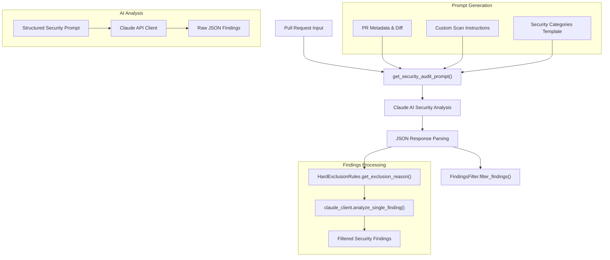
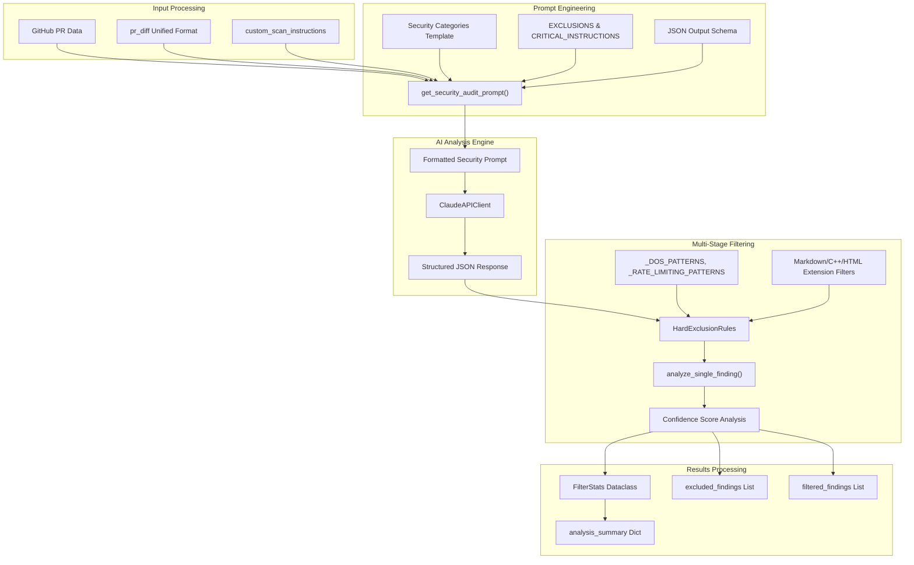
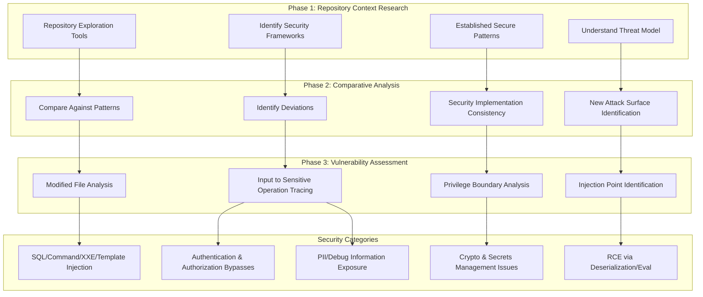
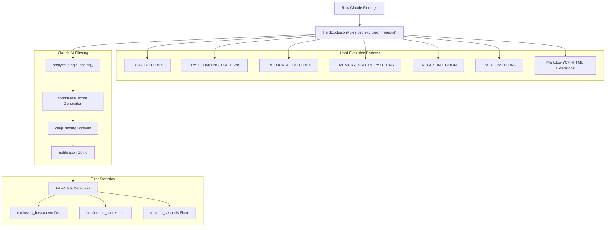

<!-- source: DeepWiki mcp.deepwiki.com · repo anthropics/claude-code-security-review · page 4 Security Analysis Pipeline · fetched 2026-10-26 -->

# Security Analysis Pipeline

Relevant source files

The following files were used as context for generating this wiki page:

- [claudecode/claude_api_client.py](claudecode/claude_api_client.py)
- [claudecode/findings_filter.py](claudecode/findings_filter.py)
- [claudecode/prompts.py](claudecode/prompts.py)

This document covers the core security analysis pipeline that processes pull requests through AI-powered vulnerability detection. The pipeline transforms GitHub pull request data into structured security findings through prompt engineering, Claude AI analysis, and multi-stage filtering.

## Pipeline Overview

The security analysis pipeline consists of four main stages that process pull request changes into actionable security findings. It bridges the "Natural Language Space" of security requirements with the "Code Entity Space" of the repository under review.

### High-Level Pipeline Flow

**Sources:** [claudecode/prompts.py:1-176](), [claudecode/findings_filter.py:1-344]()

## Core Components

The pipeline integrates several specialized components that work together to provide comprehensive security analysis:

### Component Architecture

The following diagram maps high-level system components to specific code entities within the `claudecode` package.

**Sources:** [claudecode/prompts.py:3-176](), [claudecode/findings_filter.py:27-155](), [claudecode/findings_filter.py:157-344]()

## Security Analysis Methodology

The pipeline implements a three-phase analysis methodology. This methodology is embedded directly into the system prompt to guide the AI's reasoning process. For details on the prompt structure, see [Prompt Engineering and Templates](#4.1).

### Phase-Based Analysis Process

**Sources:** [claudecode/prompts.py:106-125](), [claudecode/prompts.py:66-102]()

## Findings Processing and Filtering

The pipeline employs a two-stage filtering system to minimize false positives while maintaining high detection accuracy. For a deep dive into the logic, see [False Positive Filtering System](#4.3).

### Multi-Stage Filter Architecture

The filtering logic resides in `claudecode/findings_filter.py`. It first applies regex-based "hard" exclusions before performing a second-pass validation using the Claude API.

**Sources:** [claudecode/findings_filter.py:27-155](), [claudecode/findings_filter.py:258-296](), [claudecode/findings_filter.py:15-25]()

## Pipeline Sub-Pages

For detailed documentation on specific pipeline stages, refer to the following child pages:

- **[Prompt Engineering and Templates](#4.1)**: Details the structure of `get_security_audit_prompt` in `claudecode/prompts.py`, including vulnerability categories and instructions for minimizing false positives.
- **[Security Review Process Definition](#4.2)**: Explains how the slash command configuration defines the security review methodology.
- **[False Positive Filtering System](#4.3)**: Documents the `HardExclusionRules` class and the logic for determining which findings to drop based on file types or pattern matches.
- **[Claude API Client for Filtering](#4.4)**: Documents the `ClaudeAPIClient` in `claudecode/claude_api_client.py` and how it performs `analyze_single_finding` to validate issues with confidence scoring.

## Pipeline Configuration

The pipeline supports extensive configuration through parameters and environment variables:

| Parameter | Default | Description |
|-----------|---------|-------------|
| `use_hard_exclusions` | `True` | Enable hard exclusion pattern matching in `FindingsFilter` |
| `use_claude_filtering` | `True` | Enable AI-powered false positive filtering via `ClaudeAPIClient` |
| `model` | `claude-3-5-sonnet-20241022` | Claude model version for analysis (via `DEFAULT_CLAUDE_MODEL`) |
| `custom_filtering_instructions` | `None` | Additional filtering criteria passed to `analyze_single_finding` |
| `include_diff` | `True` | Include full diff in `get_security_audit_prompt` |
| `custom_scan_instructions` | `None` | Additional security categories appended to the audit prompt |

**Sources:** [claudecode/findings_filter.py:160-177](), [claudecode/claude_api_client.py:37-40](), [claudecode/prompts.py:3-14]()

---

